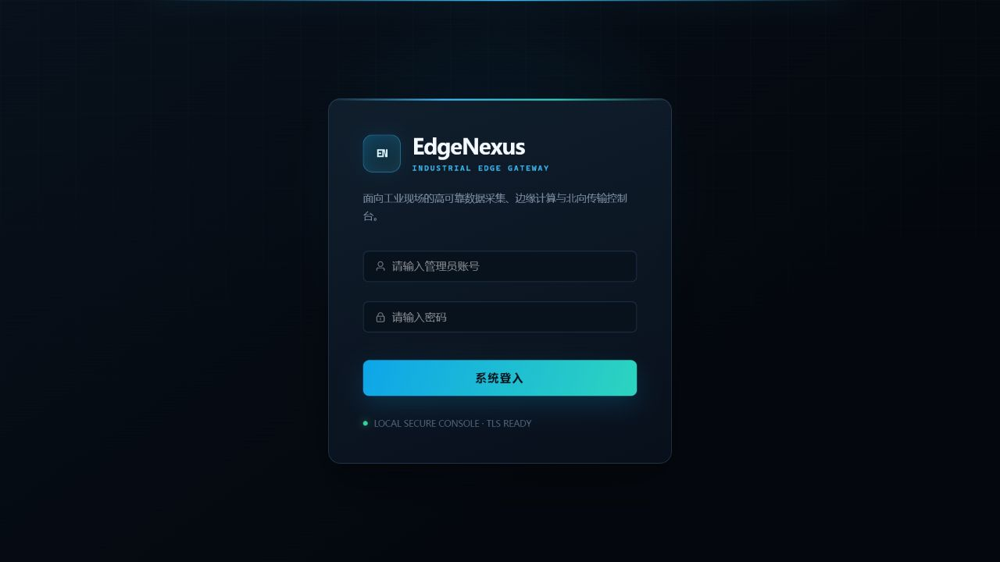
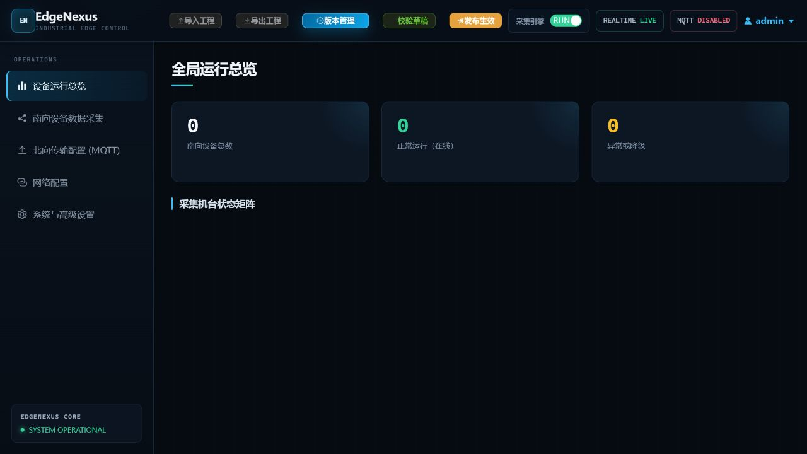
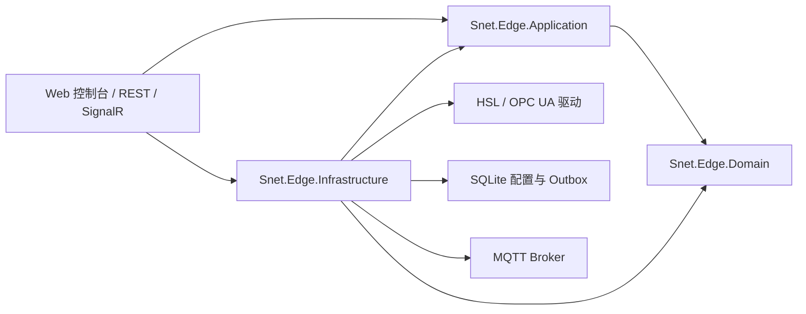

# EdgeNexus Industrial Edge Gateway

EdgeNexus 是面向 Windows、Linux 工控机的工业边缘采集网关。项目使用 .NET 10，将 PLC、OPC UA 等南向数据统一转换为设备与点位模型，再通过可配置 MQTT 模板、SQLite Store and Forward 和异步后台服务可靠上传。

当前发布版本：`V1.0`。

> 本页只描述当前源码已经实现的能力。完整设计、公共类型、配置项、HTTP API 和测试证据从 [文档中心](docs/INDEX.md) 进入。

## 项目定位

EdgeNexus 解决的是长期运行的工业采集问题，而不是普通后台管理系统：

- 多设备、多协议并行采集，单设备异常与其他设备隔离。
- 采集层只产生统一数据，不直接拼接 MQTT JSON。
- 草稿配置经校验、发布后才进入运行态。
- MQTT 断线时写入 SQLite Outbox，恢复后限速补发。
- 设备通信状态和单点数据质量分别表达。
- Web 管理、PLC 采集、MQTT 上传可绑定不同系统网卡。
- 所有网络信息来自操作系统，软件不修改系统 IP。

## 当前能力

### 南向采集

- Siemens S7
- Modbus TCP
- Mitsubishi MC TCP / UDP，支持 3E 与 A 兼容 1E 帧配置
- OPC UA
- Panasonic Mewtocol
- Omron FINS
- Omron CIP
- Allen-Bradley EtherNet/IP
- Beckhoff ADS
- Keyence MC
- Inovance TCP
- Delta TCP

协议参数、地址格式和当前边界见 [PLC 驱动文档](docs/PLC-Drivers.md) 与 [Excel 点表文档](docs/Excel-Template.md)。

### 北向 MQTT

- MQTTnet 客户端，支持认证、TLS、QoS、Retain 和 Last Will。
- 分组级 Topic 模板，支持 `${deviceId}`、`${deviceName}`、`${gatewayId}`、`${line}`。
- 设备级报文模板绑定与热更新。
- 系统字段勾选、自定义字段和实时预览。
- 统一 `DeviceData` / `TagData` 模型。
- 设备通信状态系统 Tag，可自定义 Tag 前缀和非零失败码。
- SQLite Outbox、最大容量、重试上限、限速补发和死信记录。

详细报文生成和生命周期见 [MQTT 文档](docs/MQTT.md)。

### 配置与运维

- Web 控制台、REST API、Swagger 和认证后的 SignalR。
- 分组、设备、点位、MQTT 模板与网络用途绑定。
- Excel / CSV 工程导入、设备点表导入导出和预检。
- 草稿校验、原子发布、历史版本、删除与回滚。
- Ping、TCP、MQTT、PLC 驱动连接诊断。
- `/health/live`、`/health/ready`、`/health` 和 `/metrics`。
- 独立 Watchdog、Windows Service、systemd 与 Docker 部署文件。

## 界面截图

以下截图来自当前源码启动后的本地实例，不是设计稿。

### 登录页



### 运行总览



## 架构概览



更严格的分层、依赖方向、线程模型和禁止跨层调用规则见 [内部架构](docs/Internal-Architecture.md)。

## 快速开始

### 前置条件

- .NET 10 SDK
- Windows 10/11、Windows Server 或主流 Linux x64 环境
- 可访问的 PLC 或 OPC UA Server
- 可选：MQTT Broker

### 启动源码

```powershell
dotnet restore Snet.Edge.slnx
dotnet run --project src/Snet.Edge.WebApi/Snet.Edge.WebApi.csproj
```

浏览器打开：

```text
http://127.0.0.1:5088/
```

开发引导账号来自 `appsettings.json`：

```text
用户名：admin
密码：123456
```

首次登录会要求修改密码。生产环境必须在首次初始化前使用环境变量覆盖引导账号和密码，不能继续使用默认凭据。

从创建分组到成功上传 MQTT 的完整步骤见 [Getting Started](docs/Getting-Started.md)。

## 配置生效规则

1. Web 页面修改的是草稿。
2. `校验草稿` 执行完整引用与协议参数校验。
3. `发布生效` 将草稿原子写为新的活动版本。
4. 采集和聚合后台服务只读取活动版本。
5. 回滚也会创建一个新的活动版本，不直接覆盖历史记录。

这条边界对开发新功能非常重要：不要让运行服务直接消费未发布草稿。

## MQTT 报文示例

当前标准模板可生成类似报文：

```json
{
  "deviceId": "PLC001",
  "timestamp": "2026-07-29T02:53:08.0000000+00:00",
  "d": [
    {
      "tag": "#DEVICE_ERROR_PLC001",
      "value": 0,
      "quality": 0
    },
    {
      "tag": "PLC001:Temperature",
      "value": 35.6,
      "quality": 0
    }
  ]
}
```

字段是否出现取决于设备绑定的 `MqttTemplate`。系统状态 Tag 与普通点位进入同一个 `d` 数组；设备失败码由模板配置，正常值固定为 `0`。

## 仓库结构

```text
src/
  Snet.Edge.Domain/          领域模型与枚举
  Snet.Edge.Application/     接口、校验和协议元数据
  Snet.Edge.Infrastructure/  驱动、采集、MQTT、SQLite、后台服务
  Snet.Edge.WebApi/          Web 主程序、API、SignalR、静态前端
  Snet.Edge.Watchdog/        独立健康观察与受控重启
tests/
  Snet.Edge.Tests/           xUnit 测试
deploy/                      Windows Service 与 systemd 文件
docs/                        文档中心
```

## 文档导航

- [文档中心](docs/INDEX.md)
- [快速上手](docs/Getting-Started.md)
- [内部架构](docs/Internal-Architecture.md)
- [总体架构](docs/Architecture.md)
- [运行时流程](docs/Runtime-Flows.md)
- [PLC 驱动](docs/PLC-Drivers.md)
- [MQTT](docs/MQTT.md)
- [Excel 点表](docs/Excel-Template.md)
- [配置参考](docs/Configuration.md)
- [Web API](docs/WebAPI.md)
- [公共类型](docs/Public-API.md)
- [性能与容量](docs/Performance.md)
- [部署](docs/Deployment.md)
- [扩展开发](docs/Plugin-Development.md)
- [FAQ](docs/FAQ.md)
- [Roadmap](docs/Roadmap.md)

## 构建与测试

```powershell
dotnet build Snet.Edge.slnx -c Release
dotnet test tests/Snet.Edge.Tests/Snet.Edge.Tests.csproj -c Release
```

当前测试内容和真实样例索引见 [Samples and Tests](docs/Samples-and-Tests.md)。容量测试中的 1000 设备是进程内并发模型冒烟测试，不等于对 1000 台真实 PLC 的现场性能认证。

## V1.0 Release 包

`V1.0` 发布同时提供两个自包含 x64 资产，无需预装 .NET Runtime：

- `EdgeNexus-V1.0-win-x64.zip`
- `EdgeNexus-V1.0-linux-x64.tar.gz`

Windows 解压后运行 `Snet.Edge.WebApi.exe` 或启动脚本；Linux 解压后为 `Snet.Edge.WebApi` 增加执行权限并运行。生产环境仍推荐按 [Deployment](docs/Deployment.md) 配置服务账户、数据目录和 TLS。

## 贡献

提交修改前请阅读 [CONTRIBUTING.md](CONTRIBUTING.md)。涉及协议、后台服务、SQLite 表、配置模型、API 或公共类型的改动，必须同时更新相应文档和测试。

## 安全

安全问题请按 [SECURITY.md](SECURITY.md) 的方式处理，不要在公开 Issue 中提交密码、证书、PLC 地址、生产 Topic 或现场网络拓扑。

## 变更记录

当前工作区没有可用于重建完整发行历史的 Git 元数据。已确认的当前状态与后续变更记录规则见 [CHANGELOG.md](CHANGELOG.md)。

## License

当前仓库尚未包含 `LICENSE` 文件。在项目所有者明确选择并提交许可证前，源码不应被视为已授予开源使用、修改或分发许可。

第三方组件还可能有独立授权要求，特别是 HslCommunication。正式发布或商业部署前应由项目所有者核对全部依赖许可证与商业授权。
