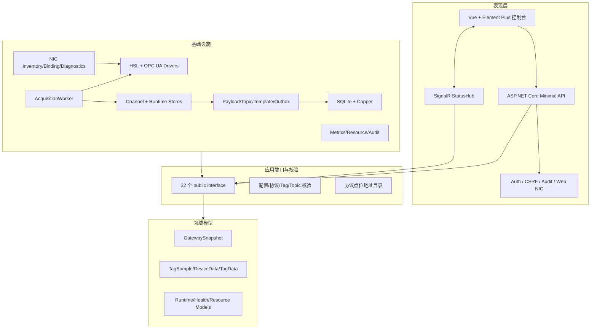
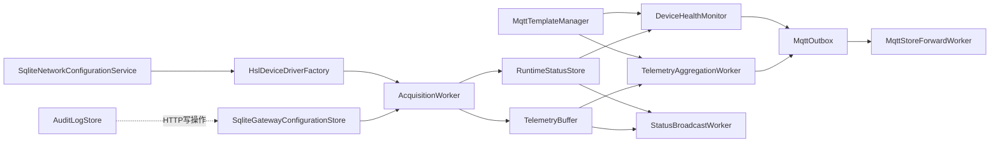
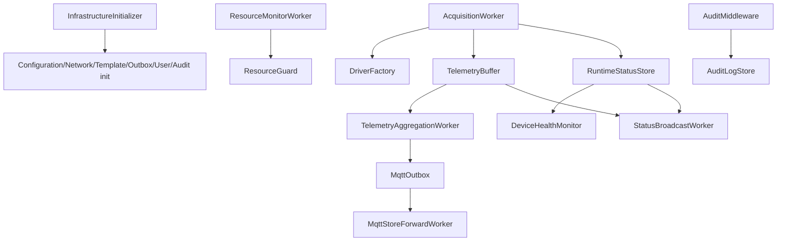

# EdgeNexus 总体架构

## 1. 文档范围

本文只描述当前源码中已经存在的结构。

本文不把规划项写成已实现能力。

源码入口为 `Snet.Edge.slnx`。

相关文档：

- [文档中心](INDEX.md)
- [运行时流程](Runtime-Flows.md)
- [PLC 驱动](PLC-Drivers.md)
- [MQTT](MQTT.md)
- [Web API](WebAPI.md)
- [配置](Configuration.md)
- [公共类型](Public-API.md)

## 2. 架构结论

当前 Solution 的实际依赖方向符合分层结构：

`WebApi -> Infrastructure -> Application -> Domain`。

`Watchdog` 为独立 Worker，不引用主网关项目。

`Tests` 直接引用 Infrastructure，因此可测试整个主运行链路。

领域层不引用外部包。

应用层只引用领域层和 Hosting Abstractions。

基础设施层承载全部外部通信和持久化依赖。

WebAPI 只通过 DI 注入应用端口或基础设施组合服务。

前端通过 REST/SignalR 与 WebAPI 交互。

## 3. 分层架构图

## 4. 项目关系

### 4.1 `Snet.Edge.Domain`

该项目只包含领域数据结构。

主要命名空间是 `Snet.Edge.Domain`。

主要模型包括：

- `GatewaySnapshot`。
- `MqttGroup`。
- `DeviceDefinition`。
- `TagDefinition`。
- `MqttOptions`。
- `MqttTemplate`。
- `TagSample`。
- `DeviceData`。
- `TagData`。
- `DeviceRuntimeStatus`。
- `DeviceHealthStatus`。
- `NetworkConfigurationView`。
- `ResourceSnapshot`。

该层不包含数据库代码。

该层不包含驱动代码。

该层不包含 Web 代码。

### 4.2 `Snet.Edge.Application`

该项目定义应用端口。

端口集中在 `Abstractions.cs`。

端口覆盖：

- 配置仓储。
- MQTT 配置发布。
- 点表导入。
- 设备点位导入导出。
- PLC 驱动。
- 驱动工厂。
- 网络清单。
- 网络绑定。
- 网络诊断。
- 采集计划。
- 遥测缓冲。
- 运行时状态。
- MQTT Builder。
- MQTT 模板。
- Outbox。
- 设备健康。
- 资源保护。
- 指标。
- 审计。
- 用户账户。

该项目还包含纯校验逻辑。

纯校验逻辑不访问数据库。

纯校验逻辑不创建通信连接。

### 4.3 `Snet.Edge.Infrastructure`

该项目实现应用端口。

主要命名空间：

- `Snet.Edge.Infrastructure`。
- `Snet.Edge.Infrastructure.GatewayMqtt`。
- `Snet.Edge.Infrastructure.GatewayDeviceHealth`。

主要外部包：

- HslCommunication。
- MQTTnet。
- OPC Foundation Client SDK。
- Microsoft.Data.Sqlite。
- Dapper。
- ClosedXML。
- Microsoft.Extensions.Identity.Core。

主要长期运行服务：

- `InfrastructureInitializer`。
- `ResourceMonitorWorker`。
- `AcquisitionWorker`。
- `TelemetryAggregationWorker`。
- `DeviceHealthMonitor`。
- `MqttStoreForwardWorker`。
- `AuditLogStore`。

### 4.4 `Snet.Edge.WebApi`

该项目是主进程入口。

它使用 ASP.NET Core Minimal API。

它托管静态 Vue 页面。

它托管 SignalR Hub。

它配置 Cookie 认证。

它配置角色授权。

它配置 CSRF。

它配置响应压缩。

它配置 Swagger。

它配置 Serilog。

它配置 Windows Service 宿主。

### 4.5 `Snet.Edge.Watchdog`

该项目是独立进程。

它不引用主网关程序集。

它只通过 HTTP 健康端点判断主进程状态。

它只执行配置中明确给出的可执行文件和参数列表。

它实现重启冷却和每小时重启上限。

### 4.6 `Snet.Edge.Tests`

该项目使用 xUnit。

它引用 Infrastructure。

它验证驱动工厂、地址解析、采集隔离、MQTT、SQLite、网络、认证和容量。

## 5. DI 组合根

主组合根在 `Program.cs` 和 `ServiceCollectionExtensions.AddEdgeInfrastructure`。

`Program.cs` 注册 Web 相关服务。

`AddEdgeInfrastructure` 注册业务运行服务。

### 5.1 Singleton 注册

- `SqliteGatewayConfigurationStore`。
- `IGatewayConfigurationStore` 指向同一实例。
- `IMqttConfigurationPublisher` 指向同一实例。
- `INetworkInventoryService` -> `SystemNetworkInventoryService`。
- `SqliteNetworkConfigurationService`。
- `INetworkConfigurationService` 指向同一实例。
- `MqttVariableResolver`。
- `IMqttPayloadBuilder` -> `MqttPayloadBuilder`。
- `ITopicBuilder` -> `MqttTopicBuilder`。
- `MqttTemplateManager`。
- `IMqttTemplateManager` 指向同一实例。
- `ITemplateResolver` 指向同一实例。
- `MqttOutbox`。
- `IMqttMessagePublisher` 指向同一实例。
- `IMqttOutboxMonitor` 指向同一实例。
- `IMqttOutboxConfigurationSynchronizer` 指向同一实例。
- `MqttRuntimeStateStore`。
- `IMqttRuntimeStateStore` 指向同一实例。
- `IGatewayConfigurationValidator` -> `GatewayConfigurationValidator`。
- `IDeviceDriverFactory` -> `HslDeviceDriverFactory`。
- `INetworkDiagnosticsService` -> `NetworkDiagnosticsService`。
- `ITagReadPlanCompiler` -> `TagReadPlanCompiler`。
- `IPointTableImportService` -> `PointTableImportService`。
- `IDeviceTagFileService` -> `DeviceTagFileService`。
- `AuthenticationBootstrapOptions`。
- `AcquisitionStabilityOptions`。
- `SqliteUserAccountStore`。
- `IUserAccountStore` 指向同一实例。
- `TelemetryBuffer`。
- `ITelemetryBuffer` 指向同一实例。
- `IRuntimeTagSampleStore` 指向同一实例。
- `RuntimeStatusStore`。
- `IRuntimeStatusStore` 指向同一实例。
- `IDeviceStatusEventSource` 指向同一实例。
- `IDeviceHealthStateStore` -> `DeviceHealthStateStore`。
- `IDeviceErrorManager` -> `DeviceErrorManager`。
- `ISystemTagBuilder` -> `SystemTagBuilder`。
- `InitializationState`。
- `IInitializationState` 指向同一实例。
- `GatewayMetrics`。
- `IGatewayMetrics` 指向同一实例。
- `AcquisitionControl`。
- `IAcquisitionControl` 指向同一实例。
- `ResourceProtectionOptions`。
- 数据目录字符串。
- `ResourceGuard`。
- `IResourceGuard` 指向同一实例。
- `AuditLogStore`。
- `IAuditLogStore` 指向同一实例。

### 5.2 HostedService 注册顺序

1. `InfrastructureInitializer`。
2. `ResourceMonitorWorker`。
3. 同一 `AuditLogStore` 实例作为 HostedService。
4. `AcquisitionWorker`。
5. `TelemetryAggregationWorker`。
6. `DeviceHealthMonitor`。
7. `MqttStoreForwardWorker`。

WebAPI 额外注册 `StatusBroadcastWorker`。

Host 会按注册顺序启动 HostedService。

基础设施初始化器负责先创建数据库对象。

## 6. 模块关系图

## 7. 领域模型边界

PLC 驱动返回原始对象值。

`AcquisitionWorker` 将值转换为 `TagSample`。

`TagSample` 同时保留工程值和原始值。

`TelemetryAggregationWorker` 将样本转换为 `TagData`。

`DeviceData` 统一承载设备身份、协议、时间和 Tags。

MQTT Builder 只接收统一模型。

PLC Driver 不生成 JSON。

PLC Driver 不知道 Topic。

PLC Driver 不访问 SQLite Outbox。

Web 页面不直接访问 SQLite。

Web 页面不直接创建 PLC Driver。

## 8. 配置边界

运行配置和草稿配置分离。

编辑接口写入草稿。

运行服务读取生效快照。

发布时使用 SQLite 事务同时更新 active、draft 和 revision。

回滚时读取历史 payload 并生成新版本。

MQTT 参数可走独立发布接口。

MQTT 模板独立于 `GatewaySnapshot`。

网络绑定独立于 `GatewaySnapshot`。

## 9. 通信边界

PLC 通信统一抽象为 `IDeviceDriver`。

协议选择集中在 `HslDeviceDriverFactory`。

HSL 客户端统一包装为 `IHslClientSession`。

OPC UA 使用独立 `OpcUaDeviceDriver`。

网络用途绑定在创建 PLC/MQTT 客户端时转换为本地地址绑定。

Web 网卡绑定由中间件限制进入的本地地址。

## 10. 并发边界

每台启用设备拥有一个异步采集循环。

设备循环由 `AcquisitionWorker` 字典管理。

设备循环不是独立线程对象。

代码没有显式创建 `Thread`。

代码没有在采集热路径调用 `Task.Run`。

采集数据通过有界 Channel 进入聚合服务。

设备状态通过有界 Channel 进入健康服务。

审计事件通过有界 Channel 进入批量写入服务。

MQTT 业务消息通过 SQLite Outbox 解耦生产和发送。

## 11. 稳定性边界

通信异常被限制在设备循环内。

单个点位配置异常被分类为点位级错误。

点位级错误不会强制重建设备连接。

全部点位读取失败会进入设备通信防抖逻辑。

连续失败阈值确认异常。

连续成功阈值确认恢复。

重连退避只在读取成功后重置。

资源临界状态阻止采集和 Outbox 持久化。

MQTT Builder 异常由聚合层捕获。

MQTT Builder 异常不会退出 PLC 采集 Worker。

## 12. 日志架构

WebAPI Serilog 在 Host 构建前配置。

Watchdog Serilog 在 Host 构建前配置。

结构化日志包含 `Application` 属性。

WebAPI 的 `Application` 为 `EdgeNexus.Gateway`。

Watchdog 的 `Application` 为 `Snet.Edge.Watchdog`。

业务组件使用模板参数记录设备、分组、点位和延迟。

审计日志不是 Serilog 文件的一部分。

审计日志独立存入 SQLite。

## 13. 可观测性架构

`GatewayMetrics` 同时维护内存累计值和 `System.Diagnostics.Metrics` Meter。

`MonitoringEndpoints` 将内存累计值转换为 Prometheus 文本格式。

指标包括采集成功、采集失败、点位数量、采集时长、MQTT 成功、MQTT 失败、SignalR 连接。

指标接口还动态读取设备状态、资源状态和 Outbox 状态。

Outbox 指标读取有两秒超时保护。

## 14. 前端架构

前端是单文件 HTML + 单文件 JavaScript。

没有 npm 构建步骤。

没有 TypeScript。

没有前端路由库。

菜单状态由 Vue `ref` 管理。

页面使用 `fetch` 包装函数访问 API。

页面在请求中携带 Cookie。

页面保存 CSRF Token。

页面启动 SignalR 自动重连。

页面 REST 刷新作为 SignalR 的补充。

## 15. 插件系统结论

当前源码没有插件接口。

当前源码没有插件注册表。

当前源码没有插件文件夹扫描。

当前源码没有程序集隔离上下文。

当前源码没有运行时驱动 DLL 热加载。

因此“插件系统”在当前版本中不存在。

协议扩展是编译期扩展。

## 16. 架构调用链

### 16.1 配置编辑

浏览器 -> Minimal API -> `IGatewayConfigurationStore` -> SQLite draft payload。

### 16.2 配置发布

浏览器 -> 校验 API -> `GatewayConfigurationValidator` -> 发布 API -> SQLite transaction。

### 16.3 PLC 采集

HostedService -> 生效快照 -> 驱动工厂 -> 驱动 -> Channel。

### 16.4 MQTT 上传

Channel -> 聚合 -> 模板解析 -> Payload/Topic Builder -> SQLite Outbox -> MQTT Worker -> Broker。

### 16.5 实时界面

采集 -> Runtime Store/Telemetry Buffer -> StatusBroadcastWorker -> SignalR -> 浏览器。

### 16.6 审计

HTTP 写请求 -> AuditMiddleware -> AuditLogStore Channel -> SQLite batch transaction。

## 17. 源码未提供的能力

以下能力在当前源码中没有实现，不应在产品说明中宣称已经存在：

- 运行时插件加载。
- PLC 自动发现。
- 多进程采集分片协调。
- SQL Server 存储。
- PostgreSQL 存储。
- InfluxDB 存储。
- TimescaleDB 存储。
- MQTT 多 Broker 同时连接。
- MQTT Topic 批量聚合多个设备为单条消息。
- OPC UA Subscription。
- PLC 写入操作。
- 点位历史数据库。
- 独立规则引擎。
- 用户自定义错误码字典表。
- 用户和角色管理页面。

## 18. 架构验证来源

- 项目引用：各 `.csproj`。
- 编译基线：`Directory.Build.props`。
- 依赖版本：`Directory.Packages.props`。
- 主启动：`Snet.Edge.WebApi/Program.cs`。
- DI：`ServiceCollectionExtensions.cs`。
- HostedService：Infrastructure、WebApi、Watchdog 源码。
- 前端依赖：`vendor-manifest.json`。
- 容器：`Dockerfile`、`docker-compose.yml`。

## 19. Solution 项目清单

### 19.1 `Snet.Edge.Domain`

- SDK：`Microsoft.NET.Sdk`。
- 项目引用：无。
- 外部 PackageReference：无。
- 主要文件：`Models.cs`、`NetworkModels.cs`。
- 命名空间：`Snet.Edge.Domain`。
- 输出：领域枚举、配置 record、Telemetry record、网络 record。

### 19.2 `Snet.Edge.Application`

- SDK：`Microsoft.NET.Sdk`。
- 项目引用：`Snet.Edge.Domain`。
- PackageReference：`Microsoft.Extensions.Hosting.Abstractions`。
- 命名空间：`Snet.Edge.Application`。
- 输出：32 个端口接口中的全部应用端口。
- 输出：配置和协议校验器。
- 输出：协议点位地址目录。

### 19.3 `Snet.Edge.Infrastructure`

- SDK：`Microsoft.NET.Sdk`。
- 项目引用：`Snet.Edge.Application`。
- PackageReference：ClosedXML、Dapper。
- PackageReference：Microsoft.Data.Sqlite、Identity Core。
- PackageReference：MQTTnet、OPC UA Client、Polly.Core。
- 内置原生异步 PLC 协议栈：`NativePlcProtocols`（无第三方商业 PLC 库依赖）。
- 命名空间：`Snet.Edge.Infrastructure`。
- 子命名空间：GatewayDeviceHealth、GatewayMqtt。
- 输出：端口实现和后台服务。

### 19.4 `Snet.Edge.WebApi`

- SDK：`Microsoft.NET.Sdk.Web`。
- 项目引用：`Snet.Edge.Infrastructure`。
- PackageReference：OpenAPI、WindowsServices、Serilog、Swashbuckle。
- 命名空间：`Snet.Edge.WebApi`。
- 输出：Kestrel Host、Minimal API、SignalR、静态前端。
- 复制启动 PowerShell 和 CMD 到发布目录。

### 19.5 `Snet.Edge.Watchdog`

- SDK：`Microsoft.NET.Sdk.Worker`。
- 项目引用：无。
- PackageReference：Hosting、Http、Serilog。
- 命名空间：`Snet.Edge.Watchdog`。
- 输出：独立健康监控进程。
- 与主网关通过 HTTP health endpoint 解耦。

### 19.6 `Snet.Edge.Tests`

- SDK：`Microsoft.NET.Sdk`。
- 项目引用：`Snet.Edge.Infrastructure`。
- PackageReference：Test SDK、xUnit、VS Runner。
- IsTestProject=true。
- IsPackable=false。
- 覆盖应用、基础设施和领域模型。

## 20. 编译基线

- TargetFramework：`net10.0`。
- LangVersion：`12.0`。
- Nullable：enable。
- ImplicitUsings：enable。
- TreatWarningsAsErrors：true。
- InvariantGlobalization：false。
- 包版本由 `Directory.Packages.props` 集中管理。
- 启用中央传递依赖固定；发布构建必须阻止包含已知高危 NuGet 漏洞的产物。

## 21. 关键依赖版本

| 包 | 版本 | 使用模块 |
|---|---|---|
| MQTTnet | 5.2.0.1603 | MQTT |
| OPC UA Client | 1.5.378.156 | OPC UA |
| Dapper | 2.1.66 | SQLite 存储 |
| Microsoft.Data.Sqlite | 10.0.0 | SQLite |
| ClosedXML | 0.105.1 | Excel 点表 |
| Polly.Core | 8.6.5 | 已引用，源码未发现策略使用 |
| Serilog.AspNetCore | 10.0.0 | Web 日志 |
| Serilog.Sinks.Async | 2.1.0 | 异步日志 |
| Swashbuckle.AspNetCore | 10.1.2 | Swagger |
| xunit | 2.9.3 | 测试 |

传递依赖安全固定：

- `Microsoft.OpenApi` 固定到 `2.7.5` 或更高的兼容修复版本，避免循环 Schema 引用导致进程终止。
- `SQLitePCLRaw.lib.e_sqlite3` 固定到 `2.1.12` 或更高的兼容修复版本，避免将存在已知高危漏洞的 SQLite 原生库打入发布包。
- 安全固定只允许在完整测试、双平台 Release 发布和漏洞扫描通过后进入版本标签。

## 22. DI 注册：配置与网络

- `SqliteGatewayConfigurationStore` -> concrete Singleton。
- `IGatewayConfigurationStore` -> 同一配置存储实例。
- `IMqttConfigurationPublisher` -> 同一配置存储实例。
- `INetworkInventoryService` -> `SystemNetworkInventoryService` Singleton。
- `SqliteNetworkConfigurationService` -> concrete Singleton。
- `INetworkConfigurationService` -> 同一网络配置实例。
- `IGatewayConfigurationValidator` -> `GatewayConfigurationValidator` Singleton。
- `IPointTableImportService` -> `PointTableImportService` Singleton。
- `IDeviceTagFileService` -> `DeviceTagFileService` Singleton。

## 23. DI 注册：MQTT

- `MqttVariableResolver` -> Singleton。
- `IMqttPayloadBuilder` -> `MqttPayloadBuilder` Singleton。
- `ITopicBuilder` -> `MqttTopicBuilder` Singleton。
- `MqttTemplateManager` -> concrete Singleton。
- `IMqttTemplateManager` -> 同一 TemplateManager。
- `ITemplateResolver` -> 同一 TemplateManager。
- `MqttOutbox` -> concrete Singleton。
- `IMqttMessagePublisher` -> 同一 Outbox。
- `IMqttOutboxMonitor` -> 同一 Outbox。
- `IMqttOutboxConfigurationSynchronizer` -> 同一 Outbox。
- `MqttRuntimeStateStore` -> concrete Singleton。
- `IMqttRuntimeStateStore` -> 同一 RuntimeStateStore。

## 24. DI 注册：PLC 与运行时

- `IDeviceDriverFactory` -> `HslDeviceDriverFactory` Singleton。
- `INetworkDiagnosticsService` -> `NetworkDiagnosticsService` Singleton。
- `ITagReadPlanCompiler` -> `TagReadPlanCompiler` Singleton。
- `TelemetryBuffer` -> concrete Singleton。
- `ITelemetryBuffer` -> 同一 TelemetryBuffer。
- `IRuntimeTagSampleStore` -> 同一 TelemetryBuffer。
- `RuntimeStatusStore` -> concrete Singleton。
- `IRuntimeStatusStore` -> 同一 RuntimeStatusStore。
- `IDeviceStatusEventSource` -> 同一 RuntimeStatusStore。
- `AcquisitionControl` -> concrete Singleton。
- `IAcquisitionControl` -> 同一 AcquisitionControl。

## 25. DI 注册：健康、资源、安全

- `IDeviceHealthStateStore` -> `DeviceHealthStateStore` Singleton。
- `IDeviceErrorManager` -> `DeviceErrorManager` Singleton。
- `ISystemTagBuilder` -> `SystemTagBuilder` Singleton。
- `InitializationState` -> concrete Singleton。
- `IInitializationState` -> 同一 InitializationState。
- `GatewayMetrics` -> concrete Singleton。
- `IGatewayMetrics` -> 同一 GatewayMetrics。
- `ResourceProtectionOptions` -> Singleton 值对象。
- `ResourceGuard` -> concrete Singleton。
- `IResourceGuard` -> 同一 ResourceGuard。
- `AuthenticationBootstrapOptions` -> Singleton 值对象。
- `AcquisitionStabilityOptions` -> Singleton 值对象。
- `SqliteUserAccountStore` -> concrete Singleton。
- `IUserAccountStore` -> 同一 UserAccountStore。
- `AuditLogStore` -> concrete Singleton。
- `IAuditLogStore` -> 同一 AuditLogStore。

## 26. Web 服务注册

- ProblemDetails。
- ResponseCompression。
- Brotli Fastest。
- Gzip Fastest。
- Cookie Authentication。
- Authorization + Admin Policy。
- Antiforgery。
- HTTP JSON Enum Converter。
- Endpoints API Explorer。
- Swagger Generator。
- SignalR。
- Edge Infrastructure。
- StatusBroadcastWorker。

## 27. 领域边界

Domain 中没有：

- Dapper 引用。
- SQLite 引用。
- MQTTnet 引用。
- HslCommunication 引用。
- ASP.NET Core 引用。
- ILogger 引用。
- 文件系统访问。
- 网络访问。

Domain 只表达数据和值语义。

## 28. Application 边界

Application 中没有：

- MQTT Client 实例。
- PLC Client 实例。
- SqliteConnection。
- HttpContext。
- SignalR Hub。
- 文件日志 Sink。
- BackgroundService 实现。

Application 定义端口和纯校验逻辑。

## 29. Infrastructure 边界

Infrastructure 承担：

- PLC 驱动实例化。
- OPC UA Session。
- MQTT Client 发送 Worker。
- SQLite 表创建和读写。
- Channel 运行时存储。
- Excel/CSV 文件解析。
- 网络库存和诊断。
- 资源监控。
- 密码哈希存储。
- 审计批量写入。

Infrastructure 不映射 HTTP 路由。

## 30. WebApi 边界

WebApi 承担：

- Host 构建。
- DI 组合根。
- HTTP 认证和授权。
- CSRF。
- Minimal API 路由。
- SignalR Hub。
- 静态前端托管。
- HTTP 审计入口。
- Web 网卡访问限制。
- Swagger。

WebApi 不直接实现 PLC 协议报文。

## 31. Watchdog 边界

Watchdog：

- 不引用主网关项目。
- 不访问主网关 SQLite。
- 不创建 PLC Driver。
- 不创建 MQTT Client。
- 只通过 HTTP 请求判断健康。
- 通过配置的外部命令请求重启。
- 有重启冷却和每小时上限。

## 32. 命名空间索引

| 命名空间 | 主要内容 |
|---|---|
| `Snet.Edge.Domain` | 领域模型 |
| `Snet.Edge.Application` | 接口和校验 |
| `Snet.Edge.Infrastructure` | 核心实现 |
| `Snet.Edge.Infrastructure.GatewayDeviceHealth` | 健康模块 |
| `Snet.Edge.Infrastructure.GatewayMqtt` | MQTT Builder/Template |
| `Snet.Edge.WebApi` | HTTP 和 SignalR |
| `Snet.Edge.Watchdog` | 外部守护 |
| `Snet.Edge.Tests` | xUnit 测试 |

## 33. 后台服务模块关系

## 34. 持久化所有权

| 表 | 唯一主要所有者 |
|---|---|
| gateway_state | SqliteGatewayConfigurationStore |
| gateway_revision | SqliteGatewayConfigurationStore |
| gateway_revision_deletion | SqliteGatewayConfigurationStore |
| mqtt_template | MqttTemplateManager |
| mqtt_outbox | MqttOutbox |
| mqtt_dead_letter | MqttOutbox |
| mqtt_sequence | MqttOutbox 初始化 |
| network_configuration | SqliteNetworkConfigurationService |
| gateway_user | SqliteUserAccountStore |
| audit_log | AuditLogStore |

## 35. 外部通信所有权

| 外部系统 | 组件 |
|---|---|
| PLC/HSL | HslDeviceDriver |
| OPC UA Server | OpcUaDeviceDriver |
| MQTT Broker | MqttStoreForwardWorker |
| 操作系统网卡 | SystemNetworkInventoryService |
| Ping/TCP 目标 | NetworkDiagnosticsService |
| 浏览器 | WebApi/StatusHub |
| Watchdog Health | GatewayWatchdogWorker |

## 36. 插件扫描证据

扫描未发现：

- `IPlugin`。
- `PluginBase`。
- `AssemblyLoadContext`。
- `Assembly.LoadFrom`。
- `Assembly.LoadFile`。
- MEF `CompositionContainer`。
- 插件 manifest。
- 插件目录 watcher。
- 动态 DI 模块加载。

因此协议扩展当前是编译期扩展。

## 37. 架构覆盖核对

- [x] 6 个项目。
- [x] 项目引用方向。
- [x] 主要命名空间。
- [x] DI 组合根。
- [x] HostedService。
- [x] Web API 和 SignalR。
- [x] PLC Driver。
- [x] MQTT。
- [x] 配置和数据库。
- [x] 网络、缓存、队列和线程模型。
- [x] 日志和审计。
- [x] 插件缺失结论。
- [x] 测试项目边界。

## 38. 目录职责索引

- `src/`：可发布产品源码。
- `tests/`：xUnit 测试源码。
- `docs/`：本次生成的源码文档。
- `artifacts/`：已有构建、验证和发布产物，不作为源码分析依据。
- `tools/`：辅助探针构建产物，未列入 Solution 产品模块。
- `Dockerfile`：Linux 容器构建。
- `docker-compose.yml`：单网关容器运行定义。
- `Directory.Build.props`：全项目编译属性。
- `Directory.Packages.props`：集中包版本。
- `Snet.Edge.slnx`：Solution 入口。

## 39. 前端架构事实

- 前端文件由 WebApi 静态文件中间件托管。
- 页面框架为 Vue 全局生产构建。
- UI 组件为 Element Plus。
- 图标为 Element Plus Icons IIFE。
- 实时通信使用 SignalR JavaScript Client。
- 依赖文件全部位于 `wwwroot/vendor`。
- `vendor-manifest.json` 固定版本和哈希。
- 正式业务逻辑位于 `wwwroot/app.js`。
- `index.html` 尾部 text/plain 原型脚本不会执行。
- 前端没有独立 Node 构建项目。
- 当前仓库没有 package.json。
- 当前仓库没有 Vite/Webpack 配置。

## 40. 缓存所有权索引

- `TelemetryBuffer`：每设备最新点位和变化集合。
- `RuntimeStatusStore`：每设备最新连接状态。
- `DeviceHealthStateStore`：每设备最新错误码状态。
- `MqttTemplateManager`：模板 ConcurrentDictionary。
- `SystemNetworkInventoryService`：操作系统网卡缓存。
- `SqliteNetworkConfigurationService`：当前绑定和 revision。
- `StatusBroadcastWorker`：上次已广播状态字典。
- `TelemetryAggregationWorker`：每设备聚合 bucket。
- `HslDeviceDriver`：Siemens 规范化地址字典。
- `BeckhoffAdsNet`：可选 HSL Tag Cache。

## 41. 同步原语索引

- `SemaphoreSlim`：配置存储写操作。
- `SemaphoreSlim`：模板管理写操作。
- `SemaphoreSlim`：网络绑定写操作。
- `SemaphoreSlim`：用户存储写操作。
- `SemaphoreSlim`：HSL 驱动读取串行化。
- `ConcurrentDictionary`：运行状态。
- `ConcurrentDictionary`：健康状态。
- `ConcurrentDictionary`：模板缓存。
- `Interlocked`：采集开关。
- `Interlocked`：指标计数。
- `Volatile`：资源快照。
- `Volatile`：MQTT Runtime 状态。

## 42. 架构未发现项

- 未发现 WPF 项目。
- 未发现 WinForms 项目。
- 未发现 Avalonia 项目。
- 未发现 MVC Controller。
- 未发现 EF Core。
- 未发现 MediatR。
- 未发现消息总线外部中间件。
- 未发现 Kafka。
- 未发现 RabbitMQ。
- 未发现 Redis。
- 未发现 SQL Server Provider。
- 未发现 PostgreSQL Provider。
- 未发现 InfluxDB Client。
- 未发现 TimescaleDB Client。
- 未发现动态程序集加载。
- 未发现 PLC 写入接口。
- 未发现规则引擎。
- 未发现历史趋势数据库。

## 43. 架构文档追踪

- 项目关系细节：本文件第 19 节。
- DI 细节：本文件第 22 至 26 节。
- 启动与线程：`Runtime-Flows.md`。
- 协议实现：`PLC-Drivers.md`。
- MQTT 实现：`MQTT.md`。
- HTTP 表面：`WebAPI.md`。
- 字段与数据库：`Configuration.md`。
- 类型级目录：`Public-API.md`。
- 测试证据：`Samples-and-Tests.md`。

## 44. 扩展文档导航

- 第一次部署和采集：[Getting-Started.md](Getting-Started.md)。
- 维护者内部边界：[Internal-Architecture.md](Internal-Architecture.md)。
- 点表列与导入流程：[Excel-Template.md](Excel-Template.md)。
- 新协议与 MQTT 扩展：[Plugin-Development.md](Plugin-Development.md)。
- 并发、GC 和压测：[Performance.md](Performance.md)。
- Windows、Linux、Docker：[Deployment.md](Deployment.md)。
- 常见现场问题：[FAQ.md](FAQ.md)。
- 候选规划与未实现边界：[Roadmap.md](Roadmap.md)。
- 文档中心：[INDEX.md](INDEX.md)。

## 45. 架构变更维护入口

修改项目关系、DI、HostedService、Channel 或数据库所有权时，同时更新：

1. 本文。
2. [Internal-Architecture.md](Internal-Architecture.md)。
3. [Runtime-Flows.md](Runtime-Flows.md)。
4. [Performance.md](Performance.md)。
5. [Public-API.md](Public-API.md)。
6. [../CHANGELOG.md](../CHANGELOG.md)。
