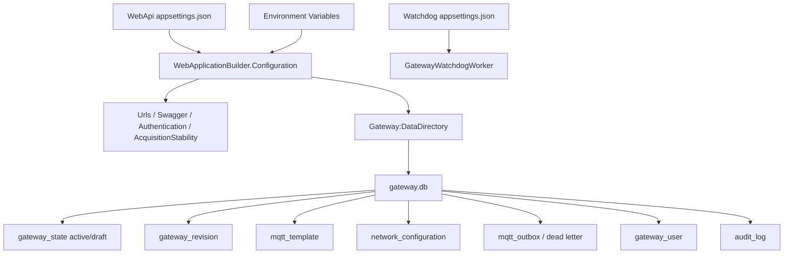
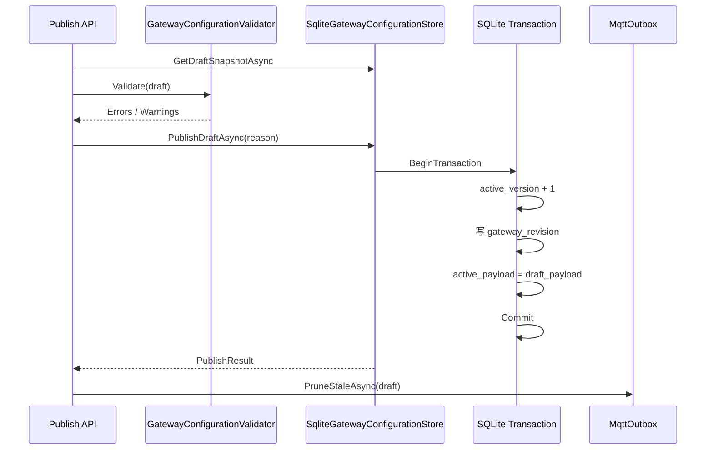

# EdgeNexus 配置、数据库与部署参数

## 1. 文档范围

本文仅记录当前源码已经定义、读取或持久化的配置。

本文不把规划项描述为已实现能力。

相关文档：

- [总体架构](Architecture.md)
- [运行时流程](Runtime-Flows.md)
- [PLC 驱动](PLC-Drivers.md)
- [MQTT](MQTT.md)
- [Web API](WebAPI.md)
- [公共类型](Public-API.md)

## 2. 配置来源总览

当前配置分为五类：

1. WebAPI 宿主配置 `appsettings.json`。
2. Watchdog 宿主配置 `appsettings.json`。
3. SQLite 中 active/draft 网关业务配置。
4. SQLite 中独立 MQTT 模板和网络用途绑定。
5. Docker / 环境变量覆盖配置。

## 3. 配置加载关系

## 4. WebAPI `appsettings.json`

源码路径：`src/Snet.Edge.WebApi/appsettings.json`。

### 4.1 `Urls`

- 当前值：`http://127.0.0.1:5088`。
- 作用：Kestrel 默认监听地址。
- 运行时读取：ASP.NET Core Host 自动读取。
- 当前默认仅监听本机回环。
- Docker 镜像通过 `ASPNETCORE_URLS` 覆盖。
- 这不是网络用途绑定配置。

### 4.2 `Gateway:DataDirectory`

- 当前值：`data`。
- 读取位置：`Program.cs`。
- 相对路径基于 `AppContext.BaseDirectory` 解析。
- 启动时调用 `Directory.CreateDirectory`。
- SQLite 文件固定为 `${DataDirectory}/gateway.db`。
- Serilog 文件固定写入 `${DataDirectory}/logs`。

### 4.3 `Authentication:AdminUsername`

- 当前值：`admin`。
- 绑定到 `AuthenticationBootstrapOptions.AdminUsername`。
- 仅在 `gateway_user` 为空时用于创建首个管理员。
- 用户名保存前 Trim 并转小写。
- 数据库主键使用 `COLLATE NOCASE`。
- 已存在用户时修改该配置不会覆盖数据库用户。

### 4.4 `Authentication:AdminPassword`

- 当前值：`123456`。
- 绑定到 `AuthenticationBootstrapOptions.AdminPassword`。
- 仅用于首次初始化管理员。
- 使用 `PasswordHasher<string>` 生成哈希后存储。
- 数据库不保存明文密码。
- 首次创建用户标记 `must_change_password=1`。

### 4.5 `Authentication:MaximumFailedAttempts`

- 当前值：5。
- 绑定到 `AuthenticationBootstrapOptions.MaximumFailedAttempts`。
- 登录失败达到阈值时进入临时锁定。
- 代码使用 `Math.Max(value, 3)`，实际最小阈值为 3。
- 成功登录后失败计数清零。
- 修改密码成功后失败计数也清零。

### 4.6 `Authentication:LockoutMinutes`

- 当前值：15。
- 绑定到 `AuthenticationBootstrapOptions.LockoutMinutes`。
- 锁定时间使用 `Math.Max(value, 1)`。
- 锁定截止时间保存为 UTC ISO 8601 文本。
- 锁定期间登录返回 HTTP 423。
- 到期后允许再次验证密码。

### 4.7 `Authentication:RequireHttps`

- 当前值：false。
- 读取位置：`Program.cs`。
- true 时启用 HSTS。
- true 时启用 HTTPS 重定向。
- true 时认证 Cookie 使用 `SecurePolicy.Always`。
- true 时 CSRF Cookie 使用 `SecurePolicy.Always`。

### 4.8 `AcquisitionStability:FailureThreshold`

- 当前值：3。
- 绑定到 `AcquisitionStabilityOptions.FailureThreshold`。
- 消费者：`DeviceCommunicationStabilityTracker`。
- 连续失败达到阈值后才确认不健康。
- 代码构造时要求至少 1。
- 用于降低瞬时通讯抖动对设备状态的影响。

### 4.9 `AcquisitionStability:SuccessThreshold`

- 当前值：2。
- 绑定到 `AcquisitionStabilityOptions.SuccessThreshold`。
- 连续成功达到阈值后才确认健康恢复。
- 代码构造时要求至少 1。
- 成功确认后清除失败防抖计数。
- 适用于全部由 `AcquisitionWorker` 管理的协议。

### 4.10 `AcquisitionStability:HeartbeatIntervalSeconds`

- 当前值：10。
- 绑定到 `AcquisitionStabilityOptions.HeartbeatIntervalSeconds`。
- 长扫描周期期间用于维持和验证连接。
- 代码使用至少 1 秒。
- 测试覆盖长扫描周期心跳保持。
- 不改变分组扫描周期。

### 4.11 `AcquisitionStability:ReconnectDelaysSeconds`

- 当前值：`[1,2,5,10,30]`。
- 类型：`int[]`。
- 消费者：`ReconnectBackoff`。
- 每次连接失败向后推进索引。
- 只有明确读取成功才调用重置。
- 空数组由实现使用安全回退值。

### 4.12 `AcquisitionStability:ReconnectJitterRatio`

- 当前值：0.2。
- 类型：double。
- 消费者：`ReconnectBackoff`。
- 在基础重连延迟上增加随机抖动。
- 用途：避免大量 PLC 同时重连。
- 实现对比率进行边界处理。

### 4.13 `Swagger:Enabled`

- 当前值：true。
- 读取位置：`Program.cs`。
- true 时启用 Swagger JSON 和 Swagger UI。
- 未配置时回退到开发环境判断。
- Docker Compose 显式覆盖为 false。
- 不影响 API 本身是否映射。

### 4.14 `AllowedHosts`

- 当前值：`*`。
- 由 ASP.NET Core Host Filtering 使用。
- 当前源码没有额外自定义读取。
- Web 网卡绑定由独立中间件处理。
- 该值不决定 PLC 或 MQTT 出口网卡。
- 该值不修改系统网络配置。

## 5. `AcquisitionStabilityOptions`

| 字段 | 类型 | 默认值 | 源码消费者 |
|---|---|---:|---|
| `FailureThreshold` | `int` | 3 | `DeviceCommunicationStabilityTracker` |
| `SuccessThreshold` | `int` | 2 | `DeviceCommunicationStabilityTracker` |
| `HeartbeatIntervalSeconds` | `int` | 10 | `AcquisitionWorker` |
| `ReconnectDelaysSeconds` | `int[]` | 1,2,5,10,30 | `ReconnectBackoff` |
| `ReconnectJitterRatio` | `double` | 0.2 | `ReconnectBackoff` |

## 6. `AuthenticationBootstrapOptions`

| 字段 | 类型 | 默认值 | 持久化影响 |
|---|---|---|---|
| `AdminUsername` | `string` | `admin` | 首次创建 `gateway_user` |
| `AdminPassword` | `string` | `123456` | 首次创建密码哈希 |
| `MaximumFailedAttempts` | `int` | 5 | 登录锁定阈值 |
| `LockoutMinutes` | `int` | 15 | 锁定截止时间 |

`RequireHttps` 不属于该 record。

`RequireHttps` 由 `Program.cs` 直接读取。

## 7. 网关业务配置快照

根模型为 `GatewaySnapshot`。

包含四个集合或对象：

- `Groups`
- `Devices`
- `Tags`
- `Mqtt`

SQLite 同时保存 active 和 draft JSON。

编辑 API 修改 draft。

发布 API把 draft 事务性复制为 active 并创建版本。

## 8. `MqttGroup` 配置

### 8.1 `Id`

- 类型：Guid。
- 必填。
- 作为分组标识。
- 设备通过 `GroupId` 引用。
- 版本比较使用该 ID。

### 8.2 `Name`

- 类型：string。
- 必填且不能为空白。
- 用于页面显示。
- 进入 `MqttPublishRequest.GroupName`。
- 可用于 MQTT 自定义变量 `${groupName}`。

### 8.3 `Topic`

- 类型：string。
- 必填且不能为空白。
- 作为该组设备的 Topic 模板。
- 由 `MqttTopicTemplateValidator` 校验。
- 最终由 `MqttTopicBuilder` 解析变量。

### 8.4 `Line`

- 类型：可空 string。
- 最大长度 128。
- 传入 `MqttPayloadContext.Line`。
- 支持 Topic 和自定义字段变量 `${line}`。
- 空值解析为空字符串。

### 8.5 `ScanCycleMs`

- 类型：int。
- 默认值：1000 ms。
- 最小值：100 ms。
- 最大值：86400000 ms。
- 由采集设备循环用于读取调度。

### 8.6 `UploadCycleSeconds`

- 类型：int。
- 默认值：10 秒。
- 最小值：1 秒。
- 最大值：86400 秒。
- `TelemetryAggregationWorker` 按该周期评估发送。

### 8.7 `Enabled`

- 类型：bool。
- 默认值：true。
- 禁用组不会启动其设备采集循环。
- 聚合 Worker 只处理有效 active 配置。
- 设备自身还需 `Enabled=true`。

## 9. `DeviceDefinition` 通用字段

| 字段 | 类型 | 默认 | 用途 |
|---|---|---|---|
| `Id` | `Guid` | 必填 | 内部设备主键 |
| `GroupId` | `Guid` | 必填 | 所属分组 |
| `Name` | `string` | 必填 | 显示名及 MQTT ID 回退 |
| `MqttDeviceId` | `string?` | null | 外部 MQTT 设备标识 |
| `MqttTemplateId` | `Guid?` | null | 设备级模板绑定 |
| `Protocol` | `ProtocolKind` | 必填 | 驱动选择 |
| `Host` | `string` | 必填 | PLC 主机或 OPC UA 地址主机部分 |
| `Port` | `int` | 必填 | 协议端口 |
| `Enabled` | `bool` | true | 是否采集 |
| `ConnectTimeoutMs` | `int` | 3000 | 建连超时 |
| `ReceiveTimeoutMs` | `int` | 3000 | 读取超时 |

## 10. `DeviceDefinition` 西门子字段

| 字段 | 类型 | 默认值 | 用途 |
|---|---|---|---|
| `Rack` | `int` | 0 | 手动机架号 |
| `Slot` | `int` | 0 | 手动槽号或 AB CPU 槽号 |
| `SiemensSeries` | `SiemensPlcSeries` | S1500 | 映射 HSL PLC 系列 |
| `SiemensAutoRackSlot` | `bool` | true | 使用系列推荐 Rack/Slot |
| `SiemensConnectionType` | `SiemensConnectionType` | Pg | PG/OP/S7Basic |
| `SiemensLocalTsap` | `int` | 0 | 大于 0 时设置 LocalTSAP |
| `SiemensDestinationTsap` | `int` | 0 | 大于 0 时设置 DestTSAP |

自动映射：

- S1200/S1500：Rack 0、Slot 1。
- S300：Rack 0、Slot 2。
- S400：Rack 0、Slot 3。
- S200/S200Smart：Rack 0、Slot 0，并使用 TSAP 建链。

## 11. `DeviceDefinition` Modbus 字段

### 11.1 `Station`

- 类型：int。
- 默认值：1。
- `ModbusTcpNet` 构造时转为 byte。
- 同时被 Panasonic、Inovance、Delta 使用。
- API 描述范围为 0 至 255。

Modbus 功能码不在设备字段中。

Modbus 功能码位于每个 `TagDefinition.ModbusFunctionCode`。

## 12. `DeviceDefinition` 三菱字段

| 字段 | 类型 | 默认值 | 用途 |
|---|---|---|---|
| `MitsubishiTransport` | enum | Tcp | TCP 或 UDP |
| `MitsubishiFormat` | enum | Binary3E | Binary3E/Ascii3E/Binary1E/Ascii1E |
| `NetworkNumber` | int | 0 | 3E 网络号 |
| `PlcNumber` | int | 255 | PLC 号；1E 也使用 |
| `NetworkStationNumber` | int | 0 | 3E 网络站号 |
| `TargetIoStation` | int | 1023 | 3E 目标 IO 号 |

限制：

- Binary1E 和 Ascii1E 只支持 TCP。
- UDP 只支持 Binary3E 和 Ascii3E。
- 1E 不使用 NetworkNumber、NetworkStationNumber、TargetIoStation。

## 13. `DeviceDefinition` 欧姆龙 FINS 字段

| 字段 | 默认值 | 映射 |
|---|---:|---|
| `FinsDestinationNetwork` | 0 | `OmronFinsNet.DNA` |
| `FinsDestinationNode` | 0 | 大于 0 时设置 `DA1` |
| `FinsDestinationUnit` | 0 | `DA2` |
| `FinsSourceNetwork` | 0 | `SNA` |
| `FinsSourceNode` | 0 | 大于 0 时设置 `SA1` |
| `FinsSourceUnit` | 0 | `SA2` |
| `FinsReadSplits` | 500 | `ReadSplits` |

## 14. `DeviceDefinition` CIP 与 AB 字段

### 14.1 `OmronCipConnectionTimeoutMultiplier`

- 默认值：2。
- 映射到 `OmronConnectedCipNet.ConnectionTimeoutMultiplier`。
- API 参数范围 0 至 10。

### 14.2 `CipRoutePath`

- 可空 string。
- 非空时构造 HSL `MessageRouter`。
- 由配置校验器检查格式。
- Allen-Bradley 驱动使用。

### 14.3 `CipReadArrayUseSegment`

- 默认值：true。
- 映射到 `AllenBradleyNet.ReadArrayUseSegment`。
- 控制数组分段读取方式。

### 14.4 `Slot`

- Allen-Bradley 下映射到 `AllenBradleyNet.Slot`。
- API 参数范围 0 至 255。
- 西门子手动配置也使用同一字段。

## 15. `DeviceDefinition` Beckhoff 字段

| 字段 | 默认值 | 用途 |
|---|---|---|
| `BeckhoffUseAutoAmsNetId` | true | `UseAutoAmsNetID` |
| `BeckhoffTargetAmsNetId` | null | `SetTargetAMSNetId` |
| `BeckhoffSenderAmsNetId` | null | `SetSenderAMSNetId` |
| `BeckhoffUseTagCache` | true | `UseTagCache` |

端口字段默认由协议描述提供 851。

数据库只保存整个 `DeviceDefinition` JSON，不拆分成列。

## 16. `DeviceDefinition` 汇川与台达字段

### 16.1 `InovanceSeries`

- 类型：`InovancePlcSeries`。
- 默认：AM。
- 可选：AM、H3U、H5U、Easy。
- 工厂映射到 HSL `InovanceSeries`。

### 16.2 `DeltaSeries`

- 类型：`DeltaPlcSeries`。
- 默认：Dvp。
- 可选：Dvp、AS。
- 映射到 `DeltaTcpNet.Series`。

### 16.3 `Station`

- 汇川和台达都将该字段转为 byte。
- 默认值为 1。

## 17. `DeviceDefinition` OPC UA 字段

| 字段 | 默认值 | 用途 |
|---|---|---|
| `OpcUaUsername` | null | 用户名认证 |
| `OpcUaPassword` | null | 用户名认证密码 |
| `OpcUaUseSecurity` | false | 选择安全端点 |
| `OpcUaAutoAcceptUntrusted` | false | 证书校验回调是否接受未信任证书 |

匿名认证条件为用户名空白。

OPC UA 地址使用点位 `Address` 中的完整 NodeId。

## 18. `TagDefinition` 字段

| 字段 | 类型 | 默认 | 用途 |
|---|---|---|---|
| `Id` | Guid | 必填 | 点位主键 |
| `DeviceId` | Guid | 必填 | 所属设备 |
| `Name` | string | 必填 | MQTT Tag 名和 UI 名称 |
| `Address` | string | 必填 | 协议地址 |
| `DataType` | enum | 必填 | 读取和转换类型 |
| `ModbusFunctionCode` | enum? | null | Modbus 点位功能码 |
| `Enabled` | bool | true | 是否采集 |
| `ByteOrder` | string | ABCD | 数字字节序 |
| `Operator` | string | `*` | 工程值运算符 |
| `Operand` | decimal | 1 | 工程值操作数 |
| `Decimals` | int | 2 | 小数位 |
| `PublishOnChange` | bool | false | 变化上传开关 |
| `Deadband` | decimal | 0 | 变化死区 |
| `StringLength` | int | 32 | 字符串读取长度 |
| `Remark` | string? | null | 备注 |

## 19. `TagDataType`

- `Bool`
- `Byte`
- `Int16`
- `UInt16`
- `Int32`
- `UInt32`
- `Int64`
- `UInt64`
- `Float32`
- `Float64`
- `String`
- `Bcd`

## 20. `ModbusFunctionCode`

- `ReadCoils = 1`。
- `ReadDiscreteInputs = 2`。
- `ReadHoldingRegisters = 3`。
- `ReadInputRegisters = 4`。
- 功能码 1/2 要求 Bool 数据类型。
- 功能码 3/4 用于寄存器类型。

## 21. `MqttOptions`

| 字段 | 默认值 | 运行时用途 |
|---|---|---|
| `Enabled` | false | 是否建立 MQTT 连接和入队 |
| `GatewayId` | EDGENEXUS_01 | Payload/Topic 变量 |
| `Host` | 127.0.0.1 | Broker 地址 |
| `Port` | 1883 | Broker 端口 |
| `ClientId` | EDGENEXUS_01 | MQTT ClientId |
| `Username` | null | 用户名认证 |
| `Password` | null | 密码认证 |
| `Qos` | 1 | Outbox 固化和发布 QoS |
| `Retain` | false | Outbox 固化和发布 Retain |
| `UseTls` | false | MQTT TLS |
| `LastWillTopic` | edge/status | 遗嘱 Topic |
| `LastWillPayload` | offline | 遗嘱内容 |
| `StoreAndForwardEnabled` | true | 断点续传开关 |
| `OutboxMaxMessages` | 500000 | SQLite 待发送上限 |
| `MaxPublishAttempts` | 20 | 转死信阈值 |
| `ReplayMaxMessagesPerSecond` | 200 | 补传速率上限 |

## 22. MQTT 配置校验

- Host 不能为空白。
- GatewayId 不能为空白。
- Port 范围 1 至 65535。
- Qos 范围 0 至 2。
- OutboxMaxMessages 至少 1000。
- MaxPublishAttempts 至少 1。
- ReplayMaxMessagesPerSecond 至少 1。
- ClientId 在 MQTTnet Builder 中使用。

## 23. `MqttTemplate`

| 字段 | 默认值 | 说明 |
|---|---|---|
| `Id` | 必填 | 模板主键 |
| `Name` | 必填 | 名称，数据库不区分大小写唯一 |
| `Enabled` | true | 是否允许设备解析使用 |
| `IsBuiltIn` | false | 内置模板保护 |
| `PayloadStyle` | Standard | Standard 或 Advantech |
| `IncludeDeviceId` | true | 系统字段 |
| `IncludeDeviceName` | false | 系统字段 |
| `IncludeDeviceIp` | false | 系统字段 |
| `IncludeProtocol` | false | 系统字段 |
| `IncludeGatewayId` | false | 系统字段 |
| `IncludeGatewayVersion` | false | 系统字段 |
| `IncludeTimestamp` | true | 时间字段 |
| `IncludeUnixTime` | false | Unix 秒字段 |
| `IncludeTag` | true | d 项 tag |
| `IncludeValue` | true | d 项 value |
| `IncludeQuality` | true | d 项 quality |
| `DeviceErrorTagPrefix` | #DEVICE_ERROR | 状态 Tag 前缀 |
| `CommunicationFailureCode` | 1001 | 通讯失败非零值 |
| `CustomFields` | 空集合 | 顶层自定义字段 |
| `CreateTime` | 默认值 | 创建时间 |
| `UpdateTime` | 默认值 | 更新时间 |

## 24. MQTT 模板约束

- `DeviceErrorTagPrefix` 不能为空白。
- 前缀必须以 `#` 开头。
- 生成时 Trim 并移除尾部下划线，再追加 `_DeviceId`。
- `CommunicationFailureCode` 不能为 0。
- 正数和负数失败码都允许。
- 正常码固定为 `DeviceErrorCodes.Normal=0`。
- 内置默认模板不可删除。

## 25. 内置 MQTT 模板

- 固定 ID：`6f5c31ec-8a04-4d8a-b7b3-58b21d890001`。
- 名称：EdgeNexus 默认模板。
- 风格：Advantech。
- 包含 Timestamp、Tag、Value、Quality。
- 默认不包含设备顶层字段。
- 状态前缀：`#DEVICE_ERROR`。
- 通讯失败码：1001。

## 26. `MqttCustomField`

- `Name`：必填字段名。
- `Value`：必填字段值或变量模板。
- 变量在 `MqttVariableResolver` 中解析。
- 结果作为 JSON 顶层属性写入。
- 值解析后仍按字符串写入。
- 字段名冲突行为由 `Utf8JsonWriter` 顺序输出决定。

## 27. MQTT 变量

源码解析以下变量：

- `${deviceId}`
- `${deviceName}`
- `${deviceIp}`
- `${protocol}`
- `${gatewayId}`
- `${gatewayVersion}`
- `${groupName}`
- `${line}`
- `${timestamp}`
- `${unixTime}`
- `${tag}`
- `${value}`
- `${quality}`

`${tag}`、`${value}`、`${quality}` 使用第一个非系统 PLC Tag。

## 28. `NetworkBindingConfiguration`

| 字段 | 类型 | 说明 |
|---|---|---|
| `PlcInterfaceId` | string? | PLC 采集用途网卡；null 表示自动 |
| `MqttInterfaceId` | string? | MQTT 上传用途网卡；null 表示自动 |
| `WebInterfaceId` | string? | Web 管理用途网卡；null 表示自动 |
| `UpdatedAt` | DateTimeOffset | 更新时间 |

三个用途允许绑定同一网卡。

三个用途也允许分别绑定不同网卡。

只有一个可绑定网卡时，自动模式解析为该网卡。

## 29. 网络配置边界

- 网卡信息来自 `NetworkInterface.GetAllNetworkInterfaces()`。
- 软件读取 IPv4、掩码、网关、DNS、MAC、状态、DHCP、速率。
- 软件保存的是业务用途到网卡 ID 的绑定。
- 软件不创建 IP。
- 软件不修改 IP。
- 软件不调用 netsh。
- 软件不写 Linux 网络配置文件。
- PLC HSL 客户端通过 `LocalBinding` 绑定源 IPv4。
- MQTT Client Options 通过本地端点绑定源 IPv4。
- Web 中间件限制允许访问的本地地址。

## 30. `ResourceProtectionOptions`

该类型在 DI 中支持传入，但当前 `Program.cs` 未从 `appsettings.json` 绑定。

因此 WebAPI 当前使用 record 默认值。

| 字段 | 默认值 |
|---|---:|
| `DiskWarningPercent` | 75 |
| `DiskRestrictedPercent` | 85 |
| `DiskCriticalPercent` | 95 |
| `MemoryWarningMb` | 2048 |
| `MemoryRestrictedMb` | 3072 |
| `MemoryCriticalMb` | 4096 |

## 31. 资源保护行为

- Normal：允许采集和持久化入队。
- Warning：仍允许采集和持久化入队。
- Restricted：`AllowPersistentEnqueue` 为 false。
- Critical：`AllowAcquisition` 和 `AllowPersistentEnqueue` 都为 false。
- `/health` 在 Critical 返回 503。
- `MqttOutbox.PublishAsync` 在禁止持久化时抛出 IOException。

## 32. Watchdog `appsettings.json`

源码路径：`src/Snet.Edge.Watchdog/appsettings.json`。

### 32.1 `HealthEndpoint`

- 默认：`http://127.0.0.1:5088/health`。
- 必须为绝对 HTTP 或 HTTPS URI。
- Watchdog 只读取响应状态码。

### 32.2 `CheckIntervalSeconds`

- 默认：5。
- 最小：1。
- 使用 `PeriodicTimer`。

### 32.3 `RequestTimeoutSeconds`

- 默认：3。
- 最小：1。
- 每次请求创建链接 CancellationTokenSource。

### 32.4 `StartupGraceSeconds`

- 默认：30。
- Worker 启动后先延迟该时间。
- 代码校验未显式要求正数。

### 32.5 `ConsecutiveFailureThreshold`

- 默认：3。
- 最小：2。
- 达到阈值后尝试执行重启命令。

### 32.6 `RestartCooldownSeconds`

- 默认：60。
- 最小：10。
- 抑制短时间重复重启。

### 32.7 `MaxRestartsPerHour`

- 默认：5。
- 最小：1。
- 超限后打开一小时窗口断路器。

### 32.8 `RestartCommandTimeoutSeconds`

- 默认：30。
- 最小：1。
- 超时记录错误，不抛出导致 Worker 退出。

### 32.9 `RestartExecutable`

- 默认空字符串。
- 空值时只记录 Critical 日志，不执行重启。
- 使用 `ProcessStartInfo.UseShellExecute=false`。
- 使用 `CreateNoWindow=true`。

### 32.10 `RestartArguments`

- 默认空数组。
- 每个字符串通过 `ArgumentList.Add` 添加。
- 不通过 shell 拼接命令行。

## 33. SQLite 连接配置

连接字符串在 `Program.cs` 中构造：

`Data Source={databasePath};Cache=Shared;Pooling=True`

配置存储初始化执行：

- `PRAGMA journal_mode=WAL`。
- `PRAGMA synchronous=NORMAL`。

各存储对象按操作创建和打开 `SqliteConnection`。

写路径使用事务或 `SemaphoreSlim` 保护。

## 34. 表 `gateway_state`

| 列 | 类型 | 约束 | 用途 |
|---|---|---|---|
| `id` | INTEGER | PK，必须为 1 | 单例行 |
| `active_version` | INTEGER | NOT NULL | 当前版本号 |
| `active_payload` | TEXT | NOT NULL | 生效快照 JSON |
| `draft_payload` | TEXT | NOT NULL | 草稿快照 JSON |
| `updated_at_utc` | TEXT | NOT NULL | 更新时间 |

## 35. 表 `gateway_revision`

| 列 | 类型 | 约束 | 用途 |
|---|---|---|---|
| `version` | INTEGER | PRIMARY KEY | 版本号 |
| `payload` | TEXT | NOT NULL | 完整快照 JSON |
| `reason` | TEXT | NOT NULL | 发布或回滚原因 |
| `created_at_utc` | TEXT | NOT NULL | 创建时间 |

## 36. 表 `gateway_revision_deletion`

| 列 | 类型 | 约束 | 用途 |
|---|---|---|---|
| `version` | INTEGER | PK/FK | 被逻辑删除版本 |
| `reason` | TEXT | NOT NULL | 删除原因 |
| `deleted_at_utc` | TEXT | NOT NULL | 删除时间 |

版本删除是逻辑删除标记。

原始 `gateway_revision` 行仍保留。

## 37. 表 `mqtt_template`

列包括：

- `id`
- `name`
- `enabled`
- `is_built_in`
- `include_device_id`
- `include_device_name`
- `include_device_ip`
- `include_protocol`
- `include_gateway_id`
- `include_gateway_version`
- `include_timestamp`
- `include_unix_time`
- `include_tag`
- `include_value`
- `include_quality`
- `payload_config`
- `custom_fields`
- `create_time_utc`
- `update_time_utc`

`ux_mqtt_template_name` 对名称建立不区分大小写唯一索引。

`payload_config` 保存风格、状态前缀和失败码等 JSON。

`custom_fields` 保存自定义字段 JSON。

## 38. 表 `mqtt_outbox`

| 列 | 类型 | 用途 |
|---|---|---|
| `id` | INTEGER AUTOINCREMENT | 发送顺序 |
| `topic` | TEXT | 最终 Topic |
| `payload` | TEXT | 最终 JSON |
| `qos` | INTEGER | 入队时 QoS |
| `retain` | INTEGER | 入队时 Retain |
| `created_at_utc` | TEXT | 入队时间 |
| `attempts` | INTEGER | 失败次数 |
| `source_device_id` | TEXT NULL | 源设备 ID |
| `source_tag_ids` | TEXT | 源点位 ID JSON |

`source_device_id` 和 `source_tag_ids` 通过迁移式列检查补充。

索引 `ix_mqtt_outbox_id` 建在 `id` 上。

## 39. 表 `mqtt_dead_letter`

| 列 | 类型 | 用途 |
|---|---|---|
| `id` | INTEGER AUTOINCREMENT | 死信 ID |
| `original_id` | INTEGER | 原 Outbox ID |
| `topic` | TEXT | Topic |
| `payload` | TEXT | Payload |
| `attempts` | INTEGER | 尝试次数 |
| `error` | TEXT | 最终错误 |
| `failed_at_utc` | TEXT | 转移时间 |

## 40. 表 `mqtt_sequence`

- `group_id`：TEXT 主键。
- `sequence`：INTEGER。
- 表由 `MqttOutbox.InitializeAsync` 创建。
- 当前源码未发现后续读写该表的方法。
- 文档不将其描述为已启用的消息序号功能。

## 41. 表 `network_configuration`

| 列 | 类型 | 用途 |
|---|---|---|
| `id` | INTEGER，固定 1 | 单例行 |
| `plc_interface_id` | TEXT NULL | PLC 用途绑定 |
| `mqtt_interface_id` | TEXT NULL | MQTT 用途绑定 |
| `web_interface_id` | TEXT NULL | Web 用途绑定 |
| `updated_at_utc` | TEXT | 更新时间 |

## 42. 表 `gateway_user`

| 列 | 类型 | 用途 |
|---|---|---|
| `username` | TEXT PK NOCASE | 登录名 |
| `password_hash` | TEXT | Identity 密码哈希 |
| `role` | TEXT | 当前首个用户为 Admin |
| `failed_attempts` | INTEGER | 连续失败数 |
| `locked_until_utc` | TEXT NULL | 锁定截止 |
| `must_change_password` | INTEGER | 首次改密标记 |
| `updated_at_utc` | TEXT | 更新时间 |

## 43. 表 `audit_log`

| 列 | 类型 | 用途 |
|---|---|---|
| `id` | TEXT PK | AuditEvent ID |
| `trace_id` | TEXT | HTTP TraceIdentifier |
| `method` | TEXT | HTTP 方法 |
| `path` | TEXT | 请求路径 |
| `status_code` | INTEGER | 响应状态 |
| `actor` | TEXT | 用户名或 anonymous |
| `remote_address` | TEXT NULL | 客户端地址 |
| `elapsed_ms` | INTEGER | 请求耗时 |
| `created_at_utc` | TEXT | 创建时间 |

索引 `ix_audit_log_created_at` 按创建时间倒序。

## 44. 发布事务

## 45. 回滚事务

- API 先读取目标版本快照。
- API 先验证目标快照。
- 请求携带 `ExpectedActiveVersion`。
- 存储在事务内检查活动版本。
- 回滚生成一个新的版本，而不是把版本号倒退。
- 成功后清理与目标配置不一致的 Outbox。

## 46. Dockerfile 配置

- 构建基础镜像：`mcr.microsoft.com/dotnet/sdk:10.0`。
- 运行基础镜像：`mcr.microsoft.com/dotnet/aspnet:10.0`。
- 运行用户：`app`。
- `ASPNETCORE_URLS=http://+:8080`。
- `Gateway__DataDirectory=/var/lib/snet-edge`。
- `DOTNET_EnableDiagnostics=0`。
- 暴露端口 8080。
- 数据卷路径 `/var/lib/snet-edge`。
- 健康检查访问 `/health/ready`。

## 47. Docker Compose 配置

- 服务名：`gateway`。
- 镜像：`snet-edge-gateway:local`。
- 重启策略：`unless-stopped`。
- 根文件系统：只读。
- 启用 init 进程。
- 端口映射：主机 5088 到容器 8080。
- 数据卷：`gateway-data:/var/lib/snet-edge`。
- `/tmp` 使用 64 MB tmpfs。
- 禁止新增权限。
- 丢弃全部 Linux capabilities。
- 优雅停止窗口：30 秒。

## 48. Compose 环境变量

| 变量 | 要求 | 映射 |
|---|---|---|
| `SNET_ADMIN_USERNAME` | 必填 | `Authentication__AdminUsername` |
| `SNET_ADMIN_PASSWORD` | 必填 | `Authentication__AdminPassword` |
| `ASPNETCORE_ENVIRONMENT` | 固定 Production | Host 环境 |
| `Authentication__RequireHttps` | false | 容器内不强制 HTTPS |
| `Swagger__Enabled` | false | 关闭 Swagger |

Compose 使用 `${VAR:?message}` 强制管理员变量存在。

## 49. 日志配置

WebAPI Serilog：

- FromLogContext。
- 固定属性 `Application=EdgeNexus.Gateway`。
- Async Console Sink。
- Async JSON File Sink。
- 文件名 `gateway-.json`。
- 每日滚动。
- 保留 30 个文件。

Watchdog 使用独立 Serilog 配置，详见 [Runtime-Flows.md](Runtime-Flows.md)。

## 50. 配置热更新范围

- active 配置发布后，采集 Worker 周期性读取新快照。
- MQTT 配置独立应用后通知 runtime revision。
- MQTT Worker 检测配置 revision 并重建连接。
- MQTT 模板 Upsert 后立即更新内存字典。
- 网络绑定保存后增加各用途 revision。
- PLC 网络 revision 变化会触发设备循环重建。
- 模板更新不需要重启进程。

## 51. 配置验证器覆盖

`GatewayConfigurationValidator` 检查：

- 分组名称、Topic、调度范围。
- Topic 重复。
- 设备所属分组。
- 设备 MQTT ID。
- 协议参数。
- 点位所属设备。
- 同设备点位名称。
- 协议点位地址和数据类型。
- MQTT 基础参数。
- MQTT 状态模板参数。
- 警告项和错误项分离。

## 52. 配置文件导入

工程导入端点接受 CSV 或 Excel，具体解析由 `PointTableImportService` 实现。

预览模式：

- 读取文件。
- 解析为候选 `GatewaySnapshot`。
- 执行验证。
- 返回错误和警告。
- 不写草稿。

正式导入：

- 同样先解析和验证。
- 有错误时不部分写入。
- 有效时调用 `ReplaceDraftAsync`。
- 不自动发布。

## 53. 单设备点位文件

`DeviceTagFileService`：

- 导出当前草稿设备点位到 Excel。
- 工作簿包含点位和说明。
- 预览导入保留可匹配的现有 Tag ID。
- 导入预览执行协议特定校验。
- API 当前没有单独的“确认导入”端点。
- 前端可将预览 Tags 再通过 PUT 全量保存。

## 54. 配置安全边界

- 密码哈希不进入 `GatewaySnapshot`。
- MQTT Password 当前位于快照 JSON 中。
- OPC UA Password 当前位于设备定义 JSON 中。
- API 要求已认证，写操作要求 Admin。
- 非只读 `/api` 请求要求 CSRF。
- 配置导出导出草稿，因此可能包含 MQTT/OPC UA 密码字段。
- 当前源码没有配置字段加密层。

## 55. 当前没有的配置能力

- 没有动态插件目录配置。
- 没有多数据库类型配置。
- 没有多 Broker 列表配置。
- 没有 PLC 写入权限配置。
- 没有历史数据保留配置。
- 没有自定义用户错误码字典表。
- 没有操作系统 IP 地址写入配置。
- 没有 `ResourceProtectionOptions` 的 appsettings 绑定。

## 56. 配置覆盖核对

- [x] WebAPI appsettings 全字段。
- [x] Watchdog appsettings 全字段。
- [x] AcquisitionStabilityOptions 全字段。
- [x] AuthenticationBootstrapOptions 全字段。
- [x] ResourceProtectionOptions 全字段。
- [x] MqttGroup 全字段。
- [x] DeviceDefinition 全字段。
- [x] TagDefinition 全字段。
- [x] MqttOptions 全字段。
- [x] MqttTemplate 全字段。
- [x] MqttCustomField 全字段。
- [x] NetworkBindingConfiguration 全字段。
- [x] 9 个主要业务表与 1 个预留表。
- [x] Dockerfile 环境变量。
- [x] Docker Compose 环境变量。
- [x] 日志路径和滚动策略。
- [x] active/draft/版本事务。

## 57. 源码索引

- 宿主配置：`src/Snet.Edge.WebApi/Program.cs`。
- Web appsettings：`src/Snet.Edge.WebApi/appsettings.json`。
- Watchdog 配置：`src/Snet.Edge.Watchdog/GatewayWatchdogWorker.cs`。
- Watchdog appsettings：`src/Snet.Edge.Watchdog/appsettings.json`。
- 领域配置：`src/Snet.Edge.Domain/Models.cs`。
- 网络配置：`src/Snet.Edge.Domain/NetworkModels.cs`。
- 配置存储：`src/Snet.Edge.Infrastructure/SqliteGatewayConfigurationStore.cs`。
- 模板存储：`src/Snet.Edge.Infrastructure/Gateway.Mqtt/MqttTemplateManager.cs`。
- Outbox：`src/Snet.Edge.Infrastructure/MqttStoreForward.cs`。
- 网络存储：`src/Snet.Edge.Infrastructure/NetworkConfiguration.cs`。
- 用户存储：`src/Snet.Edge.Infrastructure/SqliteUserAccountStore.cs`。
- 审计存储：`src/Snet.Edge.Infrastructure/AuditLogStore.cs`。
- Docker：`Dockerfile`、`docker-compose.yml`。

## 58. `NetworkInterfaceInfo` 系统只读字段

这些字段不是软件自建网络配置，而是操作系统库存读取结果。

- `Id`：操作系统网卡稳定标识。
- `Name`：网卡名称。
- `Description`：网卡描述。
- `InterfaceType`：接口类型。
- `Ipv4Addresses`：IPv4 和子网掩码集合。
- `Gateways`：IPv4 网关集合。
- `DnsServers`：DNS 地址集合。
- `MacAddress`：格式化 MAC。
- `IsOnline`：OperationalStatus 是否 Up。
- `DhcpEnabled`：Windows/Linux 可获得时返回 bool，否则可空。
- `IsBindable`：是否存在可绑定 IPv4 且满足过滤条件。
- `SpeedMbps`：操作系统报告的链路速率。

## 59. 非配置 public 属性边界

- `DeviceRuntimeStatus.FaultKind` 是运行状态，不是持久化配置。
- `DeviceHealthStatus.IsHealthy` 是错误码派生值，不是配置。
- `DeviceCommunicationStabilityTracker.HasConfirmedState` 是循环内状态。
- `MqttPublishRequest.SourceDeviceId` 是 Outbox 来源元数据。
- `MqttPublishRequest.SourceTagIds` 是 Outbox 清理元数据。
- 这些属性在 [公共类型](Public-API.md) 中说明。

## 60. 配置操作文档

- 从安装到首次发布：[Getting-Started.md](Getting-Started.md)。
- Excel/CSV 全部字段：[Excel-Template.md](Excel-Template.md)。
- 生产环境变量与数据目录：[Deployment.md](Deployment.md)。
- 配置热更新内部流程：[Internal-Architecture.md](Internal-Architecture.md)。
- 常见配置错误：[FAQ.md](FAQ.md)。

## 61. 配置同步要求

新增、删除或修改配置项时，必须同步：

1. Domain record 和默认值。
2. Validator。
3. SQLite 持久化或快照序列化。
4. Web DTO 和表单。
5. Excel 导入导出。
6. 本文和 [WebAPI.md](WebAPI.md)。
7. [Public-API.md](Public-API.md)。
8. [../CHANGELOG.md](../CHANGELOG.md)。

返回 [文档中心](INDEX.md)。
