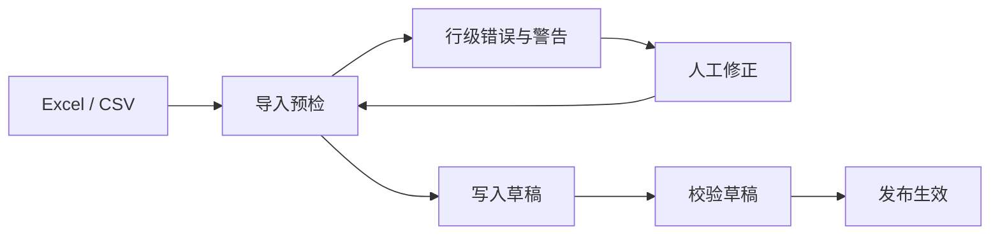

# EdgeNexus Excel / CSV 点表格式

## 1. 文档范围

EdgeNexus 当前提供两类文件流程：

1. 单设备点位导出与导入预检。
2. 整个工程的分组、设备、点位导入与预检。

两类流程都支持 `.xlsx` 和 `.csv`。本文字段全部来自 `DeviceTagFileService` 与 `PointTableImportService`。

完整协议地址规范见 [PLC-Drivers.md](PLC-Drivers.md) 和 [Samples-and-Tests.md](Samples-and-Tests.md)。文档中心见 [INDEX.md](INDEX.md)。

## 2. 安全导入流程



导入不会自动发布生产配置。

## 3. 支持文件

- `.xlsx`
- `.csv`

其他扩展名返回文件级错误。

CSV 建议使用 UTF-8，避免中文分组名、设备名和备注出现乱码。

## 4. 单设备点位导出

端点：

```text
GET /api/v1/devices/{id}/tags/export
```

导出文件包含工作表：

- `Points`
- 协议相关地址说明工作表或说明内容，以当前导出实现为准。

## 5. 单设备点位列顺序

源码固定顺序：

| 列 | 字段 | 必填 | 作用 |
|---:|---|---|---|
| A | `TagName` | 是 | 点位名称 |
| B | `Address` | 是 | PLC/OPC UA 地址 |
| C | `DataType` | 是 | 本地数据类型 |
| D | `ModbusFunctionCode` | Modbus 条件必填 | 01/02/03/04 |
| E | `Enabled` | 否 | 是否采集 |
| F | `ByteOrder` | 否 | 多字节值排列 |
| G | `Operator` | 否 | 数值换算运算符 |
| H | `Operand` | 否 | 数值换算操作数 |
| I | `Decimals` | 否 | 小数位 |
| J | `PublishOnChange` | 否 | 变化上传 |
| K | `Deadband` | 否 | 变化死区 |
| L | `StringLength` | 否 | 字符串读取长度 |
| M | `Remark` | 否 | 备注 |

## 6. 单设备最小 CSV

```csv
TagName,Address,DataType
Temperature,DB1.DBD4,Float32
Running,DB1.DBX0.0,Bool
```

## 7. 单设备完整 CSV

```csv
TagName,Address,DataType,ModbusFunctionCode,Enabled,ByteOrder,Operator,Operand,Decimals,PublishOnChange,Deadband,StringLength,Remark
Temperature,0,Float32,3,true,ABCD,*,1,2,true,0.1,32,温度
Running,0,Bool,1,true,ABCD,*,1,0,false,0,32,运行状态
```

示例只展示列格式；地址和字节序必须按实际设备手册配置。

## 8. TagName

- 对应 `TagDefinition.Name`。
- 单设备内应保持可识别和稳定。
- MQTT 普通完整 Tag 默认形成 `DeviceId:TagName`。
- 不建议以 `#` 开头，`#` 前缀用于系统 Tag 语义。

## 9. Address

- 对应 `TagDefinition.Address`。
- 不同协议语法不同。
- 必须使用 PLC 工程或服务器实际地址。
- 不要把注释、中文显示名或未发布符号当地址。

## 10. DataType

支持 `TagDataType`：

- `Bool`
- `Byte`
- `Int16`
- `UInt16`
- `Int32`
- `UInt32`
- `Int64`
- `UInt64`
- `Float32`
- `Float64`
- `String`
- `Bcd`

导入器还支持源码中定义的部分常用别名，正式模板建议使用枚举名称，减少歧义。

## 11. ModbusFunctionCode

支持：

- `1` / `01` / `ReadCoils`
- `2` / `02` / `ReadDiscreteInputs`
- `3` / `03` / `ReadHoldingRegisters`
- `4` / `04` / `ReadInputRegisters`

规则：

- 01、02 只能配 Bool。
- 03、04 用于寄存器数据。
- 地址栏填写零基偏移，不把 40001 当作偏移直接填写。

## 12. Enabled

支持：

- `true` / `false`
- `1` / `0`
- `yes` / `no`
- `是` / `否`

为空时使用默认值。

## 13. ByteOrder

默认 `ABCD`。

ByteOrder 只对多字节数据有意义。现场常见排列包括 ABCD、BADC、CDAB、DCBA，但是否可用和具体语义以当前驱动转换实现为准。

同为 Float32，西门子和三菱可能需要不同 ByteOrder，因为 PLC 内存字节与字排列不同。

## 14. Operator 与 Operand

用于读取后的数值换算。

默认：

```text
Operator = *
Operand = 1
```

配置前应确认换算顺序和支持运算符，以 `AcquisitionWorker.Transform` 当前实现为准。

## 15. Decimals

- 对应 `TagDefinition.Decimals`。
- 默认 2。
- 用于数值结果的精度处理。
- 不改变 PLC 原始寄存器长度。

## 16. PublishOnChange

开启后，点位变化达到 Deadband 时可触发变化上传。

它不改变扫描周期；PLC 仍按分组 `ScanCycleMs` 采集。

## 17. Deadband

- 对应 `TagDefinition.Deadband`。
- 默认 0。
- 与 `PublishOnChange` 配合。
- 对数字点用于过滤微小波动。

## 18. StringLength

- 对应 `TagDefinition.StringLength`。
- 默认 32。
- 只对 String 读取有意义。
- 长度必须与 PLC 字符串布局和协议响应容量匹配。

## 19. Remark

自由备注，不参与 PLC 地址解析和 MQTT Tag 生成。

不要在 Remark 中保存密码、Token 或其他秘密。

## 20. 中文列名

单设备导入支持的中文映射包括：

| 中文 | 标准字段 |
|---|---|
| 点位名称 / 变量名称 / 变量名 | `TagName` |
| 地址 / 点位地址 | `Address` |
| 数据类型 | `DataType` |
| 功能码 / Modbus功能码 | `ModbusFunctionCode` |
| 启用 / 是否启用 | `Enabled` |
| 字节序 | `ByteOrder` |
| 运算符 / 操作符 | `Operator` |
| 运算值 / 操作数 | `Operand` |
| 小数位 / 保留小数 | `Decimals` |
| 变化上传 | `PublishOnChange` |
| 变化阈值 | `Deadband` |
| 字符串长度 | `StringLength` |
| 备注 | `Remark` |

## 21. 工程导入端点

预检：

```text
POST /api/v1/configuration/import/preview
```

写入草稿：

```text
POST /api/v1/configuration/import
```

文件字段使用 `multipart/form-data` 的 `file`。

查询参数 `replaceExisting=true` 表示替换草稿中的分组、设备和点位；默认是合并模式。

## 22. 工程导入必填列

| 字段 | 作用 |
|---|---|
| `GroupName` | 分组名称 |
| `GroupTopic` | 分组 Topic 模板 |
| `DeviceName` | 设备名称 |
| `Protocol` | 协议 |
| `Host` | PLC/服务器地址 |
| `Port` | 端口 |
| `TagName` | 点位名称 |
| `Address` | 点位地址 |
| `DataType` | 点位数据类型 |

## 23. 工程最小示例

```csv
GroupName,GroupTopic,DeviceName,Protocol,Host,Port,TagName,Address,DataType
Line01,factory/${deviceId}/data,PLC001,SiemensS7,192.168.10.10,102,Temperature,DB1.DBD4,Float32
Line01,factory/${deviceId}/data,PLC001,SiemensS7,192.168.10.10,102,Running,DB1.DBX0.0,Bool
```

同一设备的多行必须保持协议、Host 和 Port 一致，否则导入器报告冲突。

## 24. 工程分组字段

常用字段：

- `GroupName`
- `GroupTopic`
- `Line`
- `ScanCycleMs`
- `UploadCycleSeconds`
- `GroupEnabled`

扫描和上传周期必须满足 `GroupScheduleLimits`。

## 25. 工程设备通用字段

- `DeviceName`
- `MqttDeviceId`
- `Protocol`
- `Host`
- `Port`
- `DeviceEnabled`
- `ConnectTimeoutMs`
- `ReceiveTimeoutMs`
- `Station`
- `Rack`
- `Slot`

## 26. Siemens 字段

- `SiemensSeries`
- `SiemensAutoRackSlot`
- `SiemensConnectionType`
- `SiemensLocalTsap`
- `SiemensDestinationTsap`

Series 支持值来自 `SiemensPlcSeries`。

## 27. Mitsubishi 字段

- `MitsubishiTransport`
- `MitsubishiFormat`
- `NetworkNumber`
- `PlcNumber`
- `NetworkStationNumber`
- `TargetIoStation`

当前 Format：

- `Binary3E`
- `Ascii3E`
- `Binary1E`
- `Ascii1E`

当前 Transport：

- `Tcp`
- `Udp`

A 兼容 1E 帧只支持 TCP。

## 28. Omron FINS 字段

- `FinsDestinationNetwork`
- `FinsDestinationNode`
- `FinsDestinationUnit`
- `FinsSourceNetwork`
- `FinsSourceNode`
- `FinsSourceUnit`
- `FinsReadSplits`

节点与网络号必须和 PLC/FINS 路由表一致。

## 29. Omron CIP 与 AB 字段

- `OmronCipConnectionTimeoutMultiplier`
- `CipRoutePath`
- `CipReadArrayUseSegment`

AB 路由通常还与 CPU Slot 有关，必须与 Studio 5000 和网络拓扑一致。

## 30. Beckhoff 字段

- `BeckhoffUseAutoAmsNetId`
- `BeckhoffTargetAmsNetId`
- `BeckhoffSenderAmsNetId`
- `BeckhoffUseTagCache`

`Port` 对应 ADS Runtime 端口，例如 TwinCAT 3 Runtime 1 常用 851，但必须以现场配置为准。

## 31. Inovance 与 Delta 字段

- `InovanceSeries`
- `DeltaSeries`

系列会影响地址区解释，不能只看品牌选择地址。

## 32. OPC UA 字段

- `OpcUaUsername`
- `OpcUaPassword`
- `OpcUaUseSecurity`
- `OpcUaAutoAcceptUntrusted`

生产中不建议无审查自动信任未知证书。

## 33. 工程点位字段

工程导入同时支持单设备点位字段：

- `TagName`
- `Address`
- `DataType`
- `ModbusFunctionCode`
- `TagEnabled` 或对应规范化字段
- `ByteOrder`
- `Operator`
- `Operand`
- `Decimals`
- `PublishOnChange`
- `Deadband`
- `StringLength`
- `Remark`

具体别名应以当前 `NormalizeHeader` 实现为准。

## 34. 协议名称别名

导入器当前支持：

| 输入 | ProtocolKind |
|---|---|
| `s7` / `siemens` / `西门子` | `SiemensS7` |
| `modbus` / `modbustcp` | `ModbusTcp` |
| `mitsubishi` / `三菱` / `mc` | `MitsubishiMc` |
| `opcua` | `OpcUa` |
| `panasonic` / `松下` | `PanasonicMewtocol` |
| `omronfins` / `欧姆龙fins` | `OmronFins` |
| `omroncip` / `欧姆龙cip` | `OmronCip` |
| `ab` / `allenbradley` | `AllenBradleyEtherNetIp` |
| `beckhoff` / `ads` / `倍福` | `BeckhoffAds` |
| `keyence` / `基恩士` | `KeyenceMc` |
| `inovance` / `汇川` | `InovanceTcp` |
| `delta` / `台达` | `DeltaTcp` |

标准模板建议直接使用 `ProtocolKind` 名称。

## 35. 地址示例：Siemens

| Address | 类型 | 说明 |
|---|---|---|
| `DB1.DBX0.0` | Bool | DB 位 |
| `DB1.DBW2` | UInt16 | DB 字 |
| `DB1.DBD4` | Float32 | DB 双字 |
| `M10.0` | Bool | M 位 |
| `VD100` | Float32 | S7-200 V 区 |

## 36. 地址示例：Modbus TCP

| Address | Function | 类型 | 说明 |
|---|---:|---|---|
| `0` | 01 | Bool | 第一个线圈 |
| `0` | 02 | Bool | 第一个离散输入 |
| `0` | 03 | UInt16 | 第一个保持寄存器 |
| `2` | 03 | Float32 | 偏移 2 开始两个寄存器 |
| `0` | 04 | Int16 | 第一个输入寄存器 |

## 37. 地址示例：Mitsubishi

| Address | 类型 | 说明 |
|---|---|---|
| `D100` | Int16 | 数据寄存器 |
| `D200` | Float32 | D200-D201 |
| `M100` | Bool | 内部继电器 |
| `X0` | Bool | 输入 |
| `Y0` | Bool | 输出 |

## 38. 地址示例：OPC UA

| Address | 类型 |
|---|---|
| `ns=2;s=Machine.Speed` | Float32 |
| `ns=2;i=1001` | Int32 |
| `ns=3;s=Line1.Running` | Bool |

必须填写完整 NodeId，不是 BrowsePath。

## 39. 地址示例：Panasonic

| Address | 类型 |
|---|---|
| `DT100` | Int16 |
| `DT200` | Float32 |
| `R0` | Bool |
| `X0` | Bool |
| `Y0` | Bool |

## 40. 地址示例：Omron FINS

| Address | 类型 |
|---|---|
| `D100` | Int16 |
| `D100.03` | Bool |
| `CIO100` | UInt16 |
| `W100` | UInt16 |
| `H100.00` | Bool |

## 41. 地址示例：Omron CIP

| Address | 类型 |
|---|---|
| `Machine.Speed` | Float32 |
| `Machine.Running` | Bool |
| `Alarm[0]` | Bool |
| `ProductionCount` | Int32 |

变量必须在 Sysmac Studio 开放外部访问。

## 42. 地址示例：Allen-Bradley

| Address | 类型 |
|---|---|
| `Motor.Speed` | Float32 |
| `Motor.Running` | Bool |
| `Counter[0]` | Int32 |
| `Program:MainProgram.BatchId` | Int32 |

## 43. 地址示例：Beckhoff ADS

| Address | 类型 |
|---|---|
| `s=MAIN.bRun` | Bool |
| `s=MAIN.nCount` | Int32 |
| `s=MAIN.rSpeed` | Float32 |
| `M100.0` | Bool |
| `IG=0xF020;0` | UInt16 |

## 44. 地址示例：Keyence

| Address | 类型 |
|---|---|
| `DM100` | Int16 |
| `DM200` | Float32 |
| `R015` | Bool |
| `MR015` | Bool |
| `LR015` | Bool |

## 45. 地址示例：Inovance

| Address | 系列 | 类型 |
|---|---|---|
| `SD100` | AM | Int16 |
| `Q0` | AM | Bool |
| `M100` | AM/H3U/H5U | Bool |
| `D100` | H3U/H5U | Int16 |
| `X0` | H3U/H5U | Bool |

## 46. 地址示例：Delta

| Address | 类型 |
|---|---|
| `D100` | Int16 |
| `D200` | Float32 |
| `M100` | Bool |
| `X0` | Bool |
| `Y0` | Bool |

## 47. 合并模式

默认导入模式是合并：

- 已有草稿作为基础。
- 按分组和设备标识合并行。
- 同一设备定义冲突会产生错误。
- 未出现在文件中的其他草稿配置不会自动删除。

## 48. 替换模式

`replaceExisting=true`：

- 以导入文件生成新的草稿结构。
- 替换草稿中的分组、设备和点位。
- 不直接替换活动版本。
- 必须校验并发布。

执行前建议先导出工程或记录当前活动版本。

## 49. 预检错误

`PointTableImportIssue` 包含：

- Row
- Field
- Message

文件级错误使用行号 0。

## 50. 预检警告

警告不会总是阻止导入，但应逐项审查。导入报告包含：

- IsValid
- TotalRows
- GroupCount
- DeviceCount
- TagCount
- Errors
- Warnings

## 51. 常见错误

### 缺少必填列

确保标题没有拼写错误，尤其是 `GroupTopic`、`DeviceName`、`DataType`。

### Modbus 功能码不匹配

Bool 使用 01/02，寄存器类型使用 03/04。

### 同名设备参数冲突

同一分组内同一设备的 Protocol、Host、Port 必须一致。

### Float 值不正确

核对地址起点、数据类型、占用寄存器数和 ByteOrder。

### OPC UA 无值

确认使用完整 NodeId、账号权限和安全端点。

## 52. 大点表建议

- 先按单设备或小分组导入验证。
- 不在一次导入中混合未经验证的多协议地址。
- 对字符串和 64 位数据单独检查响应长度。
- 用预检错误定位行，不直接反复发布试错。
- 导入后先连接测试，再启动高频采集。

## 53. 版本控制建议

点表文件适合纳入项目自己的版本管理，但必须脱敏：

- 用测试 IP 替换生产 IP。
- 删除密码。
- 删除工厂敏感 Topic。
- 保留列结构、地址模式和数据类型用于审查。

## 54. 维护检查表

- [ ] 新增 `TagDefinition` 字段后更新单设备列。
- [ ] 新增 `DeviceDefinition` 字段后更新工程列。
- [ ] 新增 `ProtocolKind` 后更新协议别名。
- [ ] 新增地址语法后更新 `ProtocolPointAddressCatalog`。
- [ ] 更新导入器后同步测试。
- [ ] 更新 [Configuration.md](Configuration.md)。
- [ ] 更新 [Samples-and-Tests.md](Samples-and-Tests.md)。
- [ ] 更新 [Plugin-Development.md](Plugin-Development.md)。

## 55. 相关文档

- [Getting Started](Getting-Started.md)
- [PLC Drivers](PLC-Drivers.md)
- [Configuration](Configuration.md)
- [Web API](WebAPI.md)
- [Samples and Tests](Samples-and-Tests.md)
- [FAQ](FAQ.md)
- [文档中心](INDEX.md)
