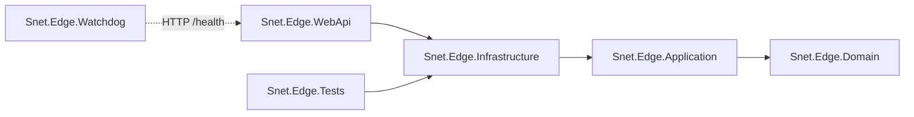
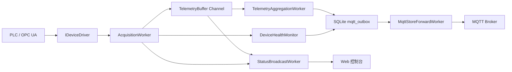

# EdgeNexus 源码文档中心

当前发布版本：`V1.0`。

> 本文档集仅依据当前 Solution 源码生成。
>
> 扫描基线：`Snet.Edge.slnx`、`src/`、`tests/`、`Dockerfile`、`docker-compose.yml`、`Directory.Build.props`、`Directory.Packages.props`。
>
> 扫描时排除了编译产物目录 `bin/`、`obj/`、`.vs/` 和 `artifacts/`。

## 1. 文档导航

- [总体架构](Architecture.md)
- [运行时流程与线程模型](Runtime-Flows.md)
- [PLC 驱动与通信协议](PLC-Drivers.md)
- [MQTT 模块](MQTT.md)
- [Web API](WebAPI.md)
- [配置、数据库与部署参数](Configuration.md)
- [公共类型与接口参考](Public-API.md)
- [示例与测试索引](Samples-and-Tests.md)

## 2. Solution 概览

| 项目 | SDK | 直接项目引用 | 主要职责 |
|---|---|---|---|
| `Snet.Edge.Domain` | `Microsoft.NET.Sdk` | 无 | 协议枚举、设备/点位/MQTT/网络领域模型 |
| `Snet.Edge.Application` | `Microsoft.NET.Sdk` | `Snet.Edge.Domain` | 端口接口、配置校验、协议参数校验、点位地址规范 |
| `Snet.Edge.Infrastructure` | `Microsoft.NET.Sdk` | `Snet.Edge.Application` | PLC 驱动、采集、MQTT、SQLite、网络、日志、资源保护 |
| `Snet.Edge.WebApi` | `Microsoft.NET.Sdk.Web` | `Snet.Edge.Infrastructure` | Web 宿主、认证授权、REST、SignalR、静态控制台 |
| `Snet.Edge.Watchdog` | `Microsoft.NET.Sdk.Worker` | 无项目引用 | 独立健康探测和受控重启命令执行 |
| `Snet.Edge.Tests` | `Microsoft.NET.Sdk` | `Snet.Edge.Infrastructure` | xUnit 单元测试、集成测试、容量冒烟测试 |

## 3. 引用方向

## 4. 代码规模清单

- WebAPI 端点映射：59 条，包含根页面、认证、监控和 `/api/v1`。
- 公共类：58 个。
- 公共接口：32 个。
- 公共记录类型：67 个。
- 公共枚举：17 个。
- PLC 协议枚举值：12 个。
- Infrastructure HostedService/BackgroundService：7 个。
- WebApi HostedService：1 个。
- Watchdog BackgroundService：1 个。
- SQLite 业务表：配置状态、配置版本、版本删除标记、MQTT 模板、Outbox、死信、网络配置、用户、审计日志。

## 5. 技术基线

- 目标框架：`.NET 10.0`。
- C# 语言版本：`12.0`。
- Nullable：开启。
- ImplicitUsings：开启。
- TreatWarningsAsErrors：开启。
- PLC 协议栈：内置 `.NET 10` 原生异步协议栈（`NativePlcProtocols`，零商业授权依赖）。
- MQTTnet：`5.2.0.1603`。
- OPC UA SDK：`1.5.378.156`。
- Dapper：`2.1.66`。
- Microsoft.Data.Sqlite：`10.0.0`。
- Polly.Core：`8.6.5`，当前源码未发现实际策略注册或调用。
- ClosedXML：`0.105.1`。
- Serilog：WebAPI 与 Watchdog 均启用异步 Console/File Sink。
- Vue：`3.5.18`，本地 vendored 文件。
- Element Plus：`2.10.7`，本地 vendored 文件。
- SignalR JavaScript Client：`10.0.0`，本地 vendored 文件。

## 6. 运行时模块索引

| 模块 | 入口类型 | 生命周期 | 详细文档 |
|---|---|---|---|
| 基础设施初始化 | `InfrastructureInitializer` | `IHostedService` | [运行时流程](Runtime-Flows.md) |
| 资源监控 | `ResourceMonitorWorker` | `BackgroundService` | [运行时流程](Runtime-Flows.md) |
| PLC 采集 | `AcquisitionWorker` | `BackgroundService` | [PLC 驱动](PLC-Drivers.md) |
| 数据聚合 | `TelemetryAggregationWorker` | `BackgroundService` | [MQTT 模块](MQTT.md) |
| 设备健康 | `DeviceHealthMonitor` | `BackgroundService` | [MQTT 模块](MQTT.md) |
| MQTT 补传 | `MqttStoreForwardWorker` | `BackgroundService` | [MQTT 模块](MQTT.md) |
| 审计持久化 | `AuditLogStore` | `BackgroundService` | [配置与数据库](Configuration.md) |
| SignalR 广播 | `StatusBroadcastWorker` | `BackgroundService` | [Web API](WebAPI.md) |
| 外部守护 | `GatewayWatchdogWorker` | `BackgroundService` | [运行时流程](Runtime-Flows.md) |

## 7. 通信协议索引

| `ProtocolKind` | 实现客户端 | 传输 |
|---|---|---|
| `SiemensS7` | `SiemensS7Net` | TCP |
| `ModbusTcp` | `ModbusTcpNet` | TCP |
| `MitsubishiMc` | `MelsecMcNet`/`MelsecMcAsciiNet`/`MelsecA1ENet`/UDP 客户端 | TCP/UDP |
| `OpcUa` | OPC Foundation `ISession` | OPC TCP |
| `PanasonicMewtocol` | `PanasonicMewtocolOverTcp` | TCP |
| `OmronFins` | `OmronFinsNet` | TCP |
| `OmronCip` | `OmronConnectedCipNet` | EtherNet/IP |
| `AllenBradleyEtherNetIp` | `AllenBradleyNet` | EtherNet/IP |
| `BeckhoffAds` | `BeckhoffAdsNet` | ADS/TCP |
| `KeyenceMc` | `KeyenceMcNet` | TCP |
| `InovanceTcp` | `InovanceTcpNet` | TCP |
| `DeltaTcp` | `DeltaTcpNet` | TCP |

## 8. Web 控制台索引

- 页面入口：`src/Snet.Edge.WebApi/wwwroot/index.html`。
- 运行脚本：`src/Snet.Edge.WebApi/wwwroot/app.js`。
- 页面采用单页 Vue 应用，没有前端构建工程和 npm 运行时依赖。
- 第三方前端文件位于 `wwwroot/vendor`。
- `vendor-manifest.json` 固定版本和 SHA-256。
- `index.html` 尾部包含 `type="text/plain"` 的旧原型脚本。
- 旧原型脚本不会被浏览器执行。
- 当前实际功能全部由 `/app.js` 驱动。
- 页面导航包含运行总览、南向采集、MQTT、网络配置、系统设置。
- 页面顶部包含工程导入、工程导出、版本管理、校验草稿、发布生效。
- 页面通过 Cookie 会话访问 API。
- 页面通过 `X-CSRF-TOKEN` 提交写请求。
- 页面通过 `/hubs/status` 接收运行状态和点位变化。

## 9. 配置治理索引

- 所有分组、设备、点位和 MQTT 业务配置封装为 `GatewaySnapshot`。
- `gateway_state.active_payload` 保存生效快照。
- `gateway_state.draft_payload` 保存草稿快照。
- 页面普通编辑只修改草稿。
- `POST /api/v1/configuration/publish` 将草稿原子发布为新版本。
- 运行时采集和 MQTT 只读取生效快照。
- 回滚不会直接切换到旧版本号。
- 回滚会生成新的递增版本。
- 历史版本删除使用删除标记表，不直接删除版本负载。
- MQTT 参数支持单独应用并产生新配置版本。
- 网络用途绑定独立保存在 `network_configuration`。
- MQTT 模板独立保存在 `mqtt_template`。

## 10. 数据流索引

## 11. 线程和队列索引

| 对象 | 类型 | 容量/周期 | 满载策略 |
|---|---|---|---|
| `TelemetryBuffer._channel` | `Channel<TagSample>` | 100000 | `Wait` |
| `RuntimeStatusStore._changes` | `Channel<DeviceRuntimeStatus>` | 10000 | `DropOldest` |
| `MqttRuntimeStateStore._configurationChanges` | `Channel<bool>` | 1 | `DropOldest` |
| `AuditLogStore._channel` | `Channel<AuditEvent>` | 10000 | `Wait`，写入口使用 `TryWrite` |
| 采集同步 | `PeriodicTimer` | 5 秒 | 每轮比较配置和网络版本 |
| MQTT 聚合 | `PeriodicTimer` | 250 毫秒 | 再按分组上传周期判定 |
| 健康协调 | `PeriodicTimer` | 2 秒 | 配置和状态重协调 |
| 资源采样 | `PeriodicTimer` | 2 秒 | 失败保留上次状态 |
| SignalR 状态 | `PeriodicTimer` | 2 秒 | 只推送变化 |
| SignalR 点位 | `PeriodicTimer` | 250 毫秒 | 按设备组推送变化 |

## 12. 数据库索引

| 表 | 写入者 | 读取者 | 用途 |
|---|---|---|---|
| `gateway_state` | `SqliteGatewayConfigurationStore` | 配置 API、采集、MQTT | active/draft 快照 |
| `gateway_revision` | `SqliteGatewayConfigurationStore` | 版本 API | 历史配置版本 |
| `gateway_revision_deletion` | `SqliteGatewayConfigurationStore` | 版本查询 | 历史版本逻辑删除 |
| `mqtt_template` | `MqttTemplateManager` | 模板 API、MQTT Builder | 报文模板 |
| `mqtt_outbox` | `MqttOutbox` | `MqttStoreForwardWorker` | 待发送消息 |
| `mqtt_dead_letter` | `MqttOutbox` | Outbox API | 超过重试上限的消息 |
| `mqtt_sequence` | `MqttOutbox.InitializeAsync` | 当前源码未发现后续使用 | 预留分组序号表 |
| `network_configuration` | `SqliteNetworkConfigurationService` | 网络绑定和连接工厂 | 业务网卡绑定 |
| `gateway_user` | `SqliteUserAccountStore` | 认证 API | 管理员账户 |
| `audit_log` | `AuditLogStore` | 审计 API | 非只读 HTTP 操作审计 |

## 13. 日志索引

- WebAPI 使用 Serilog。
- Watchdog 使用 Serilog。
- 两者均写 Console。
- 两者均写 JSON 文件。
- 文件 Sink 放在 Async Sink 内。
- WebAPI 日志目录为 `${Gateway:DataDirectory}/logs`。
- Watchdog 日志目录由 `SNET_WATCHDOG_DATA` 或 `watchdog-data` 决定。
- 日志按天滚动。
- 保留 30 个文件。
- 业务类使用 `ILogger<T>`。
- 源码未发现 `Console.WriteLine` 作为业务日志。

## 14. 安全索引

- Cookie 名称：`SnetEdge.Auth`。
- Cookie：`HttpOnly`。
- Cookie：`SameSite=Strict`。
- 可配置 SecurePolicy。
- 默认会话有效期 8 小时。
- 启用滑动过期。
- API 未认证返回 401。
- API 无权限返回 403。
- `/api/v1` 所有端点需要认证。
- `/api/v1` 非 GET/HEAD 请求需要 Admin 角色。
- `/api` 非 GET/HEAD/OPTIONS 请求需要 CSRF 校验。
- 登录端点允许匿名，但仍属于 `/api`，前端先获取防伪令牌。
- 密码使用 ASP.NET Identity `PasswordHasher<string>`。
- 连续失败达到阈值后临时锁定。
- 初始管理员被标记为必须修改密码。
- 安全响应头包含 CSP、X-Frame-Options、nosniff、Referrer-Policy。

## 15. 部署索引

- WebAPI 支持控制台运行。
- WebAPI 调用 `UseWindowsService`，可作为 Windows Service 宿主。
- Docker Runtime 使用 `mcr.microsoft.com/dotnet/aspnet:10.0`。
- Docker 容器以非 root `app` 用户运行。
- Docker 根文件系统只读。
- Docker 丢弃全部 Linux capabilities。
- Docker 健康检查访问 `/health/ready`。
- Docker 数据卷挂载 `/var/lib/snet-edge`。
- Docker 默认容器端口为 8080。
- Compose 映射主机 5088 到容器 8080。
- Watchdog 是独立进程，不嵌入 WebAPI。

## 16. 插件与 Samples 扫描结论

- 当前 Solution 未发现 `IPlugin`。
- 当前 Solution 未发现 `AssemblyLoadContext`。
- 当前 Solution 未发现动态程序集加载。
- 当前 Solution 未发现 MEF。
- 当前 Solution 未发现插件清单或插件目录约定。
- 因此当前版本不是插件式驱动架构。
- PLC 驱动扩展通过修改 `ProtocolKind`、`HslDeviceDriverFactory`、参数描述和校验器完成。
- 当前仓库没有 `Samples/`、`samples/` 或 `examples/` 目录。
- [示例与测试索引](Samples-and-Tests.md) 只引用现有测试和源码内示例。

## 17. 已知源码事实

- `Polly.Core` 已引用，但源码未发现重试管道使用。
- MQTT 重连由 `MqttStoreForwardWorker` 自行实现指数退避。
- PLC 重连由 `ReconnectBackoff` 自行实现阶梯退避和抖动。
- `mqtt_sequence` 表被创建，但当前源码没有读写序号的方法。
- `DataQuality.Uncertain` 在领域枚举中定义，当前采集路径主要输出 `Good`、`Disconnected`、`Timeout`、`ConfigurationError`。
- `DeviceFaultKind.Offline` 用于初始健康状态。
- `DeviceFaultKind.Read` 和 `Parse` 用于点位级错误状态。
- 设备错误 Tag 的 `quality` 固定由 `SystemTagBuilder` 生成 `Good`。
- 设备错误由错误 Tag 的 `value` 表达。
- `Degraded` 且存在成功时间时，设备错误码仍为 0。

## 18. 文档覆盖检查入口

- 公共类覆盖：[Public-API.md](Public-API.md#公共类)
- 公共接口覆盖：[Public-API.md](Public-API.md#公共接口)
- 领域 DTO 覆盖：[Public-API.md](Public-API.md#领域模型)
- Web DTO 覆盖：[Public-API.md](Public-API.md#web-dto)
- API 覆盖：[WebAPI.md](WebAPI.md)
- 配置项覆盖：[Configuration.md](Configuration.md)
- HostedService 覆盖：[Runtime-Flows.md](Runtime-Flows.md)
- PLC 协议覆盖：[PLC-Drivers.md](PLC-Drivers.md)
- MQTT 组件覆盖：[MQTT.md](MQTT.md)
- 测试覆盖：[Samples-and-Tests.md](Samples-and-Tests.md)

## 19. 源码文件导航

### 19.1 Domain

- `src/Snet.Edge.Domain/Models.cs`：协议、设备、点位、MQTT、状态、资源、审计模型。
- `src/Snet.Edge.Domain/NetworkModels.cs`：网卡、用途绑定、诊断模型。

### 19.2 Application

- `Abstractions.cs`：32 个公共接口和应用 DTO。
- `DeviceProtocolValidator.cs`：设备协议参数校验。
- `GatewayConfigurationValidator.cs`：完整快照校验。
- `ModbusTagAddress.cs`：Modbus 地址兼容和规范化。
- `MqttDeviceStatusTemplateValidator.cs`：状态 Tag 模板校验。
- `MqttTopicTemplateValidator.cs`：Topic 模板校验。
- `ProtocolPointAddressCatalog.cs`：12 种协议地址指南。
- `TagProtocolValidator.cs`：点位协议校验。

### 19.3 Infrastructure

- `AcquisitionStability.cs`：成功/失败防抖和重连退避。
- `AcquisitionWorker.cs`：每设备采集循环。
- `AuditLogStore.cs`：审计 Channel 和 SQLite。
- `DeviceTagFileService.cs`：单设备 Excel 点表。
- `Gateway.DeviceHealth/DeviceHealthServices.cs`：设备健康模块。
- `Gateway.Mqtt/MqttMessageBuilders.cs`：变量、Topic、Payload Builder。
- `Gateway.Mqtt/MqttTemplateManager.cs`：模板存储和热缓存。
- `GatewayMetrics.cs`：业务指标。
- `HslDeviceDriver.cs`：协议工厂、HSL、OPC UA。
- `InfrastructureInitializer.cs`：启动初始化。
- `MqttRuntimeStateStore.cs`：MQTT 状态和配置变化通知。
- `MqttStoreForward.cs`：Outbox、死信和 MQTT Worker。
- `NetworkConfiguration.cs`：系统网卡和用途绑定。
- `NetworkDiagnostics.cs`：Ping/TCP/MQTT/PLC 诊断。
- `PointTableImportService.cs`：工程 CSV/XLSX 导入。
- `ResourceProtection.cs`：资源保护。
- `RuntimeServices.cs`：Telemetry 和状态存储。
- `ServiceCollectionExtensions.cs`：DI 组合根。
- `SqliteGatewayConfigurationStore.cs`：active/draft/版本。
- `SqliteUserAccountStore.cs`：用户认证。
- `TagReadPlanCompiler.cs`：读取计划。
- `TelemetryAggregationWorker.cs`：MQTT 聚合生产者。

### 19.4 WebApi

- `Program.cs`：Web Host 和中间件。
- `ApiEndpoints.cs`：49 个 `/api/v1` 端点。
- `AuthenticationEndpoints.cs`：5 个认证端点。
- `MonitoringEndpoints.cs`：4 个监控端点。
- `NetworkDtos.cs`：网络请求 DTO。
- `StatusHub.cs`：SignalR Hub 和广播 Worker。
- `AntiforgeryProtectionMiddleware.cs`：CSRF。
- `AuditMiddleware.cs`：HTTP 审计。
- `WebNetworkBindingMiddleware.cs`：Web 管理网卡限制。
- `wwwroot/index.html`：前端页面。
- `wwwroot/app.js`：前端正式逻辑。

### 19.5 Watchdog

- `Program.cs`：Worker Host 和 Serilog。
- `GatewayWatchdogWorker.cs`：探测、重启、冷却和断路器。
- `appsettings.json`：WatchdogOptions。

## 20. 公共类快速索引

### 20.1 Application 与 Domain

- `DeviceProtocolValidator` -> [公共类型](Public-API.md)。
- `GatewayConfigurationValidator` -> [公共类型](Public-API.md)。
- `ModbusTagAddress` -> [PLC](PLC-Drivers.md)。
- `MqttDeviceStatusTemplateValidator` -> [MQTT](MQTT.md)。
- `MqttTopicTemplateValidator` -> [MQTT](MQTT.md)。
- `ProtocolPointAddressCatalog` -> [PLC](PLC-Drivers.md)。
- `TagProtocolValidator` -> [PLC](PLC-Drivers.md)。
- `DeviceErrorCodes` -> [MQTT](MQTT.md)。
- `GroupScheduleLimits` -> [配置](Configuration.md)。
- `TelemetryKey` -> [MQTT](MQTT.md)。

### 20.2 Infrastructure

- `AcquisitionControl` -> [运行时](Runtime-Flows.md)。
- `AcquisitionWorker` -> [PLC](PLC-Drivers.md)。
- `AuditLogStore` -> [运行时](Runtime-Flows.md)。
- `DeviceCommunicationStabilityTracker` -> [PLC](PLC-Drivers.md)。
- `DeviceErrorManager` -> [MQTT](MQTT.md)。
- `DeviceHealthMonitor` -> [MQTT](MQTT.md)。
- `DeviceHealthStateStore` -> [MQTT](MQTT.md)。
- `DeviceTagFileService` -> [示例与测试](Samples-and-Tests.md)。
- `GatewayMetrics` -> [运行时](Runtime-Flows.md)。
- `HslDeviceDriver` -> [PLC](PLC-Drivers.md)。
- `HslDeviceDriverFactory` -> [PLC](PLC-Drivers.md)。
- `InfrastructureInitializer` -> [运行时](Runtime-Flows.md)。
- `InitializationState` -> [运行时](Runtime-Flows.md)。
- `MqttOutbox` -> [MQTT](MQTT.md)。
- `MqttPayloadBuilder` -> [MQTT](MQTT.md)。
- `MqttRuntimeStateStore` -> [MQTT](MQTT.md)。
- `MqttStoreForwardWorker` -> [MQTT](MQTT.md)。
- `MqttTemplateManager` -> [MQTT](MQTT.md)。
- `MqttTopicBuilder` -> [MQTT](MQTT.md)。
- `MqttVariableResolver` -> [MQTT](MQTT.md)。
- `NetworkDiagnosticsService` -> [Web API](WebAPI.md)。
- `OpcUaDeviceDriver` -> [PLC](PLC-Drivers.md)。
- `PointTableImportService` -> [配置](Configuration.md)。
- `ReconnectBackoff` -> [PLC](PLC-Drivers.md)。
- `ResourceGuard` -> [运行时](Runtime-Flows.md)。
- `ResourceMonitorWorker` -> [运行时](Runtime-Flows.md)。
- `RuntimeStatusStore` -> [运行时](Runtime-Flows.md)。
- `ServiceCollectionExtensions` -> [架构](Architecture.md)。
- `SiemensConnectionProfile` -> [PLC](PLC-Drivers.md)。
- `SiemensTagAddress` -> [PLC](PLC-Drivers.md)。
- `SqliteGatewayConfigurationStore` -> [配置](Configuration.md)。
- `SqliteNetworkConfigurationService` -> [配置](Configuration.md)。
- `SqliteUserAccountStore` -> [配置](Configuration.md)。
- `SystemNetworkInventoryService` -> [配置](Configuration.md)。
- `SystemTagBuilder` -> [MQTT](MQTT.md)。
- `TagReadPlanCompiler` -> [PLC](PLC-Drivers.md)。
- `TelemetryAggregationWorker` -> [MQTT](MQTT.md)。
- `TelemetryBuffer` -> [运行时](Runtime-Flows.md)。

### 20.3 Web 与 Watchdog

- `AntiforgeryProtectionMiddleware` -> [Web API](WebAPI.md)。
- `ApiEndpoints` -> [Web API](WebAPI.md)。
- `AuditMiddleware` -> [Web API](WebAPI.md)。
- `AuthenticationEndpoints` -> [Web API](WebAPI.md)。
- `MonitoringEndpoints` -> [Web API](WebAPI.md)。
- `ProtocolDescriptors` -> [Web API](WebAPI.md)。
- `StatusBroadcastWorker` -> [Web API](WebAPI.md)。
- `StatusHub` -> [Web API](WebAPI.md)。
- `WebNetworkBindingMiddleware` -> [Web API](WebAPI.md)。
- `GatewayWatchdogWorker` -> [运行时](Runtime-Flows.md)。

## 21. 公共接口快速索引

- `IGatewayConfigurationStore`：配置 active/draft/version。
- `IMqttConfigurationPublisher`：独立发布 MQTT 配置。
- `IPointTableImportService`：工程点表预览和导入。
- `IDeviceTagFileService`：单设备点表文件。
- `IDeviceDriver`：统一 PLC/OPC UA 驱动。
- `IDeviceDriverFactory`：驱动创建。
- `INetworkInventoryService`：系统网卡库存。
- `INetworkConfigurationService`：用途绑定和解析。
- `INetworkDiagnosticsService`：网络诊断。
- `ITagReadPlanCompiler`：读取计划。
- `ITelemetryBuffer`：采集样本 Channel。
- `IRuntimeTagSampleStore`：实时点位缓存。
- `IMqttMessagePublisher`：MQTT 持久化入队。
- `IMqttPayloadBuilder`：JSON Builder。
- `ITopicBuilder`：Topic Builder。
- `ITemplateResolver`：设备模板解析。
- `IMqttTemplateManager`：模板 CRUD。
- `IMqttOutboxMonitor`：Outbox 统计和死信。
- `IMqttOutboxConfigurationSynchronizer`：旧消息清理。
- `IMqttRuntimeStateStore`：MQTT 连接状态。
- `IRuntimeStatusStore`：设备连接状态存储。
- `IDeviceStatusEventSource`：状态事件 Channel。
- `IDeviceHealthStateStore`：设备错误码状态。
- `IDeviceErrorManager`：设备错误码解析。
- `ISystemTagBuilder`：系统状态 Tag。
- `IAcquisitionControl`：全局采集开关。
- `IResourceGuard`：资源保护读模型。
- `IInitializationState`：初始化状态。
- `IGatewayMetrics`：网关业务指标。
- `IGatewayConfigurationValidator`：完整快照校验。
- `IAuditLogStore`：审计入口与查询。
- `IUserAccountStore`：认证与修改密码。

## 22. HTTP 路由快速索引

### 22.1 认证与监控

- `GET /api/auth/antiforgery`
- `POST /api/auth/login`
- `GET /api/auth/session`
- `POST /api/auth/change-password`
- `POST /api/auth/logout`
- `GET /health/live`
- `GET /health/ready`
- `GET /health`
- `GET /metrics`
- `GET /`

### 22.2 配置与版本

- `GET /api/v1/configuration`
- `GET /api/v1/configuration/draft`
- `GET /api/v1/configuration/export`
- `GET /api/v1/configuration/revisions`
- `GET /api/v1/configuration/revisions/{version:long}/preview`
- `POST /api/v1/configuration/revisions/{version:long}/delete`
- `POST /api/v1/configuration/validate`
- `POST /api/v1/configuration/import/preview`
- `POST /api/v1/configuration/import`
- `POST /api/v1/configuration/publish`
- `POST /api/v1/configuration/rollback/{version:long}`

### 22.3 分组、设备与点位

- `GET /api/v1/protocols`
- `GET /api/v1/audit`
- `GET /api/v1/dashboard`
- `GET /api/v1/device-health`
- `POST /api/v1/groups`
- `PUT /api/v1/groups/{id:guid}`
- `DELETE /api/v1/groups/{id:guid}`
- `POST /api/v1/devices`
- `PUT /api/v1/devices/{id:guid}`
- `DELETE /api/v1/devices/{id:guid}`
- `POST /api/v1/devices/{id:guid}/connection-test`
- `POST /api/v1/devices/connection-test`
- `GET /api/v1/devices/{id:guid}/tags`
- `GET /api/v1/devices/{id:guid}/tags/export`
- `POST /api/v1/devices/{id:guid}/tags/import/preview`
- `PUT /api/v1/devices/{id:guid}/tags`

### 22.4 MQTT

- `PUT /api/v1/mqtt/config`
- `POST /api/v1/mqtt/config/apply`
- `GET /api/v1/mqtt/runtime`
- `GET /api/v1/mqtt/outbox/status`
- `GET /api/v1/mqtt/outbox/dead-letters`
- `GET /api/v1/mqtt/templates`
- `POST /api/v1/mqtt/templates`
- `PUT /api/v1/mqtt/templates/{id:guid}`
- `DELETE /api/v1/mqtt/templates/{id:guid}`
- `POST /api/v1/mqtt/templates/preview`
- `POST /api/v1/mqtt/templates/test-send`

### 22.5 网络与采集

- `GET /api/v1/network/interfaces`
- `GET /api/v1/network/configuration`
- `PUT /api/v1/network/configuration`
- `POST /api/v1/network/diagnostics/ping`
- `POST /api/v1/network/diagnostics/tcp`
- `POST /api/v1/network/diagnostics/mqtt`
- `POST /api/v1/network/diagnostics/plc`
- `GET /api/v1/acquisition/status`
- `POST /api/v1/acquisition/start`
- `POST /api/v1/acquisition/stop`
- `POST /api/v1/diagnostics/ping`

## 23. 配置项快速索引

### 23.1 Host 配置

- `Urls`
- `Gateway:DataDirectory`
- `Authentication:AdminUsername`
- `Authentication:AdminPassword`
- `Authentication:MaximumFailedAttempts`
- `Authentication:LockoutMinutes`
- `Authentication:RequireHttps`
- `AcquisitionStability:FailureThreshold`
- `AcquisitionStability:SuccessThreshold`
- `AcquisitionStability:HeartbeatIntervalSeconds`
- `AcquisitionStability:ReconnectDelaysSeconds`
- `AcquisitionStability:ReconnectJitterRatio`
- `Swagger:Enabled`
- `AllowedHosts`

### 23.2 Watchdog 配置

- `Watchdog:HealthEndpoint`
- `Watchdog:CheckIntervalSeconds`
- `Watchdog:RequestTimeoutSeconds`
- `Watchdog:StartupGraceSeconds`
- `Watchdog:ConsecutiveFailureThreshold`
- `Watchdog:RestartCooldownSeconds`
- `Watchdog:MaxRestartsPerHour`
- `Watchdog:RestartCommandTimeoutSeconds`
- `Watchdog:RestartExecutable`
- `Watchdog:RestartArguments`

### 23.3 业务配置模型

- `MqttGroup`
- `DeviceDefinition`
- `TagDefinition`
- `MqttOptions`
- `MqttTemplate`
- `MqttCustomField`
- `NetworkBindingConfiguration`
- `ResourceProtectionOptions`
- `AuthenticationBootstrapOptions`
- `AcquisitionStabilityOptions`

## 24. 协议快速索引

- Siemens S7 TCP，默认端口 102。
- Modbus TCP，默认端口 502。
- Mitsubishi MC，默认端口 5000，TCP/UDP，3E/1E。
- OPC UA，默认端口 4840。
- Panasonic Mewtocol TCP，默认端口 9094。
- Omron FINS TCP，默认端口 9600。
- Omron CIP，默认端口 44818。
- Allen-Bradley EtherNet/IP，默认端口 44818。
- Beckhoff ADS，默认端口 851。
- Keyence MC，默认端口 5000。
- Inovance TCP，默认端口 502。
- Delta TCP，默认端口 502。

## 25. 后台服务快速索引

- `InfrastructureInitializer`：一次性初始化。
- `ResourceMonitorWorker`：资源采样。
- `AuditLogStore`：审计持久化。
- `AcquisitionWorker`：PLC 采集。
- `TelemetryAggregationWorker`：Telemetry 到 MQTT 请求。
- `DeviceHealthMonitor`：设备错误码状态。
- `MqttStoreForwardWorker`：Broker 连接和发送。
- `StatusBroadcastWorker`：SignalR 广播。
- `GatewayWatchdogWorker`：独立健康守护。

## 26. 测试类快速索引

- `AcquisitionIsolationTests`
- `AcquisitionStabilityTests`
- `AuditLogStoreTests`
- `CapacitySmokeTests`
- `ConfigurationStoreTests`
- `ConfigurationValidatorTests`
- `DeviceHealthTests`
- `DeviceProtocolValidatorTests`
- `DeviceTagFileServiceTests`
- `DriverFactoryTests`
- `HslDeviceDriverByteOrderTests`
- `ModbusTagAddressTests`
- `MqttMessageBuilderTests`
- `MqttOutboxTests`
- `NetworkConfigurationTests`
- `PointTableImportServiceTests`
- `ProtocolPointAddressCatalogTests`
- `ResourceGuardTests`
- `TagReadPlanCompilerTests`
- `TelemetryAggregationWorkerTests`
- `UserAccountStoreTests`
- `VendorAssetIntegrityTests`

## 27. 文档覆盖状态

- [x] Solution 项目和引用。
- [x] 命名空间。
- [x] DI 注册。
- [x] HostedService/BackgroundService。
- [x] 59 个 HTTP API。
- [x] SignalR Hub。
- [x] 12 个 PLC/工业协议。
- [x] MQTT Builder、模板、Outbox、连接 Worker。
- [x] active/draft/version 配置系统。
- [x] 插件系统缺失结论。
- [x] Serilog 和业务 ILogger。
- [x] SQLite 表结构。
- [x] 网络用途绑定。
- [x] 缓存、Channel 和线程模型。
- [x] 58 个 public class。
- [x] 32 个 public interface。
- [x] 67 个 public record。
- [x] 17 个 public enum。
- [x] 所有配置模型字段。
- [x] Samples 缺失结论。
- [x] 所有测试类和业务测试方法。

## 28. 顶层 record 快速索引

- `AcquisitionStabilityOptions`
- `AuditEvent`
- `AuthenticationBootstrapOptions`
- `ConfigurationRevision`
- `ConfigurationValidationResult`
- `DeviceData`
- `DeviceDefinition`
- `DeviceHealthStatus`
- `DeviceReadPlan`
- `DeviceRuntimeStatus`
- `DeviceTagExportFile`
- `DeviceTagImportPreview`
- `DeviceTagReadResult`
- `EffectiveNetworkBinding`
- `GatewayMetricSnapshot`
- `GatewaySnapshot`
- `MqttBuildResult`
- `MqttCustomField`
- `MqttDeadLetter`
- `MqttGroup`
- `MqttOptions`
- `MqttOutboxItem`
- `MqttOutboxStatistics`
- `MqttPayloadContext`
- `MqttPublishRequest`
- `MqttRuntimeStatus`
- `MqttTemplate`
- `NetworkBindingConfiguration`
- `NetworkConfigurationView`
- `NetworkDiagnosticResult`
- `NetworkDiagnosticStep`
- `NetworkInterfaceAddress`
- `NetworkInterfaceInfo`
- `NetworkMqttTestRequest`
- `NetworkPingRequest`
- `NetworkPlcTestRequest`
- `NetworkTcpTestRequest`
- `PasswordChangeResult`
- `PointTableImportIssue`
- `PointTableImportReport`
- `ProtocolDescriptor`
- `ProtocolParameterDescriptor`
- `ProtocolParameterOption`
- `ProtocolPointAddressExample`
- `ProtocolPointAddressGuide`
- `PublishResult`
- `ResourceProtectionOptions`
- `ResourceSnapshot`
- `SaveNetworkBindingsRequest`
- `SiemensConnectionParameters`
- `TagData`
- `TagDefinition`
- `TagReadBatch`
- `TagSample`
- `UserAuthenticationResult`
- `WatchdogOptions`

## 29. 嵌套 record 快速索引

- `AuthenticationEndpoints.LoginRequest`
- `AuthenticationEndpoints.PasswordChangeRequest`
- `ApiEndpoints.PingRequest`
- `ApiEndpoints.MqttTemplatePreviewTag`
- `ApiEndpoints.MqttTemplatePreviewRequest`
- `ApiEndpoints.PublishRequest`
- `ApiEndpoints.RollbackRequest`
- `ApiEndpoints.DeleteRevisionRequest`
- `ApiEndpoints.RevisionChangeSummary`
- `ApiEndpoints.RollbackImpact`
- `ApiEndpoints.RollbackPreviewResponse`

## 30. 枚举快速索引

- `ProtocolKind`
- `SiemensPlcSeries`
- `SiemensConnectionType`
- `MitsubishiMcFormat`
- `MitsubishiMcTransport`
- `InovancePlcSeries`
- `DeltaPlcSeries`
- `TagDataType`
- `ModbusFunctionCode`
- `DataQuality`
- `DeviceConnectionState`
- `DeviceFaultKind`
- `MqttConnectionState`
- `MqttPayloadStyle`
- `ResourceProtectionLevel`
- `NetworkUsage`
- `CommunicationStabilityTransition`

## 31. SQLite 表快速索引

- `gateway_state`：active/draft 单例状态。
- `gateway_revision`：不可变版本载荷。
- `gateway_revision_deletion`：版本逻辑删除。
- `mqtt_template`：MQTT 模板。
- `mqtt_outbox`：待发送消息。
- `mqtt_dead_letter`：超过尝试上限消息。
- `mqtt_sequence`：已创建但当前未使用的序号表。
- `network_configuration`：三用途网卡绑定。
- `gateway_user`：管理员账户。
- `audit_log`：HTTP 写操作审计。

## 32. Channel 快速索引

- Telemetry Channel：100000，Wait。
- Runtime Status Channel：10000，DropOldest。
- MQTT Config Change Channel：1，DropOldest。
- Audit Channel：10000，TryWrite 入口。
- MQTT 业务队列：SQLite Outbox。

## 33. SignalR 快速索引

- Hub：`/hubs/status`。
- 鉴权：Cookie 已认证。
- Client Method：`SubscribeDevice`。
- Client Method：`UnsubscribeDevice`。
- Server Event：`runtimeStatus`。
- Server Event：`tagSamples`。
- 状态周期：2 秒。
- 点位周期：250 ms。

## 34. 文档阅读路径

新维护人员建议顺序：

1. 先读本索引。
2. 再读 [总体架构](Architecture.md)。
3. 再读 [运行时流程](Runtime-Flows.md)。
4. PLC 问题读 [PLC 驱动](PLC-Drivers.md)。
5. MQTT 问题读 [MQTT](MQTT.md)。
6. 页面与接口读 [Web API](WebAPI.md)。
7. 字段和数据库读 [配置](Configuration.md)。
8. 类型定位读 [公共类型](Public-API.md)。
9. 验证证据读 [示例与测试](Samples-and-Tests.md)。

## 35. 运行入口索引

- Web 主入口：`src/Snet.Edge.WebApi/Program.cs`。
- Watchdog 主入口：`src/Snet.Edge.Watchdog/Program.cs`。
- Windows 启动脚本：WebApi 项目发布内容中的 PowerShell/CMD。
- Linux 容器入口：`dotnet Snet.Edge.WebApi.dll`。
- Web 默认地址：`http://127.0.0.1:5088`。
- Docker 主机默认映射：`http://127.0.0.1:5088` 到容器 8080。
- 健康地址：`/health` 或 `/health/ready`。
- 指标地址：`/metrics`。

## 36. 文档生成边界

- 文档没有使用 README 乱码文本作为事实来源。
- 文档没有描述未实现的插件系统。
- 文档没有描述未实现的 PLC 写入。
- 文档没有描述未实现的多 Broker。
- 文档没有描述未实现的多设备单消息聚合。
- 文档没有描述未实现的历史数据库。
- 文档没有将 Polly 引用写成已启用策略。
- 文档明确区分真实实现和未发现项。
- 文档中的 Mermaid 节点来自实际类和调用链。
- 文档中的 API 路径来自实际 Map 调用。
- 文档中的配置默认值来自 record 或 appsettings。
- 文档中的数据库列来自 CREATE TABLE SQL。
- 文档中的协议地址来自源码目录。
- 文档中的测试名称来自 xUnit 源码。

## 37. 维护时重新扫描入口

- 新增项目后更新 Architecture 和 INDEX。
- 新增 public 类型后更新 Public-API。
- 新增 Map 路由后更新 WebAPI。
- 新增配置 property 后更新 Configuration。
- 新增 ProtocolKind 后更新 PLC、WebAPI、INDEX。
- 新增 MQTT 字段后更新 MQTT 和 Configuration。
- 新增 SQLite 表后更新 Configuration 和 INDEX。
- 新增 HostedService 后更新 Runtime-Flows。
- 新增测试后更新 Samples-and-Tests。
- 引入插件加载后删除“无插件”结论并补充插件文档。

## 38. GitHub 首页与治理

- 项目首页：[../README.md](../README.md)。
- 变更记录：[../CHANGELOG.md](../CHANGELOG.md)。
- 贡献规则：[../CONTRIBUTING.md](../CONTRIBUTING.md)。
- 安全策略：[../SECURITY.md](../SECURITY.md)。
- 开源许可证：[../LICENSE](../LICENSE)（Apache License 2.0）。

## 39. 新增专题文档

| 文档 | 主要读者 | 解决的问题 |
|---|---|---|
| [Getting-Started.md](Getting-Started.md) | 用户、现场工程师 | 从启动到采集和 MQTT 上传 |
| [Excel-Template.md](Excel-Template.md) | 实施、数据工程师 | 点表列、协议字段、导入预检 |
| [Plugin-Development.md](Plugin-Development.md) | 协议开发者 | 新 PLC 驱动和 MQTT 扩展 |
| [Performance.md](Performance.md) | 架构师、运维 | 并发、队列、GC、压测与容量 |
| [Deployment.md](Deployment.md) | 运维 | Windows、Linux、Docker、Service |
| [FAQ.md](FAQ.md) | 用户、支持人员 | 高频故障定位 |
| [Roadmap.md](Roadmap.md) | 维护者、产品负责人 | 已实现与候选规划边界 |
| [Internal-Architecture.md](Internal-Architecture.md) | 开发者、AI Agent | 内部依赖、生命周期和红线 |

## 40. 按角色阅读路径

### 40.1 第一次使用

1. [../README.md](../README.md)
2. [Getting-Started.md](Getting-Started.md)
3. [Excel-Template.md](Excel-Template.md)
4. [FAQ.md](FAQ.md)

### 40.2 现场实施

1. [Getting-Started.md](Getting-Started.md)
2. [PLC-Drivers.md](PLC-Drivers.md)
3. [Excel-Template.md](Excel-Template.md)
4. [MQTT.md](MQTT.md)
5. [Deployment.md](Deployment.md)

### 40.3 后端开发

1. [Internal-Architecture.md](Internal-Architecture.md)
2. [Architecture.md](Architecture.md)
3. [Runtime-Flows.md](Runtime-Flows.md)
4. [Public-API.md](Public-API.md)
5. [Configuration.md](Configuration.md)
6. [WebAPI.md](WebAPI.md)

### 40.4 协议开发

1. [Plugin-Development.md](Plugin-Development.md)
2. [PLC-Drivers.md](PLC-Drivers.md)
3. [Excel-Template.md](Excel-Template.md)
4. [Samples-and-Tests.md](Samples-and-Tests.md)

### 40.5 运维与性能

1. [Deployment.md](Deployment.md)
2. [Performance.md](Performance.md)
3. [Runtime-Flows.md](Runtime-Flows.md)
4. [../SECURITY.md](../SECURITY.md)
5. [FAQ.md](FAQ.md)

## 41. AI Agent 最小阅读路径

AI Agent 在改代码前至少阅读：

1. 本索引。
2. [Internal-Architecture.md](Internal-Architecture.md)。
3. 与任务直接相关的专题文档。
4. [Public-API.md](Public-API.md) 中相关类型。
5. [Samples-and-Tests.md](Samples-and-Tests.md) 中相关测试。

AI Agent 不得仅凭文档类名猜实现；必须搜索当前源码确认。

## 42. 源码与文档同步矩阵

| 源码变化 | 文档 |
|---|---|
| Solution 项目或引用 | Architecture、Internal Architecture |
| DI 注册或生命周期 | Architecture、Internal Architecture、Public API |
| HostedService / Channel | Runtime Flows、Performance、Internal Architecture |
| ProtocolKind / 驱动 | PLC Drivers、Plugin Development、Excel Template |
| DeviceDefinition / TagDefinition | Configuration、Excel Template、Public API |
| MQTT 模板或 Outbox | MQTT、Configuration、Performance |
| HTTP 路由 / DTO | WebAPI、Public API |
| SQLite 表 / 列 | Configuration、Internal Architecture |
| 部署文件 / 默认端口 | Deployment、README |
| 用户可见行为 | README、CHANGELOG、FAQ |
| 安全控制 | SECURITY、Deployment、WebAPI |

## 43. 当前覆盖基线

本次文档体系核对的源码基线：

- 6 个 Solution 项目。
- 59 个 HTTP Map 端点。
- 172 个 public 类型声明检索结果。
- 12 个 `ProtocolKind`。
- 8 个主进程 HostedService，包括 Web 层状态广播。
- 10 张当前 SQLite 业务表。
- 90 个 xUnit `Fact/Theory` 方法声明。

统计是维护基线，不是 API 兼容版本号。源码变化后应重新扫描。

## 44. 真实截图资产

- 登录页：`assets/edgenexus-login.png`。
- 运行总览：`assets/edgenexus-dashboard.png`。
- 图片来自当前源码启动后的本地实例。
- README 使用相对路径引用这些资产。
- UI 变化后应重新采集，不能继续展示失真的旧截图。

## 45. 开源发布前检查

- [ ] 项目所有者已选择并提交 LICENSE。
- [ ] 第三方授权已核对。
- [ ] 默认凭据风险已说明。
- [ ] 生产数据、日志和证书未进入仓库。
- [ ] README 能从零启动。
- [ ] 文档链接有效。
- [ ] Mermaid 语法有效。
- [ ] Release 测试通过。
- [ ] Docker 和至少一个原生平台部署验证。
- [ ] Changelog 已更新。

## 46. 文档维护规则

- 原有专题文档以源码参考为主。
- Getting Started 与 FAQ 面向操作，不重复全部类型定义。
- Internal Architecture 解释跨模块不变量。
- Roadmap 只能把未实现能力列为候选。
- README 保持精简，详细内容链接到 docs。
- 每个新文档必须链接回本索引。
- 所有示例必须可追踪到源码、测试或当前运行页面。
