# EdgeNexus 内部架构与安全扩展边界

## 1. 文档目的

本文面向第一次接触 EdgeNexus 的开发者和 AI Agent，解释当前源码的真实分层、依赖、数据流、线程模型、生命周期和禁止跨层调用规则。

本文不替代类型级参考：

- 总体视图：[Architecture.md](Architecture.md)
- 运行顺序：[Runtime-Flows.md](Runtime-Flows.md)
- 公共类型：[Public-API.md](Public-API.md)
- 配置与数据库：[Configuration.md](Configuration.md)
- PLC 细节：[PLC-Drivers.md](PLC-Drivers.md)
- MQTT 细节：[MQTT.md](MQTT.md)
- HTTP 端点：[WebAPI.md](WebAPI.md)
- 文档中心：[INDEX.md](INDEX.md)

## 2. 源码依据

核心依据：

- `Snet.Edge.slnx`
- `src/Snet.Edge.Domain/Models.cs`
- `src/Snet.Edge.Application/Abstractions.cs`
- `src/Snet.Edge.Application/ConfigurationValidator.cs`
- `src/Snet.Edge.Application/DeviceProtocolValidator.cs`
- `src/Snet.Edge.Application/TagProtocolValidator.cs`
- `src/Snet.Edge.Infrastructure/ServiceCollectionExtensions.cs`
- `src/Snet.Edge.Infrastructure/AcquisitionWorker.cs`
- `src/Snet.Edge.Infrastructure/TelemetryAggregationWorker.cs`
- `src/Snet.Edge.Infrastructure/Gateway.DeviceHealth/DeviceHealthServices.cs`
- `src/Snet.Edge.Infrastructure/MqttStoreForward.cs`
- `src/Snet.Edge.Infrastructure/Gateway.Mqtt/*`
- `src/Snet.Edge.Infrastructure/SqliteGatewayConfigurationStore.cs`
- `src/Snet.Edge.WebApi/Program.cs`
- `src/Snet.Edge.WebApi/ApiEndpoints.cs`
- `src/Snet.Edge.WebApi/StatusHub.cs`

## 3. Solution 分层

当前 Solution 包含六个项目：

| 项目 | 类型 | 主要职责 |
|---|---|---|
| `Snet.Edge.Domain` | 类库 | 领域枚举、配置模型、运行模型、MQTT 模型 |
| `Snet.Edge.Application` | 类库 | 抽象接口、校验、协议参数描述、地址规范 |
| `Snet.Edge.Infrastructure` | 类库 | SQLite、PLC 驱动、采集、MQTT、网络、日志后台服务 |
| `Snet.Edge.WebApi` | ASP.NET Core | 组合根、认证、中间件、REST、SignalR、静态前端 |
| `Snet.Edge.Watchdog` | Worker | 通过健康端点观察主网关并执行受控恢复 |
| `Snet.Edge.Tests` | xUnit | 单元、集成、容量冒烟和 UI 契约测试 |

## 4. 依赖方向

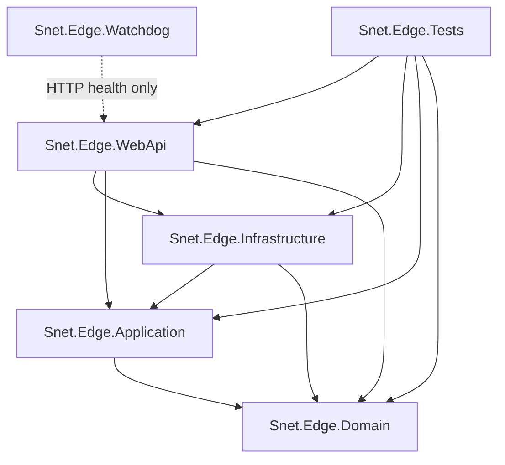

设计含义：

- Domain 不知道 HSL、MQTTnet、SQLite、ASP.NET Core。
- Application 通过接口定义能力，不创建具体 PLC 或数据库对象。
- Infrastructure 实现 Application 接口并依赖第三方库。
- WebApi 是应用组合根，负责装配和暴露边界。
- Watchdog 不引用主程序内部服务，只观察 HTTP Health。

## 5. Domain 职责

`Snet.Edge.Domain` 当前主要集中在 `Models.cs`。

### 5.1 配置模型

- `MqttGroup`
- `DeviceDefinition`
- `TagDefinition`
- `MqttOptions`
- `MqttTemplate`
- `MqttCustomField`
- `GatewaySnapshot`
- `NetworkBindingConfiguration`

### 5.2 运行模型

- `TagSample`
- `DeviceRuntimeStatus`
- `DeviceHealthStatus`
- `ResourceSnapshot`
- `MqttRuntimeStatus`
- `MqttOutboxStatistics`
- `MqttDeadLetter`

### 5.3 MQTT 统一模型

- `DeviceData`
- `TagData`
- `MqttPublishRequest`
- `MqttPayloadContext`
- `MqttBuildResult`

### 5.4 领域规则

- `TelemetryKey.Create`：普通点生成 `DeviceId:TagName`，以 `#` 开头的系统点保持原名。
- `DeviceErrorCodes.Normal`：设备通信正常固定为 `0`。
- `DeviceErrorCodes.DefaultTagPrefix`：默认 `#DEVICE_ERROR`。
- `GroupScheduleLimits`：扫描与上传周期的允许范围。

Domain 模型不执行 IO，也不管理线程。

## 6. Application 职责

Application 的核心是端口与纯校验逻辑。

### 6.1 配置端口

- `IGatewayConfigurationStore`
- `IMqttConfigurationPublisher`
- `IGatewayConfigurationValidator`
- `IPointTableImportService`
- `IDeviceTagFileService`

### 6.2 PLC 端口

- `IDeviceDriver`
- `IDeviceDriverFactory`
- `ITagReadPlanCompiler`

### 6.3 运行时端口

- `ITelemetryBuffer`
- `IRuntimeTagSampleStore`
- `IRuntimeStatusStore`
- `IDeviceStatusEventSource`
- `IAcquisitionControl`
- `IResourceGuard`

### 6.4 MQTT 端口

- `IMqttMessagePublisher`
- `IMqttPayloadBuilder`
- `ITopicBuilder`
- `ITemplateResolver`
- `IMqttTemplateManager`
- `IMqttOutboxMonitor`
- `IMqttOutboxConfigurationSynchronizer`
- `IMqttRuntimeStateStore`

### 6.5 设备健康端口

- `IDeviceHealthStateStore`
- `IDeviceErrorManager`
- `ISystemTagBuilder`

### 6.6 网络端口

- `INetworkInventoryService`
- `INetworkConfigurationService`
- `INetworkDiagnosticsService`

### 6.7 纯规则服务

- `GatewayConfigurationValidator`
- `DeviceProtocolValidator`
- `TagProtocolValidator`
- `ProtocolDescriptors`
- `ProtocolPointAddressCatalog`

## 7. Infrastructure 模块职责

Infrastructure 是当前最大的项目，模块按文件和命名空间组织，没有拆成独立程序集。

| 模块 | 主要类 | 职责 |
|---|---|---|
| 配置 | `SqliteGatewayConfigurationStore` | 草稿、活动版本、历史版本和事务 |
| PLC 驱动 | `HslDeviceDriverFactory`、`HslDeviceDriver`、`OpcUaDeviceDriver` | 连接、读取、断开、协议适配 |
| 采集 | `AcquisitionWorker` | 每设备循环、状态机、退避和 TagSample 生产 |
| 遥测 | `TelemetryBuffer` | 有界 Channel、最新值和变化集 |
| 聚合 | `TelemetryAggregationWorker` | 按设备和分组周期生成 MQTT 请求 |
| 健康 | `DeviceHealthMonitor` | 设备状态变化、系统错误 Tag 和即时入队 |
| MQTT 构建 | `MqttPayloadBuilder`、`MqttTopicBuilder` | Payload 与 Topic 生成 |
| MQTT 模板 | `MqttTemplateManager` | SQLite 模板、内存缓存、默认模板 |
| MQTT 队列 | `MqttOutbox` | 持久化待发送消息和死信 |
| MQTT 发送 | `MqttStoreForwardWorker` | 连接、重连、发送、补发和状态更新 |
| 网络 | `SystemNetworkInventoryService` | 只读操作系统网卡库存 |
| 网络绑定 | `SqliteNetworkConfigurationService` | 三用途网卡绑定与解析 |
| 网络诊断 | `NetworkDiagnosticsService` | Ping、TCP、MQTT、PLC 测试 |
| 审计 | `AuditLogStore` | 有界队列和 SQLite 批量写入 |
| 资源保护 | `ResourceMonitorWorker`、`ResourceGuard` | CPU、内存、磁盘和保护级别 |
| 初始化 | `InfrastructureInitializer` | 初始化数据库、模板、用户、网络等 |

## 8. WebApi 职责

WebApi 包含：

- `Program.cs`：组合根与中间件顺序。
- `ApiEndpoints.cs`：配置、PLC、MQTT、网络和采集端点。
- `AuthenticationEndpoints.cs`：登录、会话、改密和退出。
- `MonitoringEndpoints.cs`：健康与指标。
- `StatusHub.cs`：SignalR 状态与点位推送。
- `WebNetworkBindingMiddleware`：Web 管理网卡绑定检查。
- `AntiforgeryProtectionMiddleware`：非只读请求 CSRF。
- `AuditMiddleware`：写请求审计。
- `wwwroot`：Vue/Element Plus 静态控制台。

WebApi 不拥有采集线程，也不直接创建 PLC 会话。

## 9. 组合根与 DI

`Program.cs` 完成通用 Web 注册，再调用 `AddEdgeInfrastructure`。

### 9.1 Web 层注册

- Cookie Authentication
- Admin Authorization Policy
- Antiforgery
- JSON Enum Converter
- Swagger
- SignalR
- Response Compression
- `StatusBroadcastWorker`

### 9.2 Infrastructure 单例

当前关键服务几乎均为 Singleton，因为它们持有进程级缓存、Channel、SQLite 路径或运行状态：

- `SqliteGatewayConfigurationStore`
- `SqliteNetworkConfigurationService`
- `MqttTemplateManager`
- `MqttOutbox`
- `MqttRuntimeStateStore`
- `TelemetryBuffer`
- `RuntimeStatusStore`
- `DeviceHealthStateStore`
- `GatewayMetrics`
- `AcquisitionControl`
- `ResourceGuard`
- `AuditLogStore`

### 9.3 接口到实现

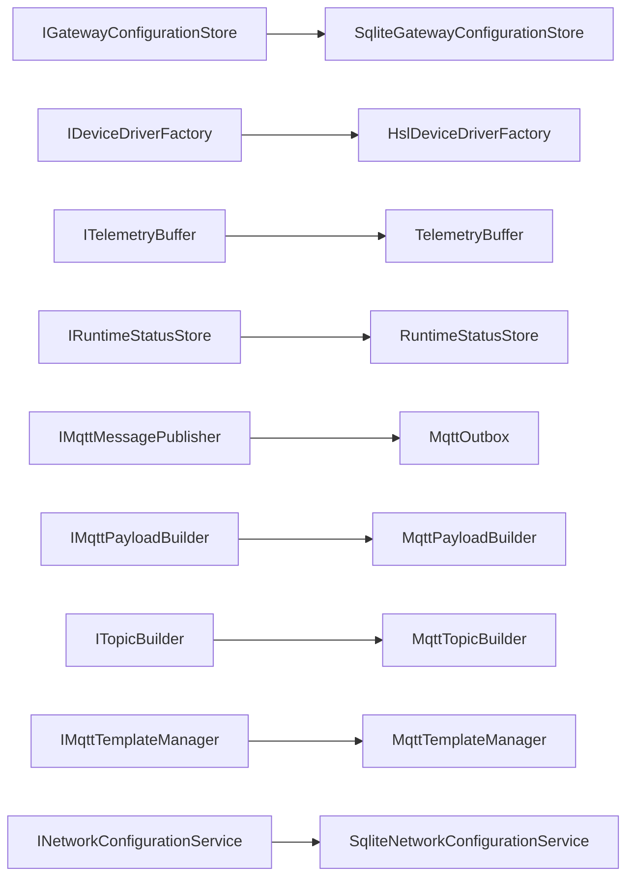

### 9.4 HostedService 注册顺序

`AddEdgeInfrastructure` 当前按以下顺序注册：

1. `InfrastructureInitializer`
2. `ResourceMonitorWorker`
3. `AuditLogStore`
4. `AcquisitionWorker`
5. `TelemetryAggregationWorker`
6. `DeviceHealthMonitor`
7. `MqttStoreForwardWorker`

WebApi 随后注册：

8. `StatusBroadcastWorker`

注册顺序不应被当作跨服务业务同步机制；初始化依赖通过 `IInitializationState` 显式表达。

## 10. 启动流程

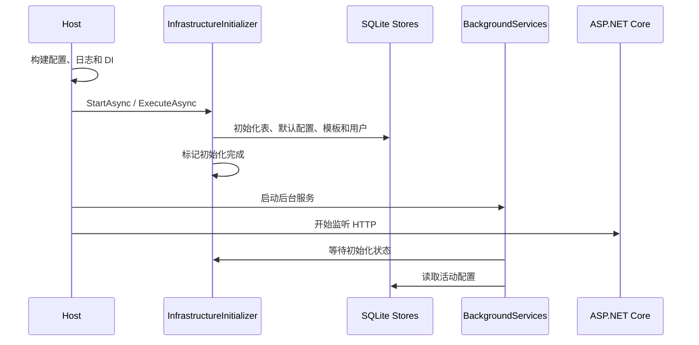

初始化失败应阻止系统被视为 Ready；后台服务不应绕过初始化状态读取未准备好的数据库。

## 11. 配置数据所有权

`GatewaySnapshot` 是运行配置快照，包含：

- Groups
- Devices
- Tags
- Mqtt

配置存储维护两种语义：

- Draft：Web 编辑与导入目标。
- Active：采集、聚合、设备健康和 MQTT 运行目标。

### 11.1 草稿流程


### 11.2 原子发布

`SqliteGatewayConfigurationStore` 使用 SQLite 事务写入状态和版本记录。运行服务通过活动快照观察新配置，不读取页面内存。

### 11.3 回滚

回滚读取历史快照并创建新的活动版本。历史版本本身保持可追踪，避免静默覆盖。

## 12. 设备生命周期

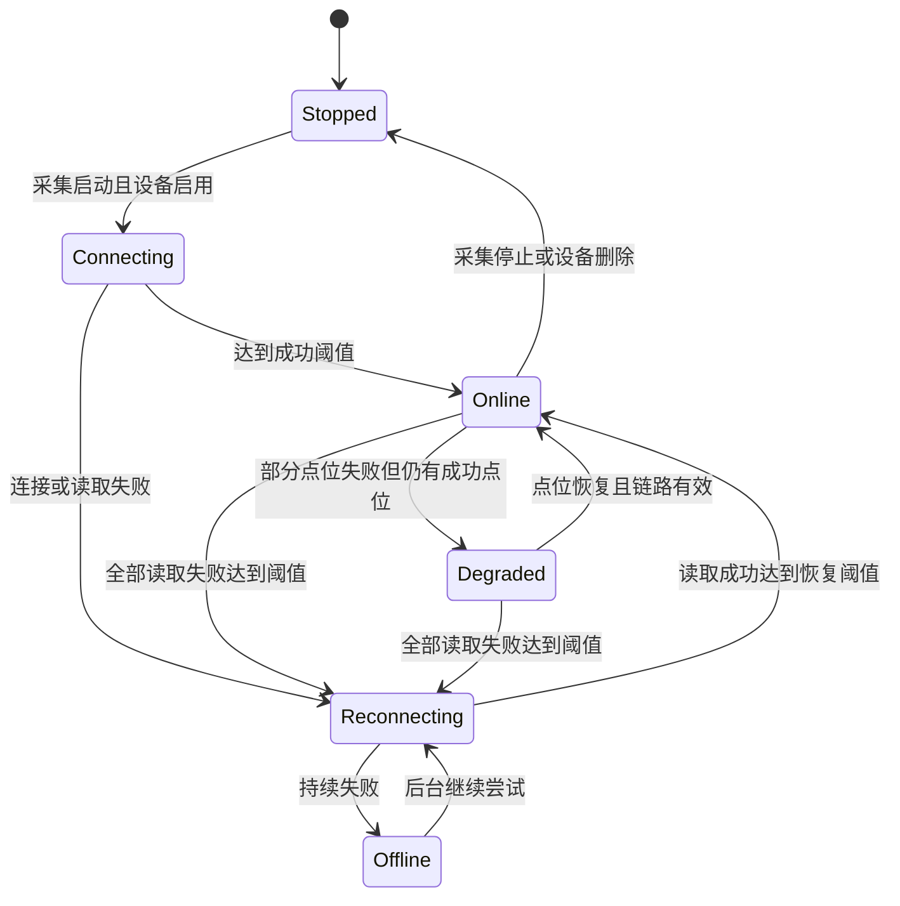

关键规则：

- 每个启用设备拥有一个长期异步循环。
- 单点配置错误不会必然重建设备连接。
- 只要存在有效点位读取，设备通信错误 Tag 保持正常值。
- 部分点位失败可显示 `Degraded`，失败点由自身 `Quality` 表达。
- 全部点位持续失败、超时或连接断开才进入设备级通信失败。
- 默认连续 3 次失败确认故障，连续 2 次成功确认恢复。
- 重连退避只有在实际读取成功后重置。

## 13. PLC 采集线程模型

`AcquisitionWorker` 是一个 BackgroundService，但内部管理多个设备任务。

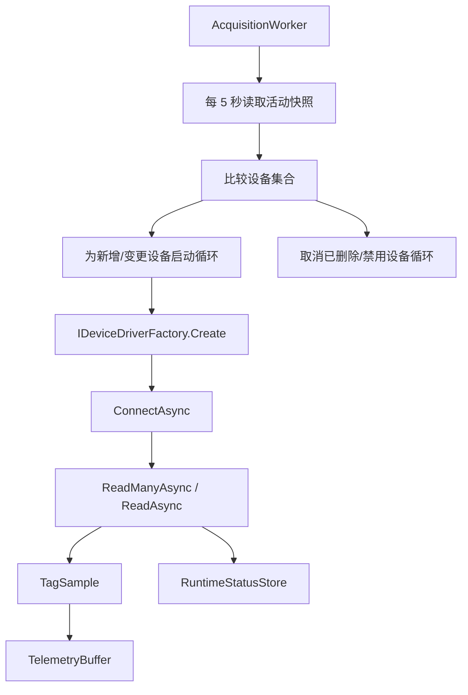

当前没有全局采集 `SemaphoreSlim` 并发上限。容量由设备数量、扫描周期、每设备点数、协议批量能力和网络超时共同决定。

## 14. 读取计划

`TagReadPlanCompiler` 决定批次：

- Siemens S7、Omron CIP、Allen-Bradley、Beckhoff 可使用原生多地址读取。
- 其他协议安全回退为单点读取。
- Bool 点位单独读取。
- 批次受点数和估算字节数限制。

驱动实例内的读取门控用于串行化同一 PLC 会话，避免并发请求破坏协议状态。

## 15. Telemetry 数据流

`TelemetryBuffer` 同时维护三种状态：

1. 100000 容量的有界 `Channel<TagSample>`。
2. `_latest`：每 Tag 最新样本。
3. `_pending`：等待 SignalR 推送的变化样本。

Channel 为：

- `FullMode = Wait`
- `SingleReader = true`
- `SingleWriter = false`
- `AllowSynchronousContinuations = false`

含义：采集在极端积压时产生背压，不静默丢弃业务遥测。

## 16. MQTT 聚合流程

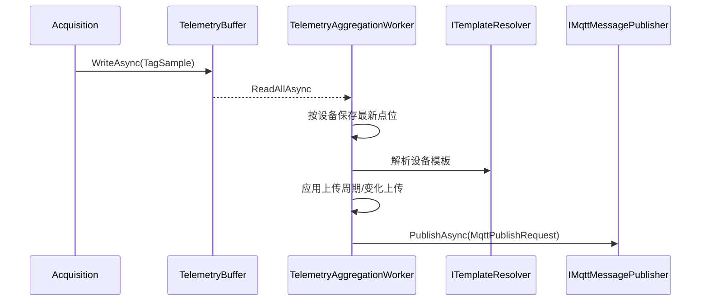

当前报文发送单位是设备级：一个 `MqttPublishRequest` 包含一个 `DeviceData`。同一分组共享 Topic 模板，但当前源码没有把多个设备合并为一个 MQTT Payload。

## 17. DeviceData 转换

聚合层将协议无关的采集结果转为：

```text
DeviceData
  DeviceId
  DeviceName
  DeviceIp
  Protocol
  Timestamp
  Tags[]
```

普通 `TagData.TagName` 在构建 Payload 时通过 `TelemetryKey.Create` 形成完整 Tag。驱动只返回原始或转换值，不知道 MQTT JSON 结构。

## 18. 设备健康流程

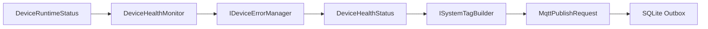

`DeviceHealthMonitor` 每 2 秒同步活动配置和运行状态，同时消费状态变化事件。

系统 Tag：

- 名称：`{DeviceErrorTagPrefix}_{DeviceId}`
- 正常：`value = 0`
- 通信失败：`value = MqttTemplate.CommunicationFailureCode`
- Quality：表达系统状态 Tag 本身是否有效，不承担设备错误码语义。

状态未变化时不高频重复入队。

## 19. MQTT Payload 生命周期

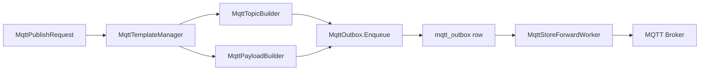

重要不变量：

- Payload 在入队前生成。
- Outbox 保存最终 Topic 和最终 Payload。
- 后续修改模板不会改变已入队消息。
- 生成失败由调用方隔离，不能停止 PLC 采集循环。

## 20. MQTT 客户端生命周期

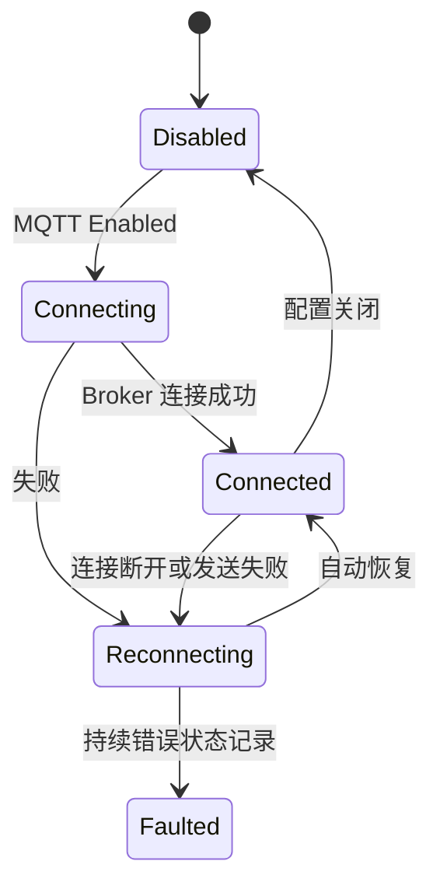

`MqttRuntimeStateStore` 保存当前状态，并通过容量 1、`DropOldest` 的配置变更 Channel 唤醒发送服务。

## 21. Store and Forward

### 21.1 入队

`MqttOutbox` 是 `IMqttMessagePublisher` 的实现。业务层调用 `PublishAsync` 时写 SQLite，不直接等待 Broker 网络发送。

### 21.2 发送

`MqttStoreForwardWorker` 从 Outbox 取待发送行，通过 MQTTnet 发送。

### 21.3 失败

- 增加尝试次数。
- 保存错误和下次尝试时间。
- 超过 `MaxPublishAttempts` 后进入 `mqtt_dead_letter`。

### 21.4 恢复

- Broker 恢复后继续读取 Outbox。
- `ReplayMaxMessagesPerSecond` 限制补发速度。
- 避免网络恢复瞬间压垮 Broker 或边缘 CPU。

### 21.5 容量

- `OutboxMaxMessages` 默认 500000。
- 入队前检查资源保护。
- 当前实现入队会执行数量检查，容量规划应计入 SQLite 查询成本。

## 22. 配置热更新

热更新不是所有对象原地修改，而是服务周期性或事件驱动地重新读取配置：

- `AcquisitionWorker` 周期读取活动快照并增删设备循环。
- `TelemetryAggregationWorker` 周期读取活动快照和模板绑定。
- `DeviceHealthMonitor` 周期读取活动设备与模板。
- `MqttStoreForwardWorker` 观察 MQTT 配置 revision/channel。
- `MqttTemplateManager` 更新 SQLite 后同步内存字典。
- 网络绑定保存后更新内存状态和用途 revision。

新增热更新功能时必须定义：配置所有者、可见性时机、旧资源释放和失败回退。

## 23. 当前事件总线设计

源码没有通用 `IEventBus`、MediatR、Kafka、RabbitMQ 或 Redis Pub/Sub。

当前事件传播使用：

- `Channel<TagSample>`：采集到聚合。
- `Channel<DeviceRuntimeStatus>`：设备状态变化。
- `Channel<bool>`：MQTT 配置变更通知。
- `Channel<AuditEvent>`：HTTP 审计异步写入。
- SignalR：服务端到 Web 客户端。
- `ConcurrentDictionary` 快照：最新值和状态查询。

因此文档中的“事件总线”应理解为进程内发布订阅通道，而不是已实现的统一总线框架。

## 24. Runtime Status Channel

容量与策略：

- 容量 10000。
- `FullMode = DropOldest`。
- 单读、多写。
- 只有状态、故障类型或错误文本变化时写入。

它传递的是可重建状态变化，最新完整状态仍保存在 `_statuses`，所以允许丢弃最旧事件而不丢失最终真相。

## 25. Audit Channel

容量与策略：

- 容量 10000。
- Channel 配置为 Wait。
- 请求中间件使用非阻塞尝试写入。
- 后台最多批量写入 100 条。

审计队列压力不应阻塞所有 HTTP 请求；但队列满时可能无法记录新的审计事件，应通过指标和日志观察。

## 26. SignalR 流程

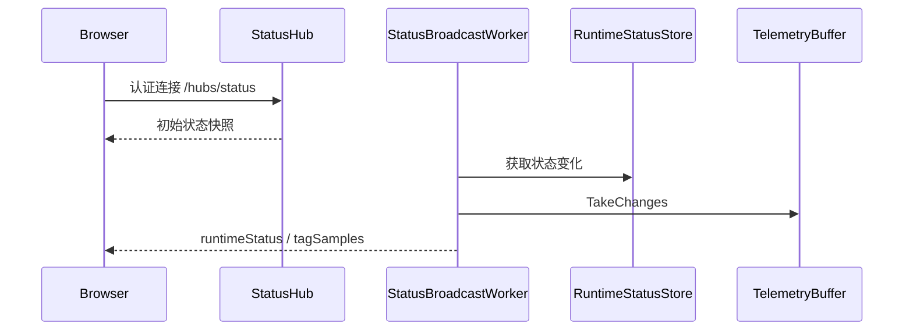

Web 前端的 SignalR 是展示通道，不参与采集控制闭环。断开不会停止 PLC 采集或 MQTT 上传。

## 27. Web API 调用流程

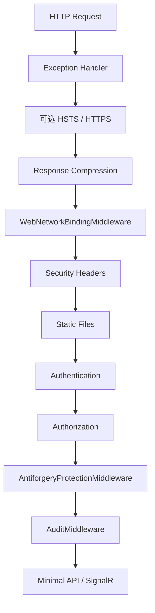

具体路径、DTO 与状态码见 [WebAPI.md](WebAPI.md)。

## 28. 网络用途绑定

网络模块只读取操作系统网卡：

- 名称
- 描述
- IPv4
- 掩码
- 网关
- DNS
- MAC
- 在线状态
- DHCP 状态

持久化的只是三个用途的网卡 ID：

- PLC Acquisition
- MQTT Upload
- Web Management

`Auto` 表示交给操作系统路由。只有一个可绑定网卡时，三个用途有效解析到该网卡。源码不调用 `netsh`，不写系统 IP。

## 29. SQLite 数据所有权

当前主要表：

- `gateway_state`
- `gateway_revision`
- `gateway_revision_deletion`
- `mqtt_template`
- `mqtt_outbox`
- `mqtt_dead_letter`
- `mqtt_sequence`
- `network_configuration`
- `gateway_user`
- `audit_log`

表结构、列和初始化 SQL 见 [Configuration.md](Configuration.md)。

## 30. SQLite 并发策略

- 连接字符串启用 `Cache=Shared` 与连接池。
- 配置库设置 `journal_mode=WAL`。
- 配置库设置 `synchronous=NORMAL`。
- 多步配置更新使用显式事务。
- 不在 Domain 或 Web 页面中直接执行 SQL。

新增表时应通过 Infrastructure 服务封装，并记录数据生命周期、索引和清理策略。

## 31. 资源保护

`ResourceMonitorWorker` 每 2 秒采样：

- CPU 百分比
- Working Set
- Managed Heap
- 数据盘使用率与剩余空间
- 线程数量

保护级别：

- Normal
- Warning
- Restricted
- Critical

Critical 时：

- `AllowAcquisition = false`
- `AllowPersistentEnqueue = false`

资源保护是防止磁盘满、内存持续增长导致整个网关失控的最后保护，不代替容量设计。

## 32. 日志与 Trace

`Program.cs` 配置 Serilog：

- 从 LogContext 丰富字段。
- 固定 `Application = EdgeNexus.Gateway`。
- 异步 Console Sink。
- 异步 JSON File Sink。
- 按日滚动。
- 保留 30 个文件。

HTTP 审计另存 SQLite，包含 TraceId、方法、路径、状态码、操作人、远端地址和耗时。

## 33. Watchdog 边界

Watchdog：

- 独立进程。
- 通过命名 HttpClient `gateway-health` 请求主网关健康端点。
- 连续失败达到阈值后执行配置好的可执行程序和参数。
- 有重启冷却和每小时次数限制。
- 不加载主网关数据库，不调用内部 DI 服务。

这种边界避免主进程内部死锁时自恢复逻辑也一起失效。

## 34. 优雅关闭

所有 BackgroundService 接收 Host 的 `stoppingToken`。

关闭要求：

- 设备循环收到取消并退出。
- PLC 驱动断开并 `DisposeAsync`。
- MQTT 客户端断开并释放。
- Channel 消费者停止等待。
- 预期取消不记录为 Host 故障。
- Windows Service、systemd 和 Docker 都预留停止窗口。

## 35. 异常隔离层次

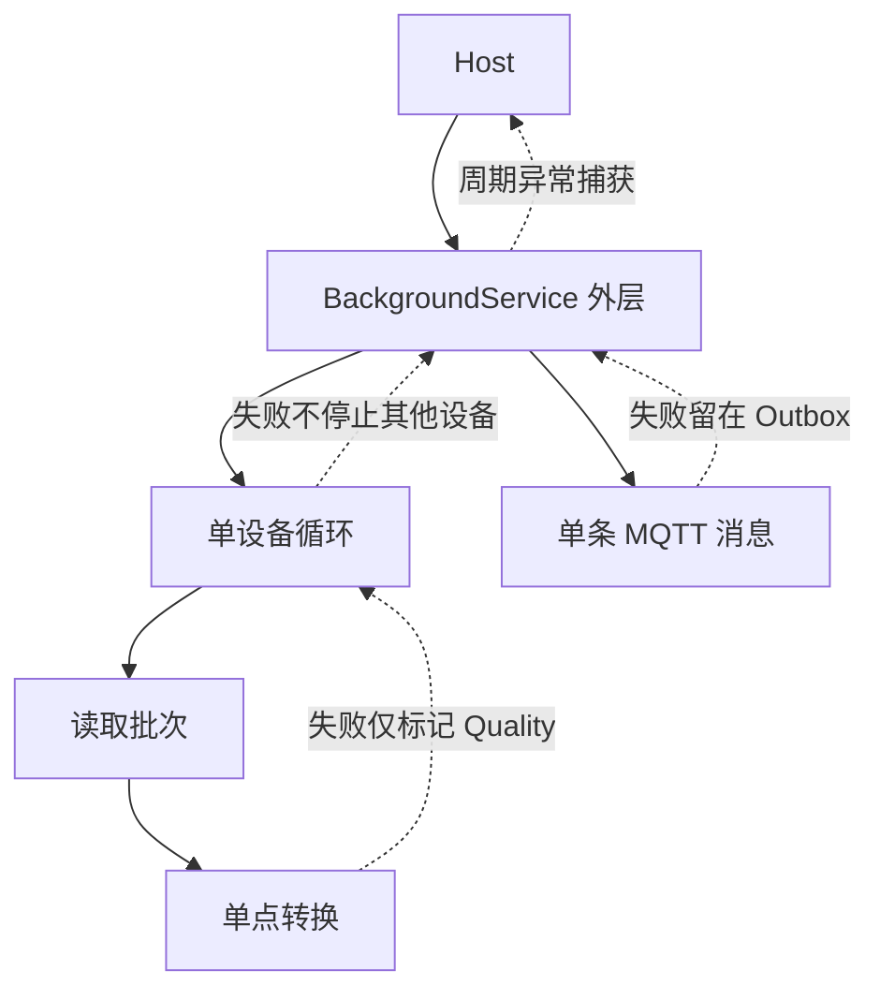

新增代码应把异常限制在最小可恢复单元。

## 36. 禁止跨层调用原则

### 36.1 禁止 UI 直接操作 PLC

错误：Vue 按钮直接持有驱动或 Socket。

正确：UI 调用诊断 API；API 调用 `INetworkDiagnosticsService`；服务通过工厂创建临时驱动。

### 36.2 禁止 API 直接写业务 SQL

错误：端点内拼接 `INSERT`。

正确：端点调用 Application 接口，由 Infrastructure 事务实现。

### 36.3 禁止 PLC 驱动生成 MQTT

错误：`ReadAsync` 返回 JSON 或 Topic。

正确：驱动返回值，聚合层生成 `DeviceData`，Builder 构造报文。

### 36.4 禁止运行时读取草稿

错误：设备循环响应每次 Web 表单输入。

正确：校验和发布后，运行服务观察活动快照。

### 36.5 禁止外部协议类型泄漏到 Domain

错误：Domain record 暴露 HSL `OperateResult` 或 MQTTnet message 类型。

正确：Infrastructure 转换为 Domain record。

## 37. 新功能安全落点

判断新功能放在哪一层：

| 问题 | 推荐位置 |
|---|---|
| 新领域字段或状态 | Domain |
| 新接口或纯校验 | Application |
| 新 PLC、数据库、网络、MQTT 实现 | Infrastructure |
| 新 HTTP 或页面 | WebApi |
| 独立外部观察进程 | Watchdog 或新 Host |

## 38. 新增配置的完整路径

新增配置字段时至少检查：

1. Domain record。
2. 默认值。
3. Web DTO 或绑定。
4. 验证器。
5. SQLite JSON 或列持久化。
6. 草稿导入导出。
7. 发布与回滚。
8. 活动运行服务读取。
9. Web 表单。
10. Configuration 文档。
11. API 文档。
12. 测试。

## 39. 新增 BackgroundService 的完整路径

1. 定义单一职责。
2. 明确输入和输出。
3. 明确队列容量与满载策略。
4. 明确取消语义。
5. 明确异常隔离边界。
6. 明确初始化依赖。
7. 明确停止顺序。
8. 注册到 DI。
9. 增加指标或日志。
10. 更新 Runtime、Performance 和本文。

## 40. AI Agent 工作规则

AI Agent 修改项目前应：

1. 从 [INDEX.md](INDEX.md) 选择阅读路径。
2. 搜索真实类和接口，不依据类名猜实现。
3. 检查 `ServiceCollectionExtensions` 的注册生命周期。
4. 检查活动配置和草稿边界。
5. 检查 Channel 容量与消费者。
6. 检查同一对象是否同时实现多个接口。
7. 检查数据库表和事务。
8. 检查取消、超时和资源释放。
9. 更新对应文档。
10. 运行最接近测试与完整 Release 测试。

## 41. 当前未实现边界

源码当前未发现：

- 运行时 DLL 插件加载。
- `AssemblyLoadContext` 插件隔离。
- 通用 `IPlugin` 或插件 Manifest。
- MediatR。
- 外部事件总线。
- PLC 写入公共接口。
- 多 MQTT Broker。
- 多设备合并为一个 MQTT Payload。
- 历史时序数据库。
- 细粒度多角色 RBAC。
- Polly 策略实际装配与执行。

`Polly.Core` 已列为包依赖，但不能据此声称自动重试使用 Polly；当前重连与退避主要由项目自身逻辑实现。

## 42. 架构变更检查表

- [ ] 依赖方向没有反转。
- [ ] Domain 未引入 IO 框架类型。
- [ ] Web 未直接控制 PLC 或数据库。
- [ ] PLC 未生成 MQTT 报文。
- [ ] 运行时只读取活动配置。
- [ ] 队列有界且满载策略明确。
- [ ] 单设备异常不影响其他设备。
- [ ] 取消和释放路径完整。
- [ ] 数据库多步写入使用事务。
- [ ] 新 public 类型已进入 Public API 文档。
- [ ] 新端点已进入 Web API 文档。
- [ ] 新配置已进入 Configuration 文档。
- [ ] 新流程已进入 Runtime 文档。
- [ ] 新能力已进入 README 和 Changelog。

## 43. 维护入口

- 文档中心：[INDEX.md](INDEX.md)
- 快速上手：[Getting-Started.md](Getting-Started.md)
- 扩展协议：[Plugin-Development.md](Plugin-Development.md)
- 性能评估：[Performance.md](Performance.md)
- 部署运维：[Deployment.md](Deployment.md)
- 常见问题：[FAQ.md](FAQ.md)
- 候选规划：[Roadmap.md](Roadmap.md)
- 贡献规则：[../CONTRIBUTING.md](../CONTRIBUTING.md)
- 安全规则：[../SECURITY.md](../SECURITY.md)
