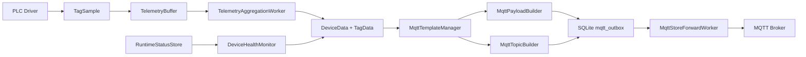
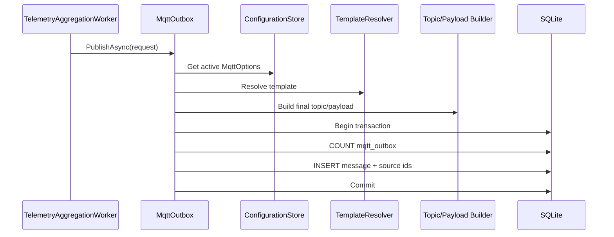

# EdgeNexus MQTT 模块

## 1. 范围

本文依据 `Gateway.Mqtt`、`MqttStoreForward.cs`、`TelemetryAggregationWorker` 和 `DeviceHealthMonitor` 生成。

API 参见 [WebAPI.md](WebAPI.md)。

配置项参见 [Configuration.md](Configuration.md)。

## 2. MQTT 数据链路



## 3. 统一模型

`DeviceData` 包含 DeviceId、DeviceName、DeviceIp、Protocol、Timestamp、Tags。

`TagData` 包含 TagName、Value、Quality。

普通完整 Tag 由 `TelemetryKey.Create` 生成。

普通格式是 `{deviceId}:{tagName}`。

以 `#` 开头的系统 Tag 不追加设备前缀。

## 4. 设备 MQTT ID

来源是 `DeviceDefinition.MqttDeviceId`。

空值回退设备名称。

参与 Topic 变量 `${deviceId}`。

参与普通点位完整 Tag。

参与设备状态 Tag。

参与系统字段 `deviceId`。

参与自定义字段变量。

## 5. 设备级模板绑定

来源是 `DeviceDefinition.MqttTemplateId`。

聚合和健康消息均传递该 ID。

模板存在且 Enabled 时使用选中模板。

选中模板不存在或禁用时回退内置默认模板。

默认模板不可删除。

被草稿设备引用的模板不可通过 API 删除。

## 6. 模板存储

管理器：`MqttTemplateManager`。

数据库表：`mqtt_template`。

内存缓存：`ConcurrentDictionary<Guid,MqttTemplate>`。

写锁：`SemaphoreSlim(1,1)`。

Upsert 成功后立即更新内存缓存。

运行时无需重启即可读取新模板。

## 7. 默认模板

固定 ID：`6f5c31ec-8a04-4d8a-b7b3-58b21d890001`。

名称：`EdgeNexus默认模板`。

PayloadStyle：Advantech。

IncludeDeviceId：false。

IncludeTimestamp：true。

IncludeTag：true。

IncludeValue：true。

IncludeQuality：true。

状态 Tag 前缀：`#DEVICE_ERROR`。

通信失败码：1001。

## 8. 系统字段

模板支持：

- deviceId。
- deviceName。
- deviceIp。
- protocol。
- gatewayId。
- gatewayVersion。
- timestamp/ts。
- unixTime。
- tag。
- value。
- quality。

数据数组固定字段名为 `d`。

## 9. Payload 风格

Standard 风格在 `d` 前写 timestamp。

Advantech 风格在 `d` 后写 `ts`。

Advantech 时间格式为 `yyyy-MM-dd'T'HH:mm:ss+0800` 形式。

Value 保留运行时类型。

Value 为 null 时写 JSON null。

Quality 输出枚举整数。

## 10. 自定义字段

最多64项。

字段名最大64字符。

字段值最大1024字符。

字段名必须以字母或下划线开头。

字段名后续只允许字母、数字、下划线。

不能与系统保留字段冲突。

不能重复。

自定义字段值最终写为 JSON string。

点位变量选取第一个非系统 Tag。

## 11. 变量解析

支持：

- `${deviceId}`。
- `${deviceName}`。
- `${deviceIp}`。
- `${protocol}`。
- `${gatewayId}`。
- `${gatewayVersion}`。
- `${groupName}`。
- `${line}`。
- `${timestamp}`。
- `${unixTime}`。
- `${tag}`。
- `${tagName}`。
- `${value}`。
- `${quality}`。

line 为空时回退 groupName。

timestamp 使用 ISO 8601 `O` 格式。

## 12. Topic 模板

Topic 配置在 `MqttGroup.Topic`。

允许变量只有 deviceId、deviceName、gatewayId、line。

禁止 `+`。

禁止 `#`。

禁止空字符。

变量缺少右花括号时拒绝。

未支持变量拒绝。

解析后仍有 `${` 时拒绝。

UTF-8 长度不得超过65535字节。

## 13. 设备状态 Tag

构建器：`SystemTagBuilder`。

格式：`{trimmedPrefix}_{trimmedDeviceId}`。

前缀尾部下划线会被去掉。

设备正常 value=0。

设备通信异常 value=模板 CommunicationFailureCode。

失败码不能为0。

失败码可以为正数或负数。

状态 Tag quality 固定为 Good/0。

状态 Tag 与普通点位位于同一个 `d` 数组。

## 14. 设备健康判定

Online -> 错误码0。

Degraded 且 LastSuccessAt 不为空 -> 错误码0。

其他状态 -> 模板通信失败码。

因此单个点位失败但仍有成功点位不会把设备错误 Tag 设为非0。

点位错误由点位自身 quality 表达。

## 15. 状态消息触发

首次初始化会生成状态。

设备错误码变化会生成状态消息。

设备外部 ID 变化会生成状态消息。

设备名称变化会生成状态消息。

模板前缀/失败码/更新时间变化会生成状态消息。

分组、点位集合、MQTT启用状态变化会改变指纹。

无状态变化且无上下文变化时不重复发送。

## 16. 周期数据消息

按分组上传周期评估。

每台设备生成一条 `MqttPublishRequest`。

同一分组内多个设备不会合并到一个 Payload。

同一设备在一个周期内包含该设备符合条件的多个点位。

设备状态 Tag 插入 Tags 的第一个位置。

## 17. Payload 构建隔离

聚合 Worker 按设备 try/catch。

模板解析失败只记录该设备错误。

Topic 构建失败只记录该设备错误。

Payload 构建失败只记录该设备错误。

Outbox 写入失败只记录该设备错误。

异常不会退出 PLC 采集 Worker。

## 18. Outbox 入队

`MqttOutbox.PublishAsync` 先读取生效 MQTT 配置。

MQTT 未启用时直接返回。

入队前生成最终 Topic。

入队前生成最终 Payload。

因此后续模板修改不会改变已排队报文。

入队使用 SQLite 事务。

每条记录保存 QoS 和 Retain。

每条记录保存来源设备 ID。

每条记录保存来源点位 ID 数组。

## 19. Outbox 容量

配置项为 OutboxMaxMessages。

运行时最小按1000处理。

入队前执行 COUNT。

达到上限抛 IOException。

ResourceGuard 为 Critical 时拒绝入队。

## 20. 失效消息清理

配置发布和回滚后调用 `PruneStaleAsync`。

删除设备会使相关消息失效。

禁用设备会使相关消息失效。

删除/禁用分组会使相关消息失效。

来源点位全部仍启用时消息有效。

状态消息 SourceTagIds 为空时，只检查设备和分组。

删除点位后包含该点位的旧消息会被清理。

## 21. Store and Forward

配置项：`StoreAndForwardEnabled`。

关闭时 Worker 清空已有待发送 Outbox。

关闭期间发送失败的消息被删除。

开启期间发送失败的消息增加 attempts。

超过 MaxPublishAttempts 进入死信。

## 21A. MQTT 下行反写与上行回执（V1.2）

- 开启开关：`MqttOptions.WriteBackEnabled`（默认 `true`）。
- 下行命令订阅模板：`MqttOptions.WriteCommandTopicTemplate`（默认 `edge/${gatewayId}/cmd/${deviceId}/write`，连接 Broker 后自动将动态段转为 `+` 订阅并启用 `NoLocal`）。
- 上行回执发布模板：`MqttOptions.WriteAckTopicTemplate`（默认 `edge/${gatewayId}/ack/${deviceId}/write`）。
- 安全防回环：严格忽略 `Retain=true` 的保留消息；配置校验禁止反写命令 Topic 与采集上报 Topic 或回执 Topic 相同。
- 处理服务：`IDeviceWriteService`（含点位 `Writable` 校验、`MinWriteValue`/`MaxWriteValue` 量程校验、`WriteCommandDefaultTtlMs` 过期拦截、`CommandId` 幂等去重、单设备每秒限流、逆向换算与写后回读校验）。

## 22. 死信

表：`mqtt_dead_letter`。

保存 original_id、topic、payload、attempts、error、failed_at_utc。

错误文本最大保留2000字符。

进入死信与删除 Outbox 在同一事务。

API 可查询最近死信。

当前源码没有死信重放 API。

## 23. MQTT 连接

客户端由 `MqttClientFactory` 创建。

ClientId 来自 MqttOptions。

Broker 来自 Host/Port。

KeepAlive 固定20秒。

CleanSession=false。

用户名非空时配置凭据。

UseTls=true 时启用 TLS。

指定 MQTT 网卡时设置 LocalEndpoint。

## 24. Last Will

Topic 来自 LastWillTopic。

Payload 来自 LastWillPayload。

QoS 固定 AtLeastOnce。

Retain 固定 true。

网络诊断连接不携带 Last Will。

## 25. 连接状态

状态枚举：Disabled、Connecting、Connected、Reconnecting、Faulted。

状态存储：`MqttRuntimeStateStore`。

记录 Host、Port、ChangedAt、LastAttemptAt、ConnectedAt、NextRetryAt、LastError。

相同状态信息保持原 ChangedAt。

## 26. 热更新

MQTT 配置应用 API 更新 active/draft 和 revision。

随后调用 `NotifyConfigurationChanged`。

Worker 比较 `ConfigurationRevision`。

连接中配置变化时主动断开并重建。

MQTT 网卡 revision 变化时主动断开并重建。

模板热更新不需要重建 MQTT 网络连接。

## 27. 重连

初始等待1秒。

失败后指数翻倍。

最大60秒。

配置变化时恢复1秒。

连接成功时恢复1秒。

异常时尝试断开旧连接。

## 28. 回放限速

配置项：ReplayMaxMessagesPerSecond。

运行时限制1至10000。

每条成功发送后 Delay。

Delay 为1000/速率毫秒。

## 29. QoS 和 Retain

QoS 在入队时 clamp 0至2。

Retain 在入队时固化。

发送时从 Outbox 记录恢复。

## 30. 测试发送

预览可使用未保存 Template 对象。

测试发送只解析已保存 TemplateId。

测试发送要求生效配置 MQTT Enabled=true。

测试发送同样进入正式 Outbox。

返回 HTTP 202 和预览结果。

## 31. 默认报文示例

```json
{
  "d": [
    {
      "tag": "#DEVICE_ERROR_PLC001",
      "value": 0,
      "quality": 0
    },
    {
      "tag": "PLC001:Temperature",
      "value": 35.6,
      "quality": 0
    }
  ],
  "ts": "2026-07-29T02:53:08+0000"
}
```

## 32. 测试覆盖

- Standard Payload 字段和类型。
- Advantech 时间格式。
- 自定义字段变量。
- 状态 Tag 位于 d 数组。
- 正负通信失败码。
- Topic 变量和通配符拒绝。
- 模板 SQLite 持久化。
- 模板热更新。
- 设备级模板绑定。
- MQTT ID 影响 Topic 和 Tag。
- Outbox 持久化。
- 删除点位后清理旧消息。
- 死信迁移。
- 关闭断点续传时丢弃消息。

## 33. 当前未实现项

- 多 Broker 并发。
- 同分组多设备合并单条 Payload。
- 死信手工重放端点。
- Outbox 优先级。
- Payload 压缩。
- 用户手写任意 JSON 模板。
- MQTT 5 User Properties。
- Broker 集群故障转移列表。

## 34. `MqttPublishRequest` 字段流向

| 字段 | 生产者 | 消费者 |
|---|---|---|
| `GroupId` | Aggregation Worker | Outbox 源配置校验 |
| `GroupName` | `MqttGroup.Name` | Payload Context 变量 |
| `Line` | `MqttGroup.Line` | Topic/Payload 变量 |
| `TopicTemplate` | `MqttGroup.Topic` | Topic Builder |
| `TemplateId` | `DeviceDefinition.MqttTemplateId` | Template Resolver |
| `DeviceData` | Aggregation Worker | Payload/Topic Builder |
| `SourceDeviceId` | 设备内部 Guid | Outbox Prune |
| `SourceTagIds` | 当前业务点位 Guid 集合 | Outbox Prune |

## 35. `DeviceData` 字段来源

- `DeviceId`：`MqttDeviceId` 非空时使用它，否则使用设备名称。
- `DeviceName`：`DeviceDefinition.Name`。
- `DeviceIp`：`DeviceDefinition.Host`。
- `Protocol`：`DeviceDefinition.Protocol`。
- `Timestamp`：当前聚合批次时间。
- `Tags`：状态 Tag 加当前设备业务 Tags。

## 36. 状态 Tag 构建步骤

1. 解析设备绑定模板。
2. 读取模板 `DeviceErrorTagPrefix`。
3. Trim 前缀。
4. 移除尾部下划线。
5. 追加 `_`。
6. 追加设备外部 MQTT ID。
7. 将 errorCode 写入 value。
8. 将 quality 固定为 `DataQuality.Good`。
9. 将状态 Tag 插入 Tags 第一项。

状态 Tag 例：`#DEVICE_ERROR_PLC001`。

自定义前缀例：前缀 `#COMM` 生成 `#COMM_PLC001`。

## 37. 设备错误码解析表

| Runtime 状态 | LastSuccessAt | 错误 Tag value |
|---|---|---:|
| Online | 任意 | 0 |
| Degraded | 非空 | 0 |
| Degraded | 空 | 模板失败码 |
| Connecting | 任意 | 模板失败码 |
| Reconnecting | 任意 | 模板失败码 |
| Offline | 任意 | 模板失败码 |
| Stopped | 任意 | 模板失败码 |

当前产品模板只配置正常和通讯失败两种 value。

`DeviceFaultKind` 不映射为不同 MQTT value。

## 38. 点位 quality 到 JSON

`DataQuality` 是从 0 开始的 enum。

当前 JSON Builder 将枚举数值写入 quality。

| 枚举 | 数值 |
|---|---:|
| Good | 0 |
| Uncertain | 1 |
| Bad | 2 |
| Disconnected | 3 |
| Timeout | 4 |
| ConfigurationError | 5 |

设备错误 Tag 的 quality 固定为 0。

设备通讯失败通过 value 非零表达。

## 39. Standard Payload 字段顺序

Builder 按源码顺序评估以下顶层字段：

1. deviceId。
2. deviceName。
3. deviceIp。
4. protocol。
5. gatewayId。
6. gatewayVersion。
7. timestamp。
8. unixTime。
9. customFields。
10. d 数组。

字段只有在模板 Include 开关打开时写入。

## 40. Advantech Payload 字段顺序

1. 可选设备和网关系统字段。
2. 可选自定义字段。
3. `d` 数组。
4. 可选 `ts`。
5. 可选 `unixTime`。

默认模板只输出 `d` 和 `ts`。

## 41. `d` 数组项字段

- IncludeTag=true 时写 `tag`。
- IncludeValue=true 时写 `value`。
- IncludeQuality=true 时写 `quality`。
- Value 为 null 时写 JSON null。
- 数值保持 JSON 数值。
- bool 保持 JSON boolean。
- string 保持 JSON string。
- 未识别对象由 JSON Serializer 写入。

## 42. Topic 变量解析

| 变量 | 来源 |
|---|---|
| `${deviceId}` | DeviceData.DeviceId |
| `${deviceName}` | DeviceData.DeviceName |
| `${deviceIp}` | DeviceData.DeviceIp |
| `${protocol}` | Protocol.ToString() |
| `${gatewayId}` | MqttPayloadContext.GatewayId |
| `${gatewayVersion}` | MqttPayloadContext.GatewayVersion |
| `${groupName}` | MqttPayloadContext.GroupName |
| `${line}` | MqttPayloadContext.Line |
| `${timestamp}` | DeviceData.Timestamp |
| `${unixTime}` | Unix seconds |
| `${tag}` | 第一个非系统 Tag 完整名称 |
| `${value}` | 第一个非系统 Tag value |
| `${quality}` | 第一个非系统 Tag quality 数值 |

Topic 最终仍要通过 `MqttTopicTemplateValidator`。

包含 `+` 或 `#` 的发布 Topic 被拒绝。

## 43. 自定义字段解析

自定义字段固定写在 JSON 顶层。

每项包含：

- `Name`：JSON 属性名。
- `Value`：变量模板。

解析步骤：

1. 找到第一个不以 `#` 开头的 Tag。
2. 将设备和上下文变量替换。
3. 将首个业务 Tag 变量替换。
4. 以字符串写入 JSON。

例如 `factoryId=F001` 输出字符串 `F001`。

例如 `asset=${deviceId}` 输出设备外部 ID。

## 44. 模板解析回退

- TemplateId 为 null：返回默认模板。
- TemplateId 等于旧 Advantech ID：迁移到默认模板 ID。
- TemplateId 找不到：返回默认模板。
- TemplateId 对应模板禁用：返回默认模板。
- 默认模板在初始化时 Seed。
- 内存缓存按模板 ID 查询。
- GetAll 内置模板排在前面。

## 45. 模板 Upsert 约束

- 模板 Id 必须有效。
- 模板名称不能为空白。
- 名称在 SQLite 中 NOCASE 唯一。
- 设备状态模板必须通过 Validator。
- CreateTime 在新增时设置。
- UpdateTime 在每次保存时更新。
- 写入使用 SemaphoreSlim 串行化。
- 写成功后更新 ConcurrentDictionary。

## 46. Outbox 入队事务



## 47. Outbox 容量行为

- 配置值小于 1000 会被 API 拒绝。
- 入队时实际上限使用 `Math.Max(OutboxMaxMessages,1000)`。
- 每次入队事务内执行 COUNT。
- 达到上限时抛出 IOException。
- ResourceGuard 禁止持久化时也抛出 IOException。
- 聚合 Worker 捕获单设备发布异常。
- PLC 采集线程不直接执行该数据库写入。

## 48. Outbox 读取与发送

- Worker 每批最多读取 100 条。
- 按 `id` 升序读取。
- QoS 和 Retain 来自入队行。
- 发布使用 MQTTnet ApplicationMessage。
- 成功后按 ID 删除。
- 每条成功调用 Metrics.RecordMqttPublished。
- 失败调用 Metrics.RecordMqttPublishFailure。
- 失败触发连接恢复流程。

## 49. 死信迁移

失败次数小于 MaxPublishAttempts：

- 更新 attempts。
- 保留在 Outbox。

失败次数达到或超过上限：

- Begin transaction。
- 插入 `mqtt_dead_letter`。
- 保存 original_id、topic、payload、attempts、error、failed_at。
- 从 `mqtt_outbox` 删除。
- Commit。

错误文本在保存前限制长度。

## 50. 断点续传关闭行为

- Worker 监测 `StoreAndForwardEnabled` 变化。
- 从 true 切换为 false 时调用 `DiscardPendingAsync`。
- 丢弃待发送消息。
- 主动丢弃不会写入死信。
- MQTT 新业务入队仍由 Enabled 控制。
- 前端名称为“断点续传”。

## 51. 配置变更清理

发布和回滚后调用 `PruneStaleAsync`。

判断依据：

- SourceDeviceId 是否仍在快照中。
- SourceTagIds 是否仍属于该设备并启用。
- 消息中来源 ID 为空时按兼容逻辑保留。

删除操作按 500 个 ID 分块执行。

该逻辑解决删除点位后旧消息继续上传的问题。

## 52. MQTT Client Options

`NetworkDiagnosticsService.Build` 同时供诊断和 Worker 使用。

设置项包括：

- ClientId。
- TCP Server Host/Port。
- 可选本地 IPv4 绑定。
- 可选 Username/Password。
- 可选 TLS。
- 可选 Last Will。
- Will Topic。
- Will Payload。
- Will QoS。
- Will Retain。

## 53. MQTT 网络绑定

- 用途枚举：`NetworkUsage.MqttUpload`。
- 绑定服务解析本地 IPv4。
- Worker 记录已经应用的网络 revision。
- 网络 revision 改变时需要重建连接。
- 自动模式由操作系统可绑定网卡解析。
- 软件不修改网卡 IP。

## 54. MQTT 重连退避

- 初始延迟 1 秒。
- 连接或发送失败后进入 Reconnecting。
- 重连延迟逐步增加。
- 成功连接后恢复初始延迟。
- 配置变化可唤醒等待。
- CancellationToken 可终止等待。
- 最终状态写入 RuntimeStateStore。

## 55. 一设备一消息的源码事实

- `TelemetryAggregationWorker` 按 DeviceId 维护 bucket。
- 每个 bucket 构造一个 `DeviceData`。
- 每个 `MqttPublishRequest` 只有一个 DeviceData。
- Outbox 每次 PublishAsync 插入一行。
- 当前没有组级 `IReadOnlyList<DeviceData>` 模型。
- 当前没有多设备合并 Payload Builder。
- 相同组只共享 Topic 模板和调度参数。

## 56. MQTT 测试覆盖矩阵

| 能力 | 测试 |
|---|---|
| Standard 字段 | `StandardTemplateBuildsTypedDevicePayload` |
| Advantech 格式 | `AdvantechTemplateBuildsCompatibleTimestampAndDataArray` |
| 自定义字段 | `CustomFieldsResolveFixedDeviceAndFirstPlcTagVariables` |
| 状态 Tag | `DeviceStatusTagStaysInPayloadDataArray` |
| Topic 变量 | `TopicBuilderResolvesIndustrialVariablesAndRejectsWildcards` |
| 模板热更新 | `TemplateManagerPersistsChangesAndResolvesThemWithoutRestart` |
| 设备 MQTT ID | `DeviceSpecificTemplateAndMqttIdentityShapeFinalMessage` |
| 删除点清理 | `ConfigurationPruneRemovesQueuedPayloadContainingDeletedTag` |
| 死信 | `OutboxPersistsBuiltPayloadAndMovesPoisonMessageToDeadLetter` |
| 主动丢弃 | `DiscardOperationsRemoveMessagesWithoutCreatingDeadLetters` |
| 聚合状态首位 | `DeletedTagIsEvictedAndStatusTagRemainsFirst` |
| 自定义失败码 | `MissingHealthStateUsesConfiguredFailureCodeAndCustomPrefix` |

## 57. MQTT 公共接口对应

- `IMqttMessagePublisher` -> `MqttOutbox`。
- `IMqttPayloadBuilder` -> `MqttPayloadBuilder`。
- `ITopicBuilder` -> `MqttTopicBuilder`。
- `ITemplateResolver` -> `MqttTemplateManager`。
- `IMqttTemplateManager` -> `MqttTemplateManager`。
- `IMqttOutboxMonitor` -> `MqttOutbox`。
- `IMqttOutboxConfigurationSynchronizer` -> `MqttOutbox`。
- `IMqttRuntimeStateStore` -> `MqttRuntimeStateStore`。

## 58. MQTT 源码文件索引

- 领域模型：`Snet.Edge.Domain/Models.cs`。
- 应用接口：`Snet.Edge.Application/Abstractions.cs`。
- 模板校验：`MqttDeviceStatusTemplateValidator.cs`。
- Topic 校验：`MqttTopicTemplateValidator.cs`。
- Builder：`Gateway.Mqtt/MqttMessageBuilders.cs`。
- TemplateManager：`Gateway.Mqtt/MqttTemplateManager.cs`。
- Outbox/Worker：`MqttStoreForward.cs`。
- 聚合：`TelemetryAggregationWorker.cs`。
- 健康：`Gateway.DeviceHealth/DeviceHealthServices.cs`。
- Runtime State：`MqttRuntimeStateStore.cs`。

## 59. MQTT API 索引

- `PUT /api/v1/mqtt/config`：保存草稿。
- `POST /api/v1/mqtt/config/apply`：独立发布并通知 Worker。
- `GET /api/v1/mqtt/runtime`：连接状态。
- `GET /api/v1/mqtt/outbox/status`：队列统计。
- `GET /api/v1/mqtt/outbox/dead-letters`：死信查询。
- `GET /api/v1/mqtt/templates`：模板列表。
- `POST /api/v1/mqtt/templates`：新增模板。
- `PUT /api/v1/mqtt/templates/{id}`：编辑模板。
- `DELETE /api/v1/mqtt/templates/{id}`：删除模板。
- `POST /api/v1/mqtt/templates/preview`：预览。
- `POST /api/v1/mqtt/templates/test-send`：正式入队测试。

## 60. MQTT Runtime 状态字段

- `State`：Disabled/Connecting/Connected/Reconnecting/Faulted。
- `Enabled`：当前 active MQTT 开关。
- `Host`：当前目标 Broker。
- `Port`：当前目标端口。
- `ChangedAt`：状态更新时间。
- `LastAttemptAt`：最近连接尝试。
- `ConnectedAt`：最近连接成功。
- `NextRetryAt`：下一重试时间。
- `LastError`：最近错误。

## 61. Outbox 监控字段

- `PendingMessages`：`mqtt_outbox` 行数。
- `DeadLetterMessages`：`mqtt_dead_letter` 行数。
- `OldestPendingAgeSeconds`：最老待发消息年龄。
- `SampledAt`：查询时间。
- Metrics 同步暴露这三个主要指标。

## 62. MQTT 异常隔离点

- Payload Builder 参数异常停留在当前设备消息。
- Topic Builder 参数异常停留在当前设备消息。
- Outbox 容量异常不会终止 AcquisitionWorker。
- MQTT Connect 异常由 Worker 捕获。
- MQTT Publish 异常更新 attempts。
- 死信写入使用事务。
- 配置变化通过独立 Channel 唤醒。
- Host 停止取消连接和发送等待。

## 63. MQTT 配置覆盖核对

- [x] Broker 地址和端口。
- [x] ClientId。
- [x] Username/Password。
- [x] QoS 0–2。
- [x] Retain。
- [x] TLS。
- [x] Last Will。
- [x] 断点续传开关。
- [x] Outbox 容量。
- [x] 最大发布尝试。
- [x] 补传速率。
- [x] 设备 MQTT ID。
- [x] 设备模板绑定。
- [x] 分组 Topic 模板。
- [x] 模板状态前缀和失败码。
- [x] 自定义字段变量。

## 50. 操作与扩展入口

- 首次 MQTT 配置：[Getting-Started.md](Getting-Started.md)。
- 模板与 Publisher 扩展：[Plugin-Development.md](Plugin-Development.md)。
- Outbox 容量与补发压测：[Performance.md](Performance.md)。
- 生产 Broker 与 TLS 部署：[Deployment.md](Deployment.md)。
- 高频问题：[FAQ.md](FAQ.md)。
- 内部数据流：[Internal-Architecture.md](Internal-Architecture.md)。

## 51. MQTT 变更同步要求

修改 Topic、Payload、模板、设备状态 Tag、Outbox 或连接生命周期时，同时更新：

1. 本文。
2. [Configuration.md](Configuration.md)。
3. [WebAPI.md](WebAPI.md)。
4. [Performance.md](Performance.md)。
5. [Samples-and-Tests.md](Samples-and-Tests.md)。
6. [../CHANGELOG.md](../CHANGELOG.md)。

返回 [文档中心](INDEX.md)。
