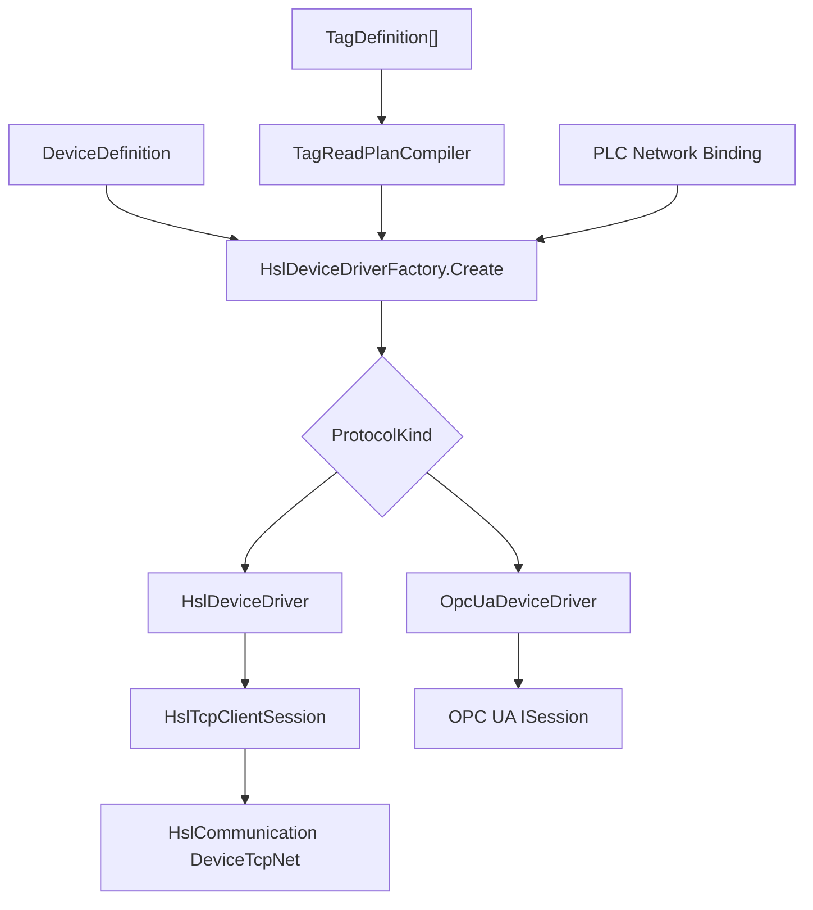
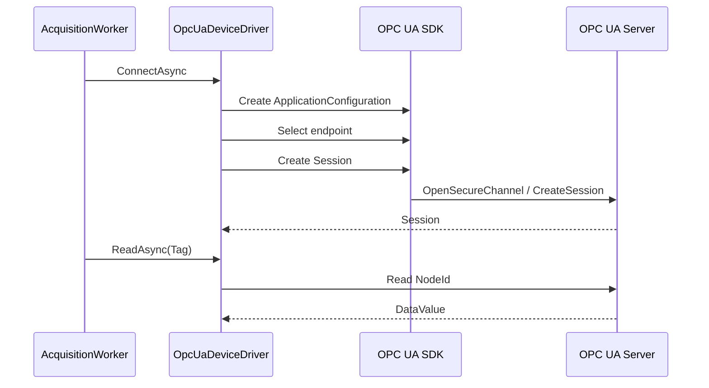

# EdgeNexus PLC 驱动与通信协议

## 1. 范围

本文依据 `ProtocolKind`、`HslDeviceDriverFactory`、`HslDeviceDriver`、`OpcUaDeviceDriver`、协议校验器和点位地址目录生成。

运行调度参见 [Runtime-Flows.md](Runtime-Flows.md)。

配置字段参见 [Configuration.md](Configuration.md)。

## 2. 驱动抽象

所有南向驱动实现 `IDeviceDriver`。

公开成员为：

- `Protocol`。
- `ConnectAsync`。
- `ReadAsync`。
- `ReadManyAsync`。
- `DisconnectAsync`。
- `DisposeAsync`。

驱动由 `IDeviceDriverFactory.Create` 创建。

默认实现是 `HslDeviceDriverFactory`。

驱动不访问 Web。

驱动不访问 MQTT。

驱动不生成 JSON。

驱动不直接更新设备健康状态。

## 3. 驱动工厂关系图

## 4. 协议矩阵

| 协议 | 实际客户端 | 默认端口 | 批量策略 |
|---|---|---:|---|
| Siemens S7 | `SiemensS7Net` | 102 | 原生多地址，Bool单读 |
| Modbus TCP | `ModbusTcpNet` | 502 | 安全单读 |
| Mitsubishi MC | 3E/1E TCP/3E UDP 客户端 | 5000 | 安全单读 |
| OPC UA | OPC Foundation `ISession` | 4840 | 当前逐点读 |
| Panasonic Mewtocol | `PanasonicMewtocolOverTcp` | 9094 | 安全单读 |
| Omron FINS | `OmronFinsNet` | 9600 | 安全单读 |
| Omron CIP | `OmronConnectedCipNet` | 44818 | 原生多地址，Bool单读 |
| Allen-Bradley | `AllenBradleyNet` | 44818 | 原生多地址，Bool单读 |
| Beckhoff ADS | `BeckhoffAdsNet` | 851 | 原生多地址，Bool单读 |
| Keyence MC | `KeyenceMcNet` | 5000 | 安全单读 |
| Inovance TCP | `InovanceTcpNet` | 502 | 安全单读 |
| Delta TCP | `DeltaTcpNet` | 502 | 安全单读 |

## 5. 读取计划

`TagReadPlanCompiler` 在驱动创建时编译计划。

单批最多16个点位。

单批最多200字节。

只有 Siemens、Omron CIP、AB、Beckhoff 标记为支持原生多地址。

Bool 点位始终单读。

超过200字节的点位始终单读。

String 字节数来自 `StringLength`。

计划保留源点位总数。

## 6. 数据长度

| 数据类型 | 字节数 |
|---|---:|
| Bool | 1 |
| Byte | 1 |
| Int16 | 2 |
| UInt16 | 2 |
| Bcd | 2 |
| Int32 | 4 |
| UInt32 | 4 |
| Float32 | 4 |
| Int64 | 8 |
| UInt64 | 8 |
| Float64 | 8 |
| String | `StringLength` |

## 7. HSL 会话

HSL TCP/UDP 客户端由 `HslTcpClientSession` 包装。

TCP Connect 调用 `ConnectServerAsync`。

返回 `IsSuccess=false` 时抛出 IOException。

Disconnect 调用 `ConnectClose`。

Dispose 再次调用 `ConnectClose`。

UDP 客户端同样包装为 DeviceTcpNet 会话。

UDP 会话通过 `IsDatagram=true` 标记。

## 8. 读互斥

`HslDeviceDriver` 使用单个 `SemaphoreSlim(1,1)`。

Connect、Read、ReadMany、Disconnect、Dispose 共用该门。

同一设备驱动不会并发执行读和断开。

该门不跨设备共享。

## 9. 字节序

字节序来自 `TagDefinition.ByteOrder`。

支持 HSL `DataFormat` 名称。

UI 和导入校验允许 `ABCD`、`CDAB`、`BADC`、`DCBA`。

无法解析时驱动回退 `ABCD`。

批量解码使用 `CreateByDateFormat`。

普通 HSL 单读先设置 `_client.ByteTransform.DataFormat`。

协议地址不拼接字节序前缀。

## 10. Siemens S7

客户端：`SiemensS7Net`。

系列映射：S1200、S1500、S300、S400、S200Smart、S200。

自动 Rack/Slot：

- S1200/S1500：Rack 0，Slot 1。
- S300：Rack 0，Slot 2。
- S400：Rack 0，Slot 3。
- S200/S200Smart：Rack 0，Slot 0。

连接角色映射到 HSL `ConnectionType`。

LocalTSAP 大于0时覆盖。

DestTSAP 大于0时覆盖。

数值读取先按原始字节读取再本地解码。

Bool 使用 `ReadBoolAsync`。

String 使用 `ReadStringAsync`。

工程地址会标准化：

- `DB1.DBW2` -> `DB1.2`。
- `DB1.DBD4` -> `DB1.4`。
- `VW100` -> `V100`。
- `MD20` -> `M20`。

点位示例：

- `DB1.DBX0.0`。
- `DB1.DBW2`。
- `DB1.DBD4`。
- `M10.0`。
- `VD100`。

## 11. Modbus TCP

客户端：`ModbusTcpNet`。

站号转换为 byte。

功能码存储在 `TagDefinition.ModbusFunctionCode`。

驱动边界转换为 HSL 地址 `x={code};{address}`。

兼容旧地址格式。

旧格式保存前可通过 `Normalize` 拆分。

01/02 只允许 Bool。

03/04 不允许 Bool。

地址栏保存原始偏移，不保存 40001 表示法转换结果。

点位示例：

- 功能码01，地址0，Bool。
- 功能码02，地址0，Bool。
- 功能码03，地址0，UInt16。
- 功能码03，地址2，Float32。
- 功能码04，地址0，Int16。

## 12. Mitsubishi MC

支持传输：TCP、UDP。

支持报文：Binary3E、Ascii3E、Binary1E、Ascii1E。

Binary3E TCP：`MelsecMcNet`。

Ascii3E TCP：`MelsecMcAsciiNet`。

Binary1E TCP：`MelsecA1ENet`。

Ascii1E TCP：`MelsecA1EAsciiNet`。

Binary3E UDP：`MelsecMcUdp`。

Ascii3E UDP：`MelsecMcAsciiUdp`。

1E 明确拒绝 UDP。

3E 配置 NetworkNumber、PLCNumber、NetworkStationNumber、TargetIOStation。

1E 只配置 PLCNumber。

UDP 不执行 TCP 端口诊断。

UDP 无协议握手。

UDP 有点位时以读返回判断通信。

UDP 无点位时只能确认本地套接字就绪。

点位示例：D100、D200、M100、X0、Y0。

## 13. OPC UA

实现类：`OpcUaDeviceDriver`。

Host 已含 `opc.tcp://` 时直接使用。

否则拼接 `opc.tcp://{Host}:{Port}`。

使用 `DefaultSessionFactory`。

安全端点选择由 `OpcUaUseSecurity` 控制。

匿名认证使用空 `UserIdentity`。

用户名认证使用用户名和 UTF-8 密码字节。

自动接受仅针对 `BadCertificateUntrusted`。

证书目录位于应用目录 `pki`。

自身证书目录：`pki/own`。

信任目录：`pki/trusted`。

拒绝目录：`pki/rejected`。

NodeId 使用 `NodeId.Parse`。

读取状态为 Bad 时抛 `ServiceResultException`。

当前 ReadMany 仍逐点调用 ReadAsync。

当前没有 Subscription。

点位示例：`ns=2;s=Machine.Speed`、`ns=2;i=1001`。

## 14. Panasonic Mewtocol

客户端：`PanasonicMewtocolOverTcp`。

使用 Host、Port、Station。

点位示例：DT100、DT200、R0、X0、Y0。

## 15. Omron FINS

客户端：`OmronFinsNet`。

配置 DNA、DA1、DA2、SNA、SA1、SA2、ReadSplits。

DA1 为0时不覆盖客户端自动值。

SA1 为0时不覆盖客户端自动值。

Bool 使用 HSL Bool 读取。

String 使用通用 String 读取。

数值类型按字长度读取原始字节。

返回字节不足时抛 IOException。

点位示例：D100、D100.03、CIO100、W100、H100.00。

## 16. Omron CIP

客户端：`OmronConnectedCipNet`。

连接超时倍数转换为 byte。

支持原生多地址读取。

Bool 保持单读。

点位使用控制器变量名。

示例：Machine.Speed、Machine.Running、Alarm[0]、ProductionCount。

## 17. Allen-Bradley EtherNet/IP

客户端：`AllenBradleyNet`。

Slot 转换为 byte。

`CipReadArrayUseSegment` 映射到 `ReadArrayUseSegment`。

非空 `CipRoutePath` 构造 `MessageRouter`。

路由格式校验为点分0至255整数。

支持原生多地址读取。

示例：Motor.Speed、Counter[0]、Program:MainProgram.BatchId。

## 18. Beckhoff ADS

客户端：`BeckhoffAdsNet`。

端口来自 DeviceDefinition。

自动 AMS Net ID 映射到 `UseAutoAmsNetID`。

Tag 缓存映射到 `UseTagCache`。

目标 AMS Net ID 非空时调用 `SetTargetAMSNetId`。

发送方 AMS Net ID 非空时调用 `SetSenderAMSNetId`。

关闭自动目标 AMS 时必须配置有效六段 Net ID。

支持原生多地址读取。

示例：`s=MAIN.rSpeed`、`M100.0`、`IG=0xF020;0`。

## 19. Keyence MC

客户端：`KeyenceMcNet`。

使用 Host 和 Port。

示例：DM100、DM200、R015、MR015、LR015。

## 20. Inovance TCP

客户端：`InovanceTcpNet`。

系列映射：AM、H3U、H5U、Easy。

使用 Station。

示例：AM 使用 SD100/Q0，H 系列使用 D100/X0。

## 21. Delta TCP

客户端：`DeltaTcpNet`。

系列映射：Dvp、AS。

使用 Station。

示例：D100、D200、M100、X0、Y0。

## 22. 网络绑定

驱动工厂查询 `NetworkUsage.PlcAcquisition`。

解析到本地 IPv4 时设置 HSL `LocalBinding`。

本地端口使用0，由操作系统分配。

OPC UA 驱动当前没有使用网络绑定服务。

网络 binding revision 变化会触发设备循环重建。

## 23. 点位级异常隔离

`DeviceReadFailureClassifier` 识别参数、格式、溢出异常。

OPC UA 特定 Bad 状态被视为点位错误。

包含非法地址标记的 IOException 被视为点位错误。

原生批量读取遇到点位错误时退化为逐点读取。

逐点错误返回 `DeviceTagReadResult.ConfigurationFailure`。

连接级异常继续向上抛出。

## 24. 数据质量

成功读取：`Good`。

单点读取异常：`ConfigurationError`。

连接超时：`Timeout`。

连接断开：`Disconnected`。

转换错误：`ConfigurationError`。

质量写入 `TagSample`。

质量随后进入 MQTT TagData。

## 25. 工程值转换

Bool、String、Bcd 不做算术转换。

其他类型转换为 decimal。

支持 `+`、`-`、`*`、`/`。

除数为0时保留原值。

结果按 Decimals 四舍五入。

舍入模式为 AwayFromZero。

## 26. 连接诊断

非三菱 UDP 先测试 TCP 端口。

TCP 成功后创建真实驱动。

调用 `ConnectAsync`。

有点位时读取第一个点位。

三菱 UDP 跳过 TCP 测试。

诊断返回步骤、耗时、错误和建议。

## 27. 测试覆盖

- 所有 ProtocolKind 都有工厂矩阵测试。
- 所有协议拒绝连接时有截止时间测试。
- Siemens 自动/手动连接配置有测试。
- Siemens 地址标准化有测试。
- Mitsubishi TCP/UDP 选择有测试。
- Mitsubishi 1E 客户端选择有测试。
- Mitsubishi 1E + UDP 拒绝有测试。
- Omron FINS 字读取和长度校验有测试。
- 字节序有测试。
- 地址规范示例有解析测试。
- 1000设备循环有容量冒烟测试。

## 28. `IDeviceDriver` 方法契约

### 28.1 `Protocol`

- 返回驱动对应的 `ProtocolKind`。
- AcquisitionWorker 不依赖具体客户端类型。

### 28.2 `ConnectAsync`

- 接收 CancellationToken。
- HSL 实现等待 `ConnectServerAsync`。
- HSL 返回失败结果时转换为 IOException。
- OPC UA 实现创建并保存 Session。

### 28.3 `ReadAsync`

- 接收单个 `TagDefinition`。
- HSL 按 DataType 选择读取方法。
- OPC UA 按完整 NodeId 读取 DataValue。
- 返回转换后的 object。

### 28.4 `ReadManyAsync`

- 返回以 Tag Id 为键的只读字典。
- 支持原生多读的批次优先多读。
- 多读遇到点位特定异常时退化为单读。
- 每个点返回 `DeviceTagReadResult`。

### 28.5 `DisconnectAsync`

- HSL 调用 `ConnectClose`。
- OPC UA 关闭 Session。
- 接收 CancellationToken。

### 28.6 `DisposeAsync`

- HSL 再次确保连接关闭。
- OPC UA 释放 Session 和配置资源。
- 设备循环停止时调用。

## 29. 驱动工厂完整映射

| ProtocolKind | 工厂构造 |
|---|---|
| SiemensS7 | `SiemensS7Net` |
| ModbusTcp | `ModbusTcpNet` |
| MitsubishiMc Binary3E TCP | `MelsecMcNet` |
| MitsubishiMc Ascii3E TCP | `MelsecMcAsciiNet` |
| MitsubishiMc Binary1E TCP | `MelsecA1ENet` |
| MitsubishiMc Ascii1E TCP | `MelsecA1EAsciiNet` |
| MitsubishiMc Binary3E UDP | `MelsecMcUdp` |
| MitsubishiMc Ascii3E UDP | `MelsecMcAsciiUdp` |
| PanasonicMewtocol | `PanasonicMewtocolOverTcp` |
| OmronFins | `OmronFinsNet` |
| OmronCip | `OmronConnectedCipNet` |
| AllenBradleyEtherNetIp | `AllenBradleyNet` |
| BeckhoffAds | `BeckhoffAdsNet` |
| KeyenceMc | `KeyenceMcNet` |
| InovanceTcp | `InovanceTcpNet` |
| DeltaTcp | `DeltaTcpNet` |
| OpcUa | `OpcUaDeviceDriver` |

## 30. 通用 HSL 客户端参数

- `ConnectTimeOut = DeviceDefinition.ConnectTimeoutMs`。
- `ReceiveTimeOut = DeviceDefinition.ReceiveTimeoutMs`。
- PLC 网络绑定存在时设置 `LocalBinding`。
- 本地端口设置为 0，由操作系统分配。
- TCP 客户端通过 `HslTcpClientSession` 包装。
- 三菱 UDP 同样使用 Session 包装，但 `IsDatagram=true`。

## 31. Siemens 连接参数

### 31.1 系列映射

- S1200 -> `SiemensPLCS.S1200`。
- S1500 -> `SiemensPLCS.S1500`。
- S300 -> `SiemensPLCS.S300`。
- S400 -> `SiemensPLCS.S400`。
- S200Smart -> `SiemensPLCS.S200Smart`。
- S200 -> `SiemensPLCS.S200`。

### 31.2 自动 Rack/Slot

- S1200/S1500：Rack 0、Slot 1。
- S300：Rack 0、Slot 2。
- S400：Rack 0、Slot 3。
- S200/S200Smart：Rack 0、Slot 0。

### 31.3 手动模式

- `SiemensAutoRackSlot=false` 时使用 DeviceDefinition.Rack/Slot。
- Port 始终使用设备 Port。
- ConnectionType 转为 byte 写入客户端。
- LocalTSAP 大于 0 时写入。
- DestTSAP 大于 0 时写入。

## 32. Siemens 地址规范化

- `SiemensTagAddress.NormalizeForRawRead` 处理工程表示法。
- 驱动创建时为计划内 Tag 建地址缓存。
- Bool 地址保留位号。
- DBW/DBD 地址转换为 HSL 原始读取需要的形式。
- S7-200 V 区地址由 HSL 系列客户端解释。
- 测试覆盖多个输入和预期地址。

## 33. Modbus 驱动边界

- 设备 Station 转为 byte。
- 点位保存地址不需要功能码前缀。
- 驱动读取前调用 `ModbusTagAddress.ToHslAddress`。
- 已带旧前缀的地址不会重复前缀。
- 保存旧地址时调用 Normalize。
- 功能码 01/02 只允许 Bool。
- 功能码 03/04 允许寄存器数值。
- Modbus 读取计划使用安全单读。

## 34. Mitsubishi 3E 参数

- NetworkNumber 写入 HSL `NetworkNumber`。
- PlcNumber 写入 `PLCNumber`。
- NetworkStationNumber 写入 `NetworkStationNumber`。
- TargetIoStation 写入 `TargetIOStation`。
- Binary3E 可用 TCP 或 UDP。
- Ascii3E 可用 TCP 或 UDP。
- UDP 不执行 TCP 连接握手。
- UDP 成功依据有效读取响应。

## 35. Mitsubishi A-compatible 1E 参数

- Binary1E 使用 `MelsecA1ENet`。
- Ascii1E 使用 `MelsecA1EAsciiNet`。
- 只写入 `PLCNumber`。
- 不写入 3E 网络路由字段。
- 只支持 TCP。
- 配置校验器拒绝 1E + UDP。
- 工厂再次拒绝 1E + UDP。

## 36. Mitsubishi ByteOrder

- 地址保持 `D100`、`M100` 等纯地址。
- ByteOrder 不拼入地址字符串。
- ByteOrder 转为 HSL `DataFormat`。
- 无效值回退 ABCD。
- Float32 是否正确取决于 PLC 实际字/字节排列。
- 测试覆盖 Mitsubishi 配置字节序。

## 37. Panasonic 参数

- 客户端：`PanasonicMewtocolOverTcp`。
- Host：设备 Host。
- Port：设备 Port。
- Station：转为 byte。
- 地址目录示例：DT、R、X、Y。
- 读取计划：单读回退。

## 38. Omron FINS 参数

- DNA <- FinsDestinationNetwork。
- DA1 <- FinsDestinationNode，大于 0 时设置。
- DA2 <- FinsDestinationUnit。
- SNA <- FinsSourceNetwork。
- SA1 <- FinsSourceNode，大于 0 时设置。
- SA2 <- FinsSourceUnit。
- ReadSplits <- FinsReadSplits。

## 39. Omron FINS 读取特性

- 数值点按 word 数据读取。
- 驱动检查返回字节长度。
- IsSuccess=true 但 Payload 为空仍视为失败。
- 位地址使用点号位号。
- 当前读取计划不标记原生多地址。
- 测试覆盖 D/CIO/W/H 示例解析。

## 40. Omron CIP 参数

- 客户端：`OmronConnectedCipNet`。
- Host 和 Port 来自设备。
- `ConnectionTimeoutMultiplier` 来自设备配置。
- 地址使用已发布 CIP 变量名。
- 支持原生多地址读取计划。
- Bool 始终拆为单读。

## 41. Allen-Bradley 参数

- 客户端：`AllenBradleyNet`。
- Slot 转为 byte。
- ReadArrayUseSegment 来自 `CipReadArrayUseSegment`。
- CipRoutePath 非空时创建 `MessageRouter`。
- 地址支持结构成员、数组和 Program Tag。
- 支持原生多地址读取计划。
- Bool 始终单读。

## 42. Beckhoff ADS 参数

- 客户端：`BeckhoffAdsNet`。
- UseAutoAmsNetID 来自设备配置。
- UseTagCache 来自设备配置。
- Target AMS Net ID 非空时调用 SetTargetAMSNetId。
- Sender AMS Net ID 非空时调用 SetSenderAMSNetId。
- 默认协议描述端口为 851。
- 支持原生多地址读取计划。

## 43. Keyence 参数

- 客户端：`KeyenceMcNet`。
- 构造参数只有 Host 和 Port。
- 地址目录示例：DM、R、MR、LR。
- 当前读取计划使用单读回退。
- 通用 Connect/Receive Timeout 仍应用。
- PLC 网络本地绑定仍应用。

## 44. Inovance 参数

- 客户端：`InovanceTcpNet`。
- AM/H3U/H5U/Easy 映射到 HSL enum。
- Station 转为 byte。
- AM 示例使用 SD/Q/M。
- H3U/H5U 示例使用 D/X/M。
- 当前读取计划使用单读回退。

## 45. Delta 参数

- 客户端：`DeltaTcpNet`。
- Station 转为 byte。
- `DeltaSeries.AS` 或 `DeltaSeries.Dvp`。
- 地址目录示例：D/M/X/Y。
- 当前读取计划使用单读回退。
- 通用字节序处理由 HslDeviceDriver 完成。

## 46. OPC UA 连接流程

## 47. OPC UA 安全参数

- `OpcUaUseSecurity=false` 时选择无安全端点。
- true 时选择安全端点。
- 用户名空白时使用匿名身份。
- 用户名非空时使用 UserNameIdentityToken。
- Password 来自设备定义。
- `OpcUaAutoAcceptUntrusted` 控制证书回调。
- 当前源码没有证书管理 Web API。

## 48. 数据类型读取

- Bool 使用布尔读取。
- Byte 使用单字节转换。
- Int16/UInt16 使用 16 位读取。
- Int32/UInt32 使用 32 位读取。
- Int64/UInt64 使用 64 位读取。
- Float32 使用单精度读取。
- Float64 使用双精度读取。
- String 使用 `StringLength`。
- Bcd 读取后按 BCD 语义转换。

## 49. 工程值转换步骤

1. 取得驱动原始值。
2. 将 RawValue 保留在 TagSample。
3. Bool/String/Bcd 跳过算术转换。
4. 其他数值转换为 decimal。
5. 按 Operator 执行 +、-、*、/。
6. 除数为 0 时保留原值。
7. 按 Decimals 四舍五入。
8. 使用 AwayFromZero。
9. 转换结果写入 Value。

## 50. 点位失败分类

- 参数异常视为点位特定错误。
- 格式异常视为点位特定错误。
- 溢出异常视为点位特定错误。
- OPC UA 特定 Bad Status 可视为点位错误。
- 非法地址特征 IOException 可视为点位错误。
- 点位特定错误返回 ConfigurationFailure。
- 会话级连接异常继续向上抛出。
- 单个错误点不阻塞健康点读取。

## 51. 批量计划细节

支持原生多读：

- Siemens S7。
- Omron CIP。
- Allen-Bradley EtherNet/IP。
- Beckhoff ADS。

安全单读：

- Modbus TCP。
- Mitsubishi MC。
- OPC UA 当前计划。
- Panasonic。
- Omron FINS。
- Keyence。
- Inovance。
- Delta。

## 52. PLC 诊断步骤

- 对 TCP 协议先进行 TCP 端口测试。
- 三菱 UDP 跳过 TCP 端口测试。
- 创建真实协议驱动。
- 调用 ConnectAsync。
- 有启用点位时读取第一个点位。
- 无点位时只验证连接。
- 记录每一步成功、详情和耗时。
- 返回 SourceAddress 和 Recommendation。
- CancellationToken 和总超时限制整个诊断。

## 53. PLC 驱动源码索引

- 接口：`Snet.Edge.Application/Abstractions.cs`。
- 协议模型：`Snet.Edge.Domain/Models.cs`。
- 工厂和驱动：`Snet.Edge.Infrastructure/HslDeviceDriver.cs`。
- 读取计划：`TagReadPlanCompiler.cs`。
- 采集调度：`AcquisitionWorker.cs`。
- 稳定性：`AcquisitionStability.cs`。
- 点位验证：`TagProtocolValidator.cs`。
- 设备验证：`DeviceProtocolValidator.cs`。
- 地址指南：`ProtocolPointAddressCatalog.cs`。
- 网络诊断：`NetworkDiagnostics.cs`。

## 54. 协议默认端口

- Siemens S7：102。
- Modbus TCP：502。
- Mitsubishi MC：5000。
- OPC UA：4840。
- Panasonic Mewtocol：9094。
- Omron FINS：9600。
- Omron CIP：44818。
- Allen-Bradley：44818。
- Beckhoff ADS：851。
- Keyence MC：5000。
- Inovance TCP：502。
- Delta TCP：502。

## 55. 点位地址目录占位提示

- Siemens：`DB1.DBW2 / DB1.DBX0.0 / M10.0`。
- Modbus：`0 / 100 / 200`。
- Mitsubishi：`D100 / M100 / X0`。
- OPC UA：`ns=2;s=Machine.Speed`。
- Panasonic：`DT100 / R0 / X0`。
- Omron FINS：`D100 / D100.03 / CIO100`。
- Omron CIP：`Machine.Speed / Alarm[0]`。
- Allen-Bradley：`Motor.Speed / Counter[0]`。
- Beckhoff：`s=MAIN.rSpeed / M100.0 / IG=0xF020;0`。
- Keyence：`DM100 / MR100 / R0`。
- Inovance：`SD100 / Q0 / D100 / X0`。
- Delta：`D100 / M100 / X0`。

## 56. 设备参数 API 元数据

- Siemens Series 使用 select。
- Siemens Auto Rack/Slot 使用 switch。
- Rack/Slot 使用 number。
- ConnectionType 使用 select。
- TSAP 使用 number。
- Modbus Station 使用 number。
- Mitsubishi Transport 使用 select。
- Mitsubishi Format 使用 select。
- Mitsubishi routing 使用 number。
- OPC UA Username 使用 text。
- OPC UA Password 标记 Secret。
- OPC UA Security 使用 switch。
- FINS DNA/DA/SNA/SA 使用 number。
- Omron CIP multiplier 使用 number。
- AB RoutePath 使用 text。
- Beckhoff AMS Net ID 使用 text。
- Inovance Series 使用 select。
- Delta Series 使用 select。

## 57. 协议配置验证边界

- Port 必须 1 至 65535。
- ConnectTimeoutMs 和 ReceiveTimeoutMs 必须有效。
- Siemens Rack/Slot 和 TSAP 有范围校验。
- Mitsubishi 1E 拒绝 UDP。
- Mitsubishi routing 数值有 byte/ushort 范围。
- FINS 节点和网络号有范围。
- CIP Route 必须符合 MessageRouter 格式。
- Beckhoff AMS Net ID 由协议校验器检查。
- OPC UA 安全参数与身份字段组合被验证。
- 点位地址由 `TagProtocolValidator` 检查。
- Modbus 功能码与数据类型被交叉检查。

## 58. 驱动稳定性保护

- 每次通信接受 CancellationToken。
- Connect 和 Receive 使用设备超时。
- 采集循环捕获设备异常。
- 成功/失败阈值防抖。
- 重连使用阶梯延迟和抖动。
- 读取成功后才重置退避。
- 单点异常隔离。
- 原生多读失败可退化单读。
- 设备循环停止释放驱动。
- 网络绑定 revision 变化重建连接。
- 长扫描周期有心跳。

## 59. 协议测试覆盖核对

- [x] 工厂覆盖全部 ProtocolKind。
- [x] 每协议连接拒绝有截止时间。
- [x] 每协议有地址指南。
- [x] 每个指南示例可验证。
- [x] 每个指南示例可编译读取计划。
- [x] Siemens 自动/手动连接参数。
- [x] Siemens 地址规范化。
- [x] Mitsubishi TCP/UDP。
- [x] Mitsubishi 1E Binary/ASCII。
- [x] Mitsubishi 1E + UDP 拒绝。
- [x] Omron FINS 数据长度。
- [x] ByteOrder 行为。
- [x] 批次边界和 Bool 单读。

## 47. 驱动开发入口

- 新增协议完整清单：[Plugin-Development.md](Plugin-Development.md)。
- Excel 地址与字段：[Excel-Template.md](Excel-Template.md)。
- 采集线程和设备生命周期：[Internal-Architecture.md](Internal-Architecture.md)。
- 性能与真实容量边界：[Performance.md](Performance.md)。
- 现场排查：[FAQ.md](FAQ.md)。

## 48. 协议变更同步要求

新增协议、地址、参数或读取策略时，同时更新：

1. `ProtocolKind` 和 Domain 模型。
2. 协议元数据与校验器。
3. 地址目录。
4. Driver Factory 与诊断。
5. Excel 导入。
6. 本文、Public API、Configuration 和 Web API。
7. 测试与 [../CHANGELOG.md](../CHANGELOG.md)。

返回 [文档中心](INDEX.md)。
