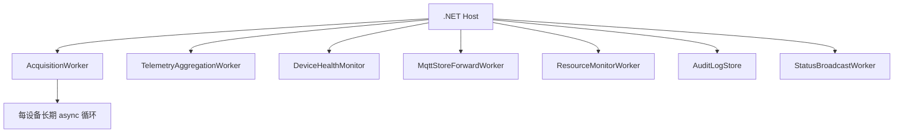

# EdgeNexus 性能、容量与压测方法

## 1. 文档原则

本文只描述当前源码的并发模型和可测事实，不承诺未经真实硬件验证的吞吐量。

“支持 1000 台设备”的源码证据是进程内设备循环容量冒烟测试，不等于 1000 台真实 PLC、指定点数和指定扫描周期的现场认证。

相关文档：

- [Internal-Architecture.md](Internal-Architecture.md)
- [Runtime-Flows.md](Runtime-Flows.md)
- [PLC-Drivers.md](PLC-Drivers.md)
- [MQTT.md](MQTT.md)
- [Samples-and-Tests.md](Samples-and-Tests.md)
- [INDEX.md](INDEX.md)

## 2. 性能由哪些变量决定

总容量主要由以下变量共同决定：

- 设备数量。
- 每设备点位数。
- 扫描周期。
- 协议往返延迟。
- 连接和读取超时。
- 批量读取能力。
- Bool、字符串和数组比例。
- 点位变化率。
- MQTT 上传周期。
- Broker 延迟和 QoS。
- 断线积压量。
- SQLite 磁盘性能。
- Web 实时订阅数量。

不能只用“设备数”估算性能。

## 3. 进程线程模型

EdgeNexus 使用 async/await 和 BackgroundService。



设备循环不是每点一个线程，也没有显式创建 Thread。

## 4. 每设备循环

`AcquisitionWorker` 为每个启用设备维护一个长期异步任务。

设备内执行：

1. 创建驱动。
2. 连接。
3. 执行读取计划。
4. 写 TagSample。
5. 更新状态。
6. 等待扫描周期或重连退避。

单设备慢响应不会同步阻塞其他设备循环，但会占用该设备自己的采集节奏和底层 Socket 资源。

## 5. 当前无全局并发闸门

当前采集层没有全局 `SemaphoreSlim` 限制同时连接或读取的设备数量。

影响：

- 大规模启动时可能同时建立很多连接。
- 重连抖动可降低重连风暴，但不等于全局并发限制。
- 真实 1000 设备部署必须观察 Socket、线程池、CPU 和 PLC 端连接上限。

如果未来增加全局闸门，应区分连接并发、读取并发和协议类别，不能用一个过小信号量拖慢所有设备。

## 6. 驱动内串行化

HSL 驱动实例使用读取门控串行化同一设备会话。

原因：

- 多数 PLC 协议会话不适合同一连接并发请求。
- 响应顺序和事务标识可能被打乱。
- 单连接并发不一定提高 PLC 吞吐。

跨设备仍可并行。

## 7. 批量读取

当前 `TagReadPlanCompiler` 允许原生多地址读取：

- Siemens S7
- Omron CIP
- Allen-Bradley EtherNet/IP
- Beckhoff ADS

约束：

- 每批最多 16 点。
- 估算数据最多 200 字节。
- Bool 安全单读。
- 其他协议回退单点。

批量读取减少网络往返，但大批次失败可能放大故障范围，因此当前限制较保守。

## 8. Telemetry Channel

配置：

```text
Capacity: 100000
FullMode: Wait
SingleReader: true
SingleWriter: false
AllowSynchronousContinuations: false
```

含义：

- 多设备生产。
- 单聚合消费者。
- 满载时采集产生背压。
- 不静默丢业务样本。

风险：聚合消费者持续慢于生产者时，采集循环会等待，扫描周期被拉长。

## 9. 最新值缓存

`TelemetryBuffer` 使用 `ConcurrentDictionary` 保存每个 Tag 最新值。

内存量大致随活动 Tag 数增长，而不是随运行时间无限增长。

删除设备或点位后的缓存清理由运行配置同步行为决定，应在长时间频繁变更配置场景中观测。

## 10. SignalR 变化缓存

另一个 `_pending` 字典保存等待 Web 推送的最新变化。

同一 Tag 在推送间隔内多次变化只保留最新样本，适合 UI 展示，不等同于历史数据存储。

## 11. Runtime Status Channel

配置：

```text
Capacity: 10000
FullMode: DropOldest
SingleReader: true
SingleWriter: false
```

状态变化可重建，完整最新状态另存在字典，因此优先保证最新事件而不是阻塞采集。

## 12. MQTT 配置变更 Channel

配置：

```text
Capacity: 1
FullMode: DropOldest
```

它是唤醒信号，不承载完整配置。消费者通过 revision 和配置存储读取最终状态，因此合并重复通知是安全的。

## 13. 审计 Channel

配置容量 10000，后台最多批量 100 条写 SQLite。

请求入口使用非阻塞尝试写入，避免审计持久化反压所有管理请求。

审计积压应通过日志和指标观察，因为满载时可能丢审计事件。

## 14. MQTT 不是内存 Channel

业务 MQTT 队列是 SQLite Outbox。

好处：

- 进程重启后保留。
- Broker 断开时不占用无界内存。
- 可以统计、重试和死信。

代价：

- 每条消息有磁盘写入。
- 入队容量检查已通过 `MqttOutbox` 内存原子计数器优化为 O(1)，避免每次入队全表 `SELECT COUNT(1)`。
- 大量小事务依赖磁盘延迟。

## 15. Outbox 默认容量

`MqttOptions` 默认：

```text
OutboxMaxMessages = 500000
MaxPublishAttempts = 20
ReplayMaxMessagesPerSecond = 200
```

容量不是目标值。生产应按最大断网时长、每秒消息数、平均 Payload 大小和磁盘空间计算。

## 16. Outbox 容量估算

估算公式：

```text
积压消息数 ≈ 每秒生成消息数 × 断网秒数
磁盘需求 ≈ 积压消息数 × 平均行大小 × 安全系数
```

平均行大小包含 Topic、Payload、索引和 SQLite 页开销。

建议安全系数至少覆盖索引、WAL、死信和日志，但具体值必须用实际数据库文件测量。

## 17. 补发限速

默认最多 200 条/秒补发。

作用：

- 避免 Broker 恢复时突发。
- 避免 SQLite 高频读写抢占采集。
- 避免 WAN 带宽被历史数据占满。

如果正常新消息速率高于补发速率，历史积压不会快速下降，需要实际测算。

## 18. MQTT 消息粒度

当前是每设备一条消息，不是每点一条，也不是每分组合并多设备一条。

因此大致消息速率：

```text
周期消息速率 ≈ 活动设备数 / 上传周期秒
```

变化上传会增加额外消息。

## 19. 变化上传压力

`PublishOnChange` 在高频波动点较多时会显著增加：

- JSON 构建。
- Outbox 写入。
- Broker 消息数。
- 订阅端处理。

应配置合理 Deadband，并优先对真正需要即时变化的点开启。

## 20. 聚合周期

`TelemetryAggregationWorker` 当前约每 250 ms 处理配置与聚合状态。

`SqliteGatewayConfigurationStore.GetSnapshotAsync` 已内置活动快照内存缓存（仅在初始化、发布或回滚时刷新），因此 250 ms 聚合循环读取活动快照为 O(1) 零反序列化开销。

## 21. 设备健康周期

`DeviceHealthMonitor` 当前约每 2 秒读取状态与活动设备上下文。

设备状态变化还会通过 Channel 提前通知，因此周期扫描用于同步和恢复，不只依赖事件。

## 22. 采集配置刷新周期

`AcquisitionWorker` 主循环约每 5 秒读取活动快照并同步设备循环。

因此发布后设备增删不是毫秒级立即生效，属于有界最终一致。

## 23. 资源监控周期

`ResourceMonitorWorker` 每 2 秒采样 CPU、内存、磁盘和线程。

采样失败保留上一次保护状态，不因监控异常停止网关。

## 24. SQLite 设置

配置数据库初始化设置：

- WAL。
- `synchronous=NORMAL`。
- Shared Cache。
- Pooling。

WAL 提高读写并行能力，但需要关注 `gateway.db-wal` 和磁盘剩余空间。

## 25. 日志性能

Serilog Console 和 File Sink 均使用异步包装。

文件日志：

- JSON。
- 每日滚动。
- 保留 30。

高频逐点 Info 日志会产生巨大 IO；当前开发应避免在每个正常点读取时记录日志。

## 26. JSON 构建

`MqttPayloadBuilder` 使用 `Utf8JsonWriter` 路径构建结构化 JSON，而不是手工拼接。

收益：

- 类型正确。
- 减少转义错误。
- 相比对象图序列化更可控。

仍应避免在同一消息上重复构建预览和正式 Payload。

## 27. GC 观察点

主要分配来源：

- 配置快照反序列化。
- 每批 TagSample record。
- `DeviceData` / `TagData` 集合。
- MQTT JSON 字符串。
- SignalR DTO。
- 日志属性和异常堆栈。

优化前应先测量 `dotnet-counters` 的分配率和 Gen 2 GC，不要凭感觉引入对象池。

## 28. 当前热路径中的 LINQ

源码部分缓存查询和快照转换使用 LINQ。

在一般规模下可读性优先；若压测显示聚合、最新值查询或配置同步成为热点，再用循环和预分配替换。

不要在没有基准的情况下大范围机械移除 LINQ。

## 29. CPU 监控

`/metrics` 和资源快照包含 CPU 指标。

压测关注：

- 平均 CPU。
- P95/P99 CPU 峰值。
- Broker 恢复补发时 CPU。
- 配置发布时 CPU。
- 1000 设备同时重连时 CPU。

## 30. 内存监控

关注：

- Working Set。
- Managed Heap。
- 活动 Tag 数变化。
- Outbox 不应进入内存无界缓存。
- 多次发布和删除设备后内存是否回落。
- SignalR 客户端数量变化。

## 31. 线程与线程池

异步 Socket 等待不等于占用一个专用线程。

仍需关注：

- 第三方 SDK 是否内部阻塞。
- ThreadPool Queue Length。
- 线程数持续增长。
- DNS、证书和 SQLite 同步路径。

## 32. 网络监控

对 PLC 网络：

- 往返延迟。
- 丢包。
- 重传。
- PLC 连接数上限。
- 每秒请求数。

对 MQTT 网络：

- 发布延迟。
- QoS 确认时间。
- 断线频率。
- 补发带宽。
- Broker 限流和 inflight 限制。

## 33. 推荐分阶段压测

### 阶段 1：纯进程容量

使用测试驱动验证大量设备循环可启动、取消和回收。

### 阶段 2：单协议仿真

固定协议、点数和扫描周期，逐步增加设备。

### 阶段 3：混合协议

按现场比例混合 S7、Modbus、MC、OPC UA 等。

### 阶段 4：Broker 断网

制造积压，观察磁盘、Outbox 和采集是否稳定。

### 阶段 5：Broker 恢复

观察补发、实时消息和 PLC 采集是否互相影响。

### 阶段 6：长稳

至少覆盖配置发布、断线、恢复、磁盘预警和服务重启。

## 34. 基准场景定义

每次性能报告必须写清：

- CPU 型号和核心数。
- 内存。
- 磁盘类型。
- 操作系统。
- .NET Runtime。
- 设备数。
- 点数/设备。
- 扫描周期。
- 上传周期。
- 协议比例。
- 平均 PLC 延迟。
- MQTT QoS。
- Payload 平均大小。
- 测试时长。

## 35. 常用命令

构建：

```powershell
dotnet build Snet.Edge.slnx -c Release
```

测试：

```powershell
dotnet test tests/Snet.Edge.Tests/Snet.Edge.Tests.csproj -c Release
```

运行时计数器示例：

```powershell
dotnet-counters monitor --process-id <PID> System.Runtime
```

这些工具需要单独安装时，应按 Microsoft 对应版本说明安装；项目当前不包含自动安装脚本。

## 36. MQTT 断网测试方法

1. 正常连接 Broker。
2. 记录 Outbox 初始值。
3. 停止 Broker 或阻断网络。
4. 保持 PLC 采集。
5. 观察 Pending 增长和磁盘。
6. 重启 Broker。
7. 观察连接恢复、补发速率和 Pending 下降。
8. 确认实时消息与历史消息语义。
9. 确认没有 Host 退出。

## 37. PLC 断网测试方法

1. 设备 Online 后断开 PLC 网络。
2. 观察连续失败阈值。
3. 观察 Reconnecting / Offline。
4. 确认其他设备持续采集。
5. 恢复网络。
6. 观察退避和成功阈值。
7. 确认错误 Tag 从非零恢复 0。
8. 确认失败点 Quality 恢复。

## 38. 配置热更新测试

1. 运行多个设备。
2. 修改草稿但不发布，确认运行不变。
3. 发布新增设备，确认约 5 秒内启动。
4. 发布删除设备，确认循环取消。
5. 修改模板，确认新消息使用新模板。
6. 确认旧 Outbox Payload 未变化。

## 39. 1000 设备声明边界

当前 `CapacitySmokeTests` 包含 `OneThousandDeviceLoopsStartAndCollectWithoutBlocking`。

它证明：

- 当前调度结构可创建大量异步设备循环。
- 测试条件下不会因同步阻塞完全停滞。

它不证明：

- 1000 台真实 PLC 都能 100 ms 扫描。
- 任意协议混合都满足固定延迟。
- 任意 Broker 和磁盘都可承受积压。
- 任意工控机配置都可满足 SLA。

## 40. 部署规模建议

不提供脱离场景的硬设备数承诺。

推荐方法：

1. 用现场最慢协议和最大点表作为基线。
2. 以目标扫描周期做单机压测。
3. 保留 CPU、内存、磁盘、网络余量。
4. 测试断网补发并发。
5. 达到资源阈值前分片部署多个网关。

## 41. 何时考虑分片

- PLC 网络跨多个物理区域。
- 单机连接数接近 PLC 或交换机限制。
- CPU 长期高占用。
- 采集 Channel 经常产生背压。
- Outbox 补发影响实时数据。
- 单数据目录增长过快。
- 故障域需要隔离。

## 42. 优化优先级

推荐顺序：

1. 修正错误扫描周期和超时。
2. 使用协议原生批量读取。
3. 减少无意义变化上传。
4. 优化 Broker 和磁盘。
5. 优化快照读取与 JSON 分配。
6. 最后再考虑对象池、Span 等微优化。

## 43. 不推荐优化

- 为每个点位 `Task.Run`。
- 同一 PLC 连接并发读多个请求。
- 使用无界 Channel 消除背压。
- 把 Outbox 全部加载到内存。
- 关闭所有日志和健康检查。
- 将失败重试改成无等待死循环。
- 为追求速度绕过草稿发布事务。

## 44. 性能变更检查表

- [ ] 有基准前后数据。
- [ ] 测试场景参数完整。
- [ ] 没有破坏取消和释放。
- [ ] 没有引入无界集合。
- [ ] 没有扩大单故障影响范围。
- [ ] Broker 断网仍稳定。
- [ ] PLC 断网仍隔离。
- [ ] 文档中的容量声明未夸大。
- [ ] 更新 Runtime、MQTT 或 PLC 文档。
- [ ] 更新 Changelog。

## 45. 相关文档

- [Internal Architecture](Internal-Architecture.md)
- [Runtime Flows](Runtime-Flows.md)
- [PLC Drivers](PLC-Drivers.md)
- [MQTT](MQTT.md)
- [Deployment](Deployment.md)
- [Samples and Tests](Samples-and-Tests.md)
- [FAQ](FAQ.md)
- [文档中心](INDEX.md)
