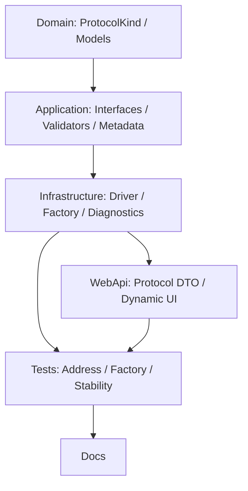

# EdgeNexus 扩展与协议开发

## 1. 重要结论

当前源码没有运行时 DLL 插件系统。

未发现：

- `IPlugin`
- 插件 Manifest
- `AssemblyLoadContext`
- 动态程序集扫描
- MEF
- 插件目录热加载

因此本文中的“插件开发”分为：

1. 当前真实可用的编译期扩展。
2. 已有接口的依赖注入替换。
3. Roadmap 中的运行时插件候选设计。

不要把第三部分写成当前已实现能力。

相关文档：

- [Internal-Architecture.md](Internal-Architecture.md)
- [PLC-Drivers.md](PLC-Drivers.md)
- [MQTT.md](MQTT.md)
- [Public-API.md](Public-API.md)
- [Roadmap.md](Roadmap.md)
- [INDEX.md](INDEX.md)

## 2. 当前扩展模型



新增协议是一个跨层功能，不是只新增一个驱动类。

## 3. PLC 驱动契约

当前公共驱动接口：

```csharp
public interface IDeviceDriver : IAsyncDisposable
{
    ProtocolKind Protocol { get; }
    ValueTask ConnectAsync(CancellationToken cancellationToken);
    ValueTask<object?> ReadAsync(TagDefinition tag, CancellationToken cancellationToken);
    ValueTask<IReadOnlyDictionary<Guid, DeviceTagReadResult>> ReadManyAsync(CancellationToken cancellationToken);
    ValueTask DisconnectAsync(CancellationToken cancellationToken);
}
```

工厂接口：

```csharp
public interface IDeviceDriverFactory
{
    IDeviceDriver Create(DeviceDefinition device, IReadOnlyList<TagDefinition>? tags = null);
}
```

接口没有 PLC 写入方法。新增驱动不应悄悄在现有读取接口中加入写入副作用。

## 4. 驱动职责

驱动负责：

- 建立协议连接或会话。
- 根据 `TagDefinition` 读取值。
- 将第三方库结果转换为通用值或 `DeviceTagReadResult`。
- 在断开时释放连接。
- 支持取消。
- 隔离第三方异常。

驱动不负责：

- 生成 MQTT JSON。
- 生成 MQTT Topic。
- 决定分组上传周期。
- 写 SQLite 配置。
- 更新 Vue 页面。
- 决定设备错误 Tag 名称。

## 5. 新增 ProtocolKind

在 Domain 的 `ProtocolKind` 增加枚举值。

影响：

- JSON 枚举序列化。
- 配置快照。
- Web 协议列表。
- Excel 导入。
- 设备工厂。
- 验证器。
- 地址规范。
- 测试与文档统计。

枚举名称一旦进入持久化配置和 API，应视为兼容性契约。

## 6. 扩展 DeviceDefinition

如果新协议需要专属参数，在 `DeviceDefinition` 增加字段。

字段应具备：

- 合理默认值。
- 可序列化类型。
- 明确范围。
- 跨平台语义。
- 不包含第三方库对象。

示例类型：

- enum：协议模式。
- int：站号、槽号、端口。
- bool：安全或缓存开关。
- string：路由路径、NodeId、AMS Net ID。

密码字段必须避免日志输出。

## 7. 更新 ProtocolDescriptors

Web 设备表单不是为每个协议硬编码一套页面，而是通过 `/api/v1/protocols` 获取元数据。

新协议描述至少包括：

- Value。
- Label。
- DefaultPort。
- Enabled。
- 参数列表。
- 地址指南。

参数元数据决定前端控件、默认值和提示。

## 8. 更新 DeviceProtocolValidator

设备级校验应覆盖：

- Host 非空。
- Port 范围。
- 超时范围。
- 协议专属站号。
- 枚举值合法。
- 路由字符串格式。
- 互斥参数。
- 模式与 Transport 兼容性。

例如当前三菱 A 兼容 1E 帧只允许 TCP，这种约束应在校验层明确，而不是等驱动运行时报错。

## 9. 更新 TagProtocolValidator

点位校验应覆盖：

- 地址语法。
- 数据类型兼容。
- Modbus 功能码与类型。
- 位地址与 Bool。
- 字符串长度。
- 协议特殊限制。

不要只依赖第三方库的运行时错误信息。

## 10. 更新 ProtocolPointAddressCatalog

每个协议必须提供：

- Summary。
- AddressPlaceholder。
- Examples。
- Notes。

示例必须来自实际驱动支持的语法。

Web 和 Excel 文档都依赖这个目录保持一致。

## 11. 实现驱动

优先选择：

1. 复用 `HslDeviceDriver` 和 `IHslClientSession`。
2. 无法复用时实现独立 `IDeviceDriver`。

当前 OPC UA 使用独立 `OpcUaDeviceDriver`，其原因是官方 SDK 的会话、证书和 NodeId 模型与 HSL 网络设备不同。

## 12. HSL 驱动适配

`HslDeviceDriverFactory` 当前为多个协议创建 `NetworkDeviceBase`，再包装到 HSL 会话。

新增 HSL 协议时检查：

- 目标类型支持 .NET 10 / netstandard。
- Linux 运行时无 Windows-only 依赖。
- Connect/Receive 超时可设置。
- 是否需要持久连接。
- 是否支持原生批量读取。
- 是否线程安全。
- 是否支持本地绑定地址。
- `ConnectClose` 与 `Dispose` 行为。

## 13. 独立驱动适配

独立驱动应把外部 SDK 类型限制在 Infrastructure 内部。

推荐结构：

```text
XxxDeviceDriver
  ConnectAsync
  ReadAsync
  ReadManyAsync
  DisconnectAsync
  DisposeAsync
```

所有 public 返回仍使用 Domain / Application 类型。

## 14. 连接生命周期

驱动由每设备采集循环拥有：

```mermaid
sequenceDiagram
    participant Loop as Device Loop
    participant Factory
    participant Driver

    Loop->>Factory: Create(device, tags)
    Factory-->>Loop: IDeviceDriver
    Loop->>Driver: ConnectAsync
    loop scan
        Loop->>Driver: ReadManyAsync / ReadAsync
    end
    Loop->>Driver: DisconnectAsync
    Loop->>Driver: DisposeAsync
```

不要把设备驱动注册为全局 Singleton。

## 15. 超时

驱动必须尊重：

- `DeviceDefinition.ConnectTimeoutMs`
- `DeviceDefinition.ReceiveTimeoutMs`
- 外层 `CancellationToken`

如果第三方 SDK 不接受 Token，应通过 SDK 自身超时和外层取消共同控制，不能留下永久阻塞调用。

## 16. 重连

重连由 `AcquisitionWorker` 和 `ReconnectBackoff` 管理。

驱动不应启动第二套不可见的无限重连线程，除非 SDK 强制且能被停止。

当前退避默认：

```text
1s, 2s, 5s, 10s, 30s
```

并加入默认 20% 抖动。

## 17. 成功与失败阈值

设备通信状态由 `DeviceCommunicationStabilityTracker` 防抖：

- 默认连续 3 次失败确认故障。
- 默认连续 2 次成功确认恢复。

新驱动必须正确区分：

- 连接失败。
- 超时。
- 读取失败。
- 配置错误。
- 至少一个点读取成功。

## 18. 部分点位失败

当前规则：

- 至少一个点位正常，设备通信错误 Tag 保持 0。
- 失败点位自己的 `Quality` 非 Good。
- 设备 UI 可显示 Degraded。
- 全部点位持续失败才进入通信失败。

新驱动的 `ReadManyAsync` 必须为每个 Tag 返回结果，不能因为一个地址失败丢弃整个批次的所有可恢复结果。

## 19. 批量读取

`TagReadPlanCompiler` 当前允许原生多地址协议：

- Siemens S7
- Omron CIP
- Allen-Bradley EtherNet/IP
- Beckhoff ADS

新增协议若支持批量读取：

- 明确一次最大点数。
- 明确估算响应字节。
- Bool 是否可混批。
- 单点失败如何映射。
- 大数组和字符串如何限制。
- 增加批次拆分测试。

## 20. 数据转换

驱动读取结果最终经过值转换路径，涉及：

- DataType。
- ByteOrder。
- Operator。
- Operand。
- Decimals。
- StringLength。

新协议不要重复实现一套与公共转换冲突的业务缩放逻辑。

## 21. 本地网卡绑定

PLC 采集用途可绑定系统网卡。

新驱动需要检查 SDK 是否支持：

- 本地源 IP 绑定。
- 本地 Socket 创建回调。
- 多网卡路由。

如果 SDK 不支持显式绑定，应记录实际依赖操作系统路由的边界，不能假装已绑定成功。

## 22. 网络诊断

新增协议必须评估 `NetworkDiagnosticsService`：

- 是否可 Ping。
- 是否为 TCP。
- 是否为 UDP。
- 是否有协议握手。
- 是否必须读取一个点才能确认。
- 是否需要特殊路由或证书。

## 23. Excel 导入

更新 `PointTableImportService`：

- 协议名称别名。
- 专属字段。
- 默认端口。
- 枚举解析。
- 范围校验。
- 同设备行一致性。

更新 [Excel-Template.md](Excel-Template.md)。

## 24. Web 前端

前端根据协议元数据动态生成参数。新增参数后检查：

- 控件类型。
- 显示条件。
- 默认值。
- 帮助文本。
- 保存 DTO。
- 编辑回填。
- Excel 字段名称。

## 25. 驱动测试最低集合

- Factory 可创建。
- 不支持配置被 Validator 拒绝。
- 地址示例与 Validator 一致。
- Connect 取消。
- Read 超时。
- 单点成功。
- 单点失败不崩溃。
- 多点部分失败。
- 断线重连。
- Dispose 可重复或安全调用。
- 网络绑定变化后重建或刷新。

## 26. 真实硬件验证记录

至少记录：

- PLC 品牌和型号。
- CPU/通信模块固件。
- 第三方库版本。
- 协议模式。
- 端口、站号、Rack/Slot、路由。
- 点位地址和类型。
- 字节序。
- 扫描周期和点数。
- 断线时长与恢复时间。
- 连续运行时长。

没有硬件记录时，只能声明源码支持或仿真测试通过。

## 27. MQTT 扩展点

当前可替换接口：

- `IMqttPayloadBuilder`
- `ITopicBuilder`
- `ITemplateResolver`
- `IMqttTemplateManager`
- `IMqttMessagePublisher`

这些接口通过 DI 注册为 Singleton 实现。

## 28. 自定义 Payload Builder

`IMqttPayloadBuilder.Build` 输入：

- `DeviceData`
- `MqttTemplate`
- `MqttPayloadContext`

输出最终 JSON 字符串。

自定义实现必须：

- 不修改输入模型。
- 对 null、数字、布尔和字符串正确序列化。
- 保持系统状态 Tag 与普通点位相同数组语义。
- 生成失败抛出可定位异常，由上层隔离。
- 避免手工字符串拼接 JSON。

## 29. 自定义 Topic Builder

`ITopicBuilder.Build` 负责变量解析。

必须验证：

- 空 Topic。
- 未知变量。
- 设备 ID 中的非法 MQTT Topic 字符。
- 斜杠组合。
- 共享 Topic 与设备级 Topic 的预期。

## 30. 自定义 Template Resolver

`ITemplateResolver.ResolveAsync` 根据设备的 `MqttTemplateId` 返回模板。

当前实现：

- 空 ID 回退内置标准模板。
- 模板保存在 SQLite。
- 内存 `ConcurrentDictionary` 提供读取缓存。

替换时应保持回退和热更新语义。

## 31. 自定义 Publisher

`IMqttMessagePublisher` 当前由 `MqttOutbox` 实现。

如果替换为其他持久队列，必须保留：

- 异步入队。
- 采集与网络发送解耦。
- 进程重启后可恢复。
- 容量限制。
- 重试和死信。
- 已构建 Topic/Payload 不受模板后改影响。

直接发布到 Broker 会破坏 Store and Forward 边界。

## 32. 新的 MQTT Transport

当前项目只有一个 MQTT Broker 配置和一个发送后台服务。

新增多 Broker 或其他北向协议时，不应复用同一配置字段冒充不同语义。应定义：

- 独立连接配置。
- 路由规则。
- 独立 Outbox 或目标标识。
- 独立状态与指标。
- 失败隔离。

## 33. 当前模板不是任意脚本插件

模板是结构化字段配置：

- Include flags。
- Payload style。
- Custom fields。
- Device error prefix/code。

用户不手写任意 JSON 脚本，也没有执行用户代码的模板引擎。

## 34. DI 替换注意

当前注册位于 `ServiceCollectionExtensions.AddEdgeInfrastructure`。

如果应用层需要可替换实现，优先：

- 修改注册为条件化。
- 提供明确 Options。
- 保持默认实现。
- 增加集成测试。

不要在业务代码中使用静态 Service Locator。

## 35. 运行时插件候选设计

以下仅为 Roadmap 候选，不是当前能力。

可能的未来边界：

```text
plugins/
  Vendor.Protocol/
    plugin.json
    Vendor.Protocol.dll
```

候选接口：

- `IGatewayPlugin`
- `IProtocolPlugin`
- `IMqttTransportPlugin`

候选 Manifest：

- Id
- Version
- MinimumGatewayVersion
- EntryAssembly
- Capabilities
- SupportedPlatforms
- Hash
- Signature

## 36. 运行时插件安全要求

如果未来实现，必须考虑：

- 程序集签名或哈希。
- 版本兼容。
- 卸载与资源释放。
- `AssemblyLoadContext` 隔离。
- 第三方 native 依赖。
- 配置 Schema 迁移。
- 插件崩溃隔离。
- 插件权限与网络访问。
- Linux 文件名大小写。
- 更新失败回滚。

.NET 进程内插件不能提供真正安全沙箱，恶意插件仍应视为主进程代码。

## 37. 禁止做法

- 把 DLL 复制到目录后假定系统会自动加载。
- 在 Domain 引用 HslCommunication 类型。
- 在驱动里直接访问 SQLite。
- 在驱动里发布 MQTT。
- 为每个点位创建独立线程。
- 在 SDK 回调中阻塞等待 Web 请求。
- 使用无限重试。
- 忽略 `CancellationToken`。
- 捕获异常后完全不记录上下文。
- 把协议握手成功等同于所有点位正常。

## 38. 新协议提交检查表

- [ ] `ProtocolKind` 已增加。
- [ ] Device 字段与默认值已定义。
- [ ] 协议元数据已增加。
- [ ] 设备参数验证已增加。
- [ ] 点位验证已增加。
- [ ] 地址目录已增加。
- [ ] Driver Factory 已增加。
- [ ] 驱动实现支持取消和释放。
- [ ] 网络诊断已适配。
- [ ] Excel 导入已适配。
- [ ] Web 表单已适配。
- [ ] 单元测试已增加。
- [ ] 真实硬件测试边界已说明。
- [ ] PLC、Excel、Public API、Configuration 文档已更新。
- [ ] Changelog 已更新。

## 39. MQTT 扩展检查表

- [ ] 仍使用统一 `DeviceData/TagData`。
- [ ] PLC 驱动没有报文逻辑。
- [ ] Topic 和 Payload 分离。
- [ ] 模板预览与正式发送一致。
- [ ] 自定义字段变量可测试。
- [ ] 系统状态 Tag 存在。
- [ ] 入队失败不停止采集。
- [ ] 已入队消息保持不可变。
- [ ] 断线恢复和死信已测试。
- [ ] MQTT、Performance、Configuration 文档已更新。

## 40. 相关文档

- [Internal Architecture](Internal-Architecture.md)
- [PLC Drivers](PLC-Drivers.md)
- [MQTT](MQTT.md)
- [Excel Template](Excel-Template.md)
- [Performance](Performance.md)
- [Samples and Tests](Samples-and-Tests.md)
- [Roadmap](Roadmap.md)
- [文档中心](INDEX.md)
