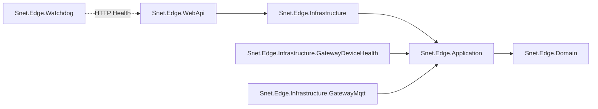

# EdgeNexus 公共类型与接口参考

## 1. 统计口径

扫描范围为 `src/**/*.cs`，排除 `bin`、`obj` 和构建产物。

当前源码包含：

- 58 个 public class，包括 static class。
- 32 个 public interface。
- 56 个顶层 public record。
- 11 个嵌套 public record。
- public record 合计 67 个。
- 17 个 public enum。

本文所称“生命周期”来自实际 DI 注册、继承关系和调用点。

## 2. 模块关系

## 3. Application 公共类

### 3.1 `DeviceProtocolValidator`

- 命名空间：`Snet.Edge.Application`。
- 类型：static class。
- 职责：验证 `DeviceDefinition` 的协议特定参数。
- 公共方法：`Validate(DeviceDefinition)`。
- 返回：只读错误字符串集合。
- 典型路径：设备新增/编辑 API -> Validator -> 返回 400 或保存草稿。
- 生命周期：无状态静态工具。

### 3.2 `GatewayConfigurationValidator`

- 命名空间：`Snet.Edge.Application`。
- 类型：sealed class，实现 `IGatewayConfigurationValidator`。
- DI：Singleton。
- 公共方法：`Validate(GatewaySnapshot)`。
- 职责：对完整快照执行分组、设备、点位和 MQTT 校验。
- 典型路径：校验/发布/回滚 API -> Validator。
- 生命周期：进程级单例，无外部资源。

### 3.3 `ModbusTagAddress`

- 命名空间：`Snet.Edge.Application`。
- 类型：static class。
- 公共方法：`Normalize`、`ToHslAddress`、`TryParseLegacy`。
- 职责：在强类型功能码和 HSL 旧前缀地址间转换。
- 典型路径：点位保存 -> Normalize；驱动读取 -> ToHslAddress。
- 生命周期：无状态静态工具。
- 测试：`ModbusTagAddressTests`。

### 3.4 `MqttDeviceStatusTemplateValidator`

- 命名空间：`Snet.Edge.Application`。
- 类型：static partial class。
- 公共方法：`Validate(MqttTemplate)`。
- 职责：校验设备通讯状态 Tag 前缀和失败码。
- 规则：前缀必须有效，失败码必须非零。
- 典型路径：模板 Upsert、预览和配置验证。
- 生命周期：无状态静态工具。

### 3.5 `MqttTopicTemplateValidator`

- 命名空间：`Snet.Edge.Application`。
- 类型：static class。
- 公共方法：`Validate(string?)`。
- 职责：校验 Topic 模板和 MQTT 通配符限制。
- 典型路径：分组保存、配置验证、Topic Builder。
- 返回：null 表示有效，否则返回错误文本。
- 生命周期：无状态静态工具。

### 3.6 `ProtocolPointAddressCatalog`

- 命名空间：`Snet.Edge.Application`。
- 类型：static class。
- 公共方法：`Get(ProtocolKind)`、`GetAll()`。
- 职责：提供 12 种协议的点位地址规范和源码示例。
- 典型路径：`ProtocolDescriptors` -> Web `/api/v1/protocols`。
- 未定义协议时抛出 `NotSupportedException`。
- 生命周期：进程内只读静态字典。

### 3.7 `TagProtocolValidator`

- 命名空间：`Snet.Edge.Application`。
- 类型：static class。
- 公共方法：`Validate(DeviceDefinition, TagDefinition)`。
- 职责：按设备协议验证点位地址、类型和功能码。
- 典型路径：点位 PUT、导入预览、完整快照校验。
- 返回：错误字符串集合。
- 生命周期：无状态静态工具。

## 4. Domain 公共静态类

### 4.1 `DeviceErrorCodes`

- 命名空间：`Snet.Edge.Domain`。
- 类型：static class。
- 常量：`Normal=0`。
- 常量：`CommunicationFailure=1001`。
- 常量：`DefaultTagPrefix="#DEVICE_ERROR"`。
- 典型路径：健康监控、模板默认值、状态 Tag Builder。
- 生命周期：编译期常量。

### 4.2 `GroupScheduleLimits`

- 命名空间：`Snet.Edge.Domain`。
- 类型：static class。
- 扫描周期范围：100 至 86400000 ms。
- 上传周期范围：1 至 86400 秒。
- 典型路径：分组 API 和 `GatewayConfigurationValidator`。
- 生命周期：编译期常量。

### 4.3 `TelemetryKey`

- 命名空间：`Snet.Edge.Domain`。
- 类型：static class。
- 公共方法：`Create(deviceId, tagName)`。
- 普通 Tag 输出 `deviceId:tagName`。
- 以 `#` 开头的系统 Tag 保持原名。
- 典型路径：`MqttPayloadBuilder` 生成 d 数组。
- 生命周期：无状态静态工具。

## 5. Infrastructure 采集与稳定性类

### 5.1 `AcquisitionWorker`

- 命名空间：`Snet.Edge.Infrastructure`。
- 基类：`BackgroundService`。
- DI：HostedService，注册顺序位于 AuditLogStore 之后。
- 公共覆盖：`StopAsync(CancellationToken)`。
- 主循环：protected `ExecuteAsync`，同步 active 配置并管理每设备异步循环。
- 典型路径：Host -> AcquisitionWorker -> DriverFactory -> TelemetryBuffer。
- 生命周期：Host 启动到停止；停止时取消设备循环并释放驱动。

### 5.2 `DeviceCommunicationStabilityTracker`

- 命名空间：`Snet.Edge.Infrastructure`。
- 类型：sealed class。
- 构造输入：`AcquisitionStabilityOptions`。
- 公共属性：`HasConfirmedState`、`IsHealthy`。
- 公共方法：`ObserveSuccessfulRead()`、`ObserveFailedRead()`。
- 职责：成功/失败阈值防抖。
- 生命周期：每个设备循环独立实例。

### 5.3 `ReconnectBackoff`

- 命名空间：`Snet.Edge.Infrastructure`。
- 类型：sealed class。
- 构造输入：重连延迟数组和抖动比率。
- 公共方法：下一延迟计算方法和 `ResetAfterSuccessfulRead()`。
- 职责：阶梯退避；只有读取成功才重置。
- 典型路径：AcquisitionWorker 设备循环连接失败分支。
- 生命周期：每个设备循环独立实例。

### 5.4 `TagReadPlanCompiler`

- 命名空间：`Snet.Edge.Infrastructure`。
- 类型：sealed class，实现 `ITagReadPlanCompiler`。
- DI：Singleton。
- 公共方法：`Compile(DeviceDefinition, IReadOnlyList<TagDefinition>)`。
- 职责：生成单读或原生多读批次。
- 约束：每批最多 16 点、200 字节，Bool 单读。
- 典型路径：DriverFactory.Create -> Compile -> Driver。

### 5.5 `HslDeviceDriverFactory`

- 命名空间：`Snet.Edge.Infrastructure`。
- 类型：sealed class，实现 `IDeviceDriverFactory`。
- DI：Singleton。
- 公共方法：`Create(DeviceDefinition, tags?)`。
- 职责：选择 HSL 或 OPC UA 驱动并应用协议参数。
- 典型路径：AcquisitionWorker/NetworkDiagnosticsService -> Create。
- 生命周期：工厂单例；每次 Create 返回新的驱动实例。

### 5.6 `HslDeviceDriver`

- 命名空间：`Snet.Edge.Infrastructure`。
- 类型：sealed class，实现 `IDeviceDriver`。
- 公共属性：`Protocol`。
- 公共方法：`ConnectAsync`、`ReadAsync`、`ReadManyAsync`、`DisconnectAsync`、`DisposeAsync`。
- 内部同步：`SemaphoreSlim` 串行化读取。
- 典型路径：设备采集循环 -> 驱动 -> HslCommunication。
- 生命周期：每设备会话；实现异步释放。

### 5.7 `OpcUaDeviceDriver`

- 命名空间：`Snet.Edge.Infrastructure`。
- 类型：sealed class，实现 `IDeviceDriver`。
- 公共属性：`Protocol` 由接口实现提供 OPC UA。
- 公共方法：连接、单读、多读、断开、释放。
- 职责：使用 OPC Foundation Client 创建 Session 并读取 NodeId。
- 典型路径：DriverFactory -> OpcUaDeviceDriver -> OPC UA Server。
- 生命周期：每设备 Session；断开和 Dispose 关闭会话。

### 5.8 `SiemensConnectionProfile`

- 命名空间：`Snet.Edge.Infrastructure`。
- 类型：static class。
- 公共方法：`Resolve(DeviceDefinition)`。
- 返回：`SiemensConnectionParameters`。
- 职责：自动或手动解析 Port、Rack、Slot、ConnectionType。
- 典型路径：HslDeviceDriverFactory.CreateSiemens。
- 生命周期：无状态静态工具。

### 5.9 `SiemensTagAddress`

- 命名空间：`Snet.Edge.Infrastructure`。
- 类型：static class。
- 公共方法：`NormalizeForRawRead(string)`。
- 职责：将工程地址规范化为 HSL 原始读取地址。
- 典型路径：HslDeviceDriver 创建 Siemens 地址缓存。
- 测试：`SiemensRawReadNormalizesEngineeringAddressNotation`。
- 生命周期：无状态静态工具。

## 6. Infrastructure 运行时存储类

### 6.1 `TelemetryBuffer`

- 命名空间：`Snet.Edge.Infrastructure`。
- 实现：`ITelemetryBuffer`、`IRuntimeTagSampleStore`。
- DI：一个具体 Singleton，同时映射两个接口。
- 公共方法：`WriteAsync`、`ReadAllAsync`、`GetByDevice`、`TakeChanges`。
- 内部：容量 100000 的 Channel 和并发样本字典。
- 典型路径：采集写入；聚合消费；SignalR 读取变化。
- 生命周期：进程级单例。

### 6.2 `RuntimeStatusStore`

- 命名空间：`Snet.Edge.Infrastructure`。
- 实现：`IRuntimeStatusStore`、`IDeviceStatusEventSource`。
- DI：一个具体 Singleton，同时映射两个接口。
- 公共方法：`Set`、`GetAll`、`ReadAllAsync`。
- 内部：ConcurrentDictionary 和容量 10000 的状态 Channel。
- 典型路径：AcquisitionWorker 写；HealthMonitor/SignalR 读。
- 生命周期：进程级单例。

### 6.3 `AcquisitionControl`

- 命名空间：`Snet.Edge.Infrastructure`。
- 实现：`IAcquisitionControl`。
- DI：Singleton。
- 公共属性：`IsRunning`。
- 公共方法：`Start()`、`Stop()`。
- 内部：Interlocked 修改 int 标志。
- 典型路径：采集控制 API 与 AcquisitionWorker。

### 6.4 `InitializationState`

- 命名空间：`Snet.Edge.Infrastructure`。
- 实现：`IInitializationState`。
- DI：Singleton。
- 公共属性：`IsReady`、`ReadyAt`、`Error`。
- 公共方法：`MarkReady()`、`MarkFailed(Exception)`。
- 典型路径：InfrastructureInitializer 写；健康端点读。
- 生命周期：进程级初始化状态。

### 6.5 `GatewayMetrics`

- 命名空间：`Snet.Edge.Infrastructure`。
- 实现：`IGatewayMetrics`、`IDisposable`。
- DI：Singleton。
- 公共属性：`Snapshot`。
- 公共方法：采集/MQTT/SignalR 计数方法和 `Dispose()`。
- 内部：Interlocked 计数和 `System.Diagnostics.Metrics.Meter`。
- 典型路径：Workers 更新；`/metrics` 读取。

## 7. Infrastructure 设备健康类

### 7.1 `DeviceErrorManager`

- 命名空间：`Snet.Edge.Infrastructure.GatewayDeviceHealth`。
- 实现：`IDeviceErrorManager`。
- DI：Singleton。
- 公共方法：`Resolve(DeviceRuntimeStatus, int communicationFailureCode)`。
- 规则：Online 为 0；有成功点位的 Degraded 为 0；其余使用失败码。
- 典型路径：DeviceHealthMonitor 和聚合缺省健康状态。
- 生命周期：无状态单例。

### 7.2 `SystemTagBuilder`

- 命名空间：`Snet.Edge.Infrastructure.GatewayDeviceHealth`。
- 实现：`ISystemTagBuilder`。
- DI：Singleton。
- 公共方法：`BuildDeviceErrorTag(deviceId, tagPrefix, errorCode)`。
- 输出：`TagData`，quality 固定 Good。
- 典型路径：TelemetryAggregationWorker 构建设备状态 Tag。
- 生命周期：无状态单例。

### 7.3 `DeviceHealthStateStore`

- 命名空间：`Snet.Edge.Infrastructure.GatewayDeviceHealth`。
- 实现：`IDeviceHealthStateStore`。
- DI：Singleton。
- 公共方法：`GetAll`、`Get`、`SetIfChanged`、`Remove`。
- 内部：ConcurrentDictionary。
- `SetIfChanged` 只在 record 值变化时更新。
- 典型路径：HealthMonitor 写；Dashboard/SignalR/MQTT 聚合读。

### 7.4 `DeviceHealthMonitor`

- 命名空间：`Snet.Edge.Infrastructure.GatewayDeviceHealth`。
- 基类：`BackgroundService`。
- DI：HostedService。
- 主循环：消费设备状态 Channel，并每 2 秒协调 active 设备集合。
- 职责：解析外部 MQTT ID、模板失败码并更新健康状态。
- 典型路径：RuntimeStatusStore -> Monitor -> DeviceHealthStateStore。
- 生命周期：Host 启动到停止。

## 8. Infrastructure MQTT 类

### 8.1 `MqttVariableResolver`

- 命名空间：`Snet.Edge.Infrastructure.GatewayMqtt`。
- 类型：sealed class。
- DI：Singleton。
- 公共方法：`Resolve(template, data, context, firstTag?)`。
- 职责：解析设备、网关、分组、时间和首个业务 Tag 变量。
- 典型路径：TopicBuilder 和 PayloadBuilder。
- 生命周期：无状态单例。

### 8.2 `MqttTopicBuilder`

- 命名空间：`Snet.Edge.Infrastructure.GatewayMqtt`。
- 实现：`ITopicBuilder`。
- DI：Singleton。
- 公共方法：`Build(topicTemplate, DeviceData, MqttPayloadContext)`。
- 职责：校验模板、解析变量并输出最终 Topic。
- 典型路径：MqttOutbox.PublishAsync 和模板预览。
- 生命周期：无状态单例。

### 8.3 `MqttPayloadBuilder`

- 命名空间：`Snet.Edge.Infrastructure.GatewayMqtt`。
- 实现：`IMqttPayloadBuilder`。
- DI：Singleton。
- 公共方法：`Build(DeviceData, MqttTemplate, MqttPayloadContext)`。
- 职责：按系统字段、自定义字段和风格生成 JSON。
- 典型路径：MqttOutbox.PublishAsync 和模板预览。
- 生命周期：无状态单例。

### 8.4 `MqttTemplateManager`

- 命名空间：`Snet.Edge.Infrastructure.GatewayMqtt`。
- 实现：`IMqttTemplateManager`、`IAsyncDisposable`。
- DI：具体 Singleton，并映射模板管理和解析接口。
- 公共方法：初始化、查询、解析、Upsert、Delete、Dispose。
- 内部：ConcurrentDictionary、SemaphoreSlim、SQLite。
- 典型路径：初始化器/API/Outbox。
- 生命周期：进程级；初始化后热更新缓存。

### 8.5 `MqttOutbox`

- 命名空间：`Snet.Edge.Infrastructure`。
- 实现：`IMqttMessagePublisher`、`IMqttOutboxMonitor`、`IMqttOutboxConfigurationSynchronizer`。
- DI：具体 Singleton，同时映射三个接口。
- 公共方法：初始化、发布入队、读批次、成功/失败/丢弃、统计、死信、Prune。
- 职责：在 SQLite 固化最终 Topic/Payload/QoS/Retain。
- 典型路径：TelemetryAggregationWorker -> Outbox -> StoreForwardWorker。
- 生命周期：进程级，无常驻连接。

### 8.6 `MqttRuntimeStateStore`

- 命名空间：`Snet.Edge.Infrastructure`。
- 实现：`IMqttRuntimeStateStore`。
- DI：Singleton。
- 公共属性：`Current`、`ConfigurationRevision`。
- 公共方法：`Set`、`NotifyConfigurationChanged`、`WaitForConfigurationChangeAsync`。
- 内部：Volatile 状态和容量 1 的配置变化 Channel。
- 典型路径：MQTT 配置 API 与 MqttStoreForwardWorker。

### 8.7 `MqttStoreForwardWorker`

- 命名空间：`Snet.Edge.Infrastructure`。
- 基类：`BackgroundService`。
- DI：HostedService。
- 主循环：读取 active MQTT 配置、维护连接、批量消费 Outbox。
- 职责：自动重连、TLS/认证/遗嘱、速率限制、死信。
- 典型路径：Host -> Worker -> MQTTnet Client -> Broker。
- 生命周期：Host 启动到停止；退出时断开 Client。

### 8.8 `TelemetryAggregationWorker`

- 命名空间：`Snet.Edge.Infrastructure`。
- 基类：`BackgroundService`。
- DI：HostedService。
- 主循环：消费 TagSample，并每 250 ms 评估设备上传。
- 职责：按设备生成 DeviceData、状态 Tag、变化上传和 Outbox 请求。
- 典型路径：TelemetryBuffer -> Aggregation -> MqttOutbox。
- 生命周期：Host 启动到停止。

## 9. Infrastructure 配置与文件类

### 9.1 `SqliteGatewayConfigurationStore`

- 命名空间：`Snet.Edge.Infrastructure`。
- 实现：`IGatewayConfigurationStore`、`IMqttConfigurationPublisher`、`IAsyncDisposable`。
- DI：具体 Singleton，并映射两个接口。
- 公共方法：初始化、读 active/draft/revision、发布、回滚、删除版本、草稿 CRUD。
- 内部：SQLite JSON 快照、事务、SemaphoreSlim。
- 典型路径：API、AcquisitionWorker、TelemetryAggregationWorker。
- 生命周期：进程级；应用停止时容器释放。

### 9.2 `PointTableImportService`

- 命名空间：`Snet.Edge.Infrastructure`。
- 实现：`IPointTableImportService`。
- DI：Singleton。
- 公共方法：`PreviewAsync`、`ImportDraftAsync`。
- 职责：解析 CSV/XLSX 工程点表并形成报告。
- 正式导入使用 `ReplaceDraftAsync`，不自动发布。
- 典型路径：配置导入 API。

### 9.3 `DeviceTagFileService`

- 命名空间：`Snet.Edge.Infrastructure`。
- 实现：`IDeviceTagFileService`。
- DI：Singleton。
- 公共方法：`ExportAsync`、`PreviewImportAsync`。
- 职责：单设备点位 Excel 导出和导入预览。
- 典型路径：设备点位导入导出 API。
- 生命周期：无常驻文件句柄。

### 9.4 `SqliteUserAccountStore`

- 命名空间：`Snet.Edge.Infrastructure`。
- 实现：`IUserAccountStore`、`IAsyncDisposable`。
- DI：具体 Singleton，并映射用户接口。
- 公共方法：初始化、认证、修改密码、DisposeAsync。
- 内部：PasswordHasher、SQLite、SemaphoreSlim。
- 典型路径：认证端点。
- 生命周期：进程级。

### 9.5 `AuditLogStore`

- 命名空间：`Snet.Edge.Infrastructure`。
- 基类：`BackgroundService`，实现 `IAuditLogStore`。
- DI：具体 Singleton，同时注册 HostedService 和接口。
- 公共方法：`InitializeAsync`、`TryWrite`、`StopAsync`、`GetRecentAsync`。
- 内部：容量 10000 Channel，后台最多 100 条批量事务写入。
- 典型路径：AuditMiddleware -> TryWrite -> SQLite。
- 生命周期：Host 启动到停止，并在停止时完成 Channel。

### 9.6 `InfrastructureInitializer`

- 命名空间：`Snet.Edge.Infrastructure`。
- 实现：`IHostedService`。
- DI：首个 Infrastructure HostedService。
- 公共方法：`StartAsync`、`StopAsync`。
- 职责：依次初始化配置、网络、模板、Outbox、审计和用户表。
- 成功调用 `InitializationState.MarkReady`，失败 MarkFailed 后重抛。
- 生命周期：启动阶段一次执行。

### 9.7 `ServiceCollectionExtensions`

- 命名空间：`Snet.Edge.Infrastructure`。
- 类型：static class。
- 公共扩展：`AddEdgeInfrastructure(...)`。
- 职责：集中注册全部 Singleton、接口映射和 HostedService。
- 典型路径：WebApi `Program.cs`。
- 生命周期：仅 Host 构建阶段调用。
- 返回原 `IServiceCollection`。

## 10. Infrastructure 网络类

### 10.1 `SystemNetworkInventoryService`

- 命名空间：`Snet.Edge.Infrastructure`。
- 实现：`INetworkInventoryService`。
- DI：Singleton。
- 公共方法：`GetInterfaces(forceRefresh=false)`。
- 职责：读取操作系统网卡、IPv4、掩码、网关、DNS、MAC、DHCP。
- 内部：带缓存和刷新锁。
- 生命周期：进程级只读服务。

### 10.2 `SqliteNetworkConfigurationService`

- 命名空间：`Snet.Edge.Infrastructure`。
- 实现：`INetworkConfigurationService`、`IDisposable`。
- DI：具体 Singleton，并映射接口。
- 公共方法：初始化、Get、Save、解析源 IP/网卡名、Revision、Web 允许判断、Dispose。
- 职责：保存三种业务用途绑定，不修改系统 IP。
- 典型路径：网络 API、驱动工厂、MQTT Worker、Web 中间件。
- 生命周期：进程级。

### 10.3 `NetworkDiagnosticsService`

- 命名空间：`Snet.Edge.Infrastructure`。
- 实现：`INetworkDiagnosticsService`。
- DI：Singleton。
- 公共方法：Ping、TCP、MQTT、PLC 诊断。
- 职责：按用途绑定源地址并返回步骤化结果。
- 静态公共方法：`Build(MqttOptions, localIpv4, includeWill)` 构建 MQTT Client Options。
- 典型路径：网络诊断 API 和 MQTT Worker。

## 11. Infrastructure 资源保护类

### 11.1 `ResourceGuard`

- 命名空间：`Snet.Edge.Infrastructure`。
- 实现：`IResourceGuard`。
- DI：具体 Singleton，并映射接口。
- 公共属性：Current、AllowAcquisition、AllowPersistentEnqueue。
- 公共方法：`Update(ResourceSnapshot)`。
- 内部：Volatile 读写当前 record。
- 典型路径：ResourceMonitorWorker 写；采集/Outbox/健康端点读。

### 11.2 `ResourceMonitorWorker`

- 命名空间：`Snet.Edge.Infrastructure`。
- 基类：`BackgroundService`。
- DI：HostedService。
- 主循环：每 2 秒采样进程 CPU、工作集、GC Heap、磁盘、线程。
- 职责：计算 Normal/Warning/Restricted/Critical。
- 典型路径：Host -> Worker -> ResourceGuard。
- 生命周期：Host 启动到停止。

## 12. WebApi 公共类

### 12.1 `ApiEndpoints`

- 命名空间：`Snet.Edge.WebApi`。
- 类型：static class。
- 公共扩展：`MapGatewayApi(IEndpointRouteBuilder)`。
- 职责：映射 49 个 `/api/v1` 端点。
- 包含多个 public 嵌套请求/响应 record。
- 典型路径：Program.cs -> MapGatewayApi。
- 生命周期：应用启动路由装配阶段。

### 12.2 `AuthenticationEndpoints`

- 命名空间：`Snet.Edge.WebApi`。
- 类型：static class。
- 公共扩展：`MapAuthenticationApi`。
- 职责：映射 CSRF、登录、会话、改密、退出 5 个端点。
- 嵌套 record：LoginRequest、PasswordChangeRequest。
- 生命周期：路由装配阶段。

### 12.3 `MonitoringEndpoints`

- 命名空间：`Snet.Edge.WebApi`。
- 类型：static class。
- 公共扩展：`MapGatewayMonitoring`。
- 职责：映射 live、ready、health、metrics。
- 典型路径：Program.cs -> MapGatewayMonitoring。
- 生命周期：路由装配阶段。

### 12.4 `ProtocolDescriptors`

- 命名空间：`Snet.Edge.WebApi`。
- 类型：static class。
- 公共字段：`All`。
- 内容：12 个协议描述和动态前端参数元数据。
- 点位指南来自 `ProtocolPointAddressCatalog.Get`。
- 典型路径：GET `/api/v1/protocols`。
- 生命周期：类型初始化时构造只读数组。

### 12.5 `AntiforgeryProtectionMiddleware`

- 命名空间：`Snet.Edge.WebApi`。
- 类型：sealed middleware。
- 公共方法：`InvokeAsync(HttpContext, IAntiforgery)`。
- 职责：校验 `/api` 下非安全方法的 CSRF Token。
- 典型路径：Program.cs 中间件管道。
- 生命周期：ASP.NET Core 中间件实例。

### 12.6 `AuditMiddleware`

- 命名空间：`Snet.Edge.WebApi`。
- 类型：sealed middleware。
- 公共方法：`InvokeAsync(HttpContext, IAuditLogStore)`。
- 职责：为非只读请求创建 `AuditEvent`。
- 典型路径：HTTP -> Endpoint -> TryWrite。
- 生命周期：ASP.NET Core 中间件实例。

### 12.7 `WebNetworkBindingMiddleware`

- 命名空间：`Snet.Edge.WebApi`。
- 类型：sealed middleware。
- 公共方法：`InvokeAsync(HttpContext, INetworkConfigurationService)`。
- 职责：按 WebManagement 用途检查请求落在哪个本地地址。
- 典型路径：响应压缩之后、安全头之前。
- 生命周期：ASP.NET Core 中间件实例。

### 12.8 `StatusHub`

- 命名空间：`Snet.Edge.WebApi`。
- 基类：SignalR `Hub`。
- 公共方法：OnConnectedAsync、OnDisconnectedAsync、SubscribeDevice、UnsubscribeDevice。
- 职责：连接快照和设备级点位订阅。
- 典型路径：Browser -> `/hubs/status` -> Runtime Stores。
- 生命周期：每个 Hub 调用由 SignalR 创建实例。

### 12.9 `StatusBroadcastWorker`

- 命名空间：`Snet.Edge.WebApi`。
- 基类：`BackgroundService`。
- DI：WebApi HostedService。
- 主循环：2 秒状态差量广播和 250 ms 点位差量广播并行运行。
- 典型路径：Runtime Stores -> HubContext -> Browser。
- 生命周期：Host 启动到停止。

## 13. Watchdog 公共类

### 13.1 `GatewayWatchdogWorker`

- 命名空间：`Snet.Edge.Watchdog`。
- 基类：`BackgroundService`。
- DI：Watchdog Host 的 HostedService。
- 主循环：启动宽限后周期性请求 HealthEndpoint。
- 职责：连续失败阈值、冷却、每小时上限、外部重启命令。
- 典型路径：Watchdog -> HTTP `/health` -> Process.Start。
- 生命周期：独立进程 Host 启动到停止。

## 14. 公共接口：配置与文件

### 14.1 `IGatewayConfigurationStore`

- 模块：Application。
- 方法：Initialize、读取 active/draft/revisions、发布、回滚、删除版本。
- 方法：分组/设备 Upsert/Delete、ReplaceTags、SaveMqtt、ReplaceDraft。
- 实现：`SqliteGatewayConfigurationStore`。
- 生命周期：接口映射到同一 Singleton 实例。

### 14.2 `IMqttConfigurationPublisher`

- 方法：`PublishMqttOptionsAsync`。
- 实现：`SqliteGatewayConfigurationStore`。
- 用途：独立发布 MQTT 配置。
- 调用方：MQTT apply API。
- 生命周期：映射配置存储单例。

### 14.3 `IPointTableImportService`

- 方法：`PreviewAsync`、`ImportDraftAsync`。
- 实现：`PointTableImportService`。
- 输入：Stream、文件名、替换标志、CancellationToken。
- 输出：`PointTableImportReport`。
- 生命周期：Singleton。

### 14.4 `IDeviceTagFileService`

- 方法：`ExportAsync`、`PreviewImportAsync`。
- 实现：`DeviceTagFileService`。
- 输入：设备 ID 和文件 Stream。
- 输出：导出文件或导入预览。
- 生命周期：Singleton。

### 14.5 `IGatewayConfigurationValidator`

- 方法：`Validate(GatewaySnapshot)`。
- 实现：`GatewayConfigurationValidator`。
- 输出：Errors、Warnings、IsValid。
- 调用：校验、发布、回滚。
- 生命周期：Singleton。

## 15. 公共接口：驱动与网络

### 15.1 `IDeviceDriver`

- 继承：`IAsyncDisposable`。
- 属性：`Protocol`。
- 方法：ConnectAsync、ReadAsync、ReadManyAsync、DisconnectAsync。
- 实现：`HslDeviceDriver`、`OpcUaDeviceDriver`。
- 生命周期：每设备会话。

### 15.2 `IDeviceDriverFactory`

- 方法：`Create(DeviceDefinition, tags?)`。
- 实现：`HslDeviceDriverFactory`。
- 返回：新的 `IDeviceDriver`。
- 调用：采集和 PLC 诊断。
- 生命周期：Singleton。

### 15.3 `INetworkInventoryService`

- 方法：`GetInterfaces(forceRefresh=false)`。
- 实现：`SystemNetworkInventoryService`。
- 返回：操作系统网卡只读信息。
- 调用：网络配置服务。
- 生命周期：Singleton。

### 15.4 `INetworkConfigurationService`

- 方法：Initialize、Get、Save。
- 方法：ResolveLocalIpv4、ResolveInterfaceName、GetRevision、IsWebRequestAllowed。
- 实现：`SqliteNetworkConfigurationService`。
- 调用：Web、PLC、MQTT、诊断。
- 生命周期：Singleton。

### 15.5 `INetworkDiagnosticsService`

- 方法：PingAsync、TestTcpAsync、TestMqttAsync、TestPlcAsync。
- 实现：`NetworkDiagnosticsService`。
- 返回：`NetworkDiagnosticResult`。
- 调用：网络和设备连接测试 API。
- 生命周期：Singleton。

### 15.6 `ITagReadPlanCompiler`

- 方法：`Compile(device, tags)`。
- 实现：`TagReadPlanCompiler`。
- 返回：`DeviceReadPlan`。
- 调用：DriverFactory。
- 生命周期：Singleton。

## 16. 公共接口：Telemetry 与状态

### 16.1 `ITelemetryBuffer`

- 方法：`WriteAsync(TagSample)`。
- 方法：`ReadAllAsync(CancellationToken)`。
- 实现：`TelemetryBuffer`。
- 调用：AcquisitionWorker 写、AggregationWorker 读。
- 生命周期：Singleton。

### 16.2 `IRuntimeTagSampleStore`

- 方法：`GetByDevice`、`TakeChanges`。
- 实现：`TelemetryBuffer`。
- 调用：StatusHub 和 StatusBroadcastWorker。
- 返回：当前样本或变化样本。
- 生命周期：同 TelemetryBuffer 单例。

### 16.3 `IRuntimeStatusStore`

- 方法：`Set`、`GetAll`。
- 实现：`RuntimeStatusStore`。
- 调用：AcquisitionWorker 写、Dashboard/SignalR 读。
- 状态按 DeviceId 保存。
- 生命周期：Singleton。

### 16.4 `IDeviceStatusEventSource`

- 方法：`ReadAllAsync`。
- 实现：`RuntimeStatusStore`。
- 调用：DeviceHealthMonitor。
- Channel 提供变化状态事件。
- 生命周期：同 RuntimeStatusStore 单例。

### 16.5 `IDeviceHealthStateStore`

- 方法：GetAll、Get、SetIfChanged、Remove。
- 实现：`DeviceHealthStateStore`。
- 调用：HealthMonitor、聚合、Dashboard、SignalR。
- 只在状态变化时返回 true。
- 生命周期：Singleton。

### 16.6 `IDeviceErrorManager`

- 方法：`Resolve(status, communicationFailureCode)`。
- 实现：`DeviceErrorManager`。
- 返回设备级通讯错误码。
- 单点异常不必导致非零设备码。
- 生命周期：Singleton。

### 16.7 `ISystemTagBuilder`

- 方法：`BuildDeviceErrorTag`。
- 实现：`SystemTagBuilder`。
- 返回统一 `TagData`。
- 调用：TelemetryAggregationWorker。
- 生命周期：Singleton。

### 16.8 `IAcquisitionControl`

- 属性：`IsRunning`。
- 方法：Start、Stop。
- 实现：`AcquisitionControl`。
- 调用：采集 API 和 Worker。
- 生命周期：Singleton。

## 17. 公共接口：MQTT

### 17.1 `IMqttMessagePublisher`

- 方法：`PublishAsync(MqttPublishRequest)`。
- 实现：`MqttOutbox`。
- 语义：生成最终报文并持久化入队。
- 调用：Aggregation 和模板测试发送。
- 生命周期：Singleton。

### 17.2 `IMqttPayloadBuilder`

- 方法：`Build(DeviceData, MqttTemplate, MqttPayloadContext)`。
- 实现：`MqttPayloadBuilder`。
- 返回：JSON string。
- 调用：Outbox 和预览 API。
- 生命周期：Singleton。

### 17.3 `ITopicBuilder`

- 方法：`Build(topicTemplate, data, context)`。
- 实现：`MqttTopicBuilder`。
- 返回：最终 MQTT Topic。
- 调用：Outbox 和预览 API。
- 生命周期：Singleton。

### 17.4 `ITemplateResolver`

- 方法：`ResolveAsync(Guid?)`。
- 实现：`MqttTemplateManager`。
- 空或无效/禁用模板回退内置默认模板。
- 调用：Outbox、预览和聚合链路。
- 生命周期：Singleton。

### 17.5 `IMqttTemplateManager`

- 继承：`ITemplateResolver`。
- 方法：Initialize、GetAll、Get、Upsert、Delete。
- 实现：`MqttTemplateManager`。
- 调用：初始化器和模板 API。
- 生命周期：Singleton。

### 17.6 `IMqttOutboxMonitor`

- 方法：GetStatisticsAsync、GetDeadLettersAsync。
- 实现：`MqttOutbox`。
- 调用：Outbox API 和 Metrics。
- 只读监控接口。
- 生命周期：Singleton。

### 17.7 `IMqttOutboxConfigurationSynchronizer`

- 方法：`PruneStaleAsync(GatewaySnapshot)`。
- 实现：`MqttOutbox`。
- 调用：发布和回滚 API。
- 清理被删除设备/点位产生的旧消息。
- 生命周期：Singleton。

### 17.8 `IMqttRuntimeStateStore`

- 属性：Current、ConfigurationRevision。
- 方法：Set、NotifyConfigurationChanged、WaitForConfigurationChangeAsync。
- 实现：`MqttRuntimeStateStore`。
- 调用：MQTT API 和 Worker。
- 生命周期：Singleton。

## 18. 公共接口：运维与安全

### 18.1 `IResourceGuard`

- 属性：Current、AllowAcquisition、AllowPersistentEnqueue。
- 实现：`ResourceGuard`。
- 调用：采集、Outbox、健康端点、Dashboard。
- 状态由 ResourceMonitorWorker 更新。
- 生命周期：Singleton。

### 18.2 `IInitializationState`

- 属性：IsReady、ReadyAt、Error。
- 实现：`InitializationState`。
- 调用：InfrastructureInitializer 和健康端点。
- 仅表示基础设施初始化状态。
- 生命周期：Singleton。

### 18.3 `IGatewayMetrics`

- 属性：Snapshot。
- 方法：采集/MQTT/SignalR 计数。
- 实现：`GatewayMetrics`。
- 调用：Workers、Hub、Metrics Endpoint。
- 生命周期：Singleton。

### 18.4 `IAuditLogStore`

- 方法：TryWrite、GetRecentAsync。
- 实现：`AuditLogStore`。
- 调用：AuditMiddleware 和审计 API。
- 写入入口非阻塞 TryWrite。
- 生命周期：Singleton + HostedService。

### 18.5 `IUserAccountStore`

- 方法：AuthenticateAsync、ChangePasswordAsync。
- 实现：`SqliteUserAccountStore`。
- 调用：认证端点。
- 返回领域认证结果，不直接操作 HttpContext。
- 生命周期：Singleton。

## 19. 顶层 public record：配置与领域

| 类型 | 模块 | 作用 |
|---|---|---|
| `MqttGroup` | Domain | 分组 Topic、扫描周期、上传周期 |
| `DeviceDefinition` | Domain | PLC/OPC UA 设备和协议参数 |
| `TagDefinition` | Domain | 点位地址、类型、转换、变化上传 |
| `MqttOptions` | Domain | Broker、QoS、TLS、遗嘱、Outbox |
| `MqttTemplate` | Domain | Payload 系统字段和状态码模板 |
| `MqttCustomField` | Domain | 自定义顶层字段 |
| `GatewaySnapshot` | Domain | Groups/Devices/Tags/Mqtt 完整快照 |
| `ConfigurationRevision` | Domain | 版本列表摘要 |
| `PublishResult` | Domain | 发布版本和时间 |
| `AcquisitionStabilityOptions` | Infrastructure | 通讯防抖和重连参数 |
| `ResourceProtectionOptions` | Infrastructure | 磁盘和内存阈值 |
| `AuthenticationBootstrapOptions` | Infrastructure | 首次管理员和锁定策略 |
| `WatchdogOptions` | Watchdog | 健康探测与重启策略 |

## 20. 顶层 public record：Telemetry 与 MQTT

| 类型 | 作用 |
|---|---|
| `TagSample` | 采集层输出，含 RawValue、Quality、Error |
| `TagData` | MQTT 统一 Tag 模型 |
| `DeviceData` | 单设备 MQTT 数据模型 |
| `MqttPublishRequest` | 聚合层到 Outbox 的请求 |
| `MqttPayloadContext` | 网关、分组、产线上下文 |
| `MqttBuildResult` | Topic/Payload/模板预览结果 |
| `MqttRuntimeStatus` | MQTT 连接运行状态 |
| `MqttOutboxStatistics` | Outbox 统计 |
| `MqttDeadLetter` | 死信 DTO |
| `MqttOutboxItem` | Infrastructure Outbox 读取项 |
| `DeviceTagReadResult` | 驱动批量读取的单点结果 |
| `DeviceRuntimeStatus` | 设备连接运行状态 |
| `DeviceHealthStatus` | 设备错误码健康状态 |

## 21. 顶层 public record：读取计划与导入

| 类型 | 作用 |
|---|---|
| `TagReadBatch` | 一批 Tag 和是否原生多读 |
| `DeviceReadPlan` | 设备读取批次集合 |
| `PointTableImportIssue` | 导入行、字段和错误 |
| `PointTableImportReport` | 工程导入统计和验证结果 |
| `DeviceTagExportFile` | 单设备导出字节、类型和文件名 |
| `DeviceTagImportPreview` | 单设备导入候选 Tags 和问题 |
| `ConfigurationValidationResult` | Errors、Warnings、IsValid |

## 22. 顶层 public record：网络

| 类型 | 作用 |
|---|---|
| `NetworkInterfaceAddress` | IPv4 地址和掩码 |
| `NetworkInterfaceInfo` | 操作系统网卡完整信息 |
| `NetworkBindingConfiguration` | 三种用途绑定 |
| `EffectiveNetworkBinding` | 自动/指定绑定解析结果 |
| `NetworkConfigurationView` | 绑定、网卡和有效绑定 |
| `NetworkDiagnosticResult` | 诊断总结果 |
| `NetworkDiagnosticStep` | 单个诊断步骤 |
| `SaveNetworkBindingsRequest` | Web 保存绑定请求 |
| `NetworkPingRequest` | Ping 请求 |
| `NetworkTcpTestRequest` | TCP 测试请求 |
| `NetworkMqttTestRequest` | MQTT 测试请求 |
| `NetworkPlcTestRequest` | PLC 测试请求 |

## 23. 顶层 public record：协议与运维

| 类型 | 作用 |
|---|---|
| `ProtocolPointAddressExample` | 地址、区域、类型、用途、功能码 |
| `ProtocolPointAddressGuide` | 协议地址说明、示例和注意事项 |
| `ProtocolDescriptor` | Web 协议完整描述 |
| `ProtocolParameterDescriptor` | 动态参数元数据 |
| `ProtocolParameterOption` | 下拉选项 |
| `SiemensConnectionParameters` | 解析后的连接参数 |
| `ResourceSnapshot` | CPU/内存/磁盘/线程采样 |
| `GatewayMetricSnapshot` | 业务计数快照 |
| `AuditEvent` | HTTP 审计事件 |
| `UserAuthenticationResult` | 登录结果 |
| `PasswordChangeResult` | 修改密码结果 |

## 24. 嵌套 public record

### 24.1 `AuthenticationEndpoints.LoginRequest`

- 字段：Username、Password。
- 用途：登录 API 请求体。

### 24.2 `AuthenticationEndpoints.PasswordChangeRequest`

- 字段：CurrentPassword、NewPassword。
- 用途：修改密码 API 请求体。

### 24.3 `ApiEndpoints.PingRequest`

- 字段：Host、TimeoutMs。
- 用途：兼容 Ping API。

### 24.4 `ApiEndpoints.MqttTemplatePreviewTag`

- 字段：TagName、Value、Quality。
- 用途：模板预览测试点位。

### 24.5 `ApiEndpoints.MqttTemplatePreviewRequest`

- 字段：模板、Topic、设备、分组、Line、时间、Tags、CommunicationFailed。
- 用途：预览和测试发送。

### 24.6 `ApiEndpoints.PublishRequest`

- 字段：Reason。
- 用途：发布草稿。

### 24.7 `ApiEndpoints.RollbackRequest`

- 字段：Reason、ExpectedActiveVersion。
- 用途：并发安全回滚。

### 24.8 `ApiEndpoints.DeleteRevisionRequest`

- 字段：Reason、ExpectedActiveVersion。
- 用途：逻辑删除版本。

### 24.9 `ApiEndpoints.RevisionChangeSummary`

- 字段：Added、Removed、Modified。
- 用途：回滚影响统计。

### 24.10 `ApiEndpoints.RollbackImpact`

- 字段：Groups、Devices、Tags、MqttChanged。
- 用途：回滚预览。

### 24.11 `ApiEndpoints.RollbackPreviewResponse`

- 字段：TargetVersion、ActiveVersion、Validation、Impact。
- 用途：版本预览响应。

## 25. public enum 清单

### 25.1 `ProtocolKind`

- SiemensS7、ModbusTcp、MitsubishiMc、OpcUa。
- PanasonicMewtocol、OmronFins、OmronCip。
- AllenBradleyEtherNetIp、BeckhoffAds、KeyenceMc。
- InovanceTcp、DeltaTcp。

### 25.2 `SiemensPlcSeries`

- S1200、S1500、S300、S400、S200Smart、S200。

### 25.3 `SiemensConnectionType`

- Pg=1、Op=2、S7Basic=3。

### 25.4 `MitsubishiMcFormat`

- Binary3E、Ascii3E、Binary1E、Ascii1E。

### 25.5 `MitsubishiMcTransport`

- Tcp、Udp。

### 25.6 `InovancePlcSeries`

- AM、H3U、H5U、Easy。

### 25.7 `DeltaPlcSeries`

- Dvp、AS。

### 25.8 `TagDataType`

- Bool、Byte、Int16、UInt16、Int32、UInt32。
- Int64、UInt64、Float32、Float64、String、Bcd。

### 25.9 `ModbusFunctionCode`

- ReadCoils=1、ReadDiscreteInputs=2。
- ReadHoldingRegisters=3、ReadInputRegisters=4。

### 25.10 `DataQuality`

- Good、Uncertain、Bad、Disconnected、Timeout、ConfigurationError。

### 25.11 `DeviceConnectionState`

- Stopped、Connecting、Online、Degraded、Reconnecting、Offline。

### 25.12 `DeviceFaultKind`

- None、Communication、Timeout、Read、Parse、Offline。

### 25.13 `MqttConnectionState`

- Disabled、Connecting、Connected、Reconnecting、Faulted。

### 25.14 `MqttPayloadStyle`

- Standard、Advantech。

### 25.15 `ResourceProtectionLevel`

- Normal、Warning、Restricted、Critical。

### 25.16 `NetworkUsage`

- PlcAcquisition、MqttUpload、WebManagement。

### 25.17 `CommunicationStabilityTransition`

- 表示防抖观察后的状态转换结果。
- 消费者为 AcquisitionWorker。
- 具体枚举值由 `AcquisitionStability.cs` 定义。

## 26. DI 生命周期核对

- 配置存储：Singleton。
- 网络库存和绑定：Singleton。
- MQTT Builders：Singleton。
- MQTT TemplateManager：Singleton。
- MqttOutbox：Singleton。
- Runtime Stores：Singleton。
- Validators：Singleton 或 static。
- DriverFactory：Singleton。
- Driver：每设备创建，不由根容器注册。
- HostedService：Host 生命周期。
- SignalR Hub：SignalR 激活生命周期。
- Middleware：ASP.NET Core 中间件生命周期。

## 27. 典型调用路径

### 27.1 配置发布

`ApiEndpoints` -> `IGatewayConfigurationValidator` -> `IGatewayConfigurationStore` -> SQLite。

### 27.2 PLC 采集

`AcquisitionWorker` -> `IDeviceDriverFactory` -> `IDeviceDriver` -> `ITelemetryBuffer`。

### 27.3 MQTT 报文

`TelemetryAggregationWorker` -> `IDeviceHealthStateStore` -> `ISystemTagBuilder` -> `IMqttMessagePublisher`。

### 27.4 MQTT 发送

`MqttOutbox` -> SQLite -> `MqttStoreForwardWorker` -> MQTTnet。

### 27.5 实时页面

`RuntimeStatusStore`/`TelemetryBuffer` -> `StatusBroadcastWorker` -> `StatusHub` -> Browser。

### 27.6 网络诊断

`ApiEndpoints` -> `INetworkDiagnosticsService` -> Network Binding -> Ping/TCP/MQTT/Driver。

## 28. 公共类型覆盖核对

- [x] 58 个 public class 均在第 3 至 13 节出现。
- [x] 32 个 public interface 均在第 14 至 18 节出现。
- [x] 56 个顶层 public record 均在第 19 至 23 节出现。
- [x] 11 个嵌套 public record 均在第 24 节出现。
- [x] 17 个 public enum 均在第 25 节出现。
- [x] HostedService 生命周期均已标明。
- [x] 公共方法按类或接口列出。
- [x] DI Singleton 映射已标明。
- [x] 每类典型调用路径已给出。

## 29. 源码索引

- Domain：`src/Snet.Edge.Domain/Models.cs`、`NetworkModels.cs`。
- Application：`src/Snet.Edge.Application/*.cs`。
- Infrastructure：`src/Snet.Edge.Infrastructure/*.cs`。
- DeviceHealth：`src/Snet.Edge.Infrastructure/Gateway.DeviceHealth/*.cs`。
- MQTT Builders：`src/Snet.Edge.Infrastructure/Gateway.Mqtt/*.cs`。
- WebApi：`src/Snet.Edge.WebApi/*.cs`。
- Watchdog：`src/Snet.Edge.Watchdog/*.cs`。

## 30. 公共方法精确补充索引

以下方法已在前文按职责说明，本节补充源码符号的逐名索引，以便覆盖率检查。

### 30.1 配置存储

- `GetSnapshotAsync`：读取 active payload。
- `GetDraftSnapshotAsync`：读取 draft payload。
- `GetRevisionsAsync`：读取未逻辑删除版本。
- `GetRevisionSnapshotAsync`：读取指定版本完整快照。
- `PublishDraftAsync`：发布草稿并创建版本。
- `RollbackAsync`：以旧快照创建新活动版本。
- `DeleteRevisionAsync`：写入版本删除标记。
- `UpsertGroupAsync`：写入草稿分组。
- `DeleteGroupAsync`：删除草稿分组。
- `UpsertDeviceAsync`：写入草稿设备。
- `DeleteDeviceAsync`：删除草稿设备。
- `ReplaceTagsAsync`：替换设备草稿点位。
- `SaveMqttOptionsAsync`：保存草稿 MQTT。

### 30.2 模板与网络

- `GetAllAsync`：返回全部 MQTT 模板。
- `GetAsync`：按 ID 返回模板。
- `UpsertAsync`：新增或更新模板。
- `DeleteAsync`：删除非内置且未引用模板。
- `SaveAsync`：保存网络用途绑定。

### 30.3 Outbox

- `ReadBatchAsync`：按 ID 读取待发批次。
- `MarkPublishedAsync`：删除已成功发送行。
- `MarkFailedAsync`：增加失败次数或转死信。
- `DiscardAsync`：主动删除单条消息。
- `DiscardPendingAsync`：主动删除全部待发消息。
- `IsCurrent`：判断 Outbox 来源设备和点位是否仍有效。

### 30.4 采集与驱动辅助

- `GetDelayAndAdvance`：取得当前重连延迟并推进索引。
- `GetByteLength`：读取计划估算点位字节长度。
- `IsPointSpecific`：判断异常是否仅属于单点。
- `ConfigurationFailure`：创建 ConfigurationError 读取结果。

### 30.5 Metrics

- `CreateMeter`：创建网关 Meter。
- `RecordAcquisitionSuccess`：累计采集成功、点数和耗时。
- `RecordAcquisitionFailure`：累计采集失败和耗时。
- `RecordMqttPublished`：累计 MQTT 成功。
- `RecordMqttPublishFailure`：累计 MQTT 失败。
- `SignalRConnected`：增加连接计数。
- `SignalRDisconnected`：减少连接计数且不低于 0。

## 31. 公共属性补充索引

- `NetworkInterfaceInfo.Description`：操作系统网卡描述。
- `NetworkInterfaceInfo.InterfaceType`：网卡类型字符串。
- `NetworkInterfaceInfo.Ipv4Addresses`：IPv4 与掩码集合。
- `NetworkInterfaceInfo.Gateways`：网关地址集合。
- `NetworkInterfaceInfo.DnsServers`：DNS 集合。
- `NetworkInterfaceInfo.MacAddress`：MAC 地址。
- `NetworkInterfaceInfo.IsOnline`：接口运行状态。
- `NetworkInterfaceInfo.DhcpEnabled`：可空 DHCP 状态。
- `NetworkInterfaceInfo.IsBindable`：是否可用于业务绑定。
- `NetworkInterfaceInfo.SpeedMbps`：链路速率。
- `DeviceRuntimeStatus.FaultKind`：设备故障分类。
- `DeviceHealthStatus.IsHealthy`：ErrorCode 为 0 的派生值。
- `DeviceCommunicationStabilityTracker.HasConfirmedState`：是否达到过阈值。
- `MqttPublishRequest.SourceDeviceId`：Outbox 来源设备。
- `MqttPublishRequest.SourceTagIds`：Outbox 来源点位。

## 32. 方法覆盖结论

- 公共方法符号均可在本文件按原名称检索。
- 构造函数通过各类型的依赖与生命周期说明覆盖。
- BackgroundService 的 protected ExecuteAsync 在各 Worker 生命周期说明中覆盖。
- Middleware 的 InvokeAsync 已逐类覆盖。
- SignalR Hub 的四个 public 方法已逐项覆盖。

## 33. 公共类型的架构语义

- 类型所属层与依赖方向：[Internal-Architecture.md](Internal-Architecture.md)。
- 新协议扩展路径：[Plugin-Development.md](Plugin-Development.md)。
- 配置字段生命周期：[Configuration.md](Configuration.md)。
- HTTP 暴露边界：[WebAPI.md](WebAPI.md)。

## 34. public API 维护规则

新增 public class、interface、record 或 enum 时：

1. 在本文增加类型、方法、生命周期和调用路径。
2. 检查是否真的需要 public。
3. 检查 Domain 是否泄漏第三方类型。
4. 更新对应专题文档。
5. 增加测试。
6. 更新 [../CHANGELOG.md](../CHANGELOG.md)。

返回 [文档中心](INDEX.md)。
