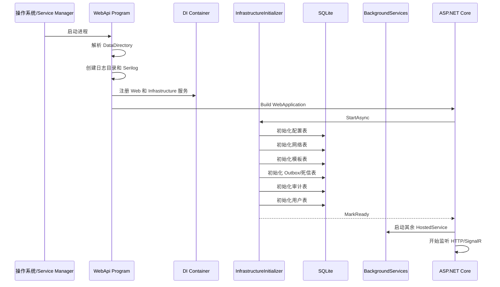
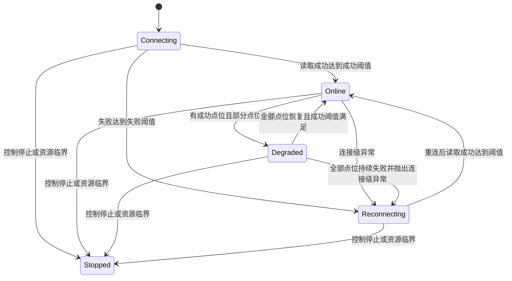
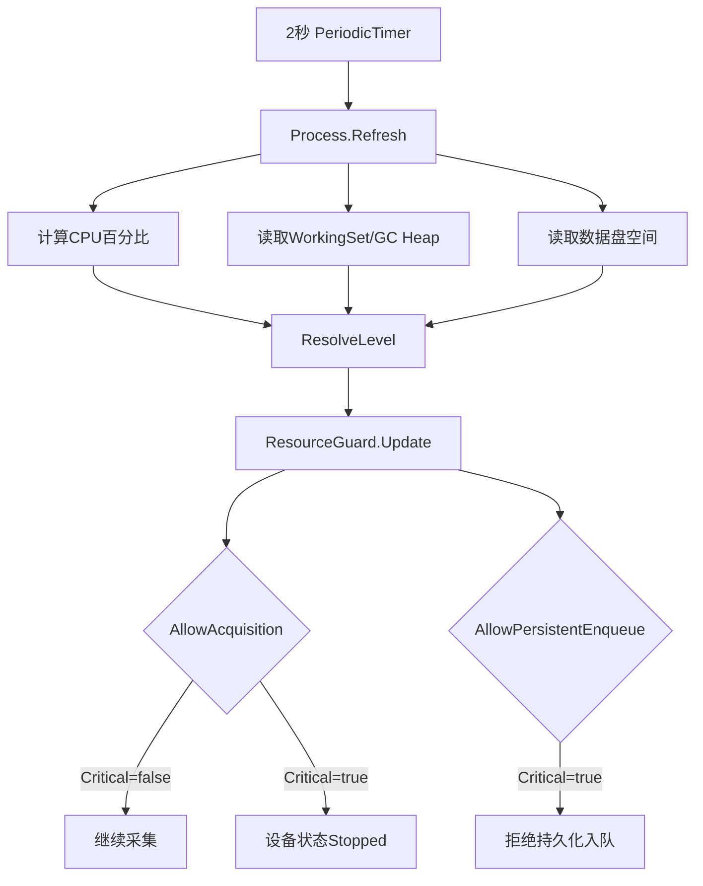
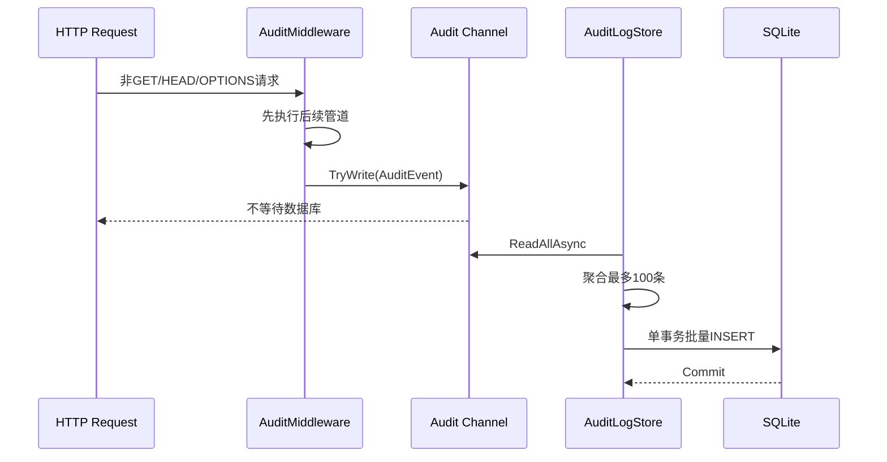
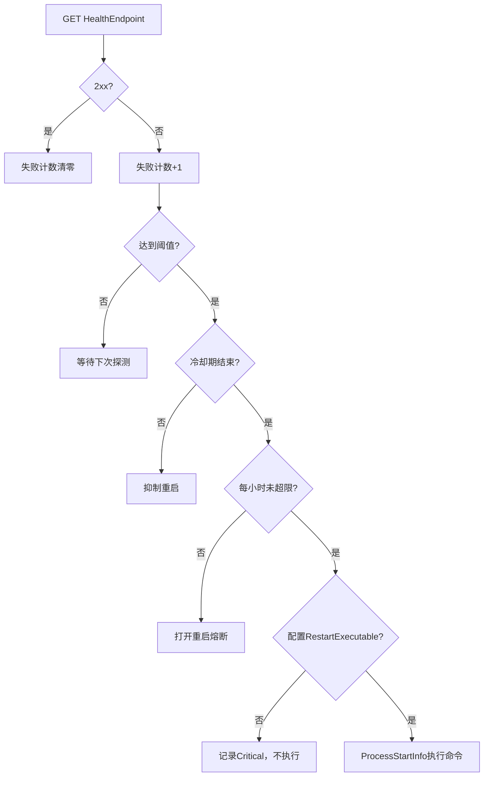
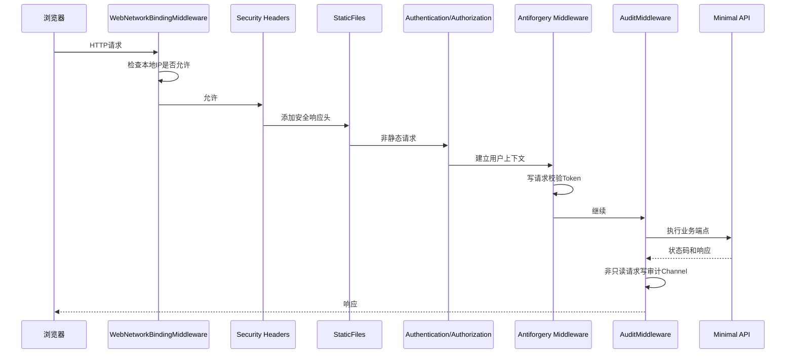
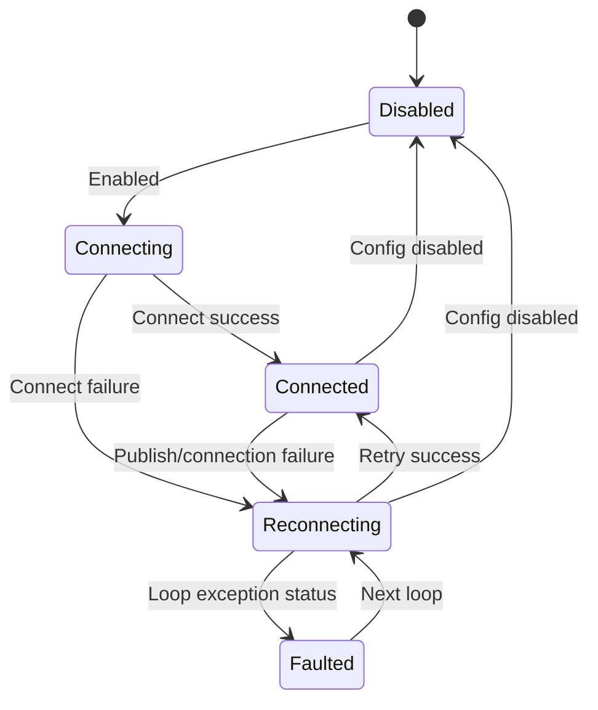

# EdgeNexus 运行时流程与线程模型

## 1. 文档范围

本文描述进程启动、后台服务、队列、定时器、关闭和关键调用链。

PLC 细节参见 [PLC-Drivers.md](PLC-Drivers.md)。

MQTT 细节参见 [MQTT.md](MQTT.md)。

Web 细节参见 [WebAPI.md](WebAPI.md)。

配置细节参见 [Configuration.md](Configuration.md)。

## 2. WebAPI 启动流程

## 3. 启动前路径计算

`ContentRootPath` 固定为 `AppContext.BaseDirectory`。

`WebRootPath` 固定为 `${AppContext.BaseDirectory}/wwwroot`。

数据目录读取 `Gateway:DataDirectory`。

未配置时数据目录为 `data`。

相对数据目录基于 ContentRoot 解析。

数据库文件名固定为 `gateway.db`。

连接字符串启用 `Cache=Shared`。

连接字符串启用 `Pooling=True`。

## 4. InfrastructureInitializer 生命周期

类型实现 `IHostedService`。

`StartAsync` 串行初始化以下服务：

1. `SqliteGatewayConfigurationStore`。
2. `INetworkConfigurationService`。
3. `IMqttTemplateManager`。
4. `MqttOutbox`。
5. `AuditLogStore`。
6. `SqliteUserAccountStore`。

全部成功后调用 `InitializationState.MarkReady()`。

任一异常调用 `MarkFailed(exception)`。

异常继续向 Host 抛出。

`StopAsync` 直接返回完成任务。

## 5. HostedService 总览

| 服务 | 所属进程 | 基类 | 主循环 |
|---|---|---|---|
| `InfrastructureInitializer` | WebAPI | `IHostedService` | 一次性初始化 |
| `ResourceMonitorWorker` | WebAPI | `BackgroundService` | 2秒资源采样 |
| `AuditLogStore` | WebAPI | `BackgroundService` | Channel 批量持久化 |
| `AcquisitionWorker` | WebAPI | `BackgroundService` | 5秒配置同步 + 每设备循环 |
| `TelemetryAggregationWorker` | WebAPI | `BackgroundService` | Channel 消费 + 250ms发布评估 |
| `DeviceHealthMonitor` | WebAPI | `BackgroundService` | 状态Channel + 2秒协调 |
| `MqttStoreForwardWorker` | WebAPI | `BackgroundService` | MQTT连接和Outbox消费 |
| `StatusBroadcastWorker` | WebAPI | `BackgroundService` | 2秒状态 + 250ms点位推送 |
| `GatewayWatchdogWorker` | Watchdog | `BackgroundService` | 健康探测和重启控制 |

## 6. Channel 清单

### 6.1 TelemetryBuffer Channel

元素类型：`TagSample`。

容量：100000。

SingleReader：true。

SingleWriter：false。

FullMode：Wait。

AllowSynchronousContinuations：false。

生产者：所有设备采集循环。

消费者：`TelemetryAggregationWorker.ConsumeAsync`。

`WriteAsync` 在写入 Channel 后更新 latest 和 pending 字典。

### 6.2 RuntimeStatusStore Channel

元素类型：`DeviceRuntimeStatus`。

容量：10000。

SingleReader：true。

SingleWriter：false。

FullMode：DropOldest。

生产者：`AcquisitionWorker.SetStatus`。

消费者：`DeviceHealthMonitor`。

只有状态、故障类型或错误文本变化时写入 Channel。

### 6.3 MQTT 配置变化 Channel

元素类型：`bool`。

容量：1。

FullMode：DropOldest。

生产者：MQTT 应用 API。

消费者：`MqttStoreForwardWorker`。

同时使用递增 revision 防止通知丢失。

### 6.4 审计 Channel

元素类型：`AuditEvent`。

容量：10000。

FullMode：Wait。

入口使用 `TryWrite`。

队列满时不会阻塞 HTTP 请求。

队列满时记录 Error 日志并返回 false。

消费者按最多100条批量写 SQLite。

## 7. 采集线程模型

`AcquisitionWorker` 自身只有一个配置协调循环。

协调周期为5秒。

首次启动立即执行一次同步。

每台设备对应一个 `Task`。

设备 Task 由 async 方法产生。

没有显式创建 OS Thread。

设备 Task 保存于 `ConcurrentDictionary<Guid, DeviceLoop>`。

设备配置、分组配置、点位集合或 PLC 网络 revision 变化时，旧循环被取消并等待退出。

新循环使用链接到 Host stoppingToken 的 CancellationTokenSource。

## 8. 采集循环状态

## 9. 采集调度

扫描周期来自所属 `MqttGroup.ScanCycleMs`。

运行时再次 clamp 到100毫秒至24小时。

使用 `Stopwatch.GetTimestamp()` 维护下一扫描绝对时间。

如果处理超过周期，下一时间重置到当前时间。

长扫描周期可插入心跳读取。

心跳间隔来自 `AcquisitionStabilityOptions.HeartbeatIntervalSeconds`。

心跳值被限制到1至60秒。

三菱 UDP 禁用心跳。

没有有效点位时禁用心跳。

## 10. 重连退避

默认序列为1、2、5、10、30秒。

配置会过滤非正数。

配置会去重。

配置会排序。

若结果为空则使用默认序列。

抖动比例限制为0至0.5。

退避到最后一级后保持最后一级。

只有存在成功点位读取时调用 `ResetAfterSuccessfulRead()`。

连接成功本身不会重置退避。

## 11. 状态防抖

失败阈值默认3。

成功阈值默认2。

阈值最小为1。

成功读取会清零连续失败。

失败读取会清零连续成功。

达到阈值前返回 `Pending`。

首次确认正常返回 `BecameHealthy`。

首次确认异常返回 `BecameFaulted`。

后续保持状态返回 Maintained 枚举值。

## 12. 遥测聚合线程模型

`TelemetryAggregationWorker.ExecuteAsync` 并行运行两个异步任务。

任务一消费 Telemetry Channel。

任务二每250毫秒检查上传条件。

消费任务将最新样本按分组和 TagId 缓存。

发布任务读取生效配置。

发布任务清理失效分组。

发布任务按分组 `UploadCycleSeconds` 节流。

发布任务按设备形成独立 `MqttPublishRequest`。

当前不是多设备合并为单条报文。

## 13. 变化上传

`PublishOnChange=false` 的点位每个分组上传周期进入待发送集合。

`PublishOnChange=true` 的点位仍受分组上传周期约束。

变化上传不是立即发送。

质量变化一定被认为有变化。

值完全相等时无变化。

Deadband 小于等于0时，值不同即变化。

无法转换为 decimal 时，值不同即变化。

只有 MQTT 入队成功后更新已发布状态。

## 14. 设备健康线程模型

`DeviceHealthMonitor` 并行运行状态消费和周期协调。

状态消费读取 RuntimeStatusStore Channel。

协调任务每2秒重新读取生效配置。

协调任务补处理状态存储中的当前状态。

配置中新增设备但尚无运行状态时，创建 Offline 初始状态。

配置中移除设备时，清理设备上下文、指纹和健康状态。

状态值或模板上下文变化时，立即生成状态 MQTT 消息。

状态未变化且上下文未变化时不重复入队。

## 15. MQTT 线程模型

`MqttStoreForwardWorker` 单线程顺序消费 Outbox。

每批最多读取200条。

Outbox 按自增 id 排序。

单条发布成功后删除。

单条失败后更新 attempts 或进入死信。

一条失败会退出当前批次并进入连接异常处理。

重连初始等待1秒。

未收到配置变化时等待翻倍。

最大等待60秒。

收到配置变化时恢复1秒。

## 16. SignalR 线程模型

状态广播每2秒执行。

状态广播只发送变化设备。

健康状态只发送变化设备。

资源状态每次状态消息都包含。

点位广播每250毫秒执行。

点位变化通过 `TelemetryBuffer.TakeChanges()` 获取。

点位按 DeviceId 分组。

只有订阅设备组的客户端接收点位。

客户端连接时先接收完整运行状态快照。

客户端订阅设备时先接收该设备当前点位快照。

## 17. 资源保护流程

## 18. 资源等级

`Normal`：低于全部 Warning 阈值。

`Warning`：磁盘或内存达到 Warning。

`Restricted`：磁盘或内存达到 Restricted。

`Critical`：磁盘或内存达到 Critical。

当前 `Restricted` 不停止采集。

当前 `Restricted` 不停止 Outbox 写入。

当前只有 `Critical` 阻止两者。

CPU 只采样和暴露指标。

CPU 不参与保护等级计算。

## 19. 审计写入流程

## 20. 优雅关闭

`AcquisitionWorker.StopAsync` 取消全部设备循环。

随后 `Task.WhenAll` 等待循环退出。

关闭 Token 超时时捕获取消异常。

每个设备循环 finally 调用驱动 Disconnect。

驱动由 `await using` 释放。

`AuditLogStore.StopAsync` 完成 Channel Writer。

随后等待 ExecuteTask 排空。

关闭超时时记录 Warning。

`MqttStoreForwardWorker` 退出后尝试断开 MQTT。

MQTT 断开异常只记录 Debug。

## 21. Watchdog 启动流程

Watchdog 数据目录来自 `SNET_WATCHDOG_DATA`。

未配置时为 `watchdog-data`。

Watchdog 注册命名 HttpClient `gateway-health`。

HttpClient 自身 Timeout 为无限。

每次请求使用链接 CancellationToken 设置超时。

启动后先等待 StartupGraceSeconds。

随后周期探测 HealthEndpoint。

## 22. Watchdog 恢复流程

## 23. Watchdog 进程安全

`UseShellExecute=false`。

`CreateNoWindow=true`。

参数通过 `ArgumentList.Add` 逐项添加。

没有字符串拼接 Shell 命令。

重启命令有独立超时。

非零退出码记录 Error。

达到每小时上限记录 Critical。

## 24. Web 请求流程

## 25. 定时器清单

- 采集配置同步：5秒。
- 资源监控：2秒。
- MQTT 聚合评估：250毫秒。
- 设备健康协调：2秒。
- SignalR 状态广播：2秒。
- SignalR 点位广播：250毫秒。
- MQTT 空队列等待：250毫秒。
- MQTT 禁用状态配置检查：1秒。
- 审计失败重试：1秒。
- Watchdog：配置值，默认5秒。

## 26. 异常隔离

设备循环最外层捕获通信异常。

点位读取捕获点位特定异常。

点位转换捕获格式、类型和溢出相关异常。

MQTT 聚合按设备捕获构建和入队异常。

设备健康按设备捕获状态消息入队异常。

资源监控每轮捕获采样异常。

审计写入失败在后台循环重试。

MQTT 发送失败进入统一重连流程。

Watchdog 捕获 HTTP、超时和进程执行异常。

## 27. 取消传播

HostedService 使用 Host stoppingToken。

每设备循环使用链接 Token。

网络诊断创建链接超时 Token。

MQTT 等待配置变化创建链接超时 Token。

Watchdog HTTP 和重启命令创建链接超时 Token。

取消异常在明确的 Host 停止场景中被吞掉。

非停止取消通常被转换为超时或失败结果。

## 28. 性能相关源码事实

Telemetry Channel 有容量上限。

状态 Channel 有容量上限。

审计 Channel 有容量上限。

MQTT Outbox 有数据库容量上限。

采集批次最多16个点位。

采集批次最多200字节。

MQTT 一次读 Outbox 最多200条。

MQTT 回放速率由配置限制。

Outbox prune 按500个ID分块删除。

Audit 批量最多100条。

SignalR 点位只发送变化集合。

## 29. 当前线程模型限制

设备数量越多，设备异步循环数量线性增加。

不存在全局 `SemaphoreSlim` 限制同时连接数。

MQTT Outbox 入队每条消息执行一次 COUNT 查询。

TelemetryAggregation 每250毫秒反序列化一次生效快照。

DeviceHealthMonitor 每2秒反序列化一次生效快照。

AcquisitionWorker 每5秒反序列化一次生效快照。

这些是当前源码事实，不代表缺陷结论。

## 30. 生命周期调用路径索引

- 初始化：Host -> `InfrastructureInitializer.StartAsync`。
- 采集：Host -> `AcquisitionWorker.ExecuteAsync` -> per-device loop。
- 聚合：Host -> `TelemetryAggregationWorker.ExecuteAsync`。
- 健康：Host -> `DeviceHealthMonitor.ExecuteAsync`。
- MQTT：Host -> `MqttStoreForwardWorker.ExecuteAsync`。
- 资源：Host -> `ResourceMonitorWorker.ExecuteAsync`。
- 审计：Middleware -> Channel -> `AuditLogStore.ExecuteAsync`。
- 实时状态：Host -> `StatusBroadcastWorker.ExecuteAsync`。
- Watchdog：Worker Host -> `GatewayWatchdogWorker.ExecuteAsync`。

## 31. HostedService 注册顺序明细

`AddEdgeInfrastructure` 的实际注册顺序如下：

1. `InfrastructureInitializer`。
2. `ResourceMonitorWorker`。
3. `AuditLogStore` 具体单例作为 HostedService。
4. `AcquisitionWorker`。
5. `TelemetryAggregationWorker`。
6. `DeviceHealthMonitor`。
7. `MqttStoreForwardWorker`。

WebApi 在调用 `AddEdgeInfrastructure` 后注册：

8. `StatusBroadcastWorker`。

Watchdog 是独立 Host，只注册：

9. `GatewayWatchdogWorker`。

## 32. 初始化调用次序

`InfrastructureInitializer.StartAsync` 的源码次序为：

1. `SqliteGatewayConfigurationStore.InitializeAsync`。
2. `INetworkConfigurationService.InitializeAsync`。
3. `IMqttTemplateManager.InitializeAsync`。
4. `MqttOutbox.InitializeAsync`。
5. `AuditLogStore.InitializeAsync`。
6. `SqliteUserAccountStore.InitializeAsync`。
7. `InitializationState.MarkReady()`。

任一步抛出异常时：

- 调用 `InitializationState.MarkFailed(exception)`。
- 将异常继续抛给 Host。
- Readiness 在成功前不会报告 ready。

## 33. 周期与等待点清单

| 组件 | 周期或等待 | 源码目的 |
|---|---|---|
| `ResourceMonitorWorker` | 2 秒 | 资源采样 |
| `AcquisitionWorker` | 5 秒配置同步 | 比较 active 设备循环 |
| 设备循环 | `ScanCycleMs` | PLC 采集 |
| 设备循环 | HeartbeatInterval | 长周期心跳 |
| `TelemetryAggregationWorker` | 250 ms | 发布评估 |
| `DeviceHealthMonitor` | 2 秒 | 配置协调与初始状态 |
| `MqttStoreForwardWorker` | Outbox/配置变化等待 | 连接和发送 |
| `StatusBroadcastWorker` | 2 秒 | 状态差量 |
| `StatusBroadcastWorker` | 250 ms | 点位差量 |
| `AuditLogStore` | Channel 等待 | 批量写入 |
| `GatewayWatchdogWorker` | CheckIntervalSeconds | 健康探测 |

## 34. Channel 配置总表

| Channel | 容量 | FullMode | Reader | Writer |
|---|---:|---|---|---|
| Telemetry | 100000 | Wait | Single | Multi |
| Runtime Status | 10000 | DropOldest | Single | Multi |
| MQTT Configuration Change | 1 | DropOldest | Worker | Multi |
| Audit | 10000 | Wait 配置，入口 TryWrite | Single | Multi |

Channel 均关闭同步 continuation。

MQTT 业务消息不使用内存 Channel。

MQTT 业务队列使用 SQLite `mqtt_outbox`。

## 35. 每设备采集循环状态

每个设备循环持有：

- 当前 `DeviceDefinition`。
- 当前分组调度。
- 当前启用点位集合。
- 一个 `IDeviceDriver`。
- 一个 `DeviceCommunicationStabilityTracker`。
- 一个 `ReconnectBackoff`。
- PLC 网络绑定 revision。
- 上次成功或故障时间。
- 循环专用 CancellationTokenSource。

设备定义、点位、分组或网络 revision 改变时，协调器重建该设备循环。

## 36. 采集单轮结果分类

- 全部读取成功：记录成功指标并输出 Good 样本。
- 部分点位失败：成功点继续输出，失败点输出点位 quality。
- 至少一个点成功：设备链路可保持通讯健康。
- 全部读取失败：进入失败防抖。
- 超时：设备故障种类标记 Timeout。
- 连接异常：设备故障种类标记 Communication 或 Offline。
- 配置点异常：不要求重建整个设备连接。

## 37. MQTT Worker 状态机

状态写入 `MqttRuntimeStateStore.Current`。

## 38. MQTT 断点续传执行序列

1. 聚合 Worker 构建 `MqttPublishRequest`。
2. `MqttOutbox.PublishAsync` 读取 active MQTT 配置。
3. MQTT 禁用时直接返回。
4. 解析模板。
5. 构建最终 Topic 和 Payload。
6. 检查资源保护是否允许持久化。
7. 事务内检查 Outbox 数量上限。
8. 插入 `mqtt_outbox`。
9. StoreForwardWorker 按 ID 读取批次。
10. 发布成功后删除该行。
11. 发布失败增加 attempts。
12. 达到上限后事务性移入死信。

## 39. 审计后台写入序列

1. `AuditMiddleware` 记录开始时间。
2. 执行后续 Endpoint。
3. 读取最终状态码和耗时。
4. 构造 `AuditEvent`。
5. 调用 `TryWrite`。
6. Channel 满时记录 Error。
7. BackgroundService 读取事件。
8. 最多 100 条组成一批。
9. 使用 SQLite 事务写入。
10. 写入失败记录日志并继续后台循环。

## 40. SignalR 后台并行任务

`StatusBroadcastWorker.ExecuteAsync` 使用 `Task.WhenAll` 并行执行：

- `BroadcastStatusesAsync`。
- `BroadcastTagSamplesAsync`。

状态任务维护上次设备状态和健康状态字典。

点位任务从 `TelemetryBuffer.TakeChanges` 原子取走变化集合。

点位按设备分组后发送到对应 Hub Group。

## 41. Watchdog 重启保护

- 启动先等待 StartupGraceSeconds。
- 连续成功会清零失败计数。
- 只有连续失败达到阈值才进入重启逻辑。
- RestartCooldownSeconds 抑制短期重复执行。
- Queue 保存最近一小时重启时间。
- 超过 MaxRestartsPerHour 打开时间窗口断路器。
- RestartExecutable 为空时不执行任何进程。
- 参数通过 ArgumentList 传递，不使用 shell 拼接。
- 重启命令受 RestartCommandTimeoutSeconds 限制。
- 进程退出码非 0 记录 Error。

## 42. 优雅关闭资源清单

- Host CancellationToken 传递到所有 BackgroundService。
- AcquisitionWorker 取消并等待设备任务。
- 每个驱动调用 DisconnectAsync/DisposeAsync。
- OPC UA Session 被关闭和释放。
- HSL Client 调用 ConnectClose。
- MQTT Client 在退出前断开。
- Audit Channel 在 StopAsync 中完成。
- SQLite 写锁在 Dispose 时释放。
- GatewayMetrics 释放 Meter。
- PeriodicTimer 使用 using 释放。

## 43. 当前线程模型源码边界

- 未发现 `Thread.Sleep`。
- 未发现为每次 PLC 读取创建原生 Thread。
- 主要并发单位是 async Task。
- 每个启用设备对应一个长期异步循环。
- 没有全局采集并发 SemaphoreSlim。
- HslDeviceDriver 每实例用 read gate 串行访问会话。
- 配置和模板写入使用独立 SemaphoreSlim。
- 并发状态容器使用 ConcurrentDictionary。
- 热路径仍存在快照 ToArray 和 JSON 反序列化。
- 本节只记录实现，不等同于性能缺陷判定。

## 44. CancellationToken 传播索引

- Host stoppingToken -> Infrastructure BackgroundServices。
- RequestAborted -> Web Endpoint CancellationToken。
- Endpoint Token -> SQLite、诊断、模板、文件服务。
- Acquisition Worker Token -> 每设备链接 Token。
- 设备 Token -> Driver Connect/Read/Disconnect。
- MQTT Worker Token -> Connect/Publish/Delay。
- Watchdog Token -> HTTP 请求和重启命令。
- SignalR Context.ConnectionAborted -> Hub Send/Group 操作。

## 45. 资源保护状态转换

- 磁盘或内存达到 Warning -> Warning。
- 达到 Restricted -> 禁止持久化入队。
- 达到 Critical -> 同时禁止采集。
- 降低到阈值以下 -> 回到对应较低级别。
- CPU 被采样但不参与级别判定。
- ThreadCount 被采样但不参与级别判定。
- `/health` 在 Critical 返回 503。

## 46. 生命周期覆盖核对

- [x] WebAPI 启动。
- [x] Infrastructure 初始化。
- [x] PLC 每设备循环。
- [x] Telemetry 聚合。
- [x] 设备健康。
- [x] MQTT 连接和 Outbox。
- [x] SignalR 广播。
- [x] 审计批量写入。
- [x] 资源保护。
- [x] Watchdog。
- [x] CancellationToken。
- [x] 优雅关闭。

## 45. 运行时运维入口

- 内部依赖与禁止跨层调用：[Internal-Architecture.md](Internal-Architecture.md)。
- 队列、GC 和压测：[Performance.md](Performance.md)。
- Windows/Linux/Docker 停止语义：[Deployment.md](Deployment.md)。
- 故障排查：[FAQ.md](FAQ.md)。

## 46. 运行流变更同步要求

修改 BackgroundService、周期、Channel、重连或停止逻辑时，同时更新：

1. 本文。
2. [Architecture.md](Architecture.md)。
3. [Internal-Architecture.md](Internal-Architecture.md)。
4. [Performance.md](Performance.md)。
5. [Samples-and-Tests.md](Samples-and-Tests.md)。
6. [../CHANGELOG.md](../CHANGELOG.md)。

返回 [文档中心](INDEX.md)。
