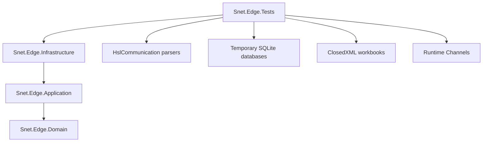

# EdgeNexus 源码示例与测试索引

## 1. 扫描结论

当前仓库没有以下目录：

- `Samples/`
- `samples/`
- `Examples/`
- `examples/`

因此本文不虚构独立示例工程。

当前可作为可执行或可核验示例的来源只有：

1. `ProtocolPointAddressCatalog` 中的协议地址示例。
2. `DeviceTagFileService` 生成的点位工作簿格式。
3. `PointTableImportService` 定义的工程导入列。
4. MQTT Builder 测试中的报文示例。
5. `tests/Snet.Edge.Tests` 中的 xUnit 测试。

## 2. 测试规模

- 测试项目：`tests/Snet.Edge.Tests/Snet.Edge.Tests.csproj`。
- 测试框架：xUnit 2.9.3。
- 测试 SDK：Microsoft.NET.Test.Sdk 18.0.1。
- 测试项目直接引用 `Snet.Edge.Infrastructure`。
- 当前源码包含 90 个 `[Fact]` 或 `[Theory]` 声明。
- Theory 的实际执行用例数由 InlineData/MemberData 决定。

## 3. 测试模块关系



## 4. 协议地址示例来源

所有下面的地址均来自 `ProtocolPointAddressCatalog.cs`。

它们不是根据经验补写。

### 4.1 Siemens S7

| 地址 | 区域 | 类型 | 源码用途 |
|---|---|---|---|
| `DB1.DBX0.0` | DB 位 | Bool | DB1 第 0 字节第 0 位 |
| `DB1.DBW2` | DB 字 | UInt16 | DB1 第 2 字节开始的 16 位值 |
| `DB1.DBD4` | DB 双字 | Float32 | DB1 第 4 字节开始的 Float |
| `M10.0` | M 位 | Bool | 中间继电器 |
| `VD100` | S7-200 V 区 | Float32 | V100 开始的 32 位值 |

源码注意事项：

- S7-1200/1500 DB 块需允许绝对地址访问。
- S7-200/SMART 常用 V/VB/VW/VD。
- 地址目录不把 TIA 符号名当作绝对地址。

### 4.2 Modbus TCP

| 地址 | 功能码 | 类型 | 源码用途 |
|---|---:|---|---|
| `0` | 01 | Bool | 第一个线圈 |
| `0` | 02 | Bool | 第一个离散输入 |
| `0` | 03 | UInt16 | 第一个保持寄存器 |
| `2` | 03 | Float32 | 从偏移 2 开始占两个寄存器 |
| `0` | 04 | Int16 | 第一个输入寄存器 |

源码规则：

- 地址栏保存从 0 开始的偏移。
- 功能码保存在 `TagDefinition.ModbusFunctionCode`。
- 01/02 只能与 Bool 匹配。
- 03/04 用于寄存器数据。

### 4.3 Mitsubishi MC

| 地址 | 区域 | 类型 |
|---|---|---|
| `D100` | 数据寄存器 | Int16 |
| `D200` | 数据寄存器 | Float32 |
| `M100` | 内部继电器 | Bool |
| `X0` | 输入继电器 | Bool |
| `Y0` | 输出继电器 | Bool |

源码格式支持：

- Binary 3E TCP。
- ASCII 3E TCP。
- Binary 3E UDP。
- ASCII 3E UDP。
- Binary A-compatible 1E TCP。
- ASCII A-compatible 1E TCP。

### 4.4 OPC UA

| NodeId | 类型 | 用途 |
|---|---|---|
| `ns=2;s=Machine.Speed` | Float32 | 速度变量 |
| `ns=2;i=1001` | Int32 | 数字 NodeId |
| `ns=3;s=Line1.Running` | Bool | 运行状态 |

源码要求填写完整 NodeId。

源码没有将 BrowsePath 转 NodeId 的实现。

### 4.5 Panasonic Mewtocol

| 地址 | 区域 | 类型 |
|---|---|---|
| `DT100` | 数据寄存器 | Int16 |
| `DT200` | 数据寄存器 | Float32 |
| `R0` | 内部继电器 | Bool |
| `X0` | 输入 | Bool |
| `Y0` | 输出 | Bool |

### 4.6 Omron FINS

| 地址 | 区域 | 类型 |
|---|---|---|
| `D100` | DM 字 | Int16 |
| `D100.03` | DM 位 | Bool |
| `CIO100` | CIO 字 | UInt16 |
| `W100` | WR 字 | UInt16 |
| `H100.00` | HR 位 | Bool |

源码注意：位号范围是 00 至 15。

### 4.7 Omron CIP

| 地址 | 类型 | 用途 |
|---|---|---|
| `Machine.Speed` | Float32 | 结构成员 |
| `Machine.Running` | Bool | 结构成员 |
| `Alarm[0]` | Bool | 数组元素 |
| `ProductionCount` | Int32 | 全局变量 |

### 4.8 Allen-Bradley EtherNet/IP

| 地址 | 类型 | 用途 |
|---|---|---|
| `Motor.Speed` | Float32 | 结构成员 |
| `Motor.Running` | Bool | 运行状态 |
| `Counter[0]` | Int32 | 数组元素 |
| `Program:MainProgram.BatchId` | Int32 | 程序 Tag |

### 4.9 Beckhoff ADS

| 地址 | 类型 | 用途 |
|---|---|---|
| `s=MAIN.bRun` | Bool | 符号变量 |
| `s=MAIN.nCount` | Int32 | 符号变量 |
| `s=MAIN.rSpeed` | Float32 | 符号变量 |
| `M100.0` | Bool | M 绝对位 |
| `IG=0xF020;0` | UInt16 | Index Group |

### 4.10 Keyence MC

| 地址 | 区域 | 类型 |
|---|---|---|
| `DM100` | 数据存储器 | Int16 |
| `DM200` | 数据存储器 | Float32 |
| `R015` | 内部继电器 | Bool |
| `MR015` | 辅助继电器 | Bool |
| `LR015` | 锁存继电器 | Bool |

### 4.11 Inovance TCP

| 地址 | 系列 | 类型 |
|---|---|---|
| `SD100` | AM | Int16 |
| `Q0` | AM | Bool |
| `M100` | AM/H3U/H5U | Bool |
| `D100` | H3U/H5U | Int16 |
| `X0` | H3U/H5U | Bool |

### 4.12 Delta TCP

| 地址 | 区域 | 类型 |
|---|---|---|
| `D100` | 数据寄存器 | Int16 |
| `D200` | 数据寄存器 | Float32 |
| `M100` | 内部继电器 | Bool |
| `X0` | 输入 | Bool |
| `Y0` | 输出 | Bool |

## 5. 单设备点位文件格式

来源：`DeviceTagFileService.ExportHeaders`。

导出工作表名称：`Points`。

说明工作表名称：`说明`。

列顺序：

1. `TagName`
2. `Address`
3. `DataType`
4. `ModbusFunctionCode`
5. `Enabled`
6. `ByteOrder`
7. `Operator`
8. `Operand`
9. `Decimals`
10. `PublishOnChange`
11. `Deadband`
12. `StringLength`
13. `Remark`

必填列：

- `TagName`
- `Address`
- `DataType`

说明页明确写明：

- Modbus 功能码可用 01/02/03/04。
- 功能码只用于 Modbus TCP。
- 同名点位导入时保留原 ID。
- 导入先进入页面。
- 点击保存后写入草稿。
- 发布后才生效。

## 6. 工程点表导入必填列

来源：`PointTableImportService.RequiredHeaders`。

- `GroupName`
- `GroupTopic`
- `DeviceName`
- `Protocol`
- `Host`
- `Port`
- `TagName`
- `Address`
- `DataType`

表头规范化为小写并去除空白差异。

源码同时支持部分中文表头别名。

## 7. 工程点表可选分组列

- `ScanCycleMs`
- `UploadCycleSeconds`

范围使用 `GroupScheduleLimits`。

同一导入文件中同名分组 Topic 必须一致。

## 8. 工程点表可选设备列

- `ConnectTimeoutMs`
- `ReceiveTimeoutMs`
- `Station`
- `Rack`
- `Slot`
- `SiemensSeries`
- `SiemensLocalTsap`
- `SiemensDestinationTsap`
- `MitsubishiTransport`
- `MitsubishiFormat`
- `NetworkNumber`
- `PlcNumber`
- `NetworkStationNumber`
- `TargetIoStation`
- `FinsDestinationNetwork`
- `FinsDestinationNode`
- `FinsDestinationUnit`
- `FinsSourceNetwork`
- `FinsSourceNode`
- `FinsSourceUnit`
- `FinsReadSplits`
- `OmronCipConnectionTimeoutMultiplier`
- `CipRoutePath`
- `CipReadArrayUseSegment`
- `BeckhoffUseAutoAmsNetId`
- `BeckhoffTargetAmsNetId`
- `BeckhoffSenderAmsNetId`
- `BeckhoffUseTagCache`
- `InovanceSeries`
- `DeltaSeries`
- `OpcUaUsername`
- `OpcUaPassword`
- `OpcUaUseSecurity`
- `OpcUaAutoAcceptUntrusted`

## 9. 工程点表可选点位列

- `ModbusFunctionCode`
- `ByteOrder`
- `StringLength`
- `Remark`

当前 `PointTableImportService.ParseRow` 只显式写入这些可选点位字段。

单设备点位导入支持更多编辑字段。

## 10. MQTT 报文示例来源

来源：`MqttMessageBuilderTests`、`MqttOutboxTests` 和 `TelemetryAggregationWorkerTests`。

默认 Advantech 风格示例：

```json
{
  "d": [
    {
      "tag": "#DEVICE_ERROR_PLC001",
      "value": 0,
      "quality": 0
    },
    {
      "tag": "PLC001:Temperature",
      "value": 35.6,
      "quality": 0
    }
  ],
  "ts": "2026-07-29T02:53:08+0000"
}
```

该示例结构与 Builder 测试断言一致。

时间值会随测试输入变化。

## 11. `AcquisitionIsolationTests`

### 11.1 `LongScanCycleUsesHeartbeatToKeepConnectionHealthy`

- 验证长扫描周期期间心跳仍维持通讯状态。
- 覆盖 AcquisitionWorker 的心跳调度。

### 11.2 `DeviceTimeoutInvalidatesPreviouslyGoodPointQuality`

- 验证设备超时会使先前 Good 样本失效。
- 覆盖 Timeout quality 传播。

### 11.3 `SingleRequestSessionFallsBackToReconnectPerScan`

- 验证单请求会话在需要时按扫描重连。
- 覆盖连接会话兼容路径。

### 11.4 `InvalidPointDoesNotReconnectDeviceOrBlockHealthyPoint`

- 验证单点配置错误不触发设备级重连。
- 验证健康点仍可输出。

## 12. `AcquisitionStabilityTests`

### 12.1 `CommunicationStateRequiresConfiguredFailureAndRecoveryThresholds`

- 验证失败阈值和恢复阈值。
- 覆盖 Pending/Became 状态转换。

### 12.2 `SuccessfulReadResetsFailureDebounce`

- 验证成功读取清除连续失败计数。
- 防止非连续失败累计成故障。

### 12.3 `ReconnectBackoffResetsOnlyWhenExplicitReadSuccessIsReported`

- 验证仅明确读取成功重置退避。
- 连接成功但未读成功不会重置。

## 13. `AuditLogStoreTests`

### 13.1 `StopDoesNotThrowWhenHostShutdownTokenAlreadyCanceled`

- 验证关闭窗口 Token 已取消时 StopAsync 不抛出。
- 覆盖审计后台任务优雅关闭。

## 14. `CapacitySmokeTests`

### 14.1 `OneThousandDeviceLoopsStartAndCollectWithoutBlocking`

- 创建 1000 个设备循环进行容量冒烟。
- 验证循环能够启动和产生采集结果。
- 该测试不是硬件 PLC 性能认证。
- 该测试不等同于 1000 台真实网络设备压力测试。

## 15. `ConfigurationStoreTests`

### 15.1 `PublishingMqttOptionsPreservesOtherDraftChanges`

- 验证独立发布 MQTT 不覆盖其他草稿修改。
- 覆盖 active/draft 合并边界。

### 15.2 `ConfigurationRoundTripPersistsGroupDeviceAndTags`

- 验证分组、设备、点位 SQLite 往返持久化。
- 覆盖 JSON 枚举序列化。

## 16. `ConfigurationValidatorTests`

### 16.1 `ValidatorRejectsGroupScheduleOutsideIndustrialBounds`

- 验证扫描和上传周期上下限。

### 16.2 `MqttStatusTemplateAcceptsPositiveCommunicationFailureCode`

- 验证正数非零失败码有效。

### 16.3 `MqttStatusTemplateAcceptsNegativeCommunicationFailureCode`

- 验证负数非零失败码有效。

### 16.4 `MqttStatusTemplateRejectsZeroCommunicationFailureCode`

- 验证失败码不能为 0。

### 16.5 `ValidatorRejectsDuplicateTopicsAndOrphanDevices`

- 验证重复 Topic 和孤儿设备。

### 16.6 `ValidatorRejectsInvalidProtocolSpecificParameters`

- 验证无效协议参数被拒绝。

### 16.7 `ValidatorAcceptsProtocolSpecificParameters`

- 验证有效协议参数通过。

### 16.8 `ValidatorRejectsMalformedCipRoute`

- 验证错误 CIP Route 被拒绝。

### 16.9 `ValidatorRejectsModbusFunctionCodeDataTypeMismatch`

- 验证 Modbus 功能码与数据类型匹配。

### 16.10 `ValidatorAcceptsLegacyModbusFunctionCodeAddress`

- 验证旧功能码前缀地址兼容。

## 17. `DeviceHealthTests`

### 17.1 `ErrorManagerMapsRuntimeFaults`

- 验证运行状态到设备错误码的映射。

### 17.2 `ErrorManagerUsesCustomCodesWithoutChangingNormalCode`

- 验证自定义失败码生效且正常码固定为 0。

### 17.3 `DegradedDeviceWithAtLeastOneSuccessfulPointKeepsCommunicationHealthy`

- 验证有一个成功点时 Degraded 设备通讯码保持 0。

### 17.4 `SystemErrorTagUsesAbsoluteAdvantechCompatibleName`

- 验证状态 Tag 以 `#` 开头且不再添加设备前缀。

## 18. `DeviceProtocolValidatorTests`

### 18.1 `MitsubishiACompatible1EAcceptsTcpAndIgnoresThreeEOnlyRoutingFields`

- 验证 1E 接受 TCP。
- 验证 3E 专用路由字段不参与 1E 连接。

### 18.2 `MitsubishiACompatible1ERejectsUdpDuringConfigurationValidation`

- 验证 1E + UDP 在配置阶段被拒绝。

## 19. `DeviceTagFileServiceTests`

### 19.1 `ExportedWorkbookContainsDevicePointsAndInstructions`

- 验证 Points 和说明工作表。
- 验证导出列和设备说明。

### 19.2 `ImportPreviewPreservesExistingTagIdAndParsesAllEditableFields`

- 验证同名 Tag ID 保留。
- 验证可编辑字段解析。

### 19.3 `ImportPreviewRejectsProtocolSpecificMismatchWithoutChangingDraft`

- 验证协议不匹配时拒绝。
- 验证预览不修改草稿。

## 20. `DriverFactoryTests`

### 20.1 `FactoryCreatesCrossPlatformHslDrivers`

- 验证协议矩阵可创建跨平台 HSL 驱动。

### 20.2 `DriverMatrixCoversEveryDeclaredProtocol`

- 验证每个 `ProtocolKind` 都有工厂分支。

### 20.3 `EveryProtocolConnectionPathReturnsWithinDeadlineWhenPeerRejectsHandshake`

- 验证拒绝握手时每个协议连接路径在截止时间内返回。

### 20.4 `TelemetryKeyCombinesDeviceAndTagNames`

- 验证普通 Tag 组合和系统 Tag 保留。

### 20.5 `FactoryAppliesAdvancedProtocolOptionsWithoutFallback`

- 验证高级协议参数实际写入客户端。

### 20.6 `MitsubishiFactoryUsesSelectedTransport`

- 验证 TCP/UDP 客户端选择。

### 20.7 `MitsubishiFactoryUsesSelectedACompatible1EClient`

- 验证 Binary/ASCII 1E 客户端选择。

### 20.8 `MitsubishiACompatible1ERejectsUdp`

- 验证工厂层也拒绝 1E + UDP。

### 20.9 `SiemensAutomaticProfileUsesSeriesRecommendedRackSlot`

- 验证西门子系列推荐 Rack/Slot。

### 20.10 `SiemensManualProfilePreservesConfiguredRackSlot`

- 验证关闭自动配置后保留手动值。

### 20.11 `SiemensRawReadNormalizesEngineeringAddressNotation`

- 验证西门子原始读取地址规范化。

## 21. `HslDeviceDriverByteOrderTests`

### 21.1 `MitsubishiUsesPlainAddressAndConfiguredByteOrder`

- 验证三菱地址不拼接字节序前缀。
- 验证 HSL DataFormat 来自 ByteOrder。

### 21.2 `InvalidByteOrderFallsBackToAbcd`

- 验证无效字节序回退 ABCD。

### 21.3 `OmronFinsReadsNumericValuesAsWordsAndValidatesPayloadLength`

- 验证 FINS 数字值按字读取和长度检查。

### 21.4 `OmronFinsRejectsSuccessfulResponseWithEmptyPayload`

- 验证成功标志但空 Payload 被拒绝。

### 21.5 `SharedHslProtocolsDoNotPrefixByteOrderIntoAddress`

- 验证共享 HSL 协议不污染地址字符串。

## 22. `ModbusTagAddressTests`

### 22.1 `StronglyTypedFunctionCodeIsConvertedAtDriverBoundary`

- 验证强类型功能码只在驱动边界转 HSL 地址。

### 22.2 `ExistingLegacyPrefixIsNotDuplicated`

- 验证旧前缀不重复添加。

### 22.3 `LegacyAddressIsNormalizedForPersistence`

- 验证旧地址保存前规范化。

## 23. `MqttMessageBuilderTests`

### 23.1 `StandardTemplateBuildsTypedDevicePayload`

- 验证 Standard 字段选择和 Value 类型保持。

### 23.2 `AdvantechTemplateBuildsCompatibleTimestampAndDataArray`

- 验证 d 数组和 Advantech 时间格式。

### 23.3 `CustomFieldsResolveFixedDeviceAndFirstPlcTagVariables`

- 验证固定值、设备变量和首个业务 Tag 变量。

### 23.4 `DeviceStatusTagStaysInPayloadDataArray`

- 验证设备状态与普通点位位于同一个 d 数组。

### 23.5 `TopicBuilderResolvesIndustrialVariablesAndRejectsWildcards`

- 验证 Topic 变量和 `+/#` 拒绝。

### 23.6 `TemplateManagerPersistsChangesAndResolvesThemWithoutRestart`

- 验证模板 SQLite 持久化和热更新。

## 24. `MqttOutboxTests`

### 24.1 `DeviceSpecificTemplateAndMqttIdentityShapeFinalMessage`

- 验证设备 MQTT ID 和设备模板影响最终 Topic/Payload。

### 24.2 `ConfigurationPruneRemovesQueuedPayloadContainingDeletedTag`

- 验证删除点位后 Prune 清理旧消息。

### 24.3 `OutboxPersistsBuiltPayloadAndMovesPoisonMessageToDeadLetter`

- 验证最终报文持久化和超限转死信。

### 24.4 `DiscardOperationsRemoveMessagesWithoutCreatingDeadLetters`

- 验证主动丢弃不创建死信。

## 25. `NetworkConfigurationTests`

### 25.1 `SingleBindableInterfaceBecomesDefaultForAllUsagesAndPersistsChanges`

- 验证单网卡自动用于三个用途。
- 验证绑定持久化。

### 25.2 `InvalidInterfaceIsRejectedAndLoopbackRemainsAWebRecoveryPath`

- 验证无效网卡 ID 被拒绝。
- 验证回环 Web 恢复路径。

## 26. `PointTableImportServiceTests`

### 26.1 `ValidCsvIsWrittenToDraftButNotActiveConfiguration`

- 验证有效 CSV 只写草稿。

### 26.2 `InvalidCsvDoesNotPartiallyChangeDraft`

- 验证无效 CSV 不部分写入。

### 26.3 `ProtocolSpecificColumnsAreImported`

- 验证协议特定设备列。

### 26.4 `ModbusFunctionCodeIsImportedAsStronglyTypedTagField`

- 验证功能码进入 enum 字段。

## 27. `ProtocolPointAddressCatalogTests`

### 27.1 `SiemensExamplesPassTheHslAddressParser`

- 验证 Siemens 示例可被 HSL 地址解析。

### 27.2 `MitsubishiExamplesPassTheHslAddressParser`

- 验证三菱 3E 示例。

### 27.3 `MitsubishiACompatible1EExamplesPassTheHslCommandBuilder`

- 验证三菱 1E 示例可构造命令。

### 27.4 `PanasonicExamplesPassTheHslAddressParser`

- 验证松下示例。

### 27.5 `OmronFinsExamplesPassTheHslAddressParser`

- 验证 FINS 示例。

### 27.6 `KeyenceExamplesPassTheHslAddressParser`

- 验证基恩士示例。

### 27.7 `InovanceExamplesPassTheHslAddressTranslator`

- 验证汇川系列地址翻译。

### 27.8 `DeltaExamplesPassTheHslAddressTranslator`

- 验证台达地址翻译。

### 27.9 `EveryDeclaredProtocolHasACompletePointAddressGuide`

- 验证 12 个协议都有指南。

### 27.10 `EveryGuideExampleCanBuildAndValidateAProtocolTag`

- 验证每个示例可形成有效 TagDefinition。

### 27.11 `EveryProtocolDriverAcceptsItsGuideExamplesDuringPlanCompilation`

- 验证指南示例能进入驱动读取计划。

### 27.12 `EveryProtocolReadPlanIsBoundedAndKeepsEveryGuidePoint`

- 验证计划有界且不丢点。

## 28. `ResourceGuardTests`

### 28.1 `CriticalLevelStopsCollectionAndPersistentWrites`

- 验证 Critical 禁止采集和持久化入队。

## 29. `TagReadPlanCompilerTests`

### 29.1 `SiemensTwentyNumericTagsAreSplitIntoBoundedNativeBatches`

- 验证 20 点被拆为有界多读批次。

### 29.2 `BooleanTagsAlwaysUseSafeSingleReads`

- 验证 Bool 始终单读。

### 29.3 `ModbusUsesProtocolSafeSingleReadFallback`

- 验证 Modbus 不启用不安全原生多读。

## 30. `TelemetryAggregationWorkerTests`

### 30.1 `FirstAvailableSamplePublishesImmediatelyAfterIdleInsteadOfWaitingAnotherCycle`

- 验证空闲后首个样本立即触发发送评估。

### 30.2 `DeletedTagIsEvictedAndStatusTagRemainsFirst`

- 验证删除点位从聚合缓存移除。
- 验证状态 Tag 保持首位。

### 30.3 `ChangeOnlyTagsRemainBoundToGroupCycleAndRespectDeadband`

- 验证变化上传仍受分组周期控制。
- 验证 Deadband。

### 30.4 `MissingHealthStateUsesConfiguredFailureCodeAndCustomPrefix`

- 验证缺失健康状态时使用模板失败码和前缀。

### 30.5 `DeviceMqttIdentityAndTemplateBindingFlowIntoPublishRequest`

- 验证 MQTT ID 和模板绑定进入发布请求。

## 31. `UserAccountStoreTests`

### 31.1 `BootstrapAdminCanAuthenticateAndChangePassword`

- 验证首次管理员、登录和改密。

### 31.2 `RepeatedFailuresTemporarilyLockAccount`

- 验证连续失败临时锁定。

### 31.3 `PasswordDoesNotRequireMixedLetterCase`

- 验证当前密码规则不要求同时大小写。
- 当前规则要求至少 8 位、数字和特殊字符。

## 32. `VendorAssetIntegrityTests`

### 32.1 `VendoredFrontendDependenciesMatchPinnedHashes`

- 验证 Vue、Element Plus、SignalR 等本地依赖哈希。
- 防止静态资源被非预期替换。

## 33. 前端静态资源索引

- `wwwroot/index.html`：页面结构。
- `wwwroot/app.js`：正式前端逻辑。
- `wwwroot/vendor/vue/vue.global.prod.js`：Vue 生产构建。
- `wwwroot/vendor/element-plus/index.full.min.js`：Element Plus。
- `wwwroot/vendor/element-plus/index.css`：Element Plus 样式。
- `wwwroot/vendor/element-plus/dark/css-vars.css`：暗色变量。
- `wwwroot/vendor/element-plus-icons/index.iife.min.js`：图标。
- `wwwroot/vendor/signalr/signalr.min.js`：SignalR Client。
- `wwwroot/vendor/vendor-manifest.json`：固定版本与哈希。

## 34. 示例与测试使用方式

运行全部测试：

```powershell
dotnet test tests\Snet.Edge.Tests\Snet.Edge.Tests.csproj -c Release
```

运行单个测试类：

```powershell
dotnet test tests\Snet.Edge.Tests\Snet.Edge.Tests.csproj -c Release --filter FullyQualifiedName~MqttMessageBuilderTests
```

运行协议地址测试：

```powershell
dotnet test tests\Snet.Edge.Tests\Snet.Edge.Tests.csproj -c Release --filter FullyQualifiedName~ProtocolPointAddressCatalogTests
```

## 35. 测试边界说明

- 单元测试不能替代真实 PLC 现场测试。
- 拒绝握手测试验证超时边界，不验证设备厂商互操作性。
- 地址解析测试验证当前 HslCommunication 版本兼容性。
- 1000 设备测试是进程内容量冒烟。
- MQTT Builder 测试不连接真实 Broker。
- Outbox 测试验证 SQLite 行为。
- 网络配置测试使用可控的测试网卡库存。
- 前端依赖测试只验证文件哈希，不验证所有交互功能。

## 36. 当前未提供的 Samples

- 没有真实 Siemens PLC 配置工程。
- 没有三菱 GX Works 工程。
- 没有欧姆龙 Sysmac Studio 工程。
- 没有 AB Studio 5000 工程。
- 没有 Beckhoff TwinCAT 工程。
- 没有 OPC UA Server 示例证书。
- 没有真实 MQTT Broker docker compose 示例。
- 没有独立 SDK 使用示例。
- 没有插件示例，因为当前没有插件系统。

## 37. 覆盖核对

- [x] 明确仓库没有 Samples 目录。
- [x] 12 种协议地址示例全部索引。
- [x] 单设备点位文件 13 列全部索引。
- [x] 工程点表 9 个必填列全部索引。
- [x] 工程点表协议特定列全部索引。
- [x] 21 个测试类全部索引。
- [x] 业务测试方法全部索引。
- [x] MQTT 报文示例来自测试和 Builder。
- [x] 前端 vendored 文件全部索引。
- [x] 测试能力边界已说明。

## 38. 源码索引

- 地址指南：`src/Snet.Edge.Application/ProtocolPointAddressCatalog.cs`。
- 工程导入：`src/Snet.Edge.Infrastructure/PointTableImportService.cs`。
- 单设备点表：`src/Snet.Edge.Infrastructure/DeviceTagFileService.cs`。
- MQTT Builder：`src/Snet.Edge.Infrastructure/Gateway.Mqtt/MqttMessageBuilders.cs`。
- 测试目录：`tests/Snet.Edge.Tests`。
- 前端资源：`src/Snet.Edge.WebApi/wwwroot`。

## 50. 示例使用入口

- 完整启动流程：[Getting-Started.md](Getting-Started.md)。
- 点表列与协议示例：[Excel-Template.md](Excel-Template.md)。
- 新协议测试清单：[Plugin-Development.md](Plugin-Development.md)。
- 容量测试解释：[Performance.md](Performance.md)。
- 常见问题：[FAQ.md](FAQ.md)。

## 51. 测试文档同步规则

- 新测试类和方法应在本文建立索引。
- 容量冒烟测试不能写成真实硬件认证。
- 真实设备验证应记录型号、固件、地址、周期和时长。
- 用户可见修复应更新 [../CHANGELOG.md](../CHANGELOG.md)。
- 返回 [文档中心](INDEX.md)。
