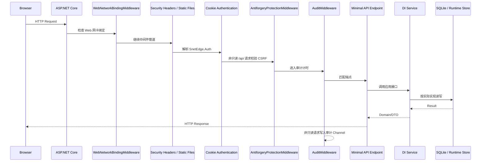
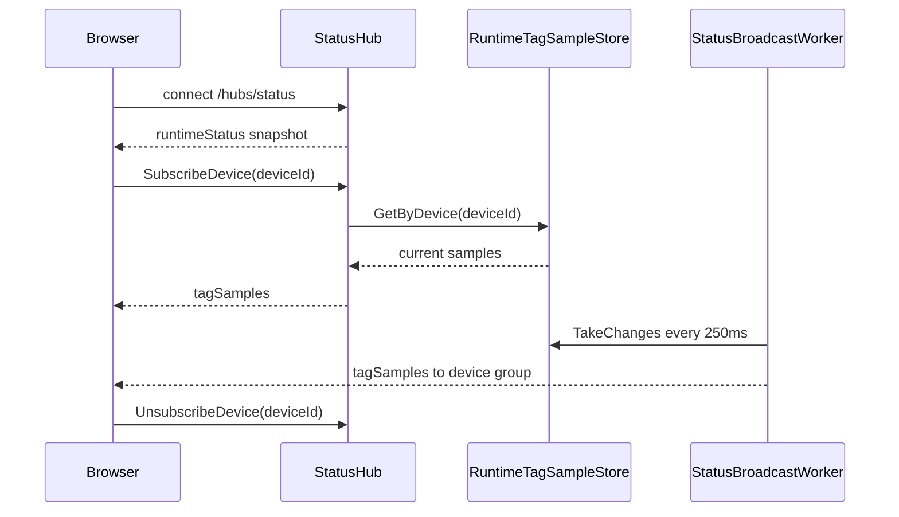

# EdgeNexus Web API 源码参考

## 1. 文档依据

本文仅依据当前 Solution 中的以下源码：

- `src/Snet.Edge.WebApi/Program.cs`
- `src/Snet.Edge.WebApi/AuthenticationEndpoints.cs`
- `src/Snet.Edge.WebApi/ApiEndpoints.cs`
- `src/Snet.Edge.WebApi/MonitoringEndpoints.cs`
- `src/Snet.Edge.WebApi/NetworkDtos.cs`
- `src/Snet.Edge.WebApi/StatusHub.cs`
- `src/Snet.Edge.WebApi/AntiforgeryProtectionMiddleware.cs`
- `src/Snet.Edge.WebApi/AuditMiddleware.cs`
- `src/Snet.Edge.WebApi/WebNetworkBindingMiddleware.cs`

领域对象参见 [Configuration.md](Configuration.md)。

运行时调用链参见 [Runtime-Flows.md](Runtime-Flows.md)。

公共类型参见 [Public-API.md](Public-API.md)。

## 2. 端点总量

当前源码映射 59 个 HTTP 端点。

其中包括：

- 1 个根页面端点。
- 5 个认证端点。
- 4 个监控端点。
- 49 个 `/api/v1` 端点。
- 另有 1 个 SignalR Hub：`/hubs/status`。

## 3. 请求处理总流程

## 4. 鉴权与授权规则

### 4.1 Cookie

- 认证方案为 ASP.NET Core Cookie Authentication。
- Cookie 名称为 `SnetEdge.Auth`。
- Cookie 设置 `HttpOnly=true`。
- Cookie 设置 `SameSite=Strict`。
- `Authentication:RequireHttps=true` 时 Cookie 只通过 HTTPS 发送。
- 会话有效期为 8 小时。
- 启用滑动过期。
- 未认证访问受保护端点返回 HTTP 401。
- 已认证但无权限返回 HTTP 403。

### 4.2 `/api/v1` 授权

- 整个 `/api/v1` 路由组调用 `RequireAuthorization()`。
- GET 和 HEAD 允许任意已认证用户。
- 非 GET/HEAD 请求要求当前用户角色为 `Admin`。
- 角色检查通过端点过滤器执行。

### 4.3 CSRF

- CSRF 请求头名称为 `X-CSRF-TOKEN`。
- CSRF Cookie 名称为 `SnetEdge.Csrf`。
- `/api` 下非 GET、HEAD、OPTIONS 请求由 `AntiforgeryProtectionMiddleware` 校验。
- 文件上传端点显式调用 `DisableAntiforgery()`，因此不走端点元数据的自动校验。
- 登录前由 `/api/auth/antiforgery` 获取请求令牌。

### 4.4 Web 网卡绑定

- `WebNetworkBindingMiddleware` 在业务端点前执行。
- 它调用 `INetworkConfigurationService.IsWebRequestAllowed`。
- Web 管理网卡绑定不修改操作系统 IP。
- 回环地址保留为本机恢复访问路径。

## 5. 公共响应行为

- 未处理异常由 `UseExceptionHandler()` 转换为 Problem Details。
- JSON 枚举通过 `JsonStringEnumConverter` 输出为字符串。
- 响应启用 Brotli 和 Gzip，压缩级别为 `Fastest`。
- `/vendor` 静态资源缓存一年并标记 `immutable`。
- 其他静态资源使用 `no-cache,no-store,must-revalidate`。
- 安全响应头包括 CSP、`X-Frame-Options`、`nosniff`、`Referrer-Policy` 和 `Permissions-Policy`。

## 6. 根页面

### 6.1 `GET /`

- 鉴权：端点本身未调用 `RequireAuthorization`。
- 输入：无。
- 处理：返回 `${AppContext.BaseDirectory}/wwwroot/index.html`。
- 内容类型：`text/html; charset=utf-8`。
- 典型调用：浏览器打开网关首页。
- 源码：`Program.cs`。

## 7. 认证 API

### 7.1 `GET /api/auth/antiforgery`

- 鉴权：`AllowAnonymous()`。
- 输入：无。
- 处理：调用 `IAntiforgery.GetAndStoreTokens`。
- 响应：HTTP 200，JSON `{ token }`。
- 副作用：设置 CSRF Cookie。
- 典型调用：登录前或刷新 CSRF 令牌。

### 7.2 `POST /api/auth/login`

- 鉴权：`AllowAnonymous()`。
- 请求体：`LoginRequest`，字段为 `Username`、`Password`。
- 服务：`IUserAccountStore.AuthenticateAsync`。
- 成功：签发 8 小时 Cookie，会话非持久化，HTTP 200。
- 成功体：`Username`、`Role`、`MustChangePassword`。
- 失败：普通失败 HTTP 401；临时锁定 HTTP 423。
- 失败体：`error`、`IsLocked`、`LockedUntil`。

### 7.3 `GET /api/auth/session`

- 鉴权：要求已认证。
- 输入：无。
- 处理：读取当前 Claims，并刷新 CSRF 请求令牌。
- 响应：HTTP 200。
- 字段：`username`、`role`、`mustChangePassword`、`csrfToken`。
- 典型调用：前端启动后恢复登录状态。

### 7.4 `POST /api/auth/change-password`

- 鉴权：要求已认证。
- 请求体：`PasswordChangeRequest`。
- 字段：`CurrentPassword`、`NewPassword`。
- 服务：`IUserAccountStore.ChangePasswordAsync`。
- 成功：HTTP 204。
- 失败：HTTP 400，JSON `{ error }`。

### 7.5 `POST /api/auth/logout`

- 鉴权：要求已认证。
- 输入：无。
- 处理：调用 `SignOutAsync` 删除认证会话。
- 响应：HTTP 204。
- 典型调用：前端退出登录。

## 8. 配置与版本 API

### 8.1 `GET /api/v1/configuration`

- 鉴权：已认证。
- 输入：无。
- 服务：`IGatewayConfigurationStore.GetSnapshotAsync`。
- 响应：当前生效 `GatewaySnapshot`。
- 数据范围：Groups、Devices、Tags、Mqtt。
- 语义：只读 active 配置。

### 8.2 `GET /api/v1/configuration/draft`

- 鉴权：已认证。
- 输入：无。
- 服务：`IGatewayConfigurationStore.GetDraftSnapshotAsync`。
- 响应：当前草稿 `GatewaySnapshot`。
- 语义：页面编辑以草稿为准。
- 不会自动发布。

### 8.3 `GET /api/v1/configuration/export`

- 鉴权：已认证。
- 输入：无。
- 数据来源：草稿快照。
- 序列化：Web 默认 JSON，缩进输出，枚举转字符串。
- 文件名：`EdgeNexus_Draft_yyyyMMdd_HHmmss.json`。
- 响应：JSON 文件下载。

### 8.4 `GET /api/v1/configuration/revisions`

- 鉴权：已认证。
- 查询参数：`take`，可空。
- 默认数量：50。
- 服务：`GetRevisionsAsync`。
- 响应：`ConfigurationRevision` 集合。
- 已逻辑删除的版本不出现在结果中。

### 8.5 `GET /api/v1/configuration/revisions/{version:long}/preview`

- 鉴权：已认证。
- 路径参数：目标版本 `version`。
- 服务：读取目标版本、当前 active 和最近版本号。
- 校验：`IGatewayConfigurationValidator.Validate(target)`。
- 响应：`RollbackPreviewResponse`。
- 未找到版本：HTTP 404，JSON `{ error }`。

### 8.6 `POST /api/v1/configuration/revisions/{version:long}/delete`

- 鉴权：Admin。
- 路径参数：目标版本。
- 请求体：`DeleteRevisionRequest`。
- 字段：`Reason`、`ExpectedActiveVersion`。
- 成功：HTTP 200，JSON `{ version }`。
- 参数错误 400；版本不存在 404；并发或活动版本冲突 409。

### 8.7 `POST /api/v1/configuration/validate`

- 鉴权：Admin。
- 输入：无。
- 数据来源：草稿快照。
- 服务：`IGatewayConfigurationValidator.Validate`。
- 响应：`ConfigurationValidationResult`。
- 校验本身不发布配置。

### 8.8 `POST /api/v1/configuration/import/preview`

- 鉴权：Admin。
- 内容类型：`multipart/form-data`。
- 表单：`file`、可空 `replaceExisting`。
- 文件限制：大于 0 且不超过 20 MB。
- 服务：`IPointTableImportService.PreviewAsync`。
- 有错误：HTTP 400；有效预览：HTTP 200；不写草稿。

### 8.9 `POST /api/v1/configuration/import`

- 鉴权：Admin。
- 内容类型：`multipart/form-data`。
- 表单：`file`、可空 `replaceExisting`。
- 文件限制：大于 0 且不超过 20 MB。
- 服务：`IPointTableImportService.ImportDraftAsync`。
- 有错误：HTTP 400；成功：HTTP 200；只更新草稿。

### 8.10 `POST /api/v1/configuration/publish`

- 鉴权：Admin。
- 请求体：`PublishRequest`，字段 `Reason`。
- 发布前：读取草稿并完整校验。
- 校验失败：HTTP 400，返回验证结果。
- 成功：事务发布草稿，并清理已失效 MQTT Outbox 消息。
- 响应：Version、PublishedAt、Warnings、prunedMessages。

### 8.11 `POST /api/v1/configuration/rollback/{version:long}`

- 鉴权：Admin。
- 请求体：`RollbackRequest`。
- 字段：`Reason`、`ExpectedActiveVersion`。
- 回滚前验证目标快照。
- 成功后清理与目标快照不一致的 Outbox 消息。
- 版本不存在 404；版本并发冲突 409；验证失败 400。

## 9. 协议、审计与仪表盘 API

### 9.1 `GET /api/v1/protocols`

- 鉴权：已认证。
- 输入：无。
- 响应：`ProtocolDescriptors.All`。
- 内容：协议值、显示名、默认端口、参数描述、点位地址指南。
- 当前数量：12。
- 数据在编译期定义。

### 9.2 `GET /api/v1/audit`

- 鉴权：已认证。
- 查询参数：`take`，可空。
- 默认数量：200。
- 服务：`IAuditLogStore.GetRecentAsync`。
- 响应：最近的 `AuditEvent`。
- 排序由存储实现按创建时间倒序。

### 9.3 `GET /api/v1/dashboard`

- 鉴权：已认证。
- 数据来源：active 快照、运行状态、健康状态、采集控制、资源保护。
- 响应字段：`isRunning`、设备总数、在线数、离线数。
- 还返回 groups、devices、runtime、deviceHealth、resource。
- 在线数按 `DeviceConnectionState.Online` 统计。
- 离线数按总设备数减在线数计算。

### 9.4 `GET /api/v1/device-health`

- 鉴权：已认证。
- 输入：无。
- 服务：`IDeviceHealthStateStore.GetAll`。
- 响应：`DeviceHealthStatus` 集合。
- 健康定义：ErrorCode 等于 0。
- 数据由 `DeviceHealthMonitor` 更新。

## 10. 分组 API

### 10.1 `POST /api/v1/groups`

- 鉴权：Admin。
- 请求体：`MqttGroup`。
- 校验：名称、Topic、Topic 变量、Line 长度、扫描和上传周期。
- 服务：`UpsertGroupAsync`。
- 成功：HTTP 200，返回输入分组。
- 校验失败：HTTP 400，JSON `{ error }`。

### 10.2 `PUT /api/v1/groups/{id:guid}`

- 鉴权：Admin。
- 路径 ID 必须等于请求体 `MqttGroup.Id`。
- 使用与新增相同的分组校验。
- 服务：`UpsertGroupAsync`。
- 成功：HTTP 204。
- ID 或字段错误：HTTP 400。

### 10.3 `DELETE /api/v1/groups/{id:guid}`

- 鉴权：Admin。
- 路径参数：分组 ID。
- 服务：`IGatewayConfigurationStore.DeleteGroupAsync`。
- 成功：HTTP 204。
- 级联行为由配置存储实现决定。
- 修改的是草稿配置。

## 11. 设备 API

### 11.1 `POST /api/v1/devices`

- 鉴权：Admin。
- 请求体：`DeviceDefinition`。
- 校验：名称、Host、Port、MQTT ID、协议参数、分组、模板绑定。
- 服务：`UpsertDeviceAsync`。
- 成功：HTTP 200，返回设备对象。
- 校验失败：HTTP 400。

### 11.2 `PUT /api/v1/devices/{id:guid}`

- 鉴权：Admin。
- 路径 ID 必须等于 `DeviceDefinition.Id`。
- 使用与新增相同的设备校验。
- 服务：`UpsertDeviceAsync`。
- 成功：HTTP 204。
- ID 或配置错误：HTTP 400。

### 11.3 `DELETE /api/v1/devices/{id:guid}`

- 鉴权：Admin。
- 路径参数：设备 ID。
- 服务：`DeleteDeviceAsync`。
- 成功：HTTP 204。
- 修改的是草稿配置。
- 旧 Outbox 在发布时由同步器清理。

### 11.4 `POST /api/v1/devices/{id:guid}/connection-test`

- 鉴权：Admin。
- 路径参数：草稿设备 ID。
- 数据来源：草稿设备和该设备的启用点位。
- 服务：`INetworkDiagnosticsService.TestPlcAsync`。
- 超时参数：设备连接超时加 1000 ms。
- 设备不存在：HTTP 404；成功执行诊断：HTTP 200。

### 11.5 `POST /api/v1/devices/connection-test`

- 鉴权：Admin。
- 请求体：尚未保存的 `DeviceDefinition`。
- 预校验：名称、Host、Port 和协议特定参数。
- 点位集合：空集合，只验证连接路径。
- 服务：`TestPlcAsync`。
- 配置无效：HTTP 400；诊断完成：HTTP 200。

## 12. 点位 API

### 12.1 `GET /api/v1/devices/{id:guid}/tags`

- 鉴权：已认证。
- 路径参数：设备 ID。
- 数据来源：草稿快照。
- 处理：按 `TagDefinition.DeviceId` 过滤。
- 响应：HTTP 200，点位集合。
- 不读取 PLC 实时数据。

### 12.2 `GET /api/v1/devices/{id:guid}/tags/export`

- 鉴权：已认证。
- 服务：`IDeviceTagFileService.ExportAsync`。
- 响应：由服务提供 Content、ContentType 和 FileName。
- 当前实现生成 Excel 工作簿。
- 设备不存在：HTTP 404。
- 导出内容来自草稿配置。

### 12.3 `POST /api/v1/devices/{id:guid}/tags/import/preview`

- 鉴权：Admin。
- 内容类型：`multipart/form-data`。
- 文件限制：大于 0 且不超过 20 MB。
- 服务：`IDeviceTagFileService.PreviewImportAsync`。
- 有效：HTTP 200；预览校验失败：HTTP 400。
- 设备不存在：HTTP 404；预览不直接保存。

### 12.4 `PUT /api/v1/devices/{id:guid}/tags`

- 鉴权：Admin。
- 请求体：`IReadOnlyCollection<TagDefinition>`。
- 校验：DeviceId 一致、名称和地址非空、设备内名称唯一。
- 校验：调用 `TagProtocolValidator` 检查协议特定地址和类型。
- Modbus：保存前调用 `ModbusTagAddress.Normalize`。
- 成功：替换该设备全部草稿点位，HTTP 204。

## 13. MQTT 配置 API

### 13.1 `PUT /api/v1/mqtt/config`

- 鉴权：Admin。
- 请求体：`MqttOptions`。
- 校验：Host、GatewayId、Port、QoS、Outbox 和补传参数。
- 服务：`SaveMqttOptionsAsync`。
- 成功：HTTP 204。
- 语义：只保存到草稿。

### 13.2 `POST /api/v1/mqtt/config/apply`

- 鉴权：Admin。
- 请求体：`MqttOptions`。
- 使用与草稿保存相同的 MQTT 校验。
- 服务：`IMqttConfigurationPublisher.PublishMqttOptionsAsync`。
- 成功后调用 `IMqttRuntimeStateStore.NotifyConfigurationChanged`。
- 响应：HTTP 200，`PublishResult`。

### 13.3 `GET /api/v1/mqtt/runtime`

- 鉴权：已认证。
- 输入：无。
- 服务：`IMqttRuntimeStateStore.Current`。
- 响应：`MqttRuntimeStatus`。
- 包含连接状态、尝试时间、连接时间、下次重试和错误。
- 数据由 `MqttStoreForwardWorker` 更新。

### 13.4 `GET /api/v1/mqtt/outbox/status`

- 鉴权：已认证。
- 输入：无。
- 服务：`IMqttOutboxMonitor.GetStatisticsAsync`。
- 响应：待发送数、死信数、最老消息年龄和采样时间。
- 数据来源：SQLite。
- 端点不触发重放。

### 13.5 `GET /api/v1/mqtt/outbox/dead-letters`

- 鉴权：已认证。
- 查询参数：`take`，可空。
- 默认数量：100。
- 服务：`GetDeadLettersAsync`。
- 响应：`MqttDeadLetter` 集合。
- 当前源码没有死信手工重放端点。

## 14. MQTT 模板 API

### 14.1 `GET /api/v1/mqtt/templates`

- 鉴权：已认证。
- 输入：无。
- 服务：`IMqttTemplateManager.GetAllAsync`。
- 响应：所有模板。
- 内置模板优先排序。
- 模板来自内存热缓存。

### 14.2 `POST /api/v1/mqtt/templates`

- 鉴权：Admin。
- 请求体：`MqttTemplate`。
- 服务：`IMqttTemplateManager.UpsertAsync`。
- 成功：HTTP 200，返回规范化后的模板。
- 参数错误：HTTP 400。
- 写入 SQLite 后更新内存缓存。

### 14.3 `PUT /api/v1/mqtt/templates/{id:guid}`

- 鉴权：Admin。
- 路径 ID 必须等于模板 ID。
- 服务：`UpsertAsync`。
- 成功：HTTP 200，返回模板。
- ID 不一致或模板参数错误：HTTP 400。
- 可用于编辑已有模板。

### 14.4 `DELETE /api/v1/mqtt/templates/{id:guid}`

- 鉴权：Admin。
- 删除前检查草稿设备是否引用该模板。
- 被引用：HTTP 409。
- 内置模板或其他删除冲突：HTTP 409。
- 成功：HTTP 204。
- 服务：`IMqttTemplateManager.DeleteAsync`。

### 14.5 `POST /api/v1/mqtt/templates/preview`

- 鉴权：Admin。
- 请求体：`MqttTemplatePreviewRequest`。
- 可直接携带未保存的 `Template`，否则按 `TemplateId` 解析。
- 使用草稿 MQTT GatewayId 构建上下文。
- 处理：生成状态 Tag、Topic 和 Payload。
- 成功 200；参数或模板状态配置错误 400。

### 14.6 `POST /api/v1/mqtt/templates/test-send`

- 鉴权：Admin。
- 请求体：`MqttTemplatePreviewRequest`。
- 使用 active MQTT 配置和已保存模板。
- active MQTT 未启用：HTTP 400。
- 处理：生成预览并通过 `IMqttMessagePublisher` 写入正式 Outbox。
- 成功：HTTP 202，返回 queued、Topic、Payload、TemplateId、TemplateName。

## 15. 网络配置 API

### 15.1 `GET /api/v1/network/interfaces`

- 鉴权：已认证。
- 查询参数：`refresh`，默认 false。
- 服务：`INetworkConfigurationService.GetAsync`。
- 响应：`NetworkConfigurationView.Interfaces`。
- 数据来自操作系统网卡枚举。
- 不修改系统网络配置。

### 15.2 `GET /api/v1/network/configuration`

- 鉴权：已认证。
- 查询参数：`refresh`，默认 false。
- 服务：`INetworkConfigurationService.GetAsync`。
- 响应：Bindings、Interfaces、EffectiveBindings。
- Bindings 是业务用途绑定。
- Interfaces 是操作系统只读网卡信息。

### 15.3 `PUT /api/v1/network/configuration`

- 鉴权：Admin。
- 请求体：`SaveNetworkBindingsRequest`。
- 字段：PlcInterfaceId、MqttInterfaceId、WebInterfaceId。
- 服务：`INetworkConfigurationService.SaveAsync`。
- 成功：HTTP 200，返回新的配置视图。
- 无效网卡绑定：HTTP 400。

## 16. 网络诊断 API

### 16.1 `POST /api/v1/network/diagnostics/ping`

- 鉴权：Admin。
- 请求体：`NetworkPingRequest`。
- 字段：Host、Usage、TimeoutMs。
- 服务：`INetworkDiagnosticsService.PingAsync`。
- 空 Host：HTTP 400。
- 诊断完成：HTTP 200，返回 `NetworkDiagnosticResult`。

### 16.2 `POST /api/v1/network/diagnostics/tcp`

- 鉴权：Admin。
- 请求体：`NetworkTcpTestRequest`。
- 字段：Host、Port、Usage、TimeoutMs。
- 服务：`TestTcpAsync`。
- Host 或端口无效：HTTP 400。
- 诊断完成：HTTP 200。

### 16.3 `POST /api/v1/network/diagnostics/mqtt`

- 鉴权：Admin。
- 请求体：`NetworkMqttTestRequest`。
- 数据来源：草稿 MQTT 配置。
- 服务：`TestMqttAsync`。
- 响应：HTTP 200，MQTT 诊断步骤。
- 不发布业务 Payload。

### 16.4 `POST /api/v1/network/diagnostics/plc`

- 鉴权：Admin。
- 请求体：`NetworkPlcTestRequest`。
- 数据来源：草稿设备和启用点位。
- 服务：`TestPlcAsync`。
- 设备不存在：HTTP 404。
- 诊断完成：HTTP 200。

## 17. 采集控制 API

### 17.1 `GET /api/v1/acquisition/status`

- 鉴权：已认证。
- 输入：无。
- 服务：`IAcquisitionControl.IsRunning`。
- 响应：HTTP 200，JSON `{ isRunning }`。
- 状态保存在进程内。
- 不等同于单台设备连接状态。

### 17.2 `POST /api/v1/acquisition/start`

- 鉴权：Admin。
- 输入：无。
- 服务：`IAcquisitionControl.Start()`。
- 响应：HTTP 202。
- 采集 Worker 下一轮检查后开始设备循环。
- 不修改设备 Enabled 字段。

### 17.3 `POST /api/v1/acquisition/stop`

- 鉴权：Admin。
- 输入：无。
- 服务：`IAcquisitionControl.Stop()`。
- 响应：HTTP 202。
- 停止全局采集开关。
- 不停止 Web、MQTT 或监控进程。

## 18. 兼容 Ping API

### 18.1 `POST /api/v1/diagnostics/ping`

- 鉴权：Admin。
- 请求体：`PingRequest`。
- 字段：Host、TimeoutMs，默认 1000 ms。
- 实现：直接使用 `System.Net.NetworkInformation.Ping`。
- 超时范围被限制为 100 至 10000 ms。
- PingException 被转换为 HTTP 200 的失败结果。

## 19. 健康检查与指标

### 19.1 `GET /health/live`

- 鉴权：匿名。
- 语义：仅确认 Web 进程能够响应。
- 响应：HTTP 200。
- 字段：`status="alive"`、`timestamp`。
- 不检查 SQLite。
- 不检查资源保护状态。

### 19.2 `GET /health/ready`

- 鉴权：匿名。
- 服务：初始化状态、配置存储、资源保护。
- 初始化未完成或失败：HTTP 503。
- 资源级别 Critical：HTTP 503，status 为 degraded。
- SQLite 快照读取限时 2 秒。
- 正常：HTTP 200，status 为 ready。

### 19.3 `GET /health`

- 鉴权：匿名。
- 实现：与 `/health/ready` 使用同一个 `CheckReadinessAsync`。
- 响应规则与 `/health/ready` 完全相同。
- Watchdog 默认访问此端点。
- 容器 HEALTHCHECK 使用 `/health/ready`。
- 两者语义都是 readiness。

### 19.4 `GET /metrics`

- 鉴权：匿名。
- 内容类型：Prometheus text format 0.0.4。
- 输出采集成功/失败、点位数、耗时、MQTT 成功/失败。
- 输出 SignalR 连接、设备状态、CPU、内存、磁盘、线程。
- 查询 Outbox 时使用 2 秒超时。
- Outbox 查询失败只设置 `snet_gateway_metrics_scrape_error=1`。

## 20. 指标名称清单

- `snet_gateway_acquisition_cycles_succeeded_total`
- `snet_gateway_acquisition_cycles_failed_total`
- `snet_gateway_tag_samples_read_total`
- `snet_gateway_acquisition_duration_milliseconds_total`
- `snet_gateway_mqtt_messages_published_total`
- `snet_gateway_mqtt_publish_failures_total`
- `snet_gateway_signalr_connections`
- `snet_gateway_devices`
- `snet_gateway_devices_by_state{state="..."}`
- `snet_gateway_process_cpu_percent`
- `snet_gateway_process_working_set_bytes`
- `snet_gateway_managed_heap_bytes`
- `snet_gateway_disk_used_percent`
- `snet_gateway_disk_free_bytes`
- `snet_gateway_process_threads`
- `snet_gateway_resource_protection_level`
- `snet_gateway_mqtt_outbox_pending`
- `snet_gateway_mqtt_dead_letters`
- `snet_gateway_mqtt_oldest_pending_age_seconds`
- `snet_gateway_metrics_scrape_error`

## 21. SignalR Hub

### 21.1 路径

- 路径：`/hubs/status`。
- 鉴权：`RequireAuthorization()`。
- Hub 类型：`StatusHub`。
- 最大接收消息：64 KB。
- 详细错误：关闭。
- 前端连接应携带认证 Cookie。

### 21.2 连接事件

- `OnConnectedAsync` 增加 SignalR 连接计数。
- 立即发送 `runtimeStatus` 快照给当前连接。
- 快照包含采集开关、设备状态、健康状态、资源状态和时间。
- `isSnapshot=true`。
- 发送失败会回滚连接计数并重新抛出。
- `OnDisconnectedAsync` 减少连接计数。

### 21.3 `SubscribeDevice(Guid deviceId)`

- 调用方：浏览器 SignalR 客户端。
- 行为：加入 `device:{deviceId:N}` 组。
- 随后向调用方发送该设备当前全部 `tagSamples`。
- 数据来源：`IRuntimeTagSampleStore.GetByDevice`。
- 用途：只订阅当前查看设备的点位变化。
- 不改变采集配置。

### 21.4 `UnsubscribeDevice(Guid deviceId)`

- 调用方：浏览器 SignalR 客户端。
- 行为：离开 `device:{deviceId:N}` 组。
- 返回：SignalR 组移除任务。
- 不删除运行时样本。
- 不停止设备采集。
- 不影响其他客户端。

### 21.5 服务端推送事件

- `runtimeStatus`：连接时发送完整快照，之后每 2 秒发送变化集合。
- `tagSamples`：每 250 ms 检查变化点位。
- 点位按 DeviceId 分组后只发送到对应 SignalR 组。
- 状态广播使用内存字典比较 record 值。
- 健康状态同样只发送变化项。
- 没有变化时发送的状态数组为空。

## 22. API DTO 清单

### 22.1 认证 DTO

- `LoginRequest(Username, Password)`。
- `PasswordChangeRequest(CurrentPassword, NewPassword)`。

### 22.2 配置版本 DTO

- `PublishRequest(Reason)`。
- `RollbackRequest(Reason, ExpectedActiveVersion)`。
- `DeleteRevisionRequest(Reason, ExpectedActiveVersion)`。
- `RevisionChangeSummary(Added, Removed, Modified)`。
- `RollbackImpact(Groups, Devices, Tags, MqttChanged)`。
- `RollbackPreviewResponse(TargetVersion, ActiveVersion, Validation, Impact)`。

### 22.3 MQTT 预览 DTO

- `MqttTemplatePreviewTag(TagName, Value, Quality)`。
- `MqttTemplatePreviewRequest` 包含模板、Topic、设备、分组、时间和 Tags。
- `CommunicationFailed=false` 时状态码为 0。
- `CommunicationFailed=true` 时使用模板 `CommunicationFailureCode`。
- 预览自动插入设备状态 Tag。
- 普通测试点位随后追加到同一 `d` 数组。

### 22.4 网络 DTO

- `SaveNetworkBindingsRequest`：三个用途的可空网卡 ID。
- `NetworkPingRequest`：Host、Usage、TimeoutMs。
- `NetworkTcpTestRequest`：Host、Port、Usage、TimeoutMs。
- `NetworkMqttTestRequest`：TimeoutMs。
- `NetworkPlcTestRequest`：DeviceId、TimeoutMs。

### 22.5 协议描述 DTO

- `ProtocolDescriptor`：Value、Label、DefaultPort、Available、Parameters、PointAddressGuide。
- `ProtocolParameterDescriptor`：Name、Label、InputType、默认值、范围、选项、Secret、Help。
- `ProtocolParameterOption`：Value、Label。
- 协议参数页面不需要硬编码每种 PLC 参数。
- 点位地址示意来自 `ProtocolPointAddressCatalog`。

## 23. 审计行为

- `AuditMiddleware` 只记录非 GET/HEAD/OPTIONS 请求。
- 它记录 TraceId、Method、Path、StatusCode、Actor、RemoteAddress。
- 它记录请求耗时和创建时间。
- 写入使用 `IAuditLogStore.TryWrite`。
- 审计写入失败不改变业务 HTTP 响应。
- 审计最终由后台 Channel 批量写 SQLite。

## 24. Swagger

- 服务注册 `AddEndpointsApiExplorer()`。
- 服务注册 `AddSwaggerGen()`。
- `Swagger:Enabled` 控制运行时是否启用 Swagger 和 Swagger UI。
- 配置缺失时回退到 `Environment.IsDevelopment()`。
- 默认 `appsettings.json` 中启用。
- Docker Compose 显式关闭。

## 25. 前端调用边界

- Web 页面只能通过 HTTP API、SignalR 和静态资源与后端交互。
- Web 页面不直接访问 SQLite。
- Web 页面不直接创建 PLC Driver。
- Web 页面不直接连接 MQTT Broker。
- API 通过 DI 调用应用接口和基础设施服务。
- 实时点位通过 SignalR 订阅，而配置读取通过 REST。

## 26. API 覆盖核对表

- [x] 根页面 1 个。
- [x] 认证端点 5 个。
- [x] 配置与版本端点 11 个。
- [x] 协议、审计、仪表盘、健康列表端点 4 个。
- [x] 分组端点 3 个。
- [x] 设备端点 5 个。
- [x] 点位端点 4 个。
- [x] MQTT 配置与运行端点 5 个。
- [x] MQTT 模板端点 6 个。
- [x] 网络配置端点 3 个。
- [x] 网络诊断端点 4 个。
- [x] 采集控制端点 3 个。
- [x] 兼容 Ping 端点 1 个。
- [x] 健康与指标端点 4 个。
- [x] HTTP 合计 59 个。
- [x] SignalR Hub 1 个。
- [x] Hub 客户端方法 2 个。
- [x] Hub 服务端事件 2 类。

## 27. 当前源码未提供的 Web API

- 没有 PLC 写入端点。
- 没有历史点位查询端点。
- 没有死信手工重放端点。
- 没有用户列表和角色管理端点。
- 没有操作系统 IP 修改端点。
- 没有插件上传或加载端点。
- 没有 MQTT 多 Broker 管理端点。
- 没有按组聚合多个设备为单条消息的配置端点。
- 没有自动发现 PLC 的端点。
- 没有日志文件下载端点。

## 28. 源码追踪索引

- 路由装配：`Program.cs`。
- 认证：`AuthenticationEndpoints.cs`。
- 业务 API：`ApiEndpoints.cs`。
- 健康与指标：`MonitoringEndpoints.cs`。
- SignalR：`StatusHub.cs`。
- CSRF：`AntiforgeryProtectionMiddleware.cs`。
- 审计：`AuditMiddleware.cs`。
- Web 网卡限制：`WebNetworkBindingMiddleware.cs`。
- 网络请求 DTO：`NetworkDtos.cs`。
- 领域 DTO：`Snet.Edge.Domain/Models.cs`。
- 网络领域 DTO：`Snet.Edge.Domain/NetworkModels.cs`。

## 29. HTTP 路由逐项索引

以下索引用于覆盖率机器核对，路径和方法均来自 `MapGet/MapPost/MapPut/MapDelete` 调用。

| 序号 | 方法 | 路径 | 分组 |
|---:|---|---|---|
| 1 | GET | `/` | 静态首页 |
| 2 | GET | `/api/auth/antiforgery` | 认证 |
| 3 | POST | `/api/auth/login` | 认证 |
| 4 | GET | `/api/auth/session` | 认证 |
| 5 | POST | `/api/auth/change-password` | 认证 |
| 6 | POST | `/api/auth/logout` | 认证 |
| 7 | GET | `/api/v1/configuration` | 配置 |
| 8 | GET | `/api/v1/configuration/draft` | 配置 |
| 9 | GET | `/api/v1/configuration/export` | 配置 |
| 10 | GET | `/api/v1/configuration/revisions` | 版本 |
| 11 | GET | `/api/v1/configuration/revisions/{version:long}/preview` | 版本 |
| 12 | POST | `/api/v1/configuration/revisions/{version:long}/delete` | 版本 |
| 13 | POST | `/api/v1/configuration/validate` | 配置 |
| 14 | POST | `/api/v1/configuration/import/preview` | 导入 |
| 15 | POST | `/api/v1/configuration/import` | 导入 |
| 16 | POST | `/api/v1/configuration/publish` | 发布 |
| 17 | POST | `/api/v1/configuration/rollback/{version:long}` | 回滚 |
| 18 | GET | `/api/v1/protocols` | 协议 |
| 19 | GET | `/api/v1/audit` | 审计 |
| 20 | GET | `/api/v1/dashboard` | 仪表盘 |
| 21 | GET | `/api/v1/device-health` | 健康 |
| 22 | POST | `/api/v1/groups` | 分组 |
| 23 | PUT | `/api/v1/groups/{id:guid}` | 分组 |
| 24 | DELETE | `/api/v1/groups/{id:guid}` | 分组 |
| 25 | POST | `/api/v1/devices` | 设备 |
| 26 | PUT | `/api/v1/devices/{id:guid}` | 设备 |
| 27 | DELETE | `/api/v1/devices/{id:guid}` | 设备 |
| 28 | POST | `/api/v1/devices/{id:guid}/connection-test` | 设备诊断 |
| 29 | POST | `/api/v1/devices/connection-test` | 设备诊断 |
| 30 | GET | `/api/v1/devices/{id:guid}/tags` | 点位 |
| 31 | GET | `/api/v1/devices/{id:guid}/tags/export` | 点位文件 |
| 32 | POST | `/api/v1/devices/{id:guid}/tags/import/preview` | 点位文件 |
| 33 | PUT | `/api/v1/devices/{id:guid}/tags` | 点位 |
| 34 | PUT | `/api/v1/mqtt/config` | MQTT 配置 |
| 35 | POST | `/api/v1/mqtt/config/apply` | MQTT 配置 |
| 36 | GET | `/api/v1/mqtt/runtime` | MQTT 运行时 |
| 37 | GET | `/api/v1/mqtt/outbox/status` | MQTT Outbox |
| 38 | GET | `/api/v1/mqtt/outbox/dead-letters` | MQTT 死信 |
| 39 | GET | `/api/v1/mqtt/templates` | MQTT 模板 |
| 40 | POST | `/api/v1/mqtt/templates` | MQTT 模板 |
| 41 | PUT | `/api/v1/mqtt/templates/{id:guid}` | MQTT 模板 |
| 42 | DELETE | `/api/v1/mqtt/templates/{id:guid}` | MQTT 模板 |
| 43 | POST | `/api/v1/mqtt/templates/preview` | MQTT 模板 |
| 44 | POST | `/api/v1/mqtt/templates/test-send` | MQTT 模板 |
| 45 | GET | `/api/v1/network/interfaces` | 网络 |
| 46 | GET | `/api/v1/network/configuration` | 网络 |
| 47 | PUT | `/api/v1/network/configuration` | 网络 |
| 48 | POST | `/api/v1/network/diagnostics/ping` | 网络诊断 |
| 49 | POST | `/api/v1/network/diagnostics/tcp` | 网络诊断 |
| 50 | POST | `/api/v1/network/diagnostics/mqtt` | 网络诊断 |
| 51 | POST | `/api/v1/network/diagnostics/plc` | 网络诊断 |
| 52 | GET | `/api/v1/acquisition/status` | 采集控制 |
| 53 | POST | `/api/v1/acquisition/start` | 采集控制 |
| 54 | POST | `/api/v1/acquisition/stop` | 采集控制 |
| 55 | POST | `/api/v1/diagnostics/ping` | 兼容诊断 |
| 56 | GET | `/health/live` | 监控 |
| 57 | GET | `/health/ready` | 监控 |
| 58 | GET | `/health` | 监控 |
| 59 | GET | `/metrics` | 监控 |

## 30. 中间件顺序

| 顺序 | 组件 | 源码行为 |
|---:|---|---|
| 1 | `UseExceptionHandler` | 捕获未处理异常 |
| 2 | HSTS/HTTPS | 仅 RequireHttps 时启用 |
| 3 | Swagger | 仅 Swagger Enabled 时启用 |
| 4 | `UseResponseCompression` | Brotli/Gzip |
| 5 | `WebNetworkBindingMiddleware` | Web 本地地址限制 |
| 6 | 安全响应头委托 | CSP 等响应头 |
| 7 | `UseDefaultFiles` | 默认文件解析 |
| 8 | `UseStaticFiles` | 前端资源 |
| 9 | `UseAuthentication` | Cookie 身份 |
| 10 | `UseAuthorization` | Role/Policy |
| 11 | `AntiforgeryProtectionMiddleware` | 非只读 API CSRF |
| 12 | `AuditMiddleware` | 非只读 API 审计 |
| 13 | Endpoint Routing | HTTP 与 Hub |

## 31. 显式错误映射

- 登录失败映射 401。
- 登录锁定映射 423。
- 未认证 Cookie 重定向被改写为 401。
- AccessDenied 重定向被改写为 403。
- 版本不存在映射 404。
- 版本并发冲突映射 409。
- 模板仍被设备引用映射 409。
- 参数和业务验证错误映射 400。
- 文件导入验证失败映射 400。
- 模板测试发送成功映射 202。
- 采集 Start/Stop 映射 202。
- Readiness 不满足映射 503。
- PingException 不映射 5xx，而返回 200 失败对象。

## 32. `MqttTemplatePreviewRequest` 字段

- `TemplateId`：待解析模板 ID。
- `Template`：预览时可直接携带未保存模板。
- `TopicTemplate`：用于 Topic Builder。
- `DeviceId`：测试设备外部 ID。
- `DeviceName`：测试设备名称。
- `DeviceIp`：可空测试 IP。
- `Protocol`：测试协议枚举。
- `GroupName`：可空测试分组名。
- `Line`：可空产线变量。
- `Timestamp`：可空；空时用 UtcNow。
- `Tags`：至少一个测试点位。
- `CommunicationFailed`：控制状态 Tag value。

## 33. `NetworkDiagnosticResult` 响应字段

- `Success`：总结果。
- `Status`：状态文本。
- `DurationMs`：总耗时。
- `SourceAddress`：实际绑定源地址。
- `Target`：目标描述。
- `Error`：可空错误。
- `Steps`：可空诊断步骤集合。
- `Recommendation`：可空建议。

## 34. SignalR 调用序列

## 35. Web API 源码事实边界

- 路由全部使用 Minimal API，没有 MVC Controller。
- 当前没有自定义 API Versioning 包。
- `/api/v1` 版本号直接写在路由前缀。
- 当前没有 GraphQL。
- 当前没有 gRPC。
- 当前没有 WebSocket 自定义协议，实时通道为 SignalR。
- 当前没有文件上传流式落盘，导入服务直接读取请求 Stream。
- 当前没有 API 限流中间件。
- 当前没有 CORS 注册。
- 当前没有匿名业务配置端点。
- 当前没有用户管理 CRUD。
- 当前没有 OpenAPI XML 注释生成配置。

## 36. 安全响应头清单

- `X-Content-Type-Options: nosniff`。
- `X-Frame-Options: DENY`。
- `Referrer-Policy: no-referrer`。
- CSP `default-src 'self'`。
- CSP script 允许 self 和 unsafe-eval。
- CSP style 允许 self 和 unsafe-inline。
- CSP connect 允许 self、ws、wss。
- CSP frame-ancestors none。
- CSP base-uri self。
- CSP form-action self。
- Permissions-Policy 禁用 camera。
- Permissions-Policy 禁用 microphone。
- Permissions-Policy 禁用 geolocation。
- Permissions-Policy 禁用 payment。

## 37. Cookie 与 CSRF 清单

- Auth Cookie：`SnetEdge.Auth`。
- CSRF Cookie：`SnetEdge.Csrf`。
- CSRF Header：`X-CSRF-TOKEN`。
- 两个 Cookie 都是 HttpOnly。
- 两个 Cookie 都是 SameSite Strict。
- RequireHttps 控制 SecurePolicy。
- 登录会话非持久化。
- Cookie AllowRefresh=true。
- Cookie ExpiresUtc=当前时间加 8 小时。
- 全局 Cookie SlidingExpiration=true。

## 38. 静态文件与压缩

- Brotli Provider 已注册。
- Gzip Provider 已注册。
- 两者 CompressionLevel=Fastest。
- HTTPS 也允许压缩。
- `/vendor` 使用长期缓存。
- 其他静态文件禁止缓存。
- `UseDefaultFiles` 位于 `UseStaticFiles` 前。
- 根端点仍显式返回 index.html。

## 39. Web 层覆盖核对

- [x] 59 个 HTTP 端点。
- [x] 1 个 SignalR Hub。
- [x] 2 个 Hub 客户端方法。
- [x] 2 类服务端事件。
- [x] Cookie 鉴权。
- [x] Admin 写权限。
- [x] CSRF。
- [x] 审计。
- [x] Web 网卡绑定。
- [x] 健康和 Metrics。
- [x] Swagger。
- [x] 静态前端。

## 40. API 使用入口

- 从 Web 操作完成首次发布：[Getting-Started.md](Getting-Started.md)。
- 内部中间件与调用流程：[Internal-Architecture.md](Internal-Architecture.md)。
- 生产反向代理和 TLS：[Deployment.md](Deployment.md)。
- 安全策略：[../SECURITY.md](../SECURITY.md)。
- 高频 API 问题：[FAQ.md](FAQ.md)。

## 41. API 变更同步要求

新增、删除或修改端点时：

1. 更新端点数量与逐项索引。
2. 更新 DTO 和状态码。
3. 更新鉴权、CSRF 与审计说明。
4. 更新 [Public-API.md](Public-API.md)。
5. 更新 [Configuration.md](Configuration.md) 中相关字段。
6. 更新测试与 [../CHANGELOG.md](../CHANGELOG.md)。

返回 [文档中心](INDEX.md)。
